# 26 — گزارش فنی کامل BioVision-SNN: معماری، کد، روش آزمایش و همهٔ آزمایش‌های فاز ۰ و فاز ۱

> **نوشته‌شده:** 2026-11-02، از روی کد و سوابق اجرای همهٔ آزمایش‌ها.
> **کد کامل:** پوشهٔ [`code/biovision-snn/`](code/biovision-snn/) در همین مخزن. این پوشه نسخهٔ کامل مخزن کاری پروژه روی شاخهٔ `phase-1` است، همراه همهٔ تغییرهای تا پایان آخرین جلسه (برای جزئیات انتشار بخش ۵-۴ را ببینید).
> **سوابق خام اجراها:** پوشهٔ [`code/biovision-snn-runs/`](code/biovision-snn-runs/). این پوشه برای هر یک از ۱۳۶ اجرای کمپین‌ها، پیکربندی، دستور اجرا، لاگ کامل و `metrics.json` را دارد. جدول یکجای آن‌ها [`code/biovision-snn/results/all_runs.csv`](code/biovision-snn/results/all_runs.csv) است و جدول ناوردایی [`code/biovision-snn/results/invariance.csv`](code/biovision-snn/results/invariance.csv).
> **نسبت با یادداشت‌های قبلی:** این سند جای یادداشت‌های 15 (گزارش فاز ۰) و 16 (پیش‌نویس گزارش فاز ۱) را نمی‌گیرد. آن دو از روی فایل‌های Word ساخته شده بودند. این سند کامل‌تر است و همهٔ آزمایش‌های فاز ۱ را دارد، از جمله آزمایش‌هایی که بعد از آن پیش‌نویس انجام شدند.
> **قرارداد صداقت:** هر عدد این سند از یک اجرای ثبت‌شده آمده است. اجراهایی که قطع شدند یا شکست خوردند هم با همان وضعیت گزارش می‌شوند.

## فهرست

- **بخش ۰:** خلاصهٔ اجرایی و نقشهٔ خواندن
- **بخش ۱:** معماری نرم‌افزار، ماژول‌ها، روند کار و آزمون‌های واحد
- **بخش ۲:** فاز ۰ کامل: سه مقالهٔ مبنا، مدل ریاضی، سازوکارهای تازه، روش ارزیابی، همهٔ آزمایش‌ها و معماری‌های A و B
- **بخش ۳:** فاز ۱، طراحی و تحلیل ریاضی: شبیه‌ساز شبکیهٔ لگاریتمی بی‌ضرب، مسیر شکمی رنگی، اثبات‌ها
- **بخش ۴:** فاز ۱، همهٔ آزمایش‌ها به ترتیب زمانی، نتیجه‌ها، ناوردایی، نقطه‌های خطا و وضعیت
- **بخش ۵:** دفتر تصمیم‌ها، بازتولید، نقشهٔ فایل‌ها و جزئیات انتشار

---

# بخش ۰. خلاصهٔ اجرایی

## ۰-۱ پروژه در یک نگاه

**هدف:** BioVision-SNN یک سامانهٔ بینایی زیستی‌الهام با نورون‌های اسپایکی است که باید مثل YOLO هم «چه چیزی» و هم «کجا» را تشخیص دهد. در این سامانه هر نورون در هر موج حداکثر یک اسپایک می‌زند (کدگذاری TTFS). یادگیری فقط با قاعده‌های محلی انجام می‌شود (STDP، R-STDP و خانوادهٔ آن‌ها) و هیچ backpropagation در کار نیست. هدف نهایی یک شتاب‌دهندهٔ FPGA/VHDL است. برای همین کاربر دو معیار طراحی گذاشت:
- هر جزء معادل زیستی داشته باشد؛
- هر جزء فقط با جمع، تفریق، shift، مقایسه و شمارنده ساخته شود و هیچ ضرب‌کننده یا تقسیم‌کننده‌ای نداشته باشد.

**دو جبهه:**
- **جبههٔ اصلی:** شبکه‌هایی که تصمیمشان با اولین اسپایک گرفته می‌شود و فقط با پاداش و تنبیه یاد می‌گیرند. در این جبهه هیچ طبقه‌بند بیرونی نیست.
- **جبههٔ دوم:** سنجش کیفیت ویژگی‌ها با SVM یا KNN. این جبهه فقط ابزار سنجش است و روی تراشه به کار نمی‌رود.

**فازها:** فاز ۰ (بازتولید سه مقالهٔ تیم خردپیشه و گنج‌تابش) در 2026-10-20 بسته شد. فاز ۱ (مسیر شکمی رنگی روی شبیه‌ساز شبکیهٔ سخت‌افزارآگاه) در همان روز اجرا شد و در ساعت 14:38 همان روز، با پایان جلسهٔ کاری، متوقف ماند. دروازهٔ ۱ هنوز بسته نشده است.

## ۰-۲ عددهای اصلی فاز ۰ (test)

| جبهه و دیتاست | عدد مقاله | بازتولید با تنظیمات مقاله | روش برگزیدهٔ ما |
|---|---|---|---|
| RL، Caltech (پروتکل Mozafari، سه seed) | 98.9 ± 0.4 (بهترین epoch) | 96.52 ± 0.61 (انتخاب‌شده) / 98.51 ± 0.64 (بهترین) | **98.65 ± 0.49** (انتخاب‌شده) / 98.94 ± 0.37 (بهترین)، نرخ کلسیمی |
| RL، ETH-80، leave-one-out (ده دور) | 89.5 ± 1.9 (بهترین epoch) | 81.83 ± 5.58 / 84.36 ± 5.31 | تنظیمات مقاله برنده شد |
| RL، ETH-80، تقسیم ۵/۵ (سه seed) | گزارش نشده | 77.48 ± 1.00 | — |
| SVM، Caltech (سه seed) | 99.1 ± 0.2 | 92.80 ± 1.15 | **98.96 ± 0.25** |
| SVM، MNIST (سه seed) | 98.4 | 91.46 ± 0.36 | **98.52 ± 0.06** |
| SVM، ETH-80، ۵/۵ (سه seed) | 82.8 | 44.55 ± 2.60 | **84.25 ± 3.49** (H-ASIZH، 800 نقشه، شبکهٔ 4×4 و آینه‌سازی) |

## ۰-۳ عددهای اصلی فاز ۱

**آزمون نهایی (test، سه seed):**

| آزمون | شبیه‌ساز شبکیه | دقت test | توضیح |
|---|---|---|---|
| RL، ETH-80 ۵/۵، تصمیم روی C1 با نرخ کلسیمی | متوازن (آستانهٔ ثابت هر کانال)، P+K | 72.86 ± 2.22 | epoch انتخاب‌شده = epoch آخر؛ آموزش ناکامل |
| طبقه‌بند، ETH-80 ۵/۵ | آستانهٔ سراسری، P+K | 78.19 ± 3.08 | مصنوع پس‌زمینه (بخش ۱۰-۱) |
| طبقه‌بند، ETH-80 ۵/۵ | متوازن، خاکستری | 75.02 ± 0.51 | کنترل خاکستری |
| RL، Caltech چهاردسته‌ای | متوازن، خاکستری | **89.42 ± 1.18** | بالای هدف 85 درصد |
| RL، Caltech چهاردسته‌ای | آستانهٔ سراسری، P+K | 55.33 ± 3.96 | ورودی گرسنه: 643 اسپایک در هر تصویر |

**غربال‌های مهم (validation، یک seed):**

| آزمون | ETH-80 | Caltech چهاردسته‌ای |
|---|---|---|
| RL، رنگی P+K، شبیه‌ساز متوازن | 71.34 | 81.67 |
| RL، خاکستری | 64.02 | **87.50** |
| RL، فقط کانال magno (رویدادهای microsaccade، شبیه DVS) | **71.95** | 80.83 |
| RL، نرمال‌سازی محلی تضاد | 67.68 | — |
| طبقه‌بند، P+K+M، شبیه‌ساز متوازن | 75.91 | — |
| طبقه‌بند، نرمال‌سازی محلی تضاد | 69.21 | — |

## ۰-۴ مهم‌ترین یافته‌ها

1. **حالت بی‌ضرب هزینهٔ دقت ندارد.** در فاز ۰، یادگیری فقط با shift و add دقت validation لایهٔ تصمیم را روی ETH-80 0.9 درصد کم و روی Caltech 1.7 درصد زیاد کرد. در فاز ۱، شبیه‌ساز شبکیه با لگاریتم Mitchell و وزن 16 بیتی در حد نوفه با نسخهٔ ممیز شناور برابر بود (73.48 در برابر 72.56 درصد).
2. **نرخ کلسیمی نورون‌به‌نورون**، که از سازوکار کلسیم در مقالهٔ H-ASIZH گرفته شده، RL را در Caltech به عدد مقالهٔ Mozafari رساند.
3. **کانال K پس‌زمینه را کد می‌کرد.** در شبیه‌سازی که در غربال طبقه‌بند بهترین بود، 97.7 درصد اسپایک‌ها از یاخته‌های K روی پس‌زمینهٔ آبی ETH-80 می‌آمد. این یک مصنوع دیتاست بود و پیدا و کنار گذاشته شد.
4. **آستانه‌های تضاد ثابت در برابر گاما شکننده‌اند:** با گامای 0.5، دقت RL از 72 به 11 درصد افتاد.
   - **رفع:** نرمال‌سازی محلی تضاد (کنترل بهرهٔ تضاد شبکیه، با محاسبهٔ بی‌ضرب) اثر گاما را عملاً حذف کرد (68.6 در برابر 67.7 درصد).
   - **هزینه:** 3.7 درصد از دقت پایه و تحمل هندسی (بخش ۷-۵).
5. **کانال magno به‌تنهایی** (فقط رویدادهای تغییر روشنایی در چهار microsaccade) در ETH-80 با چهار برابر اسپایک کمتر هم‌دقت شبیه‌ساز رنگی شد (71.95 در برابر 71.34 درصد، با 2055 در برابر 8673 اسپایک ورودی).
6. **سه خطای ریاضی سند طرح** پیدا و اصلاح شد و برای هر کدام آزمون واحد نوشته شد (بخش ۱۰-۴).

## ۰-۵ وضعیت در برابر هدف «بالای 85 درصد»

- **Caltech چهاردسته‌ای:** هدف برآورده شده است. RL خاکستری روی test به 89.42 ± 1.18 درصد رسید.
- **ETH-80 با تقسیم ۵/۵:** هدف هنوز برآورده نشده است. بهترین RL روی test 72.86 درصد و بهترین طبقه‌بند 78.19 درصد است (آن هم با مصنوع پس‌زمینه).
- **مرجع ادبیات:** عدد مرجع Mozafari (89.5 درصد) روی پروتکل leave-one-out و با بهترین epoch آزمون است. در فاز ۰، بازتولید ما روی همان پروتکل 84.36 درصد (بهترین epoch) گرفت.
- **کار ناتمام:** آزمون نهایی فاز ۱ با پروتکل leave-one-out و آزمایش‌های نسخهٔ دوم ناتمام ماندند (بخش ۱۱).

## ۰-۶ نقشهٔ خواندن

- **فقط معماری نهایی:** بخش ۲ (بخش‌های ۱۱-۳ و ۱۱-۴ فاز ۰) و بخش ۴-۱۱ را بخوانید.
- **ریاضی و اثبات‌ها:** بخش ۲ (فصل ۴ فاز ۰) و بخش ۳.
- **روش آزمایش:** بخش ۲ (فصل ۶ فاز ۰) و بخش ۳ (فصل ۶ فاز ۱).
- **بازتولید یک عدد:** بخش ۵-۲ و جدول `all_runs.csv`.


---

# بخش ۱. معماری نرم‌افزار، روند کار و آزمون‌های واحد

## ۱-۱ ساختار مخزن

همهٔ کد پایتون است (PyTorch، با CuPy اختیاری برای یک کرنل CUDA). محیط اجرا یک لپ‌تاپ با GPU نوع RTX 3050 و 4 گیگابایت حافظه بود (تصمیم D15). سرور kut دانشگاه پشتیبان اختیاری بود.

```
biovision-snn/
├── CLAUDE_BioVision.md      دستورالعمل پروژه (در مخزن کاری نامش CLAUDE.md است؛ بخش ۵-۴)
├── DECISIONS.md             دفتر تصمیم‌ها، D1 تا D29 (انگلیسی)
├── STATUS.md                وضعیت فازها
├── biovision/               بستهٔ اصلی
│   ├── config.py            خواندن YAML با ارث‌بری base و ادغام عمیق، و hash پیکربندی
│   ├── paths.py             مسیر دادهٔ خام (فقط‌خواندنی) و پوشهٔ کار
│   ├── engine/              هستهٔ شبکهٔ اسپایکی
│   ├── learning/            قاعده‌های یادگیری
│   ├── retina/              شبیه‌سازهای شبکیه
│   ├── ventral/             لایه‌های تصمیم R-STDP
│   ├── eval/                خوانش SVM، آزمون ناوردایی، شکل‌ها
│   ├── data/                بارگذارهای ETH-80، Caltech-101، MNIST و COCO
│   ├── experiments/phase0.py   اجراکنندهٔ همهٔ آزمایش‌های فاز ۰ و فاز ۱
│   └── lgn/ v1/ v2/ dorsal/ depth/ select/   جای خالی ماژول‌های فازهای بعد
├── configs/                 18 پیکربندی YAML (فاز ۰ و فاز ۱)
├── campaigns/               19 کمپین (هر کمپین چند مرحلهٔ غربال و آزمون)
├── tests/                   13 فایل، 108 آزمون واحد
├── tools/                   اجراکنندهٔ کمپین، شکل‌ها، سازندهٔ Word، اسکریپت‌های اجرا
├── docs/                    سند طرح فاز ۱، مرور قاعده‌های یادگیری، تحلیل مقاله‌ها، شکل draw.io
├── reports/                 گزارش‌های فاز ۰، فاز ۱ و راه‌اندازی (متن، شکل، Word)
├── results/                 all_runs.csv و invariance.csv (همهٔ اجراها)
└── env/                     فهرست دقیق نسخهٔ بسته‌ها (لپ‌تاپ و HPC)
```

## ۱-۲ هستهٔ شبکه (`biovision/engine`)

| فایل | کار |
|---|---|
| `spikes.py` | قرارداد نگهداری اسپایک. هر موج یک تنسور `uint8` از زمان اسپایک‌ها به شکل `[C, H, W]` است. مقدار 255 یعنی «بدون اسپایک». تبدیل به نمایش دودویی تجمعی، شمارش اسپایک و تُنُکی هم اینجاست. |
| `neurons.py` | نورون IF بدون نشت با یک اسپایک: پتانسیل جمع وزن ورودی‌هایی است که تا گام $t$ اسپایک زده‌اند. اسپایک در اولین گامی است که پتانسیل از آستانه بگذرد. |
| `inhibition.py` | بازداری جانبی: `feature_wta` (در هر مکان فقط زودترین نقشه) و `k_wta` (حداکثر $k$ برنده با شعاع بازداری، نسخهٔ برداری و نسخهٔ مرجع). |
| `sdnn.py` | شبکهٔ لایه‌ای TTFS: `ConvLayer` و `PoolLayer` از پیکربندی ساخته می‌شوند. این فایل گذر رو به جلو، WTA گروهی (برای دو گروه V2)، تنظیم خودکار آستانه (`calibrate`)، گام STDP یا SDSP و هموستازی آستانه (H-ASIZH، نرخ دوطرفه، کلاسیک) را دارد. |
| `wave.py` | موتور موج برای فازهای بعد (بازخورد فقط به موج بعدی می‌رسد). |
| `cuda_kernels.py` | کرنل CUDA اولین عبور از آستانه با CuPy (اختیاری). |
| `device.py` | انتخاب دستگاه، قطعیت (seed) و ثبت مشخصات اجرا. |

## ۱-۳ یادگیری (`biovision/learning`)

| فایل | کار |
|---|---|
| `flat_stdp.py` | STDP مسطح مقاله‌ها: $\Delta w = \pm a\,w(1-w)$. نسخهٔ برداری برای چند برنده هم دارد. |
| `rstdp.py` | R-STDP: پاداش = STDP و تنبیه = anti-STDP، نرخ تطبیقی Mozafari ($0.8 \times$ نسبت خطا $+ 0.2$). |
| `sdsp.py` | SDSP (Brader و همکاران 2007) بازنویسی‌شده برای TTFS: دروازهٔ پتانسیل و پنجره‌های کلسیمی توقف یادگیری، همراه R-SDSP. |
| `hw.py` | حالت سخت‌افزاری: ضریب نرم‌کرانهٔ $\tfrac12\min(w,1-w)$ یا $\min(w,1-w)$، نرخ‌ها به‌صورت مجموع توان‌های دو (CSD)، و وزن ممیز ثابت 16 بیتی. |
| `convergence.py` | شاخص همگرایی $C_l = \frac{1}{n_w}\sum w(1-w)$. |

## ۱-۴ شبیه‌سازهای شبکیه (`biovision/retina`)

| فایل | کار |
|---|---|
| `dog.py` | فیلترهای DoG مقالهٔ SDNN (ON و OFF) و نسخهٔ رنگی اولیه (مخروط‌ها و نرمال‌سازی تقسیمی). |
| `latency.py` | تبدیل شدت به تأخیر و کد ترتیب رتبه با بسته‌های هم‌اندازه. |
| `gabor.py` | لایه‌های ثابت Gabor و C1 شبکهٔ Mozafari، با بازداری جانبی شدت. |
| `hw_retina.py` | شبیه‌ساز شبکیهٔ فاز ۱ در حوزهٔ لگاریتم. اجزای آن: فیلترهای دوجمله‌ای، لگاریتم Mitchell، نرمال‌سازی تقسیمی با تفریق، نرمال‌سازی محلی تضاد (`lcn`)، شبیه‌ساز دومسیره (`dual`)، کد تأخیر لگاریتمی و کد رتبه، هرم گام 2، کانال magno با microsaccade، فقط magno (`m`)، آستانهٔ تضاد ثابت، خودکار یا تطبیقی. |

## ۱-۵ لایه‌های تصمیم و ارزیابی

| فایل | کار |
|---|---|
| `ventral/rstdp_global.py` | لایهٔ تصمیم اولین اسپایک Mozafari: ده نقشه برای هر دسته، dropout، و گزینه‌های نرخ کلسیمی، حاشیه، سیگنال معلم و R-SDSP. |
| `ventral/rstdp_attention.py` | لایهٔ پنهان با یادگیری توجه‌محور (AGREL، با خطای پیش‌بینی پاداش و هموستازی). |
| `eval/probes.py` | SVM خطی اولیه با L-BFGS روی GPU (`TorchLinearSVC`)، انتخاب $C$ با cross-validation گروهی، و KNN. |
| `eval/invariance.py` | تغییرهای تصویر آزمون: روشنایی، گاما، مقیاس و جابه‌جایی. |
| `eval/visualize.py` | بازسازی ویژگی‌های یادگرفته، منحنی همگرایی و ماتریس درهم‌ریختگی. |

## ۱-۶ اجراکنندهٔ آزمایش (`experiments/phase0.py`)

هر آزمایش یک بار اجرای این دستور است:

```
python -m biovision.experiments.phase0 --config configs/<x>.yaml --seed <s> --set key=value ...
```

مرحله‌های آن به ترتیب:
1. **پیکربندی:** YAML با ارث‌بری `base` خوانده می‌شود و کلیدهای `--set` روی آن نوشته می‌شوند. hash پیکربندی ثبت می‌شود.
2. **داده:** دیتاست با پروتکل خواسته‌شده بار می‌شود: تقسیم ۵/۵، leave-one-out با شمارهٔ دور، validation با کنار گذاشتن یک شیء از هر دسته در ETH-80 یا درصدی از تصویرهای آموزش در Caltech.
3. **کدگذاری ورودی:** شبیه‌ساز شبکیهٔ انتخاب‌شده اجرا می‌شود (DoG، Gabor و C1، یا شبیه‌ساز فاز ۱ با هرم سه‌سطحی).
4. **آموزش STDP لایه‌به‌لایه:** برای هر لایهٔ کانولوشنی، آستانه خودکار تنظیم می‌شود (5 درصد اسپایک با وزن‌های اولیه). بعد STDP یا SDSP با هموستازی اجرا می‌شود تا $C_l < 0.01$ یا سقف تکرار.
5. **خوانش:**
   - **SVM:** چند گونه، یعنی شبکهٔ مکانی، لایه‌ها، استانداردسازی، آینه‌سازی و $C$ ثابت یا انتخابی.
   - **KNN.**
   - **لایهٔ تصمیم R-STDP:** با گزینه‌های آینه‌سازی، پنجرهٔ کانولوشنی و نرخ کلسیمی.
6. **آزمون ناوردایی:** اگر خواسته شده باشد، خوانش آموزش‌دیده روی تصویرهای تغییریافتهٔ مجموعهٔ ارزیابی سنجیده می‌شود.
7. **خروجی:** `metrics.json` با دقت، دقت هر گونهٔ خوانش، epoch انتخاب‌شده، تاریخچهٔ R-STDP، اسپایک هر لایه، تُنُکی، $C_l$، زمان، تعداد وزن و نتیجهٔ ناوردایی. کنار آن لاگ کامل و شکل‌ها ذخیره می‌شوند.

## ۱-۷ کمپین‌ها و روند کار (`tools/campaign.py`)

هر کمپین یک فایل YAML با چند **مرحله** است:
- **مرحلهٔ غربال:** فهرستی از گروه‌ها (پیکربندی + کلیدهای `--set`) با یک seed روی validation.
- **مرحلهٔ نهایی:** با `from: <stage>`، بهترین گروه‌های غربال را بر اساس میانگین دقت validation بهترین گونهٔ خوانش انتخاب می‌کند. کلیدهای validation را با `drop` برمی‌دارد و با چند seed روی test اجرا می‌کند. `exclude` گروه‌هایی را از انتخاب کنار می‌گذارد و `wait_for` منتظر کمپین دیگری می‌ماند.

اجراکننده تعداد کار هم‌زمان را با `slots` و `max_jobs` محدود می‌کند. محدودیت اصلی حافظهٔ RAM لپ‌تاپ بود، یعنی حداکثر سه یا چهار آزمایش هم‌زمان. اجراکننده قابل ازسرگیری است: اجرایی که `metrics.json` دارد دوباره اجرا نمی‌شود، و اجرایی که لاگش در 15 دقیقهٔ اخیر نوشته شده «در حال اجرا در جای دیگر» حساب می‌شود. همهٔ رویدادها در `campaign.log` ثبت می‌شوند و نتیجه‌ها در `results.csv` جمع می‌شوند.

**قاعدهٔ انتخاب (تصمیم D17):** هر انتخابی، از پیکربندی تا epoch و $C$، فقط روی validation انجام می‌شود. test فقط یک بار و برای پیکربندی برگزیده اجرا می‌شود. در R-STDP، epoch برگزیده epochی است که دقت **آموزش** در آن بیشینه است. بهترین epoch آزمون (روش گزارش مقاله‌ها) جداگانه و با برچسب «خوش‌بینانه» گزارش می‌شود.

## ۱-۸ ابزارهای گزارش

| فایل | کار |
|---|---|
| `tools/phase0_figures.py`، `tools/phase1_figures.py` | شکل‌ها و `numbers.json` از روی metrics همهٔ اجراها. |
| `tools/docx_report.py` | سازندهٔ Word فارسی راست‌به‌چپ: فونت B Nazanin، معادلهٔ بومی Word (OMML از LaTeX)، جدول راست‌به‌چپ، شمارهٔ معادله و فهرست مطالب. |
| `tools/build_phase0_report.py`، `tools/build_phase1_report.py` | سرهم کردن متن‌های گزارش و جایگزینی عددها. |
| `tools/collect_all_runs.py` | جدول یکجای همهٔ اجراها، چه کامل، چه قطع‌شده، چه شکست‌خورده. |
| `tools/run_local.sh`، `status_local.sh`، `local_health.sh`، `keep_awake.ps1` | اجرای جداشده روی لپ‌تاپ، وضعیت و بیدار نگه داشتن دستگاه. |
| `tools/push.sh`، `fetch.sh`، `submit.sh`، `remote.sh`، `hpc_health.sh` | کار با سرور HPC (فاز راه‌اندازی). |

## ۱-۹ آزمون‌های واحد (108 آزمون، همه موفق در 2026-11-02)

| فایل | آنچه سنجیده می‌شود |
|---|---|
| `test_engine_spikes.py` | تبدیل بی‌اتلاف زمان اسپایک به نمایش دودویی؛ یک شروع برای هر نورون؛ نورون ساکت. |
| `test_engine_inhibition.py` | WTA ویژگی‌محور (یک برنده در هر مکان، شکستن تساوی با پتانسیل)؛ k-WTA با شعاع؛ لایهٔ ساکت. |
| `test_engine_wave.py` | نورون IF حداکثر یک اسپایک و در اولین عبور؛ بازخورد فقط در موج بعد؛ LIF با $\tau$ بلند برابر IF؛ برنامهٔ نرخ مقالهٔ ۲۰۱۶. |
| `test_engine_cuda.py` | برابری نتیجهٔ GPU و CPU برای شبکیه، لایهٔ IF، WTA و STDP. |
| `test_retina_dog.py` | جمع صفر کرنل DoG؛ نرمال بودن گاوسی؛ تصویر یکنواخت بدون اسپایک؛ علامت درست نقشه‌های رقیب. |
| `test_retina_latency.py` | یکنوایی تأخیر؛ بازهٔ هر کانال؛ ناوردایی ترتیب اسپایک به روشنایی؛ کد رتبه با $T$ گروه. |
| `test_learning_flat_stdp.py` | علامت درست برای جفت‌های پیش و پس؛ ماندن وزن در $[0,1]$ و همگرایی؛ padding به‌عنوان ورودی ساکت. |
| `test_learning_rstdp.py` | پاداش = STDP و تنبیه = anti-STDP؛ نرخ تطبیقی هرگز کمتر از 20 درصد؛ یادگیری دو الگو. |
| `test_sdsp.py` | تبدیل SDSP به STDP مسطح در حالت حدی؛ دروازهٔ پتانسیل؛ پنجره‌های کلسیمی؛ کران‌دار بودن آستانهٔ H-ASIZH؛ برابری R-SDSP با R-STDP وقتی پنجره‌ها باز باشند. |
| `test_vectorized_learning.py` | برابری نسخه‌های برداری k-WTA، STDP و SDSP با نسخهٔ حلقه‌ای. |
| `test_rstdp_attention.py` | فقط نقشه‌های پنهانِ مورد توجه یاد می‌گیرند. |
| `test_hw_mode.py` | ضریب قطعه‌خطی با صفرها و قلهٔ $w(1-w)$؛ نرخ توان دو؛ ماندن وزن روی شبکهٔ ممیز ثابت؛ **لم سرعت همگرایی** ضریب هم‌شیب. |
| `test_hw_retina.py` | واریانس $n/4$ فیلتر دوجمله‌ای؛ **کران خطای Mitchell** (0.0861)؛ **ناوردایی روشنایی** (دقیق برای توان دو، کران‌دار در بقیه)؛ **کران جابه‌جایی زمان** (یک گام با $\Delta=1/2$، دو گام با $\Delta=1/4$)؛ هرم و magno؛ آستانهٔ تطبیقی؛ **نرمال‌سازی محلی تضاد** (حذف دقیق روشنایی و بیشتر اثر گاما). |

## ۱-۱۰ دیتاست‌ها

| دیتاست | استفاده | پیش‌پردازش |
|---|---|---|
| ETH-80 (نسخهٔ cropped256 و close128) | فاز ۰ و ۱ | 8 دسته، 10 شیء، 41 زاویه؛ خاکستری یا رنگی؛ تغییر اندازه به 128 یا 160 |
| Caltech-101 | فاز ۰: Faces و Motorbikes؛ فاز ۱: Faces، Motorbikes، airplanes و Leopards (رنگی) | ارتفاع 160 (SDNN)، مقیاس 0.5 (Mozafari)، یا قاب مربعی 128 با حفظ نسبت (فاز ۱) |
| MNIST | فاز ۰ | فایل‌های IDX اصلی |
| COCO 2017 (زیرمجموعه) | برای فازهای بعد آماده شد | دسته‌های person، car و bird |

دیتاست‌ها به دلیل حجم و مجوز در این مخزن نیستند. مسیر آن‌ها در `paths.py` و `tools/local.env` تعریف شده است.


---

# بخش ۲. فاز ۰: گزارش کامل

> متن کامل گزارش نهایی فاز ۰ (همان متن فایل Word `code/biovision-snn/reports/phase0/گزارش_نهایی_فاز_۰.docx`)، با عددهای نهایی. شمارهٔ فصل‌ها همان شمارهٔ گزارش فاز ۰ است. شکل‌ها در `code/biovision-snn/reports/phase0/figs/` هستند.

## ۱. خلاصه

در فاز ۰ پروژهٔ BioVision-SNN سه مقالهٔ تیم خردپیشه و گنج‌تابش با ماژول‌های خودمان بازتولید شدند:
- Kheradpisheh و همکاران ۲۰۱۶، با ورودی چندمقیاسی و STDP؛
- Kheradpisheh و همکاران ۲۰۱۸، شبکهٔ SDNN؛
- Mozafari و همکاران ۲۰۱۸، با تصمیم اولین اسپایک و R-STDP.

بعد از بازتولید، سازوکارهای تازه‌ای برای بهتر کردن این شبکه‌ها آزموده شدند. کار در دو جبهه انجام شد. جبههٔ اصلی یادگیری تقویتی بدون طبقه‌بند بیرونی است، چون هدف نهایی تراشه‌ای است که فقط با shift و add یاد می‌گیرد. جبههٔ دوم سنجش ویژگی‌ها با SVM است، به روش مقاله‌های SDNN و ۲۰۱۶. همهٔ انتخاب‌ها فقط روی validation انجام شد و هر عدد نهایی با پروتکل همان مقاله‌ای که با آن مقایسه می‌شود روی test سنجیده شد.

| جبهه و دیتاست | عدد مقاله | بازتولید با تنظیمات مقاله | روش برگزیدهٔ ما |
|---|---|---|---|
| یادگیری تقویتی: Caltech (Mozafari) | 98.9 ± 0.4 | 98.51 ± 0.64 (بهترین epoch) | 98.65 ± 0.49 (epoch انتخاب‌شده)؛ 98.94 ± 0.37 (بهترین epoch) |
| یادگیری تقویتی: ETH-80، leave-one-out (Mozafari) | 89.5 ± 1.9 | 84.36 ± 5.31 (بهترین epoch) | همان تنظیمات مقاله برنده شد؛ 81.83 ± 5.58 (epoch انتخاب‌شده) |
| طبقه‌بند: Caltech (SDNN) | 99.1 ± 0.2 | 92.80 ± 1.15 | 98.96 ± 0.25 |
| طبقه‌بند: MNIST (SDNN) | 98.4 | 91.46 ± 0.36 | 98.52 ± 0.06 |
| طبقه‌بند: ETH-80، ۵/۵ (SDNN) | 82.8 | 44.55 ± 2.60 | 84.25 ± 3.49 |

*جدول: خلاصهٔ نتیجه‌های نهایی (دقت آزمون، درصد؛ میانگین ± انحراف معیار)*

مهم‌ترین یافته‌ها:

- **حالت بی‌ضرب:** یادگیری فقط با shift و add (حالت سخت‌افزاری) دقت لایهٔ تصمیم را تقریباً تغییر نمی‌دهد. روی ETH-80 فقط 0.9 درصد کم کرد و روی Caltech 1.7 درصد هم اضافه کرد.
- **نرخ کلسیمی:** نرخ تطبیقی کلسیمی نورون‌به‌نورون، که قاعدهٔ تازهٔ ما و برگرفته از سازوکار کلسیم در مقالهٔ H-ASIZH است، Caltech را روی validation 3.3 درصد بهتر کرد. در آزمون نهایی هم با عدد Mozafari برابر شد.
- **قاعدهٔ توجه:** قاعدهٔ توجه (AGREL) با خطای پیش‌بینی پاداش، یادگیری تقویتی لایهٔ پنهان را ممکن کرد و روی ETH-80 حدود 15 درصد بهتر از کنترل بود. با این حال شبکهٔ دولایه هنوز از شبکهٔ تک‌لایهٔ Mozafari عقب است.
- **H-ASIZH در جبههٔ طبقه‌بند:** در این جبهه، دینامیک آستانهٔ H-ASIZH با آستانهٔ استراحت پایین‌تر بهترین پیکربندی ETH-80 روی validation بود (85.67 درصد).
- **علت فاصلهٔ بازتولیدها:** بازتولید با تنظیمات مقاله‌ها در همهٔ موارد پایین‌تر از عدد منتشرشده بود. علت‌ها پیدا شدند: عدم توازن دسته‌ها در STDP، خوانش سراسری که مکان را دور می‌ریزد، ورودی تُنُک در ETH-80، و جزئیات نگفته در مقاله‌ها. این علت‌ها در بخش ۹ توضیح داده شده‌اند.


## ۲. هدف فاز ۰ و جایگاه آن در طرح BioVision-SNN

طرح BioVision-SNN یک سامانهٔ بینایی زیستی‌الهام با نورون‌های اسپایکی می‌سازد که مانند YOLO هم «چه چیزی» و هم «کجا» را تشخیص دهد. در این سامانه هر نورون در هر موج حداکثر یک اسپایک می‌زند (کدگذاری TTFS) و یادگیری فقط با قاعده‌های محلی STDP و R-STDP انجام می‌شود. ادعای نهایی طرح ترکیبی از چند ویژگی است: دقت قابل قبول، تأخیر کمتر از 100 میلی‌ثانیه، تعداد بسیار کم اسپایک، خروجی‌های اضافه (عمق، حرکت و پایداری هویت) و تحمل خطا.

فاز ۰ پایهٔ همهٔ فازهای بعدی است. هدف آن این است که ثابت کنیم ابزارها و پیاده‌سازی یادگیری ما درست است، پیش از آنکه چیزی را تغییر دهیم. برای این کار شبکه‌های تیم خردپیشه و گنج‌تابش را با ماژول‌های خودمان بازتولید می‌کنیم و عددهای خود را با عددهای منتشرشده مقایسه می‌کنیم. پس از بازتولید، هدف دوم این فاز شکست دادن همان عددهاست، به‌ویژه روی دیتاست دشوار ETH-80.

> قاعدهٔ اصلی گزارش: هر عدد این گزارش با پیکربندی، commit، seed و پروتکل ارزیابی‌اش همراه است. اختلاف بازتولید با مقاله صادقانه گفته می‌شود، چه کمتر باشد و چه بیشتر، و نتیجه‌های منفی هم گزارش می‌شوند.

## ۳. سه مقالهٔ مبنا و سازوکارهای مشترک آن‌ها

### ۳-۱ مقالهٔ ۲۰۱۶: یادگیری بدون نظارت ویژگی‌ها با ورودی چندمقیاسی

مقالهٔ Kheradpisheh, Ganjtabesh, Masquelier (Neurocomputing 2016) یک شبکهٔ پنج‌لایه با ساختار S1، C1، S2، C2 و طبقه‌بند دارد. لایهٔ S1 چهار فیلتر ثابت Gabor با اندازهٔ 5×5 در چهار جهت دارد. جهت‌ها 22.5 درجه چرخیده‌اند تا سوگیری به لبه‌های افقی و عمودی کم شود، و در هر مکان فقط قوی‌ترین جهت اسپایک می‌زند.

مهم‌ترین ایدهٔ این مقاله ورودی چندمقیاسی است. به‌جای اینکه کرنل‌ها در اندازه‌های مختلف ساخته شوند، خود تصویر در پنج مقیاس (100، 71، 50، 30 و 25 درصد) به شبکه داده می‌شود. وزن‌های S2 بین همهٔ مقیاس‌ها مشترک است، و همین ناوردایی به مقیاس را از همان ورودی در ساختار شبکه می‌سازد. لایهٔ C1 روی پنجرهٔ 7×7 با گام 6 بیشینه می‌گیرد. هر نورون S2 یک الگوی 16×16×4 است با آستانهٔ 64. در یادگیری هر نقشه یک برنده دارد و در هر مقیاس حداکثر دو برنده مجاز است.

یادگیری با نرخ پویا انجام می‌شود: $a^{+}$ از $2^{-6}$ شروع می‌شود، بعد از هر 400 اسپایک یادگیری دو برابر می‌شود و حداکثر به $2^{-2}$ می‌رسد. نسبت $a^{+}/a^{-}$ ثابت و برابر $4/3$ است. یادگیری وقتی متوقف می‌شود که در هر نقشهٔ S2 دقیقاً 600 اسپایک یادگیری رخ داده باشد. خروجی هر نقشه، بیشینهٔ پتانسیل نهایی آن روی همهٔ مکان‌ها و همهٔ مقیاس‌هاست، و یک SVM خطی یک‌به‌یک (one-versus-one) روی این ویژگی‌ها آموزش می‌بیند.

نتیجهٔ مهم این مقاله برای ما وابستگی دقت به تعداد ویژگی‌هاست. روی ETH-80 با 500، 750، 1000 و 1250 ویژگی دقت به‌ترتیب 75.3، 79.3، 80.7 و 81.1 درصد بوده است. روی 3D-Object با 400 ویژگی به 96 درصد رسیده است. تقسیم داده در ETH-80 این بوده است: پنج شیء از هر دسته برای آموزش و پنج شیء دیگر برای آزمون، با تصویرهای 300 پیکسلی.

### ۳-۲ مقالهٔ ۲۰۱۸: شبکهٔ عمیق کانولوشنی اسپایکی با STDP (SDNN)

مقالهٔ Kheradpisheh, Ganjtabesh, Thorpe, Masquelier (Neural Networks 2018) همان شبکه‌ای است که فاز ۰ باید بازتولیدش کند. ورودی با فیلتر DoG در دو کانال ON و OFF پردازش می‌شود. زمان اسپایک هر سلول با شدت پاسخ آن رابطهٔ معکوس دارد، و اسپایک‌ها در بسته‌های هم‌اندازه در 30 گام زمانی پخش می‌شوند.

شبکه سه لایهٔ کانولوشنی با نورون IF بدون نشت دارد و بین آن‌ها لایه‌های pooling قرار دارند. هر سه لایهٔ کانولوشنی با STDP مسطح یاد می‌گیرند. معماری Caltech این است: 4 نقشهٔ 5×5 با آستانهٔ 10، سپس pooling 7×7 با گام 6، سپس 20 نقشهٔ 16×16 با آستانهٔ 60، سپس pooling 2×2، و در پایان 10 نقشهٔ 5×5 با آستانهٔ 2. در ETH-80 لایه‌های دوم و سوم 400 نقشه دارند. نرخ‌های یادگیری $a^{+}=0.004$ و $a^{-}=0.003$ هستند. یادگیری هر لایه وقتی متوقف می‌شود که شاخص همگرایی آن کمتر از 0.01 شود.

برای خوانش، آستانهٔ آخرین لایه بی‌نهایت گذاشته می‌شود و بیشینهٔ پتانسیل نهایی هر نقشه به یک SVM خطی داده می‌شود. عددهای گزارش‌شده: Caltech صورت/موتور 99.1 ± 0.2 درصد، ETH-80 برابر 82.8 درصد، و MNIST برابر 98.4 درصد. در ETH-80 هر تصویر به‌طور میانگین حدود 9100 اسپایک دارد و در MNIST حدود 600 اسپایک.

### ۳-۳ مقالهٔ Mozafari و همکاران ۲۰۱۸: دسته‌بندی با اولین اسپایک و R-STDP

مقالهٔ Mozafari, Kheradpisheh, Masquelier, Nowzari-Dalini, Ganjtabesh (IEEE TNNLS 2018) طبقه‌بند بیرونی را حذف می‌کند. ورودی S1 چهار فیلتر Gabor است و C1 بیشینهٔ محلی می‌گیرد. در C1 دو نوع بازداری جانبی وجود دارد: در هر مکان فقط یک جهت اسپایک می‌زند، و تأخیر اسپایک همسایه‌های هم‌جهت بسته به فاصله زیاد می‌شود.

نقشه‌های S2 از پیش به دسته‌ها تقسیم شده‌اند، مثلاً ده نقشه برای هر دسته. تصمیم شبکه دستهٔ نقشه‌ای است که زودتر از همه اسپایک بزند. اگر تصمیم درست باشد، نورون برنده STDP معمولی می‌گیرد (پاداش). اگر غلط باشد، anti-STDP می‌گیرد (تنبیه). دو سازوکار جلوی بیش‌برازش را می‌گیرند: نرخ یادگیری تطبیقی و dropout. نرخ تطبیقی یعنی هرچه شبکه همگراتر شود، تنبیه خطا شدیدتر و پاداش ضعیف‌تر می‌شود.

پروتکل این مقاله با دو مقالهٔ دیگر فرق دارد. در ETH-80 از روش leave-one-out استفاده شده است: در هر دور نُه شیء از هر دسته برای آموزش و یک شیء برای آزمون، در ده دور. عدد گزارش‌شده بهترین دقت آزمون در طول epochها است. نتیجه‌ها: Caltech برابر 98.9 ± 0.4 درصد، ETH-80 برابر 89.5 ± 1.9 درصد، و NORB برابر 88.4 درصد.

### ۳-۴ سازوکارهای مشترک سه مقاله و وضعیت آن‌ها در پیاده‌سازی ما

| سازوکار | مقاله | وضعیت در کد ما |
|---|---|---|
| ورودی چندمقیاسی با وزن مشترک | ۲۰۱۶ | پیاده‌شده (تصمیم D19) |
| فیلتر ثابت DoG، تبدیل شدت به تأخیر و کدگذاری ترتیب رتبه | ۲۰۱۸ | پیاده‌شده |
| فیلتر ثابت Gabor با بازداری جانبی شدت | ۲۰۱۶ و Mozafari | پیاده‌شده |
| نورون IF بدون نشت و حداکثر یک اسپایک (TTFS) | هر سه | پیاده‌شده |
| بازداری جانبی WTA در هر مکان و k-WTA در یادگیری | هر سه | پیاده‌شده |
| STDP مسطح با ضریب $w(1-w)$ | ۲۰۱۶ و ۲۰۱۸ | پیاده‌شده |
| پاداش با STDP و تنبیه با anti-STDP | Mozafari | پیاده‌شده |
| نرخ یادگیری تطبیقی | Mozafari | پیاده‌شده |
| Dropout روی نورون‌های تصمیم | Mozafari | پیاده‌شده |
| توقف یادگیری با شاخص همگرایی یا 600 اسپایک برای هر نقشه | ۲۰۱۸ و ۲۰۱۶ | پیاده‌شده |
| SVM خطی یک‌به‌یک | ۲۰۱۶ | پیاده‌شده |
| پروتکل‌های تقسیم ۵/۵ و leave-one-out | هر سه | پیاده‌شده |

*جدول: سازوکارهای مقاله‌های مبنا و وضعیت آن‌ها در کد ما*

## ۴. مدل ریاضی و فرمول‌ها

در این بخش همهٔ فرمول‌هایی که در شبکه به کار رفته‌اند آمده است. برای هر فرمول توضیح داده‌ایم که هر نماد چیست و چرا به کار رفته است. فرمول‌های 1 تا 15 از مقاله‌های مبنا هستند. فرمول‌های بعد از آن یا بهبودهای ما هستند، یا از مقالهٔ H-ASIZH (Roshani و همکاران) آمده‌اند.

### ۴-۱ ورودی: فیلتر DoG و فیلتر Gabor

فیلتر تفاضل دو گاوسی (DoG) پاسخ سلول‌های مرکز‌پیرامون شبکیه را شبیه‌سازی می‌کند:

$$ \mathrm{DoG}(x,y) = \frac{1}{2\pi\sigma_1^2} e^{-\frac{x^2+y^2}{2\sigma_1^2}} - \frac{1}{2\pi\sigma_2^2} e^{-\frac{x^2+y^2}{2\sigma_2^2}} $$

در این فرمول $(x,y)$ مکان نسبت به مرکز کرنل است. $\sigma_1$ و $\sigma_2$ پهنای گاوسی مرکز و پیرامون هستند (در SDNN برابر 1 و 2 پیکسل، روی کرنل 7×7). کانال ON با $\sigma_1<\sigma_2$ به لکهٔ روشن در زمینهٔ تاریک پاسخ می‌دهد و کانال OFF برعکس. پاسخ کانولوشن تصویر با این کرنل را $r$ می‌نامیم. سلولی که $r$ آن از آستانهٔ ورودی کمتر باشد اصلاً اسپایک نمی‌زند، و این ورودی را تُنُک نگه می‌دارد.

فیلتر Gabor در مقالهٔ ۲۰۱۶ و Mozafari لبه‌های جهت‌دار را مانند سلول‌های سادهٔ V1 پیدا می‌کند:

$$ G_\theta(x,y) = \exp\left(-\frac{X^2+\gamma^2 Y^2}{2\sigma^2}\right)\cos\left(\frac{2\pi}{\lambda}X\right), \quad X = x\cos\theta + y\sin\theta, \quad Y = -x\sin\theta + y\cos\theta $$

در این فرمول $\theta$ جهت لبه است. $\lambda$ طول موج است (2.5 در Mozafari) و $\sigma$ پهنای مؤثر است (برابر 2). $\gamma$ نسبت کشیدگی است. جهت‌ها از این رابطه به دست می‌آیند: $\theta_l = (l-1)\frac{\pi}{4} + \frac{\pi}{8}$ برای $l=1,\dots,4$، یعنی 22.5، 67.5، 112.5 و 157.5 درجه. قدر مطلق پاسخ گرفته می‌شود تا لبهٔ روشن‌به‌تاریک و تاریک‌به‌روشن یکسان دیده شوند.

### ۴-۲ تبدیل شدت به تأخیر و کدگذاری ترتیب رتبه

در کدگذاری TTFS هر سلول حداکثر یک بار اسپایک می‌زند، و هرچه پاسخش قوی‌تر باشد زودتر. SDNN زمان اسپایک را با رابطهٔ معکوس تعریف می‌کند:

$$ t_i = \frac{1}{r_i} $$

برای اجرای موازی، سلول‌ها بر اساس رتبهٔ پاسخ مرتب می‌شوند و در $T$ بستهٔ هم‌اندازه پخش می‌شوند. اگر $N$ سلول فعال داشته باشیم و رتبهٔ سلول $i$ (از قوی‌ترین) $\rho_i$ باشد، گام زمانی آن این است:

$$ t_i = \left\lfloor \frac{T\,\rho_i}{N} \right\rfloor, \quad \rho_i \in \{0,1,\dots,N-1\} $$

پس فقط ترتیب پاسخ‌ها مهم است و مقدار دقیق آن‌ها نه. در SDNN مقدار $T$ برابر 30 است. این کدگذاری تنها راه انتقال اطلاعات در شبکهٔ ماست، و برای همین هر خطای زمانی مستقیم کد را خراب می‌کند.

### ۴-۳ نورون IF، بازداری جانبی و pooling

نورون‌های لایه‌های کانولوشنی از نوع IF بدون نشت هستند. پتانسیل نورون $i$ در هر گام این‌طور به‌روز می‌شود:

$$ V_i(t) = V_i(t-1) + \sum_{j} W_{ji}\, S_j(t-1) $$

در این فرمول $W_{ji}$ وزن سیناپس از نورون پیش‌سیناپسی $j$ است، و $S_j(t-1)$ برابر 1 است اگر نورون $j$ در گام قبل اسپایک زده باشد و در غیر این صورت 0. وزن‌ها در یک نقشه مشترک‌اند (weight sharing)، یعنی همهٔ نورون‌های یک نقشه یک ویژگی را در مکان‌های مختلف جست‌وجو می‌کنند. وقتی پتانسیل به آستانه برسد، نورون اسپایک می‌زند و پتانسیلش صفر می‌شود:

$$ S_i(t) = 1, \quad V_i(t) \leftarrow 0 \quad \text{if} \quad V_i(t) \ge V_{thr} $$

هر نورون در هر تصویر حداکثر یک بار اسپایک می‌زند. بازداری جانبی دو نوع است. در استنتاج، در هر مکان فقط زودترین نقشه اسپایک می‌زند (feature-wise WTA) و بقیهٔ نقشه‌ها در آن مکان تا تصویر بعد ساکت می‌شوند. در یادگیری، رقابت k-WTA برقرار است: زودترین نورون برنده می‌شود، کل نقشه‌اش و همهٔ نقشه‌ها در همسایگی به شعاع $r$ بازداری می‌شوند، و این کار تا $k$ برنده ادامه پیدا می‌کند. این رقابت باعث می‌شود نقشه‌های مختلف ویژگی‌های مختلف یاد بگیرند.

لایهٔ pooling در کدگذاری TTFS بسیار ساده است: بیشینه یعنی زودترین اسپایک.

$$ t^{pool}_i = \min_{j \in P(i)} t_j $$

در این فرمول $P(i)$ پنجرهٔ ورودی نورون pooling است. این لایه یاد نمی‌گیرد و فقط ناوردایی محلی به جابه‌جایی می‌سازد و اطلاعات را فشرده می‌کند.

### ۴-۴ یادگیری STDP مسطح و شاخص همگرایی

قاعدهٔ STDP مسطح فقط به ترتیب اسپایک‌ها نگاه می‌کند و نه به فاصلهٔ زمانی آن‌ها:

$$ \Delta w_{ij} = \begin{cases} a^{+} w_{ij}(1-w_{ij}) & t_j - t_i \le 0 \\ -a^{-} w_{ij}(1-w_{ij}) & t_j - t_i > 0 \end{cases} $$

در این فرمول $i$ نورون پس‌سیناپسی برنده و $j$ نورون پیش‌سیناپسی است. اگر نورون پیش‌سیناپسی قبل از نورون پس‌سیناپسی یا هم‌زمان با آن اسپایک بزند، وزن تقویت می‌شود (LTP). اگر دیرتر بزند یا اصلاً نزند، وزن تضعیف می‌شود (LTD). ضریب $w(1-w)$ دو کار می‌کند: وزن را در بازهٔ $[0,1]$ نگه می‌دارد، و وزن‌ها را به سمت 0 یا 1 می‌راند. فرض پنهان این قاعده این است که کل موج ورودی در بازهٔ کوتاهی (20 تا 30 میلی‌ثانیه) فشرده است. برای همین ورودی‌ای که قبل از پس‌سیناپس نیامده، در عمل بعد از آن می‌آید.

برای تشخیص پایان یادگیری، شاخص همگرایی لایهٔ $l$ تعریف می‌شود:

$$ C_l = \frac{1}{n_w} \sum_{f}\sum_{i} w_{f,i}(1-w_{f,i}) $$

در این فرمول $n_w$ تعداد کل وزن‌های لایه است. وقتی همهٔ وزن‌ها نزدیک 0 یا 1 باشند، $C_l$ به صفر میل می‌کند. در SDNN یادگیری لایه وقتی متوقف می‌شود که $C_l<0.01$ شود.

### ۴-۵ برنامهٔ نرخ یادگیری و توقف یادگیری در مقالهٔ ۲۰۱۶

در مقالهٔ ۲۰۱۶ نرخ یادگیری هر نقشه به تعداد یادگیری‌های قبلی همان نقشه بستگی دارد. اگر نقشهٔ $m$ تا کنون $n_m$ بار یاد گرفته باشد:

$$ a^{+}_m = \min\left(2^{-6}\cdot 2^{\lfloor n_m/400 \rfloor},\; 2^{-2}\right), \qquad a^{-}_m = \frac{3}{4}\, a^{+}_m $$

دلیل این برنامه این است که شروع با نرخ بزرگ نتیجه‌های نامنظم می‌دهد، و نرخ کوچک ثابت یادگیری را خیلی کند می‌کند. هر نقشه بعد از $n_m=600$ یادگیری منجمد می‌شود ولی همچنان در رقابت شرکت می‌کند و بقیه را بازداری می‌کند. نتیجه این است که همهٔ نقشه‌ها به یک اندازه آموزش می‌بینند و هیچ نقشه‌ای غالب نمی‌شود.

### ۴-۶ خوانش و طبقه‌بند

برای خوانش، آستانهٔ آخرین لایه بی‌نهایت گذاشته می‌شود تا هیچ نورونی اسپایک نزند، و پتانسیل نهایی هر نورون بعد از پخش کامل موج خوانده می‌شود. ویژگی مقاله برای نقشهٔ $m$ بیشینهٔ این پتانسیل روی همهٔ مکان‌ها و (در ۲۰۱۶) همهٔ مقیاس‌هاست:

$$ f_m = \max_{s}\,\max_{(x,y)} V_m^{(s)}(x,y,T) $$

این پتانسیل نهایی در عمل تعداد اسپایک‌های زودهنگامی است که بین ورودی فعلی و الگوی ذخیره‌شده در وزن‌ها مشترک است. خوانش ما مکان درشت را نگه می‌دارد: نقشه به یک شبکهٔ $g\times g$ تقسیم می‌شود و بیشینه در هر خانه جدا گرفته می‌شود:

$$ f_{m,c} = \max_{s}\,\max_{(x,y) \in R_c} V_m^{(s)}(x,y,T), \qquad c = 1,\dots,g^2 $$

بعد هر ویژگی با میانگین و انحراف معیار دادهٔ آموزش استاندارد می‌شود: $\tilde f = (f - \mu_{train}) / \sigma_{train}$. طبقه‌بند یک SVM خطی یک‌در‌برابر‌همه است با همان تابع هدف LinearSVC:

$$ \min_{w_c, b_c} \; \frac{1}{2}\left(\lVert w_c \rVert^2 + b_c^2\right) + C \sum_{n} \max\left(0,\, 1 - y_{n,c}(w_c^{\top} x_n + b_c)\right)^2 $$

در این فرمول $y_{n,c}$ برابر 1 است اگر نمونهٔ $n$ از دستهٔ $c$ باشد و در غیر این صورت -1. ضریب $C$ با cross-validation گروهی داخل دادهٔ آموزش انتخاب می‌شود (بخش ۶). SVM یک ابزار ارزیابی است و بخشی از شبکهٔ اسپایکی نیست. در مسیر R-STDP هیچ طبقه‌بند بیرونی وجود ندارد.

### ۴-۷ یادگیری تقویتی R-STDP، نرخ تطبیقی و dropout

در مسیر Mozafari، تصمیم کلاس اولین نقشه‌ای است که اسپایک بزند: $\hat y = g\left(\operatorname{argmin}_i\, t_i\right)$، که در آن $g(i)=\lfloor (i-1)/k \rfloor + 1$ نقشه را به دسته‌اش نسبت می‌دهد. فقط نورون برنده یاد می‌گیرد:

$$ \Delta w_{ij} = \begin{cases} a_r^{+} w_{ij}(1-w_{ij}) \;\text{ or }\; -a_r^{-} w_{ij}(1-w_{ij}) & \text{reward} \\ -a_p^{+} w_{ij}(1-w_{ij}) \;\text{ or }\; a_p^{-} w_{ij}(1-w_{ij}) & \text{punishment} \end{cases} $$

در حالت پاداش، ورودی‌های علّی (زودتر از پس‌سیناپس) تقویت و بقیه تضعیف می‌شوند، یعنی همان STDP. در حالت تنبیه جهت عوض می‌شود (anti-STDP): ورودی‌های علّی تضعیف و بقیه تقویت می‌شوند. پس نورونی که به‌اشتباه زود اسپایک زده، در تصویرهای مشابه دیرتر اسپایک می‌زند.

نرخ تطبیقی Mozafari بعد از هر epoch بر اساس تعداد تصمیم‌های درست $N_{hit}$ و غلط $N_{miss}$ در epoch قبل تنظیم می‌شود:

$$ a_r \leftarrow a_r \cdot \frac{N_{miss}}{N}, \qquad a_p \leftarrow a_p \cdot \frac{N_{hit}}{N} $$

یعنی وقتی شبکه دقیق‌تر می‌شود، پاداش ضعیف‌تر و تنبیه قوی‌تر می‌شود. این جلوی بیش‌برازش را می‌گیرد، چون تأثیر نمونه‌های درست و غلط متوازن می‌شود. در پیاده‌سازی SpykeTorch (که ما دنبال کرده‌ایم) ضریب‌ها از 20 درصد کمتر نمی‌شوند: $0.8\,N_{miss}/N + 0.2$ و $0.8\,N_{hit}/N + 0.2$. در dropout، در هر epoch بخشی از نقشه‌ها (40 تا 50 درصد) به‌تصادف خاموش می‌شوند تا شبکه به چند نورون خاص وابسته نشود.

### ۴-۸ سازوکارهای تازهٔ ما: هموستازی، آستانهٔ H-ASIZH، SDSP کلسیمی و R-STDP کلسیمی

#### هموستازی ساده (بخش 5.2 سند طرح)

آستانهٔ هر نقشه در یادگیری با فعالیتش تنظیم می‌شود:

$$ \theta_i \leftarrow \theta_i + \eta\,(z_i - \rho) $$

در این فرمول $z_i$ برابر 1 است اگر نقشهٔ $i$ روی این تصویر اسپایک زده باشد، $\rho$ احتمال هدف اسپایک و $\eta$ نرخ تنظیم است. نقشهٔ پرکار آستانهٔ بالاتر می‌گیرد و نقشهٔ کم‌کار آستانهٔ پایین‌تر. هدف این است که هیچ نقشه‌ای مرده یا غالب نشود.

#### آستانهٔ H-ASIZH (Roshani و همکاران)

در مقالهٔ H-ASIZH آستانهٔ نورون Izhikevich یک متغیر حالت کُند است که با بازخورد منفی، یک خرابی دائمی (جریان انگلی ناشی از stuck-at) را بدون ناظر بیرونی جبران می‌کند:

$$ \frac{d\theta}{dt} = \alpha(\theta_0 - \theta) + \gamma \sum_{k} \delta(t - t_k) $$

در این فرمول $\theta_0$ آستانهٔ استراحت است. جملهٔ نشت $\alpha(\theta_0-\theta)$ آستانه را وقتی نورون آرام است به $\theta_0$ برمی‌گرداند. جملهٔ جریمهٔ $\gamma$ با هر اسپایک ($t_k$ زمان اسپایک‌هاست) آستانه را بالا می‌برد، تا تخلیهٔ ناشی از خرابی خودش را خفه کند. در آن مقاله ترمز $\beta$ هم پرش متغیر بازیابی هنگام reset را به نسبت $\theta-\theta_0$ بزرگ‌تر می‌کند:

$$ U \leftarrow U + d + \beta\,(\theta - \theta_0) $$

بهینهٔ سخت‌افزاری مقاله $\alpha=2^{-6}$، $\gamma=2^{-3}$ و $\beta=2^{3}$ است. اثبات Lyapunov مقاله نشان می‌دهد نرخ اسپایک به‌طور یکنواخت و نهایی کران‌دار می‌ماند. اگر $r^{*}$ نرخ تعادل باشد، آستانهٔ تعادل از $\alpha(\theta_0-\theta^{*})+\gamma r^{*}=0$ به دست می‌آید، و تابع Lyapunov و مشتق آن این‌ها هستند:

$$ \mathcal{V}(\theta) = \frac{1}{2}(\theta - \theta^{*})^2, \qquad \dot{\mathcal{V}} = (\theta - \theta^{*})\left[-\alpha(\theta - \theta^{*}) + \gamma\left(r(t) - r^{*}\right)\right] $$

چون نرخ اسپایک با آستانه نزولی است ($\partial r/\partial\theta<0$)، دو جملهٔ داخل کروشه هم‌علامت‌اند و $\dot{\mathcal{V}}<0$ است. پس آستانه به $\theta^{*}$ همگرا می‌شود.

ما این دینامیک را به لایه‌های کانولوشنی TTFS آوردیم، با یک گام به‌ازای هر تصویر (چون هر نورون در هر موج حداکثر یک اسپایک دارد):

$$ \theta_i \leftarrow \theta_i + \alpha(\theta_{0,i} - \theta_i) + \gamma\, z_i $$

دو ویژگی این شکل گسسته برای یادگیری مهم است. اول، آستانه همیشه بین دو کران می‌ماند: $\theta_{0} \le \theta_i \le \theta_{0} + \gamma/\alpha$. دوم، اختلاف $\theta_i-\theta_{0}$ یک ردِ نمایی از اسپایک‌های نقشه با ضریب $1-\alpha$ است. خود مقالهٔ H-ASIZH هم گفته است که این سه پارامتر نظیر سازوکار کلسیم درون‌سلولی هستند. بنابراین ما «کلسیم» هر نقشه را این‌طور تعریف می‌کنیم:

$$ C_i = \frac{\alpha}{\gamma}\,(\theta_i - \theta_{0}) \in [0, 1] $$

این مقدار در حالت پایا همان احتمال اسپایک نقشه در هر تصویر است ($\theta^{*}=\theta_0+\frac{\gamma}{\alpha}r^{*}$). ترمز $\beta$ را هم از متغیر بازیابی به قاعدهٔ یادگیری منتقل کردیم: هرچه کلسیم یک نقشه بیشتر باشد، تضعیف سیناپسی آن قوی‌تر است.

$$ a^{-}_i = a^{-}\left(1 + \beta\, C_i\right) $$

دلیل این انتقال این است که در شبکهٔ ما خطر اصلی «نقشهٔ غالب» است. مثلاً روی Caltech همهٔ نقشه‌های conv2 آشکارساز موتورسیکلت شده بودند. نقشه‌ای که زیاد اسپایک می‌زند، با این ترمز انتخابی‌تر می‌شود.

#### قاعدهٔ SDSP با کلسیم (Brader، Senn و Fusi ۲۰۰۷، بازنویسی برای TTFS)

در SDSP تغییر وزن با اسپایک پیش‌سیناپسی رخ می‌دهد. جهت تغییر به پتانسیل پس‌سیناپسی $V$ در همان لحظه و به کلسیم پس‌سیناپسی $C$ بستگی دارد. کلسیم ردِ کُندِ اسپایک‌های پس‌سیناپسی است:

$$ \frac{dC}{dt} = -\frac{C}{\tau_C} + J_C \sum_{k}\delta(t - t_k) $$

اگر $V$ بالا باشد و $C$ در پنجرهٔ تقویت باشد، وزن بالا می‌پرد. اگر $V$ پایین باشد و $C$ در پنجرهٔ تضعیف باشد، وزن پایین می‌پرد. ورودی ساکت هیچ تغییری نمی‌کند. خاصیت مهم این قاعده «توقف یادگیری» است: نورونی که از قبل خیلی فعال است، دیگر تقویت نمی‌شود.

شکل TTFS ما برای برندهٔ $i$ با اسپایک در $t_i$ و هر ورودی $j$ با اسپایک در $t_j$ این است:

$$ \Delta w_{ij} = \begin{cases} a^{+} w_{ij}(1-w_{ij}) & t_j \le t_i,\; V_i(t_j^{-}) \ge \kappa\,\theta_i,\; C_i < C^{\uparrow} \\ -a^{-}_i\, w_{ij}(1-w_{ij}) & \text{otherwise},\; C_i > C^{\downarrow} \end{cases} $$

در این فرمول $V_i(t_j^{-})$ پتانسیل برنده درست پیش از رسیدن اسپایک $j$ است. $\theta_i$ همان آستانهٔ متغیر H-ASIZH است، پس آستانهٔ متغیر مستقیم وارد قاعدهٔ یادگیری می‌شود. $\kappa$ کسری از آستانه است که دروازهٔ پتانسیل را تعیین می‌کند. $C^{\uparrow}$ و $C^{\downarrow}$ پنجره‌های کلسیم هستند. بعد از اسپایک پس‌سیناپسی پتانسیل صفر می‌شود، پس ورودی‌هایی که بعد از آن می‌رسند تضعیف می‌شوند. اگر $\kappa=0$ باشد، تضعیف ورودی‌های ساکت فعال باشد و پنجره‌ها باز باشند، این قاعده دقیقاً همان STDP مسطح است. پس SDSP ما تعمیم STDP مقاله است و آزمون آن مقایسه‌ای منصفانه است.

#### نرخ تطبیقی کلسیمی در R-STDP

سه گزینهٔ تازه به لایهٔ تصمیم R-STDP اضافه کردیم:

- **نرخ تطبیقی نورون‌به‌نورون:** هر نورون تصمیم دو ردِ کلسیمی برای تصمیم‌های درست و غلط خودش دارد: $h_i \leftarrow \lambda h_i + (1-\lambda)[\text{correct}]$ و $m_i \leftarrow \lambda m_i + (1-\lambda)[\text{wrong}]$. نرخ پاداش و تنبیه همان فرمول Mozafari است، ولی با نسبت‌های خود همان نورون: $h_i/(h_i+m_i)$. نورونی که همگرا شده و هنوز خطا می‌کند، شدیدتر از نورون تازه‌کار تنبیه می‌شود.
- **توقف یادگیری با حاشیه:** تصمیم درستی که اولین اسپایکش بیش از $d$ گام زودتر از اولین اسپایک همهٔ دسته‌های دیگر باشد، دیگر پاداش نمی‌گیرد. این مثل حاشیه در SVM است.
- **سیگنال معلم:** وقتی تصمیم غلط است، علاوه بر تنبیه نورون غلط، زودترین نورون دستهٔ درست هم STDP ضعیف (با ضریب $s$) می‌گیرد. این همان جریان معلم در SDSP است.

#### یادگیری تقویتی با SDSP (R-SDSP)

در R-SDSP، تغییر وزن نورون برندهٔ لایهٔ تصمیم همان پرش‌های SDSP است، ولی علامت آن با پاداش تعیین می‌شود: پاداش همان پرش‌ها را اعمال می‌کند و تنبیه همان پرش‌ها را با علامت معکوس. کلسیمِ هر نورون تصمیم ردِ تعداد دفعاتی است که آن نورون برنده شده است:

$$ C_i \leftarrow \lambda C_i + (1-\lambda)\,[\,i = \text{winner}\,] $$

اگر $C_i$ از $C^{\uparrow}$ بیشتر شود، تقویت آن نورون متوقف می‌شود. یعنی نورونی که بیش از سهم خود برنده می‌شود، دیگر قوی‌تر نمی‌شود و یک نورون نمی‌تواند همهٔ تصمیم‌های یک دسته را در اختیار بگیرد. اگر پنجره‌ها باز باشند، R-SDSP دقیقاً همان R-STDP است و این با آزمون واحد تأیید شده است.

### ۴-۹ حالت سخت‌افزاری: یادگیری فقط با shift و add

هدف نهایی BioVision تراشه‌ای است که یادگیری و تصمیم را فقط با shift، جمع و مقایسه انجام دهد و هیچ ضرب‌کننده‌ای نداشته باشد. سه جایگزینی این کار را ممکن می‌کند. اول، ضریب نرم‌کران $w(1-w)$ که یک ضرب است، با تابع قطعه‌خطی زیر عوض می‌شود:

$$ s(w) = \frac{1}{2}\min(w,\,1-w) $$

این تابع همان صفرها ($w=0$ و $w=1$) و همان قلهٔ $0.25$ را در $w=0.5$ دارد و فقط به یک مقایسه، یک تفریق و یک shift یک‌بیتی نیاز دارد. دوم، همهٔ نرخ‌های یادگیری و ضریب‌های تطبیقی به نزدیک‌ترین توان دو گرد می‌شوند:

$$ \hat a = 2^{\operatorname{round}(\log_2 a)} $$

پس ضرب $\hat a\, s(w)$ یک shift است. سوم، وزن‌ها اعداد ممیز ثابت با $b$ بیت کسری (در اینجا $b=16$) هستند و بعد از هر به‌روزرسانی برش می‌خورند: $w \leftarrow \lfloor 2^{b} w \rfloor / 2^{b}$، که همان shift به راست است. پتانسیل نورون IF جمع وزن‌هاست و آستانه یک مقایسه است، پس بقیهٔ مسیر هم بی‌ضرب است. در آستانهٔ H-ASIZH هم $\alpha=2^{-6}$ است و $\gamma$ و $\beta$ توان دو هستند، پس تنظیم آستانه نیز فقط shift و add است.

### ۴-۱۰ قاعدهٔ توجه: یادگیری تقویتی لایهٔ پنهان (AGREL برای TTFS)

در شبکهٔ Mozafari فقط یک لایه با پاداش یاد می‌گیرد. برای اینکه لایهٔ پنهان هم با پاداش یاد بگیرد، باید مشخص شود کدام واحدهای پنهان در تصمیم سهم داشته‌اند. این همان مسئلهٔ اختصاص اعتبار است. در AGREL (Roelfsema و van Ooyen) پاسخ این است: بازخورد توجه فقط از واحد خروجی انتخاب‌شده به لایه‌های پایین برمی‌گردد، و یک سیگنال پاداش سراسری شدت یادگیری را تعیین می‌کند. شکل TTFS ما این است: اگر نورون تصمیم $o$ در زمان $t_o$ برنده شده باشد، واحد pooling پنهان $u$ در میدان دید آن «مورد توجه» است اگر

$$ t_u \le t_o \quad \text{and} \quad W_{o,u} \ge g $$

یعنی پیش از تصمیم اسپایک زده باشد و سیناپس قوی به نورون برنده داشته باشد. $g$ آستانهٔ دروازهٔ توجه است. حداکثر $K$ واحد از نقشه‌های متفاوت انتخاب می‌شوند، از راه پنجرهٔ pooling به نورون پنهانی که اسپایک را ساخته برگردانده می‌شوند، و R-STDP با همان علامت تصمیم می‌گیرند. واحدهای پنهانی که در تصمیم سهم نداشته‌اند تغییر نمی‌کنند. شدت یادگیری با خطای پیش‌بینی پاداش تعیین می‌شود:

$$ \delta = r - \bar r, \qquad \bar r \leftarrow \lambda_r \bar r + (1-\lambda_r)\, r $$

در این فرمول $r=1$ برای تصمیم درست و $r=0$ برای تصمیم غلط است و $\bar r$ پاداش مورد انتظار است. در شروع آموزش که خطا عادی است ($\bar r \approx 1/8$)، تصمیم غلط لایهٔ پنهان را تقریباً تنبیه نمی‌کند. وقتی شبکه خوب شده است ($\bar r$ بزرگ)، خطا سنگین تنبیه می‌شود. این همان منطق نرخ تطبیقی Mozafari است، این بار برای لایهٔ پنهان. در سخت‌افزار دروازهٔ توجه فقط مقایسهٔ یک وزن ذخیره‌شده با یک عدد ثابت است و به‌روزرسانی $\bar r$ با $\lambda_r = 1-2^{-k}$ یک shift و یک جمع است.

## ۵. پیاده‌سازی و درستی‌سنجی

همهٔ شبکه با ماژول‌های خودمان در PyTorch روی GPU لپ‌تاپ (RTX 3050 با 4 گیگابایت حافظه) پیاده شده است. موج اسپایک به شکل یک تانسور زمانی $[T, N, C, H, W]$ ساخته می‌شود و پتانسیل همهٔ گام‌ها با یک کانولوشن به دست می‌آید. اجزای اصلی این‌ها هستند:

- `engine/sdnn.py`: لایه‌های کانولوشن و pooling، نورون IF و LIF، WTA، k-WTA، STDP، SDSP، هموستازی و H-ASIZH؛
- `learning/`: STDP مسطح، SDSP، R-STDP و شاخص همگرایی؛
- `retina/`: DoG، Gabor و کدگذاری ترتیب رتبه؛
- `eval/probes.py`: SVM خطی، انتخاب $C$ با cross-validation و KNN.

درستی کد با 93 آزمون واحد سنجیده شده است. نمونه‌هایی از این آزمون‌ها:

- STDP مسطح دقیقاً فرمول بخش ۴-۴ را اجرا می‌کند.
- SDSP با $\kappa=0$ همان STDP است.
- آستانهٔ H-ASIZH همیشه در کران $[\theta_0,\theta_0+\gamma/\alpha]$ می‌ماند.
- برنامهٔ نرخ ۲۰۱۶ نرخ را درست دو برابر و نقشه را در سقف یادگیری منجمد می‌کند.
- نسخه‌های برداری k-WTA و STDP دقیقاً همان نتیجهٔ نسخه‌های حلقه‌ای را می‌دهند.

برای سرعت، انتخاب برنده‌های k-WTA و به‌روزرسانی وزن همهٔ برنده‌ها برداری شد. نتیجهٔ ریاضی تغییر نکرد و هر گام یادگیری از حدود 233 به 22.5 میلی‌ثانیه رسید، یعنی حدود ده برابر سریع‌تر. حل‌کنندهٔ SVM هم برای ویژگی‌های بزرگ استانداردشده با L-BFGS روی تابع هدف اولیه جایگزین شد، چون حل‌کنندهٔ دوگان liblinear روی این داده‌ها تا ده‌ها دقیقه طول می‌کشید. تابع هدف هر دو یکی است و اکیداً محدب است، پس جواب یکتاست. روی دادهٔ آزمایشی هر دو حل‌کننده در 100 درصد نمونه‌ها پیش‌بینی یکسان دادند.

یک اجراکنندهٔ خودکار (`tools/campaign.py`) آزمایش‌ها را مرحله‌به‌مرحله اجرا می‌کند:
1. پیکربندی‌های نامزد را روی validation غربال می‌کند.
2. بهترین‌ها را با تقسیم دوم تأیید می‌کند.
3. برگزیده را خودکار با پروتکل نهایی روی test می‌سنجد.

همهٔ نتیجه‌ها در یک فایل CSV جمع می‌شوند و همین فایل منبع جدول‌های این گزارش است.

## ۶. پروتکل ارزیابی و cross-validation

یکی از دلیل‌های احتمالی فاصلهٔ عددهای ما با مقاله، پروتکل ارزیابی است. این پروتکل‌ها را از متن خود مقاله‌ها بیرون آوردیم:

| مقاله | دیتاست | پروتکل در متن مقاله | عدد گزارش‌شده |
|---|---|---|---|
| SDNN ۲۰۱۸ | Caltech | ۲۰۰ تصویر تصادفی از هر دسته برای آموزش و بقیه برای آزمون؛ ارتفاع 160؛ $C$ با جست‌وجوی شبکه‌ای در $(0,10]$ | 99.1 ± 0.2 |
| SDNN ۲۰۱۸ | ETH-80 | پنج شیء تصادفی از هر دسته برای آموزش و پنج شیء دیگر برای آزمون (یک تقسیم)؛ $C=1.2$ | 82.8 |
| SDNN ۲۰۱۸ | MNIST | 60 هزار تصویر آموزش و 10 هزار تصویر آزمون | 98.4 |
| مقالهٔ ۲۰۱۶ | ETH-80 | تقسیم ۵/۵؛ ارتفاع 300؛ پنج مقیاس؛ 1250 ویژگی؛ SVM یک‌به‌یک | 81.1 |
| Mozafari ۲۰۱۸ | Caltech | 435 تصویر از هر دسته، 200 تصویر برای آموزش؛ کوچک‌سازی با ضریب 0.5؛ بهترین epoch آزمون | 98.9 ± 0.4 |
| Mozafari ۲۰۱۸ | ETH-80 | leave-one-out: نُه شیء آموزش و یک شیء آزمون، ده دور؛ بهترین epoch آزمون | 89.5 ± 1.9 |

*جدول: پروتکل ارزیابی هر مقاله، برگرفته از متن خود مقاله‌ها*

سه نکته از این جدول بیرون می‌آید:

- **تقسیم واحد:** مقاله‌های ۲۰۱۶ و ۲۰۱۸ همان یک تقسیم تصادفی را «cross-validation استاندارد» نامیده‌اند. نتیجهٔ یک تقسیم واحد می‌تواند چند درصد بالا یا پایین باشد، به‌ویژه در ETH-80 که فقط پنج شیء آزمون در هر دسته دارد.
- **انتخاب $C$:** ضریب $C$ با جست‌وجو تنظیم شده و مقاله نگفته است روی کدام داده.
- **بهترین epoch:** Mozafari بهترین epoch آزمون را گزارش کرده است، که برآوردی خوش‌بینانه است.

پروتکل ما سخت‌گیرانه‌تر است:

1. همهٔ جست‌وجوها فقط روی validation انجام می‌شوند. در ETH-80 validation شامل اشیای کنارگذاشته از دادهٔ آموزش است و اشیای آزمون اصلاً بارگذاری نمی‌شوند.
2. ضریب $C$ با cross-validation گروهی داخل دادهٔ آموزش انتخاب می‌شود. گروه‌ها اشیا هستند تا نماهای یک شیء هم‌زمان در آموزش و ارزیابی نیفتند.
3. پیکربندی برگزیده با پروتکل همان مقاله‌ای که با آن مقایسه می‌شود روی test سنجیده می‌شود: سه تقسیم تصادفی ۵/۵ برای SDNN و ۲۰۱۶، و leave-one-out ده‌دوری برای Mozafari. نتیجه به شکل میانگین ± انحراف معیار گزارش می‌شود.
4. برای مسیر R-STDP سه عدد جدا گزارش می‌شود: epoch آخر، epoch انتخاب‌شده با دقت آموزش، و بهترین epoch آزمون (خوش‌بینانه، مانند مقاله).


## ۷. مرور قاعده‌های یادگیری زیستی

> نوشته‌شده در 2026-10-19 به درخواست کاربر. معیار انتخاب سه چیز است: واقعاً زیستی باشد (محلی، بدون پس‌انتشار خطا)، با کدگذاری TTFS (یک اسپایک برای هر نورون در هر موج) سازگار باشد، و روی تراشه فقط با shift، add و مقایسه پیاده شود (تصمیم D22).

### ۷-۱ جدول مقایسه

| قاعده | پایهٔ زیستی | عامل سوم (پاداش یا آموزش) | سازگاری با TTFS | هزینهٔ سخت‌افزاری | وضعیت در پروژه |
|---|---|---|---|---|---|
| STDP مسطح (Kheradpisheh 2018) | ترتیب اسپایک پیش و پس | ندارد | کامل؛ برای همین طراحی شده | ضریب ‏$w(1-w)$؛ در حالت بی‌ضرب ‏$\tfrac12\min(w,1-w)$ | پیاده و پایهٔ همهٔ لایه‌های ویژگی |
| STDP نمایی (Bi و Poo) | پنجرهٔ زمانی ‏$e^{-\Delta t/\tau}$ | ندارد | نیمه؛ فاصلهٔ زمانی در موج فشرده تقریباً بی‌معناست | جدول ثابت (LUT) برای ‏$\Delta t$ صحیح | در سند طرح برای حرکت (فاز ۳) |
| R-STDP (Florian 2007؛ Mozafari 2018) | دوپامین تعدیل‌کنندهٔ STDP | پاداش و تنبیه سراسری | کامل (Mozafari) | مثل STDP؛ نرخ‌های توان دو | پیاده؛ **جبههٔ اصلی** |
| R-STDP با ردِ شایستگی (Izhikevich 2007) | ردِ سیناپسی که دوپامین دیررس آن را تثبیت می‌کند | پاداش با تأخیر | در تصویر ثابت با پاداش فوری همان R-STDP است | یک شمارندهٔ نزولی برای هر سیناپس | برای ویدیو و حرکت (فاز ۳) |
| SDSP (Brader, Senn, Fusi 2007) | پرش وزن در اسپایک پیش، بسته به پتانسیل و کلسیم پس‌سیناپسی | جریان معلم | با بازنویسی ما کامل | مقایسه با آستانه‌ها؛ بی‌ضرب | پیاده (D20) |
| R-SDSP (پیشنهاد سند طرح) | SDSP با علامت پاداش | پاداش و تنبیه | کامل | بی‌ضرب | پیاده (D23)؛ در حال آزمون |
| قاعدهٔ کلسیمی Graupner و Brunel (2012) | کلسیم سیناپسی و دو آستانهٔ ‏$\theta_p$ و ‏$\theta_d$ | ندارد | با بازنویسی؛ هم‌ارز STDP با پنجرهٔ زمانی محدود | جدول ثابت و مقایسه | نامزد آزمون |
| BCM | آستانهٔ لغزان وابسته به فعالیت میانگین | ندارد | با بازنویسی (کلسیم = احتمال اسپایک) | ضرب در ‏$(1-C)$؛ با کلسیم کوانتیده بی‌ضرب | نزدیک به ترمز H-ASIZH ما |
| هموستازی آستانه و H-ASIZH (Roshani و همکاران) | کلسیم درون‌سلولی و آستانهٔ متغیر | ندارد | کامل | ‏$\alpha=2^{-6}$: shift و add | پیاده (D21) |
| Tempotron و ReSuMe | ردِ شایستگی و سیگنال آموزش | برچسب | کامل (تصمیم با اسپایک یا سکوت) | مثل STDP | گزینهٔ «معلم» ما (D20) |
| AGREL، Q-AGREL و BrainProp (Roelfsema 2005؛ Pozzi 2020) | پاداش سراسری + بازخورد توجه از واحد انتخاب‌شده به لایه‌های پایین | پاداش و توجه | نیمه؛ نیاز به مسیر بازخورد | ضرب در وزن بازخورد؛ با وزن دودویی بی‌ضرب | **نامزد مهم** برای یادگیری تقویتی لایه‌های عمیق |
| BTSP (Bittner 2017) | پتانسیل plateau و پنجرهٔ چندثانیه‌ای، یادگیری یک‌باره | ورودی آموزنده | برای حافظهٔ اپیزودی، نه دسته‌بندی | ساده | برای حافظهٔ کاری (فاز ۴) |
| e-prop (Bellec 2020) | ردِ شایستگی × سیگنال یادگیری | خطای پخش‌شده | برای شبکهٔ بازگشتی | ضرب | خارج از معیار |
| پس‌انتشار زمانی (S4NN، BS4NN، STiDi-BP) | زیستی نیست | گرادیان خطا | کامل | ضرب و تقسیم | فقط برای مقایسه؛ خارج از معیار |

### ۷-۲ نتیجه‌گیری برای پروژه

- **قاعدهٔ یادگیری ویژگی‌ها:** STDP مسطح با هموستازی همچنان بهترین نتیجه را داده است. SDSP و H-ASIZH در حال آزمون‌اند. در این آزمون‌ها H-ASIZH با ‏$\theta_0$ پایین‌تر تنظیم شده، چون آستانه‌ای که هرگز پایین نمی‌آید نقشه‌های خاموش را زنده نمی‌کند.
- **لایهٔ تصمیم (جبههٔ اصلی):** چهار نامزد در کمپین `rl_main` مقایسه می‌شوند:
  - R-STDP با نرخ تطبیقی و dropout؛
  - R-STDP با نرخ کلسیمی نورون‌به‌نورون؛
  - R-STDP با سیگنال معلم (شبیه ReSuMe)؛
  - R-SDSP با توقف یادگیری کلسیمی.
- **ردِ شایستگی (Izhikevich و Florian):** در دسته‌بندی تصویر ثابت با پاداش فوری چیزی اضافه نمی‌کند، چون ردِ شایستگی همان STDP همین تصویر است. جای آن در فاز ۳ است، وقتی پاداش با تأخیر می‌آید.
- **قدم بعدی پیشنهادی:** یادگیری تقویتی لایه‌های عمیق با بازخورد توجه (AGREL و BrainProp). Mozafari 2019 نشان داده است که R-STDP در لایه‌های بالاتر ویژگی‌هایی یاد می‌گیرد که برای تکلیف تشخیصی‌اند، و روی MNIST بدون طبقه‌بند بیرونی به 97.2% رسیده است. BrainProp نشان داده است که یادگیری تقویتی با بازخورد توجه می‌تواند به دقت پس‌انتشار برسد.

### ۷-۳ منابع

- Florian (2007), *Reinforcement Learning Through Modulation of Spike-Timing-Dependent Synaptic Plasticity*, Neural Computation.
- Izhikevich (2007), *Solving the distal reward problem through linkage of STDP and dopamine signaling*, Cerebral Cortex.
- Brader, Senn, Fusi (2007), *Learning real-world stimuli in a neural network with spike-driven synaptic dynamics*, Neural Computation.
- Graupner, Brunel (2012), *Calcium-based plasticity model explains sensitivity of synaptic changes to spike pattern, rate, and dendritic location*, PNAS.
- Roelfsema, van Ooyen (2005), *Attention-Gated Reinforcement Learning of Internal Representations for Classification*, Neural Computation.
- Pozzi, Bohté, Roelfsema (2020), *Attention-Gated Brain Propagation*.
- Mozafari et al. (2018), *First-Spike-Based Visual Categorization Using Reward-Modulated STDP*, IEEE TNNLS.
- Mozafari et al. (2019), *Bio-inspired digit recognition using reward-modulated STDP in deep convolutional networks*, Pattern Recognition.
- Bittner et al. (2017), *Behavioral time scale synaptic plasticity underlies CA1 place fields*, Science.
- Gütig, Sompolinsky (2006), *The tempotron*, Nature Neuroscience.
- Khacef et al. (2022), *Spike-based local synaptic plasticity: a survey of computational models and neuromorphic circuits*, Neuromorphic Computing and Engineering.
- Quintana et al. (2022), *Bio-plausible digital implementation of a reward modulated STDP synapse*, Neural Computing and Applications.
- Roshani, Ansari, Manzuri Shalmani (2026), *H-ASIZH*, submitted to IEEE TCAS-I.


## ۸. جبههٔ اول (اصلی): یادگیری تقویتی بدون طبقه‌بند بیرونی

هدف نهایی BioVision تراشه‌ای است که هم یاد بگیرد و هم تصمیم بگیرد. برای همین جبههٔ اصلی این فاز شبکه‌هایی است که تصمیمشان با اولین اسپایک گرفته می‌شود و فقط با پاداش و تنبیه یاد می‌گیرند (R-STDP و قاعده‌های تازهٔ ما). در این جبهه هیچ SVM یا KNN وجود ندارد. همهٔ عددهای این بخش با پروتکل خود مقالهٔ Mozafari به دست آمده‌اند. برای هر آزمون سه عدد داریم:

- **epoch انتخاب‌شده:** epochی که دقت آموزش در آن بیشینه است. این روش منصفانه است.
- **epoch آخر.**
- **بهترین epoch آزمون:** همان روش گزارش مقاله، که خوش‌بینانه است.

### ۸-۱ بازتولید شبکهٔ Mozafari

شبکهٔ بازتولیدشده این ساختار را دارد:
- لایهٔ ثابت Gabor با چهار جهت و پنجرهٔ 5×5؛
- لایهٔ C1 با بیشینهٔ محلی و بازداری جانبی شدت؛
- لایهٔ S2 با نقشه‌های اختصاصی هر دسته (ده نقشه برای هر دسته)، نورون IF و آموزش با R-STDP، نرخ تطبیقی و dropout.

تصمیم شبکه دستهٔ اولین نقشه‌ای است که اسپایک بزند. پارامترها همان جدول ضمیمهٔ مقاله‌اند. در Caltech پنجرهٔ S2 برابر 17×17، آستانه 42 و dropout برابر 0.5 است. در ETH-80 پنجرهٔ S2 برابر 31×31، آستانه 160 و dropout برابر 0.4 است.

| دیتاست و پروتکل | مقالهٔ Mozafari | ما: epoch انتخاب‌شده | ما: epoch آخر | ما: بهترین epoch آزمون |
|---|---|---|---|---|
| Caltech، 435 تصویر از هر دسته، سه seed | 98.9 ± 0.4 | 96.52 ± 0.61 | 97.02 ± 0.98 | 98.51 ± 0.64 |
| ETH-80، leave-one-out، ده دور | 89.5 ± 1.9 | 81.83 ± 5.58 | 81.04 ± 5.10 | 84.36 ± 5.31 |
| ETH-80، تقسیم ۵/۵، سه seed | گزارش نشده | 77.48 ± 1.00 | 77.58 ± 1.91 | 77.87 ± 1.49 |

*جدول: بازتولید شبکهٔ Mozafari با تنظیمات و پروتکل خود مقاله (دقت آزمون، درصد)*

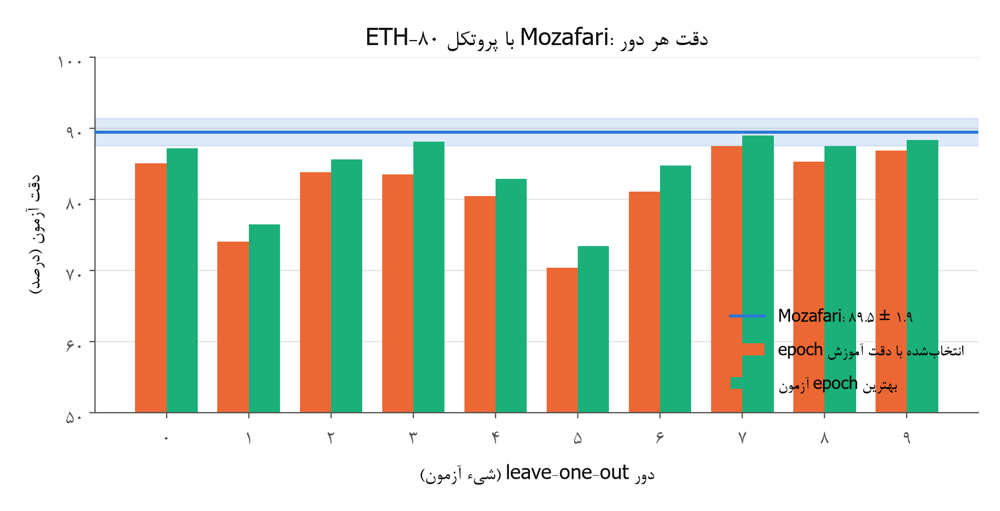

در ETH-80 بازتولید ما حتی با روش خوش‌بینانهٔ خود مقاله چند درصد پایین‌تر از 89.5 است. دلیل‌های محتمل این‌ها هستند:

1. **پراکندگی بین دورها:** دقت دورها بین حدود 70 و 87 درصد است. علتش این است که در هر دور فقط یک شیء از هر دسته آزمون می‌شود و بعضی اشیا (مثلاً یک سگ یا اسب خاص) به دسته‌های هم‌شکل خیلی شبیه‌اند. مقاله نگفته است که انحراف معیار 1.9 درصد بر روی دورهاست یا بر روی تکرارها.
2. **جزئیات نگفته:** تعداد epochها و ترتیب نمونه‌ها، و پیاده‌سازی دقیق Gabor و بازداری C1 در مقاله کامل نیامده است. ما پیاده‌سازی SpykeTorch را دنبال کرده‌ایم.
3. **گزارش بهترین epoch:** عدد مقاله بهترین epoch آزمون است. در روش منصفانهٔ ما دقت چند درصد پایین‌تر است.

در Caltech، با همان روش گزارش مقاله (بهترین epoch)، عدد ما با مقاله برابر است.

### ۸-۲ قاعده‌های تازهٔ تصمیم روی validation

همهٔ قاعده‌ها روی validation مقایسه شدند. در ETH-80 validation شامل یک شیء کنارگذاشته از دادهٔ آموزش در هر دسته است. در Caltech شامل 30 درصد تصویرهای آموزش است.

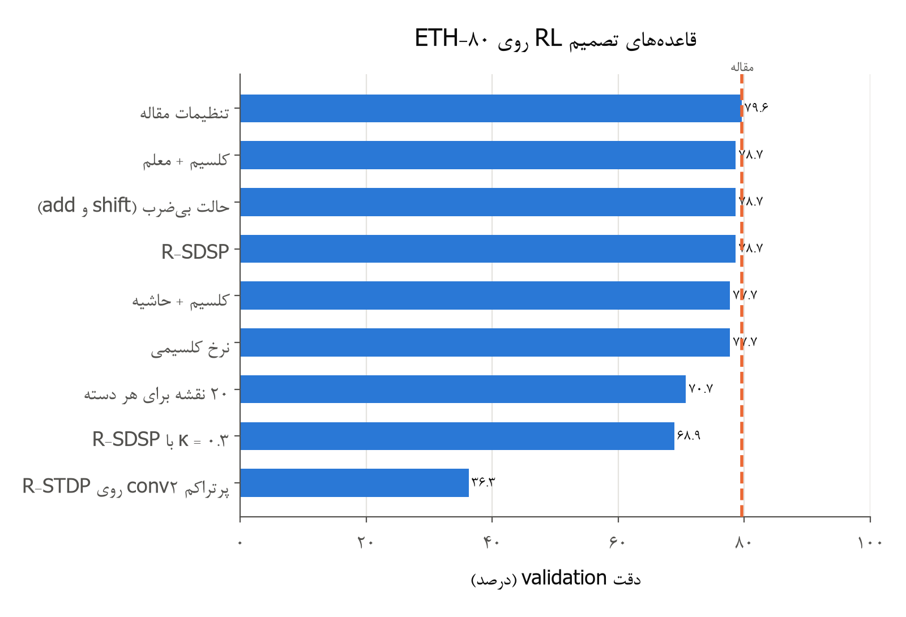

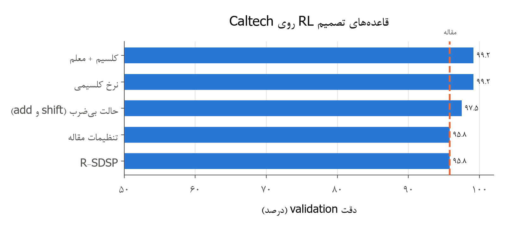

| قاعده | ETH-80 | Caltech | تفسیر |
|---|---|---|---|
| تنظیمات مقاله (R-STDP، نرخ تطبیقی، dropout) | 79.57 | 95.83 | معیار |
| نرخ تطبیقی کلسیمی نورون‌به‌نورون | 77.74 | **99.17** | بهترین روی Caltech |
| کلسیم + سیگنال معلم | 78.66 | 99.17 | معلم افت ETH-80 را جبران می‌کند |
| کلسیم + حاشیهٔ توقف یادگیری | 77.74 | آزموده نشد | اثر نداشت |
| R-SDSP (توقف یادگیری کلسیمی) | 78.66 | 95.83 | هم‌سطح مقاله |
| R-SDSP با دروازهٔ پتانسیل $\kappa=0.3$ | 68.90 | آزموده نشد | بدتر |
| ۲۰ نقشه برای هر دسته | 70.73 | آزموده نشد | بدتر |
| حالت بی‌ضرب (shift و add) | 78.66 | 97.50 | هزینهٔ کم یا هیچ |
| R-STDP روی conv2 پرتراکم شبکهٔ STDP | 36.28 | آزموده نشد | شکست |

*جدول: دقت validation قاعده‌های تصمیم (درصد)*

توضیح نتیجه‌ها:

- **نرخ کلسیمی روی Caltech:** در Caltech فقط دو دسته وجود دارد. نرخ تطبیقی سراسری Mozafari همهٔ نورون‌ها را با یک ضریب تنبیه می‌کند، حتی نورون تازه‌کاری که هنوز چیزی یاد نگرفته است. نرخ کلسیمی هر نورون را بر اساس سابقهٔ خودش تنبیه می‌کند. نورون همگراشده‌ای که خطا می‌کند سخت تنبیه می‌شود و نورون تازه‌کار آسوده‌تر یاد می‌گیرد. نتیجه 3.3 درصد بهبود روی validation بود و در آزمون نهایی هم‌سطح مقاله شد.
- **نرخ کلسیمی روی ETH-80:** در ETH-80 با هشت دسته، هر نورون کمتر برنده می‌شود و ردِ کلسیمی آن (با ضریب 0.9) پرنوسان است. چند تنبیه پشت‌سرهم نورونی را که همگرا شده بود به هم می‌ریزد. سیگنال معلم بخشی از این افت را جبران می‌کند، چون نورون درست را هم‌زمان تقویت می‌کند.
- **دروازهٔ پتانسیل R-SDSP:** با $\kappa=0.3$ ورودی‌هایی که خیلی زود می‌رسند (وقتی پتانسیل هنوز پایین است) تضعیف می‌شوند. ولی در کدگذاری ترتیب رتبه همین ورودی‌های زودرس پرارزش‌ترین اطلاعات را دارند. پس این دروازه با TTFS ناسازگار است.
- **نقشهٔ بیشتر برای هر دسته:** وقتی نقشه‌ها بیشتر می‌شوند، هر نقشه به‌روزرسانی کمتری می‌گیرد و در همان تعداد epoch کمتر همگرا می‌شود.
- **R-STDP روی conv2:** شبکهٔ STDP ‏800‌نقشه‌ای بعد از آستانه و WTA فقط حدود 200 اسپایک از 51 هزار ورودی ممکن تولید می‌کند. این کد برای اینکه یک نورون تصمیم بتواند الگو یاد بگیرد بیش از حد تُنُک است.

### ۸-۳ هزینهٔ حالت سخت‌افزاری بی‌ضرب

در حالت بی‌ضرب همهٔ نرخ‌ها توان دو شدند. مثلاً 0.004 به $2^{-8}=0.0039$ و 0.01 به $2^{-7}=0.0078$ رسید. ضریب نرم‌کران قطعه‌خطی شد و وزن‌ها ممیز ثابت 16 بیتی شدند. دقت validation روی ETH-80 فقط 0.9 درصد (سه تصویر) کم شد و روی Caltech 1.7 درصد بیشتر شد. پس محدودیت سخت‌افزاری BioVision، یعنی یادگیری فقط با shift و add، به دقت لایهٔ تصمیم آسیب جدی نمی‌زند. دلیلش این است که قاعدهٔ STDP مسطح از ابتدا فقط به علامت ترتیب اسپایک‌ها وابسته است و نه به مقدار دقیق نرخ.

### ۸-۴ قاعدهٔ توجه (AGREL): یادگیری تقویتی لایهٔ پنهان

قاعدهٔ توجه روی یک شبکهٔ دولایه آزموده شد:
- **ورودی:** Gabor C1؛
- **لایهٔ پنهان:** 64 نقشهٔ 5×5 که اول با STDP پیش‌آموزش دید؛
- **pooling:** پنجرهٔ 3×3؛
- **لایهٔ تصمیم:** R-STDP.

در آزمایش کنترل همین شبکه با لایهٔ پنهانِ منجمد بعد از STDP آموزش دید.

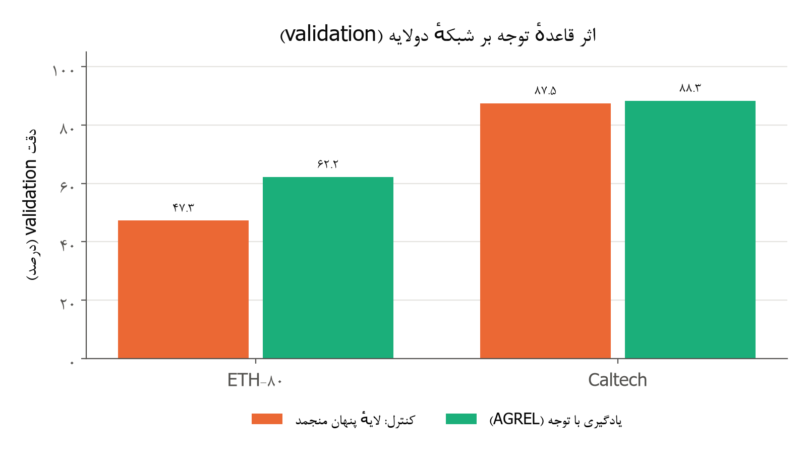

| آزمایش | ETH-80 | Caltech |
|---|---|---|
| کنترل: لایهٔ پنهان منجمد | 47.26 | 87.50 |
| توجه با علامت خام پاداش (نسخهٔ اول) | فروپاشی: 87 درصد تصمیم‌ها ساکت | آزموده نشد |
| توجه + خطای پیش‌بینی پاداش | **62.20** | **88.33** |
| توجه + خطای پیش‌بینی پاداش، فقط پاداش | 60.06 | آزموده نشد |
| توجه با $K=8$ و شدت 0.2 | 54.57 | آزموده نشد |
| توجه با 128 نقشهٔ پنهان | 57.01 | آزموده نشد |

*جدول: اثر قاعدهٔ توجه (دقت validation، درصد)*

یافته‌ها:

- **نسخهٔ اول فرو ریخت.** در شروع آموزش هفت تصمیم از هشت تصمیم غلط است. وقتی علامت خام پاداش به لایهٔ پنهان می‌رسد، این لایه پشت‌سرهم anti-STDP می‌گیرد، ورودی‌های علّی‌اش ضعیف می‌شوند و خاموش می‌شود.
- **خطای پیش‌بینی پاداش مشکل را حل کرد.** با $\delta=r-\bar r$ (فرمول بخش ۴-۱۰)، خطایی که انتظارش می‌رود تنبیه سنگینی ندارد.
- **توجه روی ETH-80 حدود 15 درصد دقت اضافه کرد.** این نشان می‌دهد که اعتبار تصمیم واقعاً به واحدهای پنهان درست می‌رسد. روی Caltech که ویژگی‌های STDP بدون نظارت از قبل کافی‌اند، اثر کوچک بود (یک تصویر).
- **شبکهٔ دولایه هنوز از شبکهٔ تک‌لایهٔ Mozafari عقب است** (62.2 در برابر 79.6 روی ETH-80). علت اصلی این است که نورون تصمیم Mozafari کل شیء را در پنجرهٔ 31×31 می‌بیند و الگوی کامل شیء را یاد می‌گیرد. ویژگی‌های 5×5 بعد از pooling این شکل کلی را از دست می‌دهند.

این نتیجه نشان می‌دهد که قاعدهٔ توجه درست کار می‌کند و با سخت‌افزار بی‌ضرب سازگار است. پس برای فاز ۴ که بازخورد و توجه از بالا به پایین دارد، پایهٔ آزموده‌شده‌ای است. معماری لایهٔ پنهان آن هنوز باید بهتر شود.

### ۸-۵ معماری برگزیدهٔ جبههٔ RL

معماری برگزیدهٔ این جبهه این است:
- **ورودی:** Gabor ثابت و C1 با بازداری جانبی.
- **لایهٔ تصمیم:** R-STDP با نقشه‌های اختصاصی هر دسته و تصمیم با اولین اسپایک.
- **سازوکارهای ضد بیش‌برازش:** نرخ تطبیقی و dropout.
- **نرخ یادگیری:**
  - در Caltech، نرخ تطبیقی کلسیمی نورون‌به‌نورون (قاعدهٔ تازهٔ ما)؛
  - در ETH-80، نرخ تطبیقی سراسری مقاله.
- **سازگاری سخت‌افزاری:** این معماری در حالت بی‌ضرب تقریباً همان دقت را دارد.

نتیجهٔ آزمون نهایی:

| دیتاست | مقالهٔ Mozafari (بهترین epoch) | ما: epoch انتخاب‌شده | ما: بهترین epoch آزمون |
|---|---|---|---|
| Caltech، سه seed، نرخ کلسیمی | 98.9 ± 0.4 | 98.65 ± 0.49 | 98.94 ± 0.37 |
| ETH-80، leave-one-out | 89.5 ± 1.9 | 81.83 ± 5.58 | 84.36 ± 5.31 |

*جدول: نتیجهٔ نهایی جبههٔ یادگیری تقویتی (دقت آزمون، درصد)*

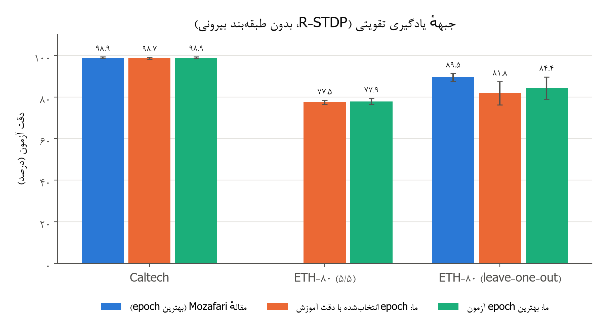

## ۹. جبههٔ دوم: طبقه‌بند SVM و KNN

در این جبهه، ویژگی‌های شبکهٔ اسپایکی با یک SVM خطی سنجیده می‌شوند. این ویژگی‌ها پتانسیل نهایی آخرین لایه با آستانهٔ بی‌نهایت هستند. این کار روش مقاله‌های SDNN و ۲۰۱۶ است. SVM روی تراشه نمی‌رود و فقط ابزار سنجش کیفیت ویژگی‌هاست.

### ۹-۱ بازتولید با تنظیمات مقاله‌ها

| دیتاست | عدد مقاله | بازتولید ما با تنظیمات مقاله | همان وزن‌ها با خوانش ما |
|---|---|---|---|
| Caltech (SDNN) | 99.1 ± 0.2 | 92.80 ± 1.15 | — |
| MNIST (SDNN) | 98.4 | 91.46 ± 0.36 | 98.52 ± 0.06 |
| ETH-80 (SDNN، ۵/۵) | 82.8 | 44.55 ± 2.60 | 69.53 ± 2.03 |
| ETH-80 (مقالهٔ ۲۰۱۶، ۵/۵، 1250 ویژگی) | 81.1 | 77.07 (یک seed) | 83.96 |

*جدول: بازتولید با تنظیمات مقاله‌ها (دقت آزمون، درصد)*

بازتولید با تنظیمات مقاله در هر چهار مورد پایین‌تر از عدد منتشرشده است. با بررسی اسپایک‌ها و ویژگی‌ها، این دلیل‌ها را پیدا کردیم:

1. **عدم توازن دسته‌ها در یادگیری STDP (Caltech):** تصویرهای موتورسیکلت حدود دو برابر صورت‌ها لبه دارند. در نتیجه هر بیست نقشهٔ conv2 آشکارساز موتورسیکلت شدند و صورت‌ها فقط با «نبودِ موتورسیکلت» شناخته می‌شدند.
2. **خوانش سراسری مکان را دور می‌ریزد:** بیشینه روی کل تصویر می‌گوید یک ویژگی کجا بوده یا نه، ولی نمی‌گوید کجا. روی MNIST همین وزن‌ها با خوانش مکان‌دار از 91.5 به 98.5 درصد می‌رسند. با این حال، مقاله با همین خوانش سراسری 98.4 درصد گزارش کرده است. پس یکی از جزئیات نگفتهٔ پیاده‌سازی آن‌ها با ما فرق دارد.
3. **ورودی خیلی تُنُک در ETH-80:** مقاله اندازهٔ تصویر را نگفته است. با تصویر 160 پیکسلی و آستانهٔ DoG برابر 50، هر تصویر فقط حدود 780 اسپایک ورودی دارد، در حالی که مقاله کل اسپایک‌های هر تصویر را حدود 9100 گزارش کرده است. با این ورودی، 400 نقشهٔ conv2 و conv3 یاد نمی‌گیرند.
4. **پروتکل:** مقاله‌ها یک تقسیم تصادفی دارند و ضریب $C$ با جست‌وجو تنظیم شده است. ما سه تقسیم و انتخاب $C$ داخل دادهٔ آموزش را به کار برده‌ایم.

### ۹-۲ بهبودها و دلیل هر کدام

**Caltech:**

| قدم | دقت | دلیل |
|---|---|---|
| تنظیمات مقاله | 92.8 ± 1.1 | نقطهٔ شروع |
| آستانهٔ DoG برابر 25 و شعاع بازداری 4 در conv2 | 95.3 (seed 0) | ورودی پرتراکم‌تر و رقابت قوی‌تر |
| هموستازی آستانه ($\rho=0.5$) | 96.3 (seed 0) | نقشه‌های موتورسیکلت دیگر غالب نمی‌شوند |
| خوانش conv2 با شبکهٔ 3×3 و استانداردسازی | 98.48 ± 0.59 | مکان ویژگی حفظ می‌شود |
| 8 نقشه در conv1 (برگزیده روی validation) | 98.96 ± 0.25 | لبه‌های متنوع‌تر در لایهٔ اول |

*جدول: زنجیرهٔ بهبود Caltech (دقت آزمون، درصد)*

**MNIST:** همان شبکهٔ مقاله با خوانش conv2 روی شبکهٔ 5×5، که روی validation انتخاب شد، با سه seed به 98.52 ± 0.06 درصد رسید. عدد مقاله 98.4 درصد است، پس این عدد از مقاله بیشتر است.

**ETH-80:** سه دور غربال روی validation انجام شد.

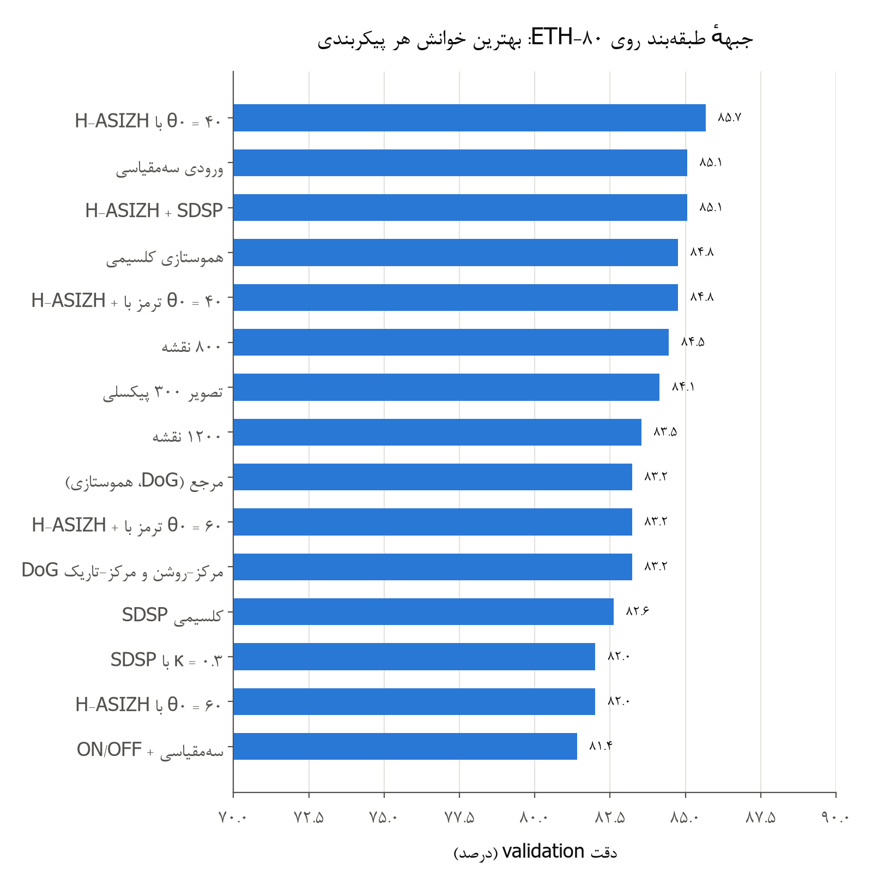

- **مهم‌ترین قدم‌ها:**
  - تصویر 200 پیکسلی و آستانهٔ DoG برابر 15، یعنی حدود 2800 اسپایک ورودی به‌جای حدود 780؛
  - هموستازی؛
  - خوانش مکان‌دار conv2. این سه قدم با هم دقت را از حدود 44 درصد (تنظیمات مقاله، روی test) به حدود 83 درصد (روی validation) رساندند.
- **تعداد ویژگی:** مانند مقالهٔ ۲۰۱۶، نقشهٔ بیشتر کمک کرد: 800 نقشه 84.45 درصد گرفت.
- **H-ASIZH:** بهترین پیکربندی روی validation دینامیک آستانهٔ H-ASIZH از مقالهٔ Roshani و همکاران بود، با آستانهٔ استراحت 40 و $\gamma/\alpha=64$. این پیکربندی با آینه‌سازی تصویرهای آموزش 85.67 درصد گرفت. همین قاعده با آستانهٔ استراحت 60 بدتر از مرجع بود، چون آستانه هرگز پایین‌تر از 60 نمی‌رفت و نقشه‌های کم‌کار زنده نمی‌شدند.
- **ورودی سه‌مقیاسی:** ایدهٔ مقالهٔ ۲۰۱۶، 85.06 درصد گرفت.

**نتیجهٔ نهایی ETH-80 (۵/۵، سه seed، پیکربندی برگزیده با دو تقسیم validation):** 84.25 ± 3.49 درصد، در برابر 82.8 درصد SDNN و 81.1 درصد مقالهٔ ۲۰۱۶.

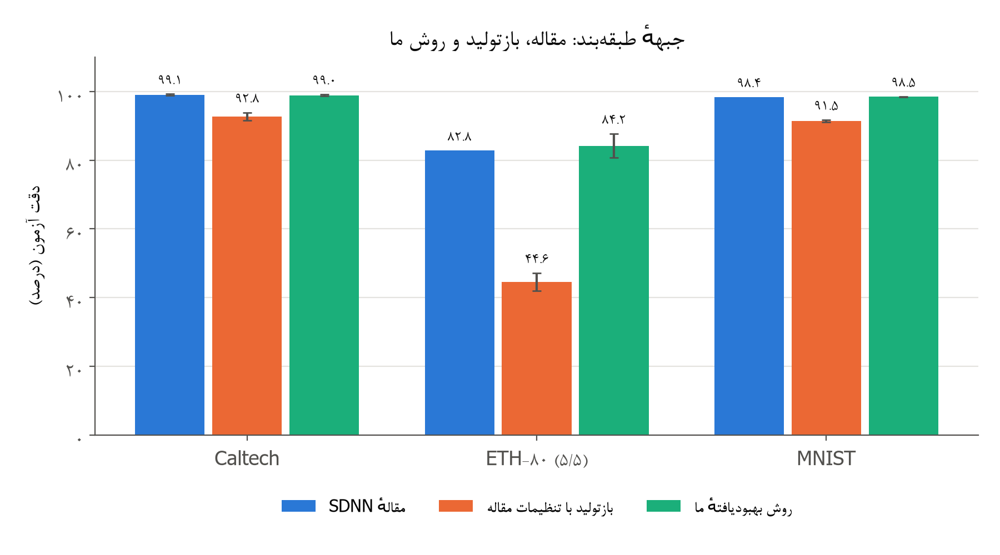

### ۹-۳ نتیجهٔ منفی: نورون LIF

به پیشنهاد کاربر، نورون LIF با آستانهٔ تطبیقی هم آزموده شد (تصمیم D18). نشت در لایه‌های پایین کد ترتیب رتبه را از بین می‌برد، چون ورودی‌های زودرس محو می‌شوند. روی Caltech دقت validation از 98.75 به 75 تا 80 درصد افت کرد. در لایهٔ سوم LIF بی‌اثر بود. پس برای تصویر ثابت نورون IF نگه داشته شد. LIF برای فاز ۳ (رویدادها و ویدیو) دوباره بررسی می‌شود.

## ۱۰. هزینهٔ محاسبه: اسپایک، وزن و سرعت

| شبکه | اسپایک در هر تصویر | تعداد وزن قابل یادگیری | تصویر در ثانیه (استخراج ویژگی) |
|---|---|---|---|
| Caltech، طبقه‌بند، روش ما | حدود 14000 | 46 هزار | 66 |
| Caltech، طبقه‌بند، تنظیمات مقاله | حدود 7100 | 26 هزار | 52 |
| MNIST، طبقه‌بند | حدود 755 (مقاله حدود 600) | 76 هزار | 113 |
| ETH-80، طبقه‌بند، 800 نقشه | حدود 5100 (مقاله حدود 9100) | 819 هزار | 25 |
| Caltech، RL (ورودی C1) | حدود 720 | 23 هزار | — |
| ETH-80، RL (ورودی C1) | حدود 960 | 308 هزار | — |

*جدول: هزینهٔ محاسبه در شبکه‌های برگزیده*

شبکهٔ RL با کمتر از هزار اسپایک ورودی برای هر تصویر تصمیم می‌گیرد. تصمیم هم با اولین اسپایک گرفته می‌شود، پس پخش موج می‌تواند همان لحظه متوقف شود. این همان ویژگی کم‌مصرفی است که BioVision لازم دارد. سرعت‌ها روی GPU لپ‌تاپ و هم‌زمان با دو یا سه کار دیگر اندازه گرفته شده‌اند، پس فقط برای مقایسهٔ نسبی معتبرند.

## ۱۱. معماری‌های نهایی برگزیده: جمع‌بندی 141 آزمایش

در فاز ۰ در مجموع 141 اجرای کامل آموزش و ارزیابی انجام شد و 217 نوع خوانش سنجیده شد. درستی کد با 99 آزمون واحد بررسی شد و 25 تصمیم طراحی در فایل تصمیم‌ها ثبت شد. این بخش نتیجهٔ همهٔ این آزمایش‌ها را جمع می‌کند و به سه سؤال پاسخ می‌دهد:
- کدام ویژگی‌ها از مقاله‌ها بودند؛
- کدام ویژگی‌ها را ما اضافه کردیم و ماندند؛
- کدام ویژگی‌ها آزموده و کنار گذاشته شدند.

در پایان دو معماری نهایی با همهٔ جزئیات تعریف می‌شود. معماری اصلی، معماری یادگیری تقویتی است، چون SVM و KNN در سامانهٔ نهایی و روی تراشه به کار نمی‌روند.

### ۱۱-۱ دو معیار طراحی: وفاداری زیستی و سخت‌افزار بی‌ضرب

هر جزء معماری باید دو شرط را با هم داشته باشد. شرط اول این است که معادل زیستی داشته باشد و فقط از اطلاعات محلی استفاده کند. شرط دوم این است که روی FPGA و در کد VHDL شتاب‌دهنده بدون ضرب‌کننده ساخته شود، یعنی فقط با shift، جمع و مقایسه.

| جزء | معادل زیستی | عمل سخت‌افزاری |
|---|---|---|
| فیلتر ثابت DoG یا Gabor | سلول‌های مرکز‌پیرامون شبکیه و سلول ساده V1 | ضریب‌های ثابت؛ ضرب در عدد ثابت با shift و جمع (نمایش CSD) |
| کدگذاری ترتیب رتبه (TTFS) | زمان اولین اسپایک شبکیه | شمارش و مقایسه |
| نورون IF با حداکثر یک اسپایک | نورون انباشتگر | جمع وزن‌ها و مقایسه با آستانه |
| WTA و k-WTA | بازداری جانبی | مقایسه (زودترین اسپایک) |
| pooling | سلول پیچیده | کمینهٔ زمان اسپایک (مقایسه) |
| STDP و R-STDP | پلاستیسیتهٔ وابسته به زمان و دوپامین | ضریب قطعه‌خطی $\tfrac12\min(w,1-w)$ و نرخ توان دو: shift، تفریق و مقایسه |
| آستانهٔ H-ASIZH و کلسیم | کلسیم درون‌سلولی و تطبیق آستانه | $\alpha=2^{-6}$ و $\gamma$ توان دو: shift و جمع |
| نرخ تطبیقی کلسیمی | ردِ پاداش هر نورون | میانگین نمایی با $\lambda=1-2^{-k}$: shift و جمع |
| Dropout | نوفهٔ سیناپسی | ثبات‌گر شیفت با بازخورد خطی (LFSR) |
| SVM خطی و KNN | **ندارد** | **ضرب‌کننده لازم دارد؛ فقط ابزار سنجش است** |

*جدول: اجزای معماری، معادل زیستی و عمل سخت‌افزاری آن‌ها*

فقط یک بخش هنوز اثرش بر دقت سنجیده نشده است: کوانتیده کردن ضریب‌های ثابت فیلترهای ورودی به مجموع چند توان دو. این بخش در فاز ۱ آزموده می‌شود.

### ۱۱-۲ دفتر ویژگی‌ها: از مقاله‌ها، افزوده‌های ما و کنار گذاشته‌ها

| ویژگی | منشأ | شاهد عددی | تصمیم |
|---|---|---|---|
| فیلتر ثابت DoG و Gabor | مقاله‌ها | پایهٔ همهٔ نتیجه‌ها | نگه داشته شد |
| کد ترتیب رتبه، نورون IF، WTA و k-WTA | مقاله‌ها | پایهٔ همهٔ نتیجه‌ها | نگه داشته شد |
| STDP مسطح و توقف یادگیری | مقاله‌ها | SDSP هم‌ارز آن بهتر نبود (82.6 در برابر 83.2) | نگه داشته شد |
| ورودی چندمقیاسی با وزن مشترک | مقالهٔ ۲۰۱۶ | ETH-80: از 83.2 به 85.1 (validation) | نگه داشته شد؛ هرم فاز ۱ |
| تعداد ویژگی بیشتر | مقالهٔ ۲۰۱۶ | ETH-80: 800 نقشه 84.5، ولی 1200 نقشه 83.5 | 800 نقشه |
| R-STDP، نرخ تطبیقی و dropout | Mozafari | Caltech: 98.51 با بهترین epoch، در برابر 98.9 | نگه داشته شد؛ جبههٔ اصلی |
| خوانش سراسری (بیشینهٔ کل تصویر) | مقاله‌ها | MNIST: 91.5 در برابر 98.5 با خوانش مکان‌دار | جایگزین شد |
| هموستازی آستانه | ما (سند طرح) | Caltech: از 95.3 به 96.3 | نگه داشته شد |
| آستانهٔ H-ASIZH با $\theta_0$ پایین | ما (مقالهٔ Roshani و همکاران) | ETH-80: 85.7 و 91.5 روی دو تقسیم، بهترین پیکربندی | نگه داشته شد |
| ترمز $\beta$ در پلاستیسیته | ما (H-ASIZH) | با $\theta_0=60$ یک درصد بهتر؛ با $\theta_0=40$ بی‌اثر | اختیاری |
| نرخ تطبیقی کلسیمی نورون‌به‌نورون | ما | Caltech: از 96.52 به 98.65 روی test؛ ETH-80: 1.8 درصد بدتر روی validation | برای Caltech |
| حالت سخت‌افزاری بی‌ضرب | ما | ETH-80 0.9 درصد کمتر؛ Caltech 1.7 درصد بیشتر | پیش‌فرض |
| قاعدهٔ توجه با خطای پیش‌بینی پاداش | ما (AGREL) | شبکهٔ دولایهٔ ETH-80: از 47.3 به 62.2 | برای لایه‌های عمیق فاز ۱ |
| آینه‌سازی تصویرهای آموزش طبقه‌بند | ما | ETH-80: از 0.6 تا 4.6 درصد بهتر | فقط در جبههٔ طبقه‌بند |
| نورون LIF | پیشنهاد کاربر | Caltech: از 98.8 به 75 تا 80 | کنار گذاشته شد |
| R-SDSP | ما (سند طرح) | برابر مقاله در Caltech، 0.9 درصد کمتر در ETH-80 | بدون مزیت |
| دروازهٔ پتانسیل SDSP با $\kappa=0.3$ | ما | ETH-80: 68.9 در برابر 79.6 | کنار گذاشته شد |
| کانال DoG مرکز‌تاریک | ما | ETH-80: بدون تغییر (83.2) | بدون مزیت |
| ۲۰ نقشه برای هر دسته | ما | ETH-80: 70.7 در برابر 79.6 | کنار گذاشته شد |
| R-STDP روی اسپایک‌های تُنُک conv2 | ما | ETH-80: 36.3 | کنار گذاشته شد |
| بودجهٔ برابر اسپایک ورودی | ما | Caltech: 66.0 در برابر 92.8 | کنار گذاشته شد |
| خوانش هرمی | ما | ETH-80: 80.5 در برابر 82.6 | کنار گذاشته شد |

*جدول: دفتر ویژگی‌ها و شاهد عددی هر تصمیم (دقت به درصد)*

### ۱۱-۳ معماری A (اصلی): یادگیری تقویتی با اولین اسپایک

این معماری در فاز ۰ بهترین معماری کاملاً زیستی و سخت‌افزارپذیر است. هیچ طبقه‌بند بیرونی ندارد و تصمیمش همان دستهٔ اولین نورونی است که اسپایک می‌زند. یادگیری آن فقط با پاداش و تنبیه است و در حالت بی‌ضرب با همان دقت کار می‌کند.

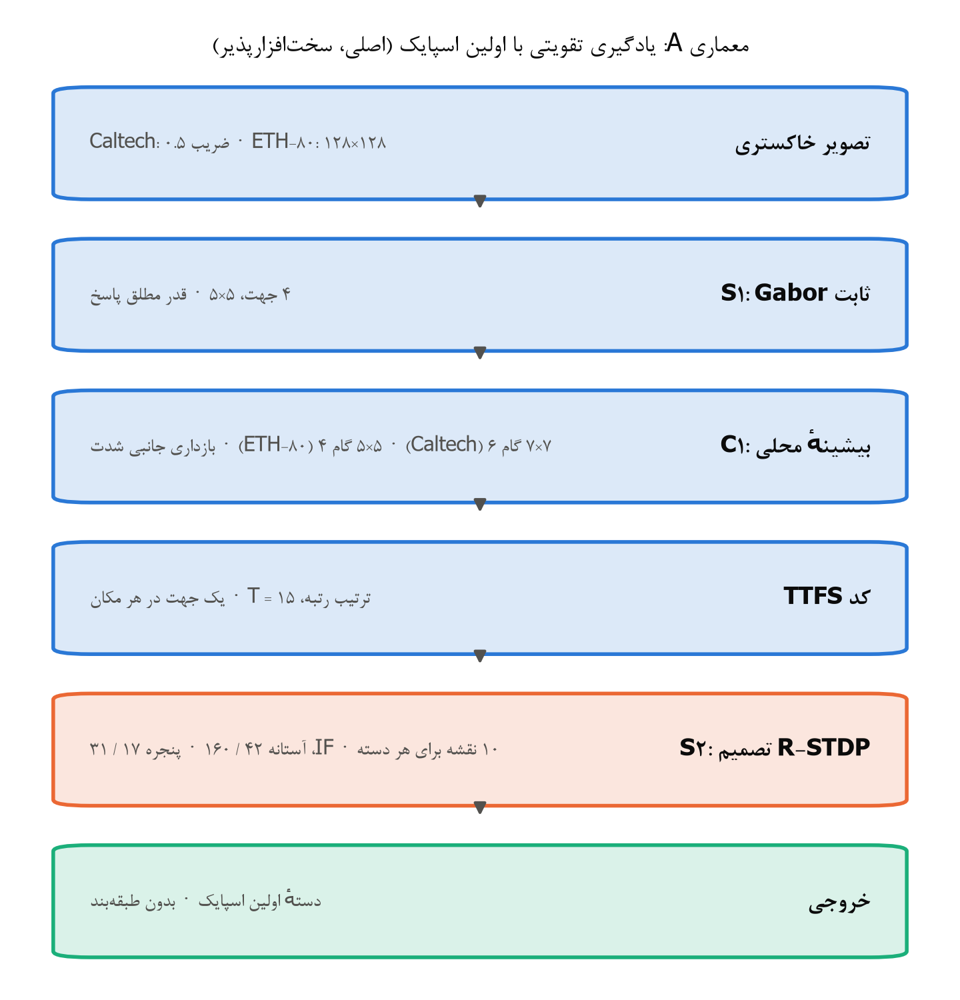

| مرحله | تعریف | Caltech | ETH-80 |
|---|---|---|---|
| ورودی | تصویر خاکستری | 435 تصویر از هر دسته، کوچک‌سازی با ضریب 0.5 | تصویر 128×128 |
| S1 | Gabor ثابت 5×5 در 4 جهت ($22.5^\circ+k\cdot45^\circ$)، قدر مطلق پاسخ | همان | همان |
| C1 | بیشینهٔ محلی + بازداری جانبی شدت با ضریب‌های 0.15، 0.12، 0.10، 0.07 و 0.05 | پنجرهٔ 7، گام 6 | پنجرهٔ 5، گام 4 |
| کدگذاری | ترتیب رتبه در $T=15$ گام؛ در هر مکان فقط یک جهت | همان | همان |
| S2 (تصمیم) | نورون IF، 10 نقشهٔ اختصاصی برای هر دسته، تصمیم = اولین اسپایک | پنجرهٔ 17×17، آستانه 42 | پنجرهٔ 31×31، آستانه 160 |
| نرخ پاداش | $a_r^{+}$ و $a_r^{-}$ | 0.005 و 0.0025 | 0.01 و 0.0035 |
| نرخ تنبیه | $a_p^{-}$ و $a_p^{+}$ | 0.005 و 0.0005 | 0.01 و 0.0006 |
| نرخ تطبیقی | ضریب نرخ‌ها با سابقهٔ درست و غلط | کلسیمی نورون‌به‌نورون، $\lambda=0.9$ | سراسری در هر epoch (مقاله) |
| Dropout و epoch | | 0.5 و 300 | 0.4 و 150 |
| وزن قابل یادگیری | | 23 هزار | 308 هزار |
| حالت سخت‌افزاری | وزن ممیز ثابت 16 بیتی، نرخ‌های توان دو، ضریب قطعه‌خطی | هزینهٔ دقت ≤ 1 درصد | هزینهٔ دقت ≤ 1 درصد |
| دقت آزمون، epoch انتخاب‌شده | | 98.65 ± 0.49 | 81.83 ± 5.58 (leave-one-out) |
| دقت آزمون، بهترین epoch | | 98.94 ± 0.37 (مقاله 98.9 ± 0.4) | 84.36 ± 5.31 (مقاله 89.5 ± 1.9) |

*جدول: مشخصات کامل معماری A*

دو نکتهٔ سخت‌افزاری دیگر برای کد VHDL مهم است:
- در سخت‌افزار $\lambda=1-2^{-3}=0.875$ نزدیک‌ترین مقدار shift و add به 0.9 است.
- نسبت $h_i/(h_i+m_i)$ در نرخ کلسیمی را می‌شود با تفریق در حوزهٔ لگاریتم و آشکارساز اولین بیت یک ساخت، چون خروجی آن به هر حال به توان دو گرد می‌شود. هر دو مورد در فاز ۱ آزموده می‌شوند.

### ۱۱-۴ معماری B (فرعی): ویژگی‌های STDP با سنجهٔ SVM

این معماری بهترین ویژگی‌های بدون نظارت را می‌سازد. لایه‌های STDP آن کاملاً زیستی و بی‌ضرب هستند، ولی خوانش SVM هیچ‌کدام از این دو نیست. پس این معماری فقط نشان می‌دهد ویژگی‌ها چقدر اطلاعات دارند و روی تراشه نمی‌رود. در فاز ۰ تلاش برای جایگزینی SVM با R-STDP روی همین ویژگی‌ها شکست خورد (36.3 درصد)، چون کد conv2 خیلی تُنُک است. قاعدهٔ توجه راه پیشنهادی ما برای این جایگزینی است.

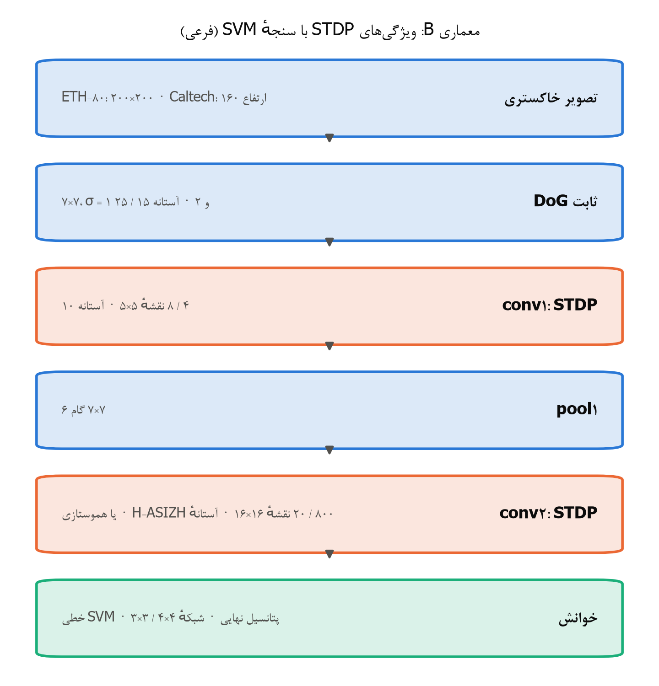

| مرحله | ETH-80 | Caltech |
|---|---|---|
| ورودی | خاکستری 200×200 | خاکستری، ارتفاع 160 |
| شبکیه | DoG مرکز‌روشن 7×7، $\sigma=1$ و 2، آستانه 15، ترتیب رتبه در 30 گام | همان، آستانه 25 |
| conv1 | 4 نقشهٔ 5×5، آستانه 10، STDP مسطح ($a^{+}=0.004$، $a^{-}=0.003$) تا $C_l<0.01$ | 8 نقشه |
| pool1 | 7×7 گام 6 | همان |
| conv2 | 800 نقشهٔ 16×16، آستانهٔ H-ASIZH ($\theta_0=40$، $\alpha=2^{-6}$، $\gamma=1$)، k-WTA با شعاع 1، 30 هزار تکرار | 20 نقشه، آستانه 60، هموستازی ($\eta=0.5$، $\rho=0.5$)، شعاع 4 |
| خوانش | پتانسیل نهایی conv2، بیشینه در شبکهٔ 4×4 (12800 ویژگی)، استانداردسازی، SVM خطی با $C=1.2$ و تصویرهای آینه‌ای آموزش | شبکهٔ 3×3، استانداردسازی، $C=1.0$ |
| وزن قابل یادگیری | 819 هزار | 46 هزار |
| دقت آزمون | 84.25 ± 3.49 (۵/۵، مقاله 82.8) | 98.96 ± 0.25 (مقاله 99.1 ± 0.2) |

*جدول: مشخصات کامل معماری B*

### ۱۱-۵ معماری پیشنهادی برای شروع فاز ۱

معماری پیشنهادی فاز ۱ ترکیب ویژگی‌هایی است که در فاز ۰ ماندند:

1. **ورودی:** شبیه‌ساز شبکیهٔ سه‌کاناله (P، K و M) از سند طرح، با نرمال‌سازی تقسیمی و هرم سه‌مقیاسی با وزن مشترک (ایدهٔ ۲۰۱۶ که در فاز ۰ کمک کرد).
2. **لایه‌های ویژگی V1 تا IT:** STDP مسطح با k-WTA، با آستانهٔ H-ASIZH با $\theta_0$ پایین در همهٔ لایه‌ها.
3. **حالت بی‌ضرب از روز اول:** همهٔ یادگیری‌ها و تصمیم‌ها فقط با shift، جمع و مقایسه.
4. **خوانش اصلی:** تصمیم R-STDP با اولین اسپایک، با نرخ کلسیمی نورون‌به‌نورون و dropout، مکان‌دار و بدون pooling سراسری.
5. **تنظیم لایهٔ IT با قاعدهٔ توجه:** قاعدهٔ توجه (AGREL) با خطای پیش‌بینی پاداش، همان «STDP و سپس تنظیم با R-STDP» سند طرح.
6. **SVM فقط سنجه:** SVM فقط برای مقایسه با فاز ۰ به کار می‌رود.


## ۱۲. جمع‌بندی، محدودیت‌ها و دروازهٔ ۰

**آنچه به دست آمد:**

- **جبههٔ RL (اصلی):**
  - در Caltech به عدد Mozafari رسیدیم. با نرخ کلسیمی نورون‌به‌نورون دقت 98.65 ± 0.49 با epoch انتخاب‌شده و 98.94 ± 0.37 با بهترین epoch بود، در برابر 98.9 ± 0.4.
  - حالت سخت‌افزاری بی‌ضرب تقریباً هیچ هزینه‌ای نداشت.
  - قاعدهٔ توجه یادگیری تقویتی لایهٔ پنهان را ممکن کرد و روی ETH-80 حدود 15 درصد بهبود داد.
- **جبههٔ طبقه‌بند:**
  - در MNIST مقاله را شکست دادیم: 98.52 ± 0.06 در برابر 98.4.
  - در Caltech هم‌سطح مقاله شدیم: 98.96 ± 0.25 در برابر 99.1 ± 0.2.
  - در ETH-80 با پروتکل ۵/۵ به 84.25 ± 3.49 رسیدیم، در برابر 82.8.

**آنچه به دست نیامد:**

- **ETH-80 در جبههٔ RL:** با پروتکل leave-one-out به 89.5 درصد Mozafari نرسیدیم.
- **هدف 90 درصد:** هدف بالای 90 درصد برای ETH-80 در این فاز محقق نشد.
- **بازتولید با تنظیمات مقاله‌ها:** در همهٔ دیتاست‌ها پایین‌تر از عدد منتشرشده درآمد. دلیل‌ها در بخش ۹-۱ آمده است.

**محدودیت‌ها:**

- **یک تقسیم validation:** همهٔ غربال‌ها با یک تقسیم validation انجام شدند. اختلاف‌های کمتر از حدود یک درصد (سه تصویر در ETH-80) معنادار نیستند.
- **محاسبه:** محاسبه روی یک GPU لپ‌تاپ انجام شد.
- **آزمون نشده‌ها:** بعضی ترکیب‌ها آزموده نشدند، مثلاً قاعدهٔ توجه با میدان دید بزرگ‌تر.

**دروازهٔ ۰:** بازتولید در محدودهٔ دو درصد مقاله در Caltech (هر دو جبهه) و MNIST برقرار است و فاصلهٔ ETH-80 توضیح داده شده است. دروازهٔ ۰ در تاریخ 2026-10-20 به دستور کاربر بسته شد («فاز ۰ را هرچه سریع‌تر ببند و برویم سراغ فاز بعدی»). کار با معماری پیشنهادی بخش ۱۱-۵ به فاز ۱ می‌رود.

## منابع و مسیر نتیجه‌ها

**منابع اصلی:**

- Kheradpisheh, Ganjtabesh, Masquelier (2016), *Bio-inspired unsupervised learning of visual features leads to robust invariant object recognition*, Neurocomputing (arXiv 1504.03871).
- Kheradpisheh, Ganjtabesh, Thorpe, Masquelier (2018), *STDP-based spiking deep convolutional neural networks for object recognition*, Neural Networks (arXiv 1611.01421).
- Mozafari, Kheradpisheh, Masquelier, Nowzari-Dalini, Ganjtabesh (2018), *First-spike-based visual categorization using reward-modulated STDP*, IEEE TNNLS (arXiv 1705.09132).
- Mozafari, Ganjtabesh, Nowzari-Dalini, Masquelier (2019), *SpykeTorch*, Frontiers in Neuroscience.
- Roshani, Ansari, Manzuri Shalmani (2026), *H-ASIZH: A Highly Reliable Digital Izhikevich Neuron Core Using Adaptive Threshold Control for Fault Accommodation*, submitted to IEEE TCAS-I.
- بقیهٔ منابع قاعده‌های یادگیری در بخش ۷-۳ آمده‌اند.

**مسیر نتیجه‌ها:** همهٔ اجراها در پوشهٔ `work/campaigns` هستند. هر اجرا پیکربندی کامل، commit، seed، دقت، اسپایک‌ها، وزن‌ها، منحنی همگرایی و شکل ویژگی‌های یادگرفته را ذخیره کرده است. جدول یکجای همهٔ نتیجه‌ها `reports/phase0/results_all.csv` است و همهٔ تصمیم‌های پروژه (D1 تا D24) در `DECISIONS.md` ثبت شده‌اند.


---

# بخش ۳. فاز ۱: هدف، طراحی سخت‌افزارآگاه و تحلیل ریاضی

> فصل‌های ۲ تا ۶ گزارش فاز ۱. شمارهٔ فصل‌ها با بخش ۴ (فصل‌های ۷ تا ۱۲) پیوسته است.

## ۲. هدف فاز ۱ و دو معیار طراحی

هدف فاز ۱ طبق سند طرح ساختن مسیر شکمی رنگی تا ناحیهٔ IT است. این مسیر سه بخش دارد:
- یک شبیه‌ساز شبکیه با سه کانال P، K و M؛
- چهار لایهٔ یادگیرنده که به ترتیب نقش V1، V2، V4 و IT را دارند؛
- دو خوانش: لایهٔ تصمیم R-STDP با اولین اسپایک (جبههٔ اصلی) و SVM خطی (فقط برای سنجش ویژگی‌ها).

در این فاز دو پرسش اصلی داریم. پرسش اول این است که آیا رنگ و هرم مقیاس دقت را بالا می‌برند. پرسش دوم این است که شبکه در برابر تغییر روشنایی، گاما، مقیاس و جابه‌جایی چقدر پایدار است.

همهٔ تصمیم‌های این فاز با دو معیار گرفته شدند که کاربر در شروع فاز تعیین کرد:

1. **وفاداری زیستی:** هر جزء معادل زیستی دارد و فقط از اطلاعات محلی استفاده می‌کند.
2. **سخت‌افزار بی‌ضرب:** هر جزء روی FPGA و در کد VHDL شتاب‌دهنده فقط با جمع، تفریق، shift، مقایسه، شمارنده و جدول کوچک ساخته می‌شود. هیچ ضرب‌کننده یا تقسیم‌کنندهٔ عمومی در مسیر شبکه نیست. هدف کمترین توان مصرفی و بیشترین سرعت است.

برای اینکه نتیجه‌ها در بودجهٔ ۲۴ ساعته به دست بیایند، اندازهٔ تصویر در همهٔ آزمایش‌های این فاز 128×128 است. همهٔ انتخاب‌ها فقط روی validation انجام شد و test فقط یک بار و برای پیکربندی برگزیده اجرا شد.

> قاعدهٔ گزارش مثل فاز ۰ است: هر عدد با پیکربندی، seed و پروتکل ارزیابی‌اش ثبت شده است. نتیجه‌های منفی و خطاهایی که در طراحی خودمان پیدا شد هم گزارش می‌شوند.

## ۳. شبیه‌ساز شبکیه در حوزهٔ لگاریتم

شبکیهٔ فاز ۰ فیلتر DoG ممیز شناور و کد ترتیب رتبه داشت. شبکیهٔ فاز ۱ از پایه دوباره طراحی شد تا دو کار را با هم انجام دهد: رنگ را مثل شبکیهٔ نخستی‌ها کد کند و فقط با عمل‌های بی‌ضرب ساخته شود. همهٔ محاسبه‌ها در حوزهٔ لگاریتم انجام می‌شوند، چون در این حوزه ضرب و تقسیم به جمع و تفریق تبدیل می‌شوند. گیرنده‌های نوری چشم هم پاسخ تقریباً لگاریتمی دارند (قانون Weber–Fechner).

### ۳-۱ فیلترهای دوجمله‌ای به‌جای گاوسی

فیلتر دوجمله‌ای مرتبهٔ $n$ همان $n$ بار کانولوشن پشت‌سرهم فیلتر دوتایی $[1,1]/2$ است:

$$ B_n = \left(\tfrac12[1,1]\right)^{*n}, \qquad B_n[k] = \binom{n}{k} 2^{-n}, \qquad \mathrm{Var}(B_n) = \frac{n}{4} $$

**اثبات واریانس:** هر فیلتر $\tfrac12[1,1]$ توزیع یک متغیر برنولی با واریانس $\tfrac14$ است. کانولوشن توزیع‌ها همان توزیع جمع متغیرهای مستقل است، پس واریانس‌ها جمع می‌شوند و واریانس $B_n$ برابر $n/4$ می‌شود. طبق قضیهٔ حد مرکزی، $B_n$ به گاوسی با $\sigma=\sqrt n/2$ میل می‌کند.

هر مرحلهٔ این کانولوشن یک جمع دو پیکسل همسایه و یک shift یک‌بیتی است، پس فیلتر بدون هیچ ضربی ساخته می‌شود. فیلتر دوبعدی جداپذیر است و اول روی سطرها و بعد روی ستون‌ها اعمال می‌شود. یاخته‌های افقی شبکیه هم همین میانگین‌گیری پیاپی همسایه‌ها را از راه اتصال‌های الکتریکی (gap junction) انجام می‌دهند.

| فیلتر | مرتبهٔ $n$ | $\sigma$ (پیکسل) | نقش زیستی |
|---|---|---|---|
| مرکز | 4 | 1 | مرکز میدان پذیرای یاختهٔ گانگلیونی midget |
| پیرامون | 36 | 3 | پیرامون (یاخته‌های افقی) |
| کانال K | 16 | 2 | یاختهٔ bistratified آبی‌زرد |
| حوضچهٔ نرمال‌سازی | 36 | 3 | کنترل بهرهٔ محلی روشنایی |

*جدول: فیلترهای دوجمله‌ای شبکیه (همه فقط با جمع و shift)*

### ۳-۲ مخروط‌ها و کانال‌های رنگی

سه مخروط از سه رنگ تصویر گرفته می‌شوند: $L \approx R$، $M \approx G$ و $S \approx B$. روشنایی $Y = (L+M)/2$ با یک جمع و یک shift ساخته می‌شود. پاسخ‌های تفاضلی هر کانال این‌ها هستند:

$$ D_{L+M-} = B_4 * L - B_{36} * M, \qquad D_{M+L-} = B_4 * M - B_{36} * L, \qquad D_{K} = B_{16} * (S - Y) $$

هر پاسخ تفاضلی دو یاختهٔ ON و OFF دارد: یاختهٔ ON به $D^{+} = \max(D,0)$ پاسخ می‌دهد و یاختهٔ OFF به $\max(-D,0)$. این کانال‌ها در غربال مقایسه شدند:

- **خاکستری (کنترل):** $B_4 * Y - B_{36} * Y$ با ON و OFF، یعنی دو کانال. این همان DoG فاز ۰ است.
- **فقط P:** دو جفت رقیب قرمز‌سبز، یعنی چهار کانال.
- **P+K:** P به‌اضافهٔ جفت آبی‌زرد، یعنی شش کانال. این پیکربندی اصلی است.
- **P+K+M:** P+K به‌اضافهٔ دو کانال گذرای magno (بخش ۳-۸)، یعنی هشت کانال.

### ۳-۳ لگاریتم بیتی Mitchell

هر عدد مثبت به شکل $x = 2^{k}(1+f)$ با $0 \le f < 1$ نوشته می‌شود. در این نمایش $k$ مکان اولین بیت یک است و $f$ بیت‌های بعد از آن. تقریب Mitchell این است:

$$ \log_2 x \approx k + f $$

پس محاسبهٔ لگاریتم فقط یک priority encoder و خواندن بیت‌هاست.

**قضیهٔ کران خطا:** خطای تقریب $e(f) = \log_2(1+f) - f$ است. داریم $e(0) = e(1) = 0$ و مشتق آن $e'(f) = \frac{1}{(1+f)\ln 2} - 1$ فقط در $f^{*} = 1/\ln 2 - 1 \approx 0.4427$ صفر می‌شود. چون $e$ مقعر است، این نقطه بیشینه است:

$$ 0 \le e(f) \le e(f^{*}) = \log_2\!\left(\frac{1}{\ln 2}\right) - \frac{1}{\ln 2} + 1 \approx 0.0861 \ \text{octave} $$

این کران در آزمون واحد با دقت $10^{-3}$ بررسی شده است.

### ۳-۴ نرمال‌سازی تقسیمی با یک تفریق

پاسخ نرمال‌شدهٔ هر کانال در حوزهٔ لگاریتم این است:

$$ \ell = \log_2 D^{+} - \log_2\!\left(\epsilon + B_{36} * Y\right) $$

یعنی تقسیم پاسخ بر روشنایی محلی (نرمال‌سازی تقسیمی Carandini و Heeger) به یک تفریق تبدیل می‌شود.

**قضیهٔ ناوردایی به روشنایی:** فرض کنید روشنایی کل تصویر در $s>0$ ضرب شود. چون هر فیلتر خطی است، $D \to sD$ و $B*Y \to s\,B*Y$. پس با لگاریتم دقیق و $\epsilon \to 0$:

$$ \ell(s) = \log_2 s + \log_2 D^{+} - \log_2 s - \log_2(B*Y) = \ell(1) $$

با لگاریتم Mitchell هر جمله خطایی در $[0, 0.0861]$ دارد. تغییر روشنایی خطای صورت و خطای مخرج را هر کدام حداکثر 0.0861 جابه‌جا می‌کند، پس

$$ |\ell_{Mitchell}(s) - \ell_{Mitchell}(1)| \le 2 \times 0.0861 = 0.172 \ \text{octave} $$

اگر $s$ توانی از دو باشد، mantissa تغییر نمی‌کند و ناوردایی دقیق است. هر دو حالت در آزمون واحد بررسی شده‌اند. تنها منبع دیگر خطا $\epsilon = 1/256$ است که در تصویرهای خیلی تاریک اثر دارد.

> اصلاح نسبت به سند طرح: در سند طرح کران این بخش 0.0861 نوشته شده بود. کران درست 0.172 است، چون خطای صورت و مخرج می‌توانند در دو جهت مخالف تغییر کنند.

### ۳-۵ آستانهٔ تضاد یاخته‌های گانگلیونی

یاختهٔ گانگلیونی فقط وقتی اسپایک می‌زند که تضاد نرمال‌شده از یک آستانه بیشتر باشد: $\ell \ge \ell_{min}$. این فقط یک مقایسه‌گر است. بدون این آستانه نیمی از همهٔ یاخته‌ها اسپایک می‌زدند و کد تُنُک نبود. در این فاز سه روش برای تعیین آستانه ساخته و آزموده شد. هر روش از خطایی که در روش قبلی پیدا شد بیرون آمد:

1. **آستانهٔ ثابت سراسری:** $\ell_{min} = -0.5$ اکتاو برای همهٔ کانال‌ها، و یک $\ell_{max}$ مشترک برای زمان اسپایک. این روش کانال خاکستری را تقریباً خاموش می‌کرد (حدود 4 اسپایک در هر تصویر)، چون تضاد DoG روشنایی خیلی کمتر از پاسخ‌های رقیب L/M است. خطای بزرگ‌تر آن در بخش ۱۰-۱ آمده است: در ETH-80 کد آن تقریباً فقط سایه‌نمای شیء روی پس‌زمینهٔ آبی است.
2. **آستانهٔ ثابت هر کانال (شبکیهٔ متوازن):** برای هر کانال یک آستانهٔ جدا، طوری که روی تصویرهای آموزش حدود 7 درصد یاخته‌های آن کانال اسپایک بزنند. زمان اسپایک هر کانال هم نسبت به $\ell_{max}$ همان کانال حساب می‌شود، چون هر نوع یاختهٔ گانگلیونی کنترل بهرهٔ خودش را دارد. آستانه یک بار و بیرون از تراشه حساب می‌شود و در سخت‌افزار یک ثابت است. خطای این روش در آزمون ناوردایی پیدا شد: تغییر گاما بیشتر یاخته‌ها را زیر آستانهٔ ثابت می‌برد یا همه را بالای آن (بخش ۱۰-۳).
3. **تطبیق تضاد:** آستانهٔ هر کانال در هر تصویر طوری تنظیم می‌شود که حداکثر 7 درصد یاخته‌های آن کانال اسپایک بزنند. این همان تطبیق تضاد در شبکیه است (contrast adaptation). آستانه حداکثر دو اکتاو زیر آستانهٔ ثابت روش ۲ پایین می‌رود، چون بازهٔ تطبیق در شبکیه هم محدود است. بدون این کف، کانالی که در تصویر هیچ سیگنالی ندارد مجبور می‌شد 7 درصد یاخته‌هایش را با نوفه فعال کند.

**پیاده‌سازی سخت‌افزاری تطبیق تضاد:** پاسخ‌های هر کانال روی شبکه‌ای با گام $\Delta/4$ زیر $\ell_{max}$ کوانتیده و در یک هیستوگرام شمرده می‌شوند. جمع پیشوندی هیستوگرام از قوی‌ترین خانه شروع می‌شود و اولین خانه‌ای که جمع از $0.07N$ بیشتر شود آستانه را می‌دهد. پس فقط شمارنده و مقایسه لازم است و آستانه حداکثر یک خانه ($\Delta/4$) با مقدار دقیق فاصله دارد:

$$ \ell_{min}^{(c)} = \max\!\left(\ell_{max}^{(c)} - \frac{\Delta}{4}\left\lfloor \frac{\ell_{max}^{(c)} - \ell_{(k)}^{(c)}}{\Delta/4} \right\rfloor,\ \ \bar\ell_{min}^{(c)} - 2\right), \qquad k = \lfloor 0.07 N \rfloor $$

در این فرمول $\ell_{(k)}^{(c)}$ پاسخ $k$ام از نظر قدرت در کانال $c$ است و $\bar\ell_{min}^{(c)}$ آستانهٔ ثابت روش ۲.

**گزاره (ناوردایی مجموعهٔ فعال):** اگر تبدیل تصویر ترتیب پاسخ‌های یک کانال را حفظ کند، مجموعهٔ $k$ یاختهٔ قوی‌تر تغییر نمی‌کند، جز در مرز یک خانهٔ هیستوگرام و به شرط اینکه کف فعال نشود. ضرب روشنایی در یک عدد ترتیب را دقیقاً حفظ می‌کند. گاما ترتیب پاسخ‌های DoG را فقط تقریباً حفظ می‌کند، چون DoG روی شدت خطی حساب می‌شود. روی 30 تصویر ETH-80، همپوشانی مجموعهٔ فعال با گامای 0.5 برابر 0.77 بود، در حالی که با آستانهٔ ثابت فقط 0.04 بود.

**خطای روش ۳:** آستانهٔ هر تصویر به محتوای کل تصویر بستگی دارد، پس سراسری است. اگر بخشی از تصویر عوض شود (جابه‌جایی یا بزرگ‌نمایی)، آستانهٔ همهٔ یاخته‌ها جابه‌جا می‌شود. در آزمون شبکه، این روش مقاومت در برابر گاما را خیلی بهتر کرد، ولی 7 درصد از دقت پایه کم کرد و مقاومت در برابر مقیاس و جابه‌جایی را بدتر کرد (بخش ۷-۵). شبکیهٔ زیستی این مشکل را ندارد، چون کنترل بهرهٔ آن محلی است.

### ۳-۵-۱ نرمال‌سازی محلی تضاد (روش نهایی)

روش چهارم همان کنترل بهرهٔ تضاد شبکیه است، با محاسبهٔ بی‌ضرب. پاسخ هر یاخته بر انرژی تضاد همسایه‌های هم‌کانالش تقسیم می‌شود (نرمال‌سازی تقسیمی، با مخرج Naka–Rushton):

$$ \ell = \log_2 D^{+} - \log_2\!\Big(\kappa\,\big(\epsilon + B_{36} * Y\big) + B_{36} * |D|\Big), \qquad \kappa = 2^{-7} $$

جملهٔ اول مخرج همان نرمال‌سازی روشنایی بخش ۳-۴ است که در یک ثابت توان دو ضرب شده (یک shift). جملهٔ دوم میانگین قدر مطلق پاسخ همان کانال در یک حوضچهٔ دوجمله‌ای ($\sigma = 3$) است. در ناحیه‌های کم‌تضاد جملهٔ اول غالب است و نوفه را خاموش نگه می‌دارد. در ناحیه‌های پرتضاد جملهٔ دوم غالب است و بهره را تنظیم می‌کند. آستانهٔ هر کانال ثابت است (روش ۲)، ولی روی همین پاسخ‌های نرمال‌شده تنظیم می‌شود.

**قضیه (ناوردایی به روشنایی و گاما):**
1. **روشنایی:** با ضرب روشنایی در $s$، صورت و هر دو جملهٔ مخرج در $s$ ضرب می‌شوند (به شرط $\epsilon \to 0$)، پس $\ell$ دقیقاً تغییر نمی‌کند.
2. **گاما:** در یک همسایگی با روشنایی میانگین $\bar I$ بنویسید $I = \bar I(1+e)$. برای تضادهای کوچک $I^{\gamma} \approx \bar I^{\gamma}(1 + \gamma e)$. پس $D \to \gamma \bar I^{\gamma} D_e$ و $B*|D| \to \gamma \bar I^{\gamma} B*|D_e|$، در حالی که $B*Y \to \bar I^{\gamma}$. در نتیجه:

$$ \ell(\gamma) = \log_2 D_e^{+} - \log_2\!\Big(\frac{\kappa}{\gamma} + B*|D_e|\Big) \;\xrightarrow{\ \kappa \ll \gamma B*|D_e|\ }\; \ell(1) $$

یعنی وقتی $\kappa$ نسبت به تضاد محلی کوچک باشد، اثر گاما تا مرتبهٔ اول حذف می‌شود. بدون جملهٔ تضاد، همین تبدیل همهٔ $\ell$ها را $\log_2 \gamma$ اکتاو جابه‌جا می‌کند (برای $\gamma = 0.5$ یک اکتاو کامل).

3. **محلی بودن:** مخرج فقط به یک همسایگی $\sigma = 3$ پیکسلی بستگی دارد. پس جابه‌جایی تصویر کد را جز در لبه‌ها فقط جابه‌جا می‌کند، و این دقیقاً همان رفتاری است که لایه‌های کانولوشنی لازم دارند.

**سنجش روی کد ورودی:** این سنجش روی 30 تصویر ETH-80 و 30 تصویر Caltech، با آستانه‌های ثابت هر کانال انجام شد:

| روش | اسپایک با گامای 0.5 | همپوشانی با گامای 0.5 | همپوشانی با گامای 2 | همپوشانی با جابه‌جایی 8 پیکسل |
|---|---|---|---|---|
| روش ۲ (ثابت هر کانال)، ETH-80 | 0.05 برابر | 0.04 | 1.00 (5.8 برابر اسپایک) | 1.00 |
| نرمال‌سازی محلی، ETH-80 | 0.81 برابر | 0.78 | 0.89 | 1.00 |
| روش ۲، Caltech | 0.20 برابر | 0.17 | 0.98 (2.2 برابر اسپایک) | 1.00 |
| نرمال‌سازی محلی، Caltech | 0.81 برابر | 0.73 | 0.84 | 1.00 |

*جدول: پایداری کد ورودی شبکیه (حوضچهٔ $n=36$ و $\kappa=2^{-7}$؛ همپوشانی = کسری از یاخته‌های فعال تصویر اصلی که در تصویر تغییریافته هم فعال‌اند)*

**هزینهٔ سخت‌افزاری:** یک قدر مطلق (حذف بیت علامت)، یک فیلتر دوجمله‌ای دیگر (جمع و shift)، یک shift برای $\kappa$، یک جمع، یک لگاریتم Mitchell و یک تفریق. هیچ ضربی لازم نیست.

**اثر جانبی مفید:** کد ورودی از «ناحیه‌های رنگی پر» به «لبه‌ها و نقش‌ها» تبدیل می‌شود، چون در ناحیه‌های یکنواخت انرژی تضاد محلی پاسخ را خنثی می‌کند (شکل بخش ۱۰). این همان کاری است که سرکوب پیرامونی در شبکیه و V1 انجام می‌دهد.

### ۳-۶ کدگذاری زمان اولین اسپایک و لم جابه‌جایی

زمان اسپایک هر یاخته با کوانتیده کردن فاصلهٔ آن تا قوی‌ترین پاسخ به دست می‌آید:

$$ t = \left\lfloor \frac{\ell_{max} - \ell}{\Delta} \right\rfloor, \qquad t \le T-1 $$

در این فرمول $\ell_{max}$ با یک درخت مقایسه‌گر پیدا می‌شود. با $\Delta = 2^{-2}$ تقسیم یک shift دوبیتی است. با $T = 15$ گام، کد یک بازهٔ پویای $T\Delta = 3.75$ اکتاوی را می‌پوشاند. نگاشت یکنوا و نزولی است، پس پاسخ قوی‌تر زودتر اسپایک می‌زند، درست مثل یاخته‌های گانگلیونی.

**لم جابه‌جایی زمان در برابر روشنایی:** طبق بخش ۳-۴ هر پاسخ حداکثر 0.172 اکتاو جابه‌جا می‌شود. بیشینهٔ پاسخ‌ها هم حداکثر به همین اندازه جابه‌جا می‌شود، چون $|\max_i(x_i+d_i) - \max_i x_i| \le \max_i |d_i|$. پس فاصلهٔ $\ell_{max} - \ell$ حداکثر $4 \times 0.0861 = 0.344$ اکتاو تغییر می‌کند و زمان هر اسپایک حداکثر این مقدار گام جابه‌جا می‌شود:

$$ |\Delta t| \le \left\lceil \frac{0.344}{\Delta} \right\rceil = \begin{cases} 1 & \Delta = 1/2 \\ 2 & \Delta = 1/4 \end{cases} $$

هر دو حالت در آزمون واحد بررسی شده‌اند. با ضریب روشنایی توان دو جابه‌جایی صفر است.

> اصلاح نسبت به سند طرح: سند طرح برای $\Delta = 0.5$ نوشته شده بود و نتیجه‌اش «حداکثر یک گام» بود. پیکربندی نهایی $\Delta = 0.25$ دارد، پس کران درست دو گام است. این خطا با آزمون واحد تازه پیدا و ثبت شد.

جایگزین این کد، کد ترتیب رتبهٔ فاز ۰ است که اسپایک‌ها را در بسته‌های هم‌اندازه پخش می‌کند. این کد در سخت‌افزار با یک هیستوگرام از $\ell$ کوانتیده و جمع پیشوندی ساخته می‌شود. یعنی دو بار عبور روی تصویر و فقط شمارنده لازم دارد. هر دو کد در غربال مقایسه شدند.

### ۳-۷ هرم مقیاس با گام 2

هرم مقیاس جایگزین پنج مقیاس دلخواه مقالهٔ ۲۰۱۶ است. هر سطح از سطح قبل با جمع چهار پیکسل و shift دوبیتی ساخته می‌شود:

$$ I_{l+1}(x,y) = \Big(\sum_{i,j \in \{0,1\}} I_{l}(2x+i, 2y+j)\Big) \gg 2 $$

سطح‌های 128، 64 و 32 پیکسلی ساخته می‌شوند و شبکیه روی هر سطح جداگانه اجرا می‌شود. وزن‌های S1 تا S4 بین سطح‌ها مشترک است. پس شیئی که با ضریب $2^{-m}$ کوچک شده، در سطح $m$ با همان اندازهٔ اصلی دیده می‌شود. ضریب‌های میانی مثل 0.7 و 1.4 به تحمل جابه‌جایی لایه‌های pooling تکیه دارند و آزمون ناوردایی همین را می‌سنجد.

### ۳-۸ کانال magno با microsaccade

کانال M به تغییر حساس است، نه به تضاد ثابت. چشم حتی هنگام خیره شدن حرکت‌های ریز (microsaccade) دارد. در شبیه‌ساز، تصویر در گام‌های 0، 3، 6 و 9 یک پیکسل جابه‌جا می‌شود. در سخت‌افزار این فقط جابه‌جایی آدرس حافظه است. یک رویداد magno وقتی رخ می‌دهد که لگاریتم روشنایی یک یاخته از آخرین رویدادش به اندازهٔ $C$ تغییر کرده باشد:

$$ |\ell_Y(t) - \ell_Y^{ref}| \ge C, \qquad C = 0.2/\ln 2 \approx 0.29 \ \text{octave} $$

این یک تفریق و یک مقایسه است، همان سازوکار حسگرهای رویدادمحور (DVS).

## ۴. مسیر شکمی رنگی تا IT

### ۴-۱ ساختار شبکه

ورودی شبکه زمان اسپایک‌های شش کانال P+K در سه سطح هرم است. هر لایهٔ S نورون IF بدون نشت دارد. هر نورون در هر تصویر حداکثر یک اسپایک می‌زند و پتانسیلش فقط جمع وزن ورودی‌هایی است که اسپایک زده‌اند. هر لایهٔ C کمینهٔ زمان اسپایک را روی پنجرهٔ 2×2 می‌گیرد، یعنی فقط مقایسه است.

| لایه | ناحیهٔ زیستی | نقشه | کرنل | بازداری | تعداد سیناپس هر نورون |
|---|---|---|---|---|---|
| S1 | V1 | 12 | 5×5 | WTA ویژگی‌محور، k-WTA با شعاع 2 | 150 |
| C1 | V1 (یاختهٔ پیچیده) | 12 | 2×2 | — | — |
| S2 | V2، دو گروه رگه‌های نازک و کم‌رنگ | 32 (دو گروه 16تایی) | 5×5 | WTA جدا در هر گروه، شعاع 1 | 300 |
| C2 | V2 | 32 | 2×2 | — | — |
| S3 | V4 | 64 | 5×5 | k-WTA با شعاع 1 | 800 |
| C3 | V4 | 64 | 2×2 | — | — |
| S4 | IT | 128 | 3×3 | k-WTA | 576 |
| C4 | IT | 128 | 2×2 | — | — |

*جدول: ساختار مسیر شکمی فاز ۱ (ورودی 128×128، هرم 128، 64 و 32)*

ویژگی‌های مشترک همهٔ لایه‌های S:

- **یادگیری:** STDP مسطح بی‌ضرب (بخش ۵) با $a^{+} = 2^{-8} + 2^{-13} \approx 0.0040$ و $a^{-} = 2^{-8} - 2^{-10} \approx 0.0029$؛ وزن اولیه $0.8 \pm 0.05$؛ وزن‌های ممیز ثابت 16 بیتی.
- **توقف یادگیری:** وقتی شاخص همگرایی $C_l$ کمتر از 0.01 شود، یا تعداد به‌روزرسانی‌ها به 3000، 6000، 8000 و 8000 برسد (برای S1 تا S4).
- **آستانهٔ اولیه:** طبق بند 5.4 سند طرح پروژه خودکار تنظیم می‌شود، طوری که با وزن‌های اولیه حدود 5 درصد مکان‌ها اسپایک بزنند. این کار روی 200 تصویر و یک بار انجام می‌شود.
- **هموستازی:** هموستازی دوطرفهٔ نرخ اسپایک (بخش ۵-۵).

### ۴-۲ خوانش‌ها

**جبههٔ اصلی، لایهٔ تصمیم R-STDP:** این لایه همان لایهٔ تصمیم Mozafari در فاز ۰ است. برای هر دسته ده نقشه دارد و تصمیم شبکه دستهٔ اولین نقشه‌ای است که اسپایک بزند. یادگیری با پاداش (STDP) و تنبیه (anti-STDP)، نرخ تطبیقی و dropout انجام می‌شود. پنجرهٔ هر نورون کل تصویر را می‌پوشاند. دو محل برای این لایه آزموده شد:

- **روی C1:** خروجی C1 با یک pooling 4×4 دیگر به 16×16×12 می‌رسد و لایهٔ تصمیم کرنل 16×16 دارد. این همان معماری A فاز ۰ است، فقط با S1 یادگرفته و رنگی به‌جای Gabor ثابت.
- **روی C4:** لایهٔ تصمیم مستقیماً خروجی IT را می‌خواند (8×8×128).

نرخ‌های R-STDP همان مقادیر فاز ۰ برای ETH-80 هستند ($a^{+}=0.01$، $a^{-}=0.0035$، $p^{-}=0.01$، $p^{+}=0.0006$، dropout برابر 0.4 و 80 epoch). آستانهٔ تصمیم برابر 0.2 برابر پتانسیل مورد انتظار با وزن‌های اولیه است. گزینهٔ نرخ کلسیمی نورون‌به‌نورون فاز ۰ هم با $\lambda = 0.9$ آزموده شد.

**جبههٔ دوم، SVM:** پتانسیل نهایی S4 روی یک شبکهٔ 4×4 مکانی جمع می‌شود (خوانش مکان‌دار فاز ۰)، استاندارد می‌شود و به یک SVM خطی با $C = 1$ داده می‌شود. تصویرهای آینه‌ای آموزش هم اضافه می‌شوند. این خوانش فقط برای سنجش کیفیت ویژگی‌هاست و روی تراشه به کار نمی‌رود.

## ۵. تحلیل ریاضی یادگیری بی‌ضرب

### ۵-۱ ماندن وزن‌ها در بازهٔ صفر تا یک با STDP بی‌ضرب

STDP مسطح مقاله‌ها $\Delta w = \pm a\, w(1-w)$ است که یک ضرب متغیر در متغیر دارد. در حالت سخت‌افزاری این ضرب با یک تابع قطعه‌خطی جایگزین می‌شود:

$$ \Delta w = \pm a \, s \, \min(w, 1-w), \qquad s \in \left\{\tfrac12, 1\right\} $$

حالت $s = \tfrac12$ («هم‌قله») همان بیشینهٔ 0.25 تابع $w(1-w)$ را در $w = 0.5$ دارد. حالت $s = 1$ («هم‌شیب») همان شیب تابع $w(1-w)$ را در دو مرز $w = 0$ و $w = 1$ دارد. نرخ $a$ مجموع دو توان دو است، پس هر به‌روزرسانی یک مقایسه، یک تفریق، دو shift و دو جمع است.

**گزاره:** اگر $a s < 1$ باشد، وزن هرگز از بازهٔ $[0,1]$ بیرون نمی‌رود. **اثبات:** در تقویت، $\Delta w \le a s (1-w) < 1-w$، پس $w + \Delta w < 1$. در تضعیف، $|\Delta w| \le a s\, w < w$، پس $w - |\Delta w| > 0$. نقطه‌های $w=0$ و $w=1$ ثابت و جذب‌کننده‌اند.

### ۵-۲ لم سرعت همگرایی و خطایی که پیدا شد

نزدیک مرز $w = 1$ و برای سیناپسی که مدام تقویت می‌شود، فاصله تا مرز $u = 1-w$ این‌طور تغییر می‌کند:

$$ u_{n+1} = u_n \left(1 - a\,\phi\right), \qquad \phi = \begin{cases} w \approx 1 & \text{ممیز شناور} \\ s & \text{بی‌ضرب} \end{cases} \quad\Rightarrow\quad u_n \approx u_0\, e^{-a \phi n} $$

پس بعد از $n$ به‌روزرسانی، قاعدهٔ هم‌قله ($s = \tfrac12$) دقیقاً همان‌جایی است که قاعدهٔ ممیز شناور بعد از $n/2$ به‌روزرسانی بود. نزدیک $w = 0$ هم همین نتیجه برقرار است. شاخص همگرایی $C_l$ میانگین $w(1-w)$ است و نزدیک مرزها با $u$ متناسب است. پس قاعدهٔ هم‌قله با همان بودجهٔ تکرار تقریباً دو برابر $C_l$ بیشتری دارد.

داده‌های غربال همین را تأیید می‌کنند. لایهٔ S1 با سقف 3000 به‌روزرسانی در حالت ممیز شناور به $C_l = 0.041$ رسید و در حالت بی‌ضرب هم‌قله به $C_l = 0.080$، یعنی نسبت 1.95. هیچ‌کدام زیر 0.01 نرفت، یعنی لایهٔ S1 با سقف تکرار متوقف شد و نه با معیار همگرایی.

دو راه برای رفع این مشکل وجود دارد:

1. **ضریب هم‌شیب:** $s = 1$ همان سرعت ممیز شناور را نزدیک مرزها برمی‌گرداند و هیچ هزینهٔ سخت‌افزاری ندارد (یک shift کمتر). در وسط بازه دو برابر سریع‌تر است، ولی طبق گزارهٔ بخش ۵-۱ وزن در بازه می‌ماند. چون $\min(w,1-w) \ge w(1-w)$، این قاعده در همهٔ بازه دست‌کم به سرعت قاعدهٔ ممیز شناور است.
2. **بودجهٔ تکرار بیشتر برای S1:** از 3000 به 8000.

هر دو راه روی validation آزموده شدند. این دو آزمون با شبکیهٔ آستانهٔ سراسری انجام شدند، چون در آن زمان آن شبکیه بهترین بود:

| پیکربندی S1 | $C_l$ لایهٔ S1 | دقت validation (خوانش اول) | بهترین خوانش |
|---|---|---|---|
| ضریب هم‌قله، 3000 تکرار (پایه) | 0.20 | 78.96 | 79.88 |
| ضریب هم‌شیب، 3000 تکرار | 0.18 | 76.52 | 77.44 |
| ضریب هم‌قله، 8000 تکرار | 0.14 | 80.49 | 82.32 |

*جدول: اثر ضریب نرم‌کرانه و بودجهٔ تکرار S1 (ETH-80، validation، یک seed)*

نتیجه دو بخش دارد. اول اینکه لم درست است، ولی در این شبکیه $C_l$ لایهٔ S1 حتی با ضریب هم‌شیب حدود 0.18 ماند. پس عامل اصلی همگرا نشدن S1 این بود که بعضی نقشه‌ها کم برنده می‌شوند و کم به‌روز می‌شوند، نه شیب ضریب. دوم اینکه بودجهٔ تکرار بیشتر دقت را حدود 1.5 درصد بالا برد، ولی این اختلاف در حد نوفهٔ یک seed است (خطای معیار validation با 328 تصویر حدود 2.3 درصد است). ضریب هم‌قله پیش‌فرض ماند و بودجهٔ 8000 تکرار برای S1 در فاز ۲ پیشنهاد می‌شود. این لم در آزمون واحد هم ثبت شده است.

### ۵-۳ گرد کردن وزن‌های ممیز ثابت

وزن‌ها 16 بیت کسری دارند و بعد از هر به‌روزرسانی با حذف بیت‌های اضافه (floor) گرد می‌شوند. حذف بیت در سخت‌افزار رایگان است، ولی دو اثر دارد:

- **توقف خودکار یادگیری:** تقویتی که از یک LSB ($2^{-16}$) کوچک‌تر باشد صفر می‌شود. با $a \approx 2^{-8}$ این یعنی وزن‌هایی که به فاصلهٔ $2^{-8}/s$ از مرز رسیده‌اند منجمد می‌شوند. این همان توقف یادگیری است که بدون هزینه به دست می‌آید.
- **سوگیری به سمت تضعیف:** floor همیشه به سمت پایین گرد می‌کند. پس هر تضعیف، هر قدر کوچک، حداقل یک LSB وزن را کم می‌کند. اندازهٔ این سوگیری حداکثر $2^{-16} \approx 1.5 \times 10^{-5}$ در هر رویداد است، یعنی در وسط بازه حدود 64 برابر کوچک‌تر از گام یادگیری ($2^{-8} \times 0.25 = 2^{-10}$). اثرش بر دقت ناچیز است. اگر لازم شد، گرد کردن به نزدیک‌ترین عدد فقط یک جمع با نصف LSB لازم دارد.

### ۵-۴ نرخ یادگیری با دو توان دو

اولین نسخهٔ حالت بی‌ضرب هر نرخ را به نزدیک‌ترین توان دو گرد می‌کرد. اما $0.004$ و $0.003$ هر دو به $2^{-8}$ گرد می‌شوند. در این حالت $a^{+} = a^{-}$ است و نسبت $4/3$ که شکل‌گیری ویژگی به آن وابسته است از بین می‌رود. اولین آزمایش‌های فاز ۱ با این خطا ویژگی‌های بی‌کیفیت داشتند.

راه‌حل نمایش هر نرخ با دو توان دو علامت‌دار (CSD) است. ضرب در چنین نرخی دو shift و یک جمع است. وقتی توان دوی نزدیک‌تر در مقیاس لگاریتمی انتخاب شود، نسبت $a/q$ در بازهٔ $[2^{-1/2}, 2^{1/2}]$ است. پس خطای نسبی هر مرحله حداکثر $\sqrt2 - 1 \approx 0.414$ است و بعد از دو مرحله حداکثر $0.414^2 \approx 0.17$. خطای واقعی نرخ‌های ما خیلی کمتر است:

| نرخ | مقدار مقاله | دو توان دو | خطای نسبی |
|---|---|---|---|
| $a^{+}$ | 0.004 | $2^{-8} + 2^{-13} = 0.004028$ | 0.7 درصد |
| $a^{-}$ | 0.003 | $2^{-8} - 2^{-10} = 0.002930$ | 2.3 درصد |
| نسبت | 1.333 | 1.375 | 3.1 درصد |

*جدول: نرخ‌های STDP در حالت بی‌ضرب*

### ۵-۵ هموستازی آستانه: چرا H-ASIZH در S1 شکست خورد و چه جایش آمد

قاعدهٔ H-ASIZH مقالهٔ کاربر این است:

$$ \theta \leftarrow \theta + \alpha(\theta_0 - \theta) + \gamma z $$

با $\alpha = 2^{-6}$ و $\gamma$ توان دو، این قاعده فقط shift و جمع است. **گزاره:** اگر $\theta$ در $[\theta_0, \theta_0 + \gamma/\alpha]$ باشد، همان‌جا می‌ماند. **اثبات:** اگر $\theta \ge \theta_0$ و $z \ge 0$، آنگاه $\theta' - \theta_0 = (1-\alpha)(\theta - \theta_0) + \gamma z \ge 0$. اگر $z \le 1$ و $\theta \le \theta_0 + \gamma/\alpha$، آنگاه $\theta' - \theta_0 \le (1-\alpha)\gamma/\alpha + \gamma = \gamma/\alpha$.

همین کف $\theta \ge \theta_0$ در S1 فاز ۱ مشکل ساخت. آستانهٔ $\theta_0$ روی وزن‌های اولیه (حدود 0.8) تنظیم می‌شود. وقتی STDP همگرا می‌شود، بیشتر وزن‌ها به 0 و تعداد کمی به 1 می‌روند، پس پتانسیل یک ورودی معمولی کم می‌شود. آستانه نمی‌تواند زیر $\theta_0$ برود و S1 خاموش شد. در فاز ۰ این مشکل پیش نیامد، چون آنجا آستانه‌ها از مقاله آمده بودند و نه از تنظیم روی وزن‌های اولیه.

جایگزین فاز ۱ هموستازی دوطرفهٔ نرخ اسپایک است:

$$ \theta_i \leftarrow \theta_i + \eta\, \theta_0 \, \frac{z_i - \rho}{\rho}, \qquad \eta = \rho = 2^{-5} $$

در این قاعده $z_i$ کسری از مکان‌های نقشهٔ $i$ است که در این تصویر اسپایک زده‌اند. **نقطهٔ ثابت و پایداری:** نقطهٔ ثابت $E[z_i] = \rho$ است. اگر نزدیک نقطهٔ ثابت $z \approx \rho - g(\theta - \theta^{*})$ با $g > 0$ باشد (آستانهٔ بالاتر، اسپایک کمتر)، خطا این‌طور تغییر می‌کند:

$$ e_{n+1} = \left(1 - \frac{\eta\, \theta_0\, g}{\rho}\right) e_n $$

پس قاعده وقتی پایدار است که $0 < \eta \theta_0 g / \rho < 2$ باشد. با $\eta = \rho$ این شرط ساده‌تر می‌شود: $\theta_0 g < 2$.

**پیاده‌سازی بی‌ضرب:** اگر $c$ تعداد اسپایک‌های نقشه و $N$ تعداد مکان‌هایش باشد، $z = c/N$ است. چون $\eta = \rho$:

$$ \Delta\theta = \theta_0 \frac{c}{N} - \frac{\theta_0}{32} $$

پس هر اسپایک یک مقدار ثابت $\theta_0/N$ را به آستانه اضافه می‌کند و در پایان هر تصویر یک مقدار ثابت $\theta_0/32$ کم می‌شود (یک shift پنج‌بیتی). $N$ در همهٔ لایه‌ها و همهٔ سطح‌های هرم توان دو است (برای S1: $2^{14}$، $2^{12}$ و $2^{10}$)، پس $\theta_0/N$ هم یک shift است. هیچ ضربی لازم نیست.

### ۵-۶ پهنای بیت انباشتگرها

پتانسیل نورون IF جمع وزن‌های ورودی‌هایی است که اسپایک زده‌اند. با وزن $b$ بیتی و $N$ سیناپس، $V \le N(1-2^{-b})$. پس انباشتگر $b + \lceil \log_2 N \rceil$ بیت لازم دارد و هرگز سرریز نمی‌شود:

| لایه | تعداد سیناپس هر نورون | بیت انباشتگر (با $b=16$) |
|---|---|---|
| S1: 5×5×6 | 150 | 24 |
| S2: 5×5×12 | 300 | 25 |
| S3: 5×5×32 | 800 | 26 |
| S4: 3×3×64 | 576 | 26 |
| تصمیم روی C1: 16×16×12 | 3072 | 28 |
| تصمیم روی C4: 8×8×128 | 8192 | 29 |

*جدول: پهنای بیت انباشتگر هر لایه*

### ۵-۷ هزینهٔ رویدادمحور

در TTFS هر نورون حداکثر یک اسپایک دارد. هر اسپایک ورودی یک لایه به $k^2 M$ نورون آن لایه می‌رسد و هر رسیدن یک جمع است. پس تعداد عمل‌های سیناپسی (SOP) هر تصویر این است:

$$ \mathrm{SOP} = \sum_{\ell} n_{\ell}^{in}\, k_{\ell}^2\, M_{\ell} $$

در این فرمول $n^{in}$ تعداد اسپایک‌های ورودی لایه، $k$ اندازهٔ کرنل و $M$ تعداد نقشه است. شبکهٔ کانولوشنی هم‌اندازه با محاسبهٔ متراکم $\sum_\ell H_\ell W_\ell k_\ell^2 C_\ell M_\ell$ عمل ضرب‌وجمع (MAC) لازم دارد. نسبت این دو در بخش ۹ با تعداد واقعی اسپایک‌ها حساب شده است.

## ۶. پروتکل آزمایش

**داده:**
- **ETH-80 رنگی:** هشت دسته و ده شیء از هر دسته، هر شیء از 41 زاویه. تقسیم ۵/۵: پنج شیء برای آموزش و پنج شیء برای آزمون (1640 و 1640 تصویر). تصویرها 128×128 هستند.
- **Caltech-101 رنگی، چهار دسته:** Faces، Motorbikes، airplanes و Leopards. از هر دسته 200 تصویر تصادفی گرفته شد (100 برای آموزش و 100 برای آزمون) و با حفظ نسبت ابعاد در قاب 128×128 قرار گرفت.

**انتخاب:** غربال روی validation انجام شد. در ETH-80 یک شیء از پنج شیء آموزش هر دسته کنار گذاشته شد (1312 تصویر آموزش و 328 تصویر validation). در هر جبهه بهترین پیکربندی validation با سه seed روی test اجرا شد.

**آزمون‌های کنترل:** اثر رنگ با اجرای همان شبکه روی کانال خاکستری سنجیده شد. Caltech با بهترین تنظیمات شبکیه و با همان شبکه اجرا شد، بدون هیچ تنظیم دوباره.

**آزمون ناوردایی:** طبقه‌بند یا لایهٔ تصمیمی که روی تصویرهای عادی آموزش دیده، بدون آموزش دوباره روی تصویرهای تغییریافتهٔ test سنجیده شد (400 تصویر از test):
- **روشنایی:** ضریب 0.25، 0.5، 2 و 4 (با بریدن در 255)؛
- **گاما:** 0.5 و 2؛
- **مقیاس:** ضریب 0.7، 0.85، 1.2 و 1.4 حول مرکز تصویر؛
- **جابه‌جایی افقی:** 4، 8 و 16 پیکسل، معادل 8، 16 و 32 پیکسل در تصویر 256 پیکسلی سند طرح.


---

# بخش ۴. فاز ۱: همهٔ آزمایش‌ها، نتیجه‌ها و نقطه‌های خطا

> **محل شکل‌ها:** `code/biovision-snn/reports/phase1/figs/`. شمارهٔ فصل‌های این بخش (۷ تا ۱۲) ادامهٔ شمارهٔ فصل‌های بخش ۳ است، و ارجاع‌های بخش ۳ (مثل «بخش ۱۰-۱») به همین فصل‌ها اشاره دارند.

## ۷-۰ روند زمانی آزمایش‌های فاز ۱ (همه در 2026-10-20)

فاز ۱ در یک روز و در ده کمپین اجرا شد. هر کمپین از خطا یا پرسشی بیرون آمد که کمپین قبلی پیدا کرده بود:

| ساعت | کمپین | چرا | وضعیت |
|---|---|---|---|
| 05:50 تا 08:20 | راه‌اندازی و آزمون دود | ساخت شبیه‌ساز شبکیه، تنظیم آستانه، هموستازی، نرخ CSD | چهار خطا پیدا و رفع شد (بخش ۱۰-۵) |
| 08:20 تا 12:34 | `phase1_main` | غربال طبقه‌بند (8 گروه) و RL (7 گروه)، آزمون نهایی هر دو جبهه، کنترل‌های خاکستری و Caltech | تمام شد. شش اجرای Caltech به دلیل یک خطای پیکربندی شکست خورد |
| 08:29 تا 09:38 | `phase1_extra` | لم سرعت همگرایی: ضریب هم‌شیب و S1 طولانی‌تر | تمام شد |
| 08:35 تا 09:52 | `phase1_extra_rl` | پنجرهٔ تصمیم 32×32 با آستانهٔ سراسری | تمام شد |
| 11:40 تا 12:15 | `phase1_bal` | آزمون‌های نهایی با شبیه‌ساز متوازن، پس از کشف مصنوع کانال K | غربال RL تمام شد. نهایی‌ها به دستور کاربر متوقف شدند |
| 11:45 تا 12:48 | `phase1_adapt`، `phase1_adapt2` | تطبیق تضاد هر تصویر، پس از کشف شکنندگی در برابر گاما | دو اجرا تمام شد. بقیه به دستور کاربر متوقف شدند |
| 13:10 تا 14:36 | `phase1_v2` | نرمال‌سازی محلی تضاد، آینه‌سازی، 150 epoch | چهار اجرا تمام شد. سه اجرا اجرا نشد |
| 13:47 تا 14:38 | `phase1_v2b`، `phase1_v2c` | لایهٔ تصمیم کانولوشنی و شبیه‌ساز دومسیره | با پایان جلسه قطع شدند (یک اجرا تا epoch 90) |
| 14:11 تا 14:38 | `phase1_mag` | پیشنهاد کاربر: فقط کانال magno، شبیه دوربین DVS | سه اجرا تمام شد. یک اجرا تا epoch 80 رسید و آزمون ناوردایی‌اش نیمه‌کاره ماند |

**شمار کل:** فاز ۱ 46 اجرای کامل، 5 اجرای قطع‌شده و 6 اجرای شکست‌خورده دارد (جدول `results/all_runs.csv`).

## ۷. جبههٔ اول (اصلی): یادگیری تقویتی با اولین اسپایک

### ۷-۱ غربال روی validation (ETH-80)

**پیکربندی پایه:** S1 یادگرفته (12 نقشه)، C1، یک pooling 4×4 دیگر، و لایهٔ تصمیم R-STDP با ده نقشه برای هر دسته. پنجرهٔ تصمیم 16×16 است و کل تصویر را می‌پوشاند. 80 epoch با dropout برابر 0.4.

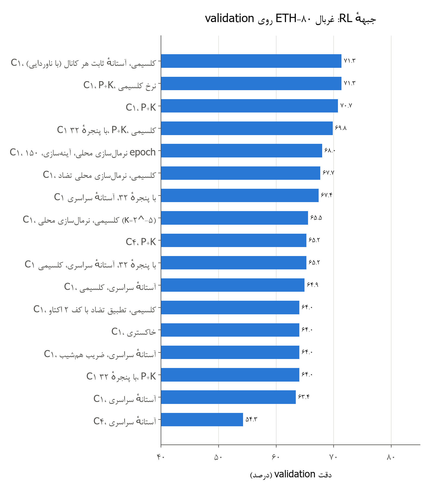

| پیکربندی | شبیه‌ساز شبکیه | اسپایک ورودی | دقت validation |
|---|---|---|---|
| تصمیم روی C1، P+K، نرخ کلسیمی | متوازن | 8673 | **71.34** |
| تصمیم روی C1، P+K | متوازن | 8673 | 70.73 |
| تصمیم روی C1، **فقط magno**، نرخ کلسیمی (قطع‌شده در epoch 80 = آخر) | فقط رویداد | **2055** | **71.95** |
| تصمیم روی C1، خاکستری | متوازن | 3733 | 64.02 |
| تصمیم روی C4، P+K | متوازن | 8673 | 65.24 |
| تصمیم روی C1 با پنجرهٔ 32، P+K، نرخ کلسیمی | متوازن | 8673 | 69.82 |
| تصمیم روی C1 با پنجرهٔ 32، P+K | متوازن | 8673 | 64.02 |
| تصمیم روی C1، P+K | آستانهٔ سراسری | 14589 | 63.41 |
| تصمیم روی C1، P+K، نرخ کلسیمی | آستانهٔ سراسری | 14589 | 64.94 |
| تصمیم روی C1، ضریب هم‌شیب | آستانهٔ سراسری | 14589 | 64.02 |
| تصمیم روی C1 با پنجرهٔ 32 | آستانهٔ سراسری | 14589 | 67.38 |
| تصمیم روی C1 با پنجرهٔ 32، نرخ کلسیمی | آستانهٔ سراسری | 14589 | 65.24 |
| تصمیم روی C4، P+K | آستانهٔ سراسری | 14589 | 54.27 |
| تطبیق تضاد سراسری با کف 2 اکتاو | تطبیقی | 6753 | 64.02 |
| تطبیق تضاد سراسری بدون کف (قطع‌شده در epoch 60) | تطبیقی | — | 64.33 |
| نرمال‌سازی محلی تضاد، $\kappa = 2^{-7}$ | LCN | 9751 | 67.68 |
| نرمال‌سازی محلی تضاد، $\kappa = 2^{-5}$ | LCN | 9958 | 65.55 |
| نرمال‌سازی محلی، آینه‌سازی، 150 epoch | LCN | 9751 | 67.99 |
| نرمال‌سازی محلی، پنجرهٔ کانولوشنی 12، آینه‌سازی (قطع‌شده در epoch 90 از 150) | LCN | — | 62.50 |

*جدول: غربال جبههٔ RL روی ETH-80 (validation: یک شیء کنارگذاشته از هر دسته، 328 تصویر؛ یک seed؛ خطای معیار حدود 2.5 درصد)*

**یافته‌ها:**
- **رنگ:** با شبیه‌ساز متوازن، P+K حدود 6.7 درصد از خاکستری بهتر است. این بزرگ‌ترین اثر غربال RL است.
- **کانال magno به‌تنهایی** (پیشنهاد کاربر) با یک‌چهارم اسپایک ورودی همان دقت رنگی را داد. کد رویدادی (تغییر روشنایی در microsaccadeها) لبه‌های شیء را با کمترین اسپایک کد می‌کند، و این برای تراشه‌ای که هزینه‌اش با تعداد اسپایک‌ها متناسب است بسیار مهم است.
- **آستانهٔ سراسری** که طبقه‌بند را بالا برد (بخش ۱۰-۱)، لایهٔ تصمیم RL را حدود 7 درصد پایین آورد. وقتی تقریباً همهٔ اسپایک‌ها از یک کانال می‌آیند، اولین اسپایک‌ها همیشه از لبهٔ پس‌زمینه‌اند و رنگ و بافت شیء به لایهٔ تصمیم نمی‌رسد.
- **تصمیم روی C4** ضعیف‌تر از تصمیم روی C1 است. R-STDP روی کد خیلی تُنُک لایه‌های عمیق (حدود 300 اسپایک S4 در هر تصویر) سیگنال کافی ندارد. این همان یافتهٔ فاز ۰ است.
- **نرمال‌سازی محلی تضاد** حدود 3.7 درصد از دقت پایه کم کرد، ولی شکنندگی در برابر گاما را حذف کرد (بخش ۷-۵).
- **آینه‌سازی و 150 epoch** در نرمال‌سازی محلی اثر معناداری نداشت (67.99 در برابر 67.68).

### ۷-۲ آزمون نهایی ETH-80 (تقسیم ۵/۵، سه seed)

پیکربندی برگزیدهٔ غربال اول (تصمیم روی C1، P+K، نرخ کلسیمی، شبیه‌ساز متوازن):

| seed | epoch انتخاب‌شده | دقت test | دقت آموزش |
|---|---|---|---|
| 0 | 80 | 74.02 | 91.77 |
| 1 | 80 | 70.30 | — |
| 2 | 80 | 74.27 | — |
| **میانگین** | | **72.86 ± 2.22** | |

*جدول: جبههٔ RL روی ETH-80 (test، 1640 تصویر آموزش و 1640 تصویر آزمون)*

در هر سه seed، epoch انتخاب‌شده همان epoch آخر بود. یعنی لایهٔ تصمیم هنوز کامل آموزش ندیده است. Mozafari برای ETH-80 از 150 epoch استفاده کرده بود. **مقایسه با فاز ۰:** شبکهٔ Gabor خاکستری فاز ۰ روی همین تقسیم 77.48 ± 1.00 گرفته بود. سه تفاوت این فاصله را توضیح می‌دهند:
1. ورودی تصمیم در فاز ۰ شبکهٔ 31×31 بود و در فاز ۱ شبکهٔ 16×16.
2. نسخهٔ تصویرها متفاوت بود (close128 در برابر cropped256 کوچک‌شده).
3. تعداد epoch متفاوت بود (150 در برابر 80).

### ۷-۳ Caltech چهاردسته‌ای (Faces، Motorbikes، airplanes، Leopards)

| شبیه‌ساز شبکیه | ارزیابی | دقت | اسپایک ورودی |
|---|---|---|---|
| متوازن، خاکستری | test، سه seed | **89.42 ± 1.18** (90.75، 88.50، 89.00) | 3450 |
| آستانهٔ سراسری، P+K | test، سه seed | 55.33 ± 3.96 (58.75، 51.00، 56.25) | 1090 |
| متوازن، خاکستری | validation (30 درصد آموزش) | 87.50 | 3439 |
| متوازن، P+K | validation | 81.67 | 6172 |
| فقط magno | validation | 80.83 | 3218 |

*جدول: جبههٔ RL روی Caltech چهاردسته‌ای (100 تصویر آموزش و 100 تصویر آزمون از هر دسته؛ سطح شانس 25 درصد). پیکربندی Caltech نرخ کلسیمی دارد و 100 epoch آموزش می‌بیند.*

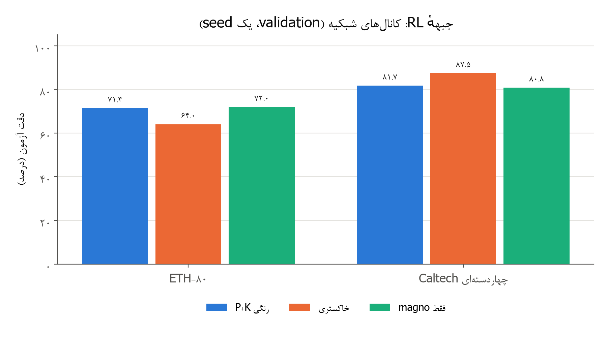

**تفسیر:** برخلاف ETH-80، در Caltech خاکستری از رنگی بهتر بود. در ETH-80 رنگ سطح شیء سرنخ اصلی است (گوجه، سیب، گلابی). در این چهار دستهٔ Caltech شکل و بافت مهم‌ترند (چهره، موتور، هواپیما، پلنگ)، و پس‌زمینه‌های رنگی طبیعی اسپایک‌های رنگی بی‌ربط می‌سازند. validation این آزمون 120 تصویر دارد، پس خطای معیارش حدود 3.5 درصد است.

### ۷-۴ ناوردایی آزمون‌های نهایی

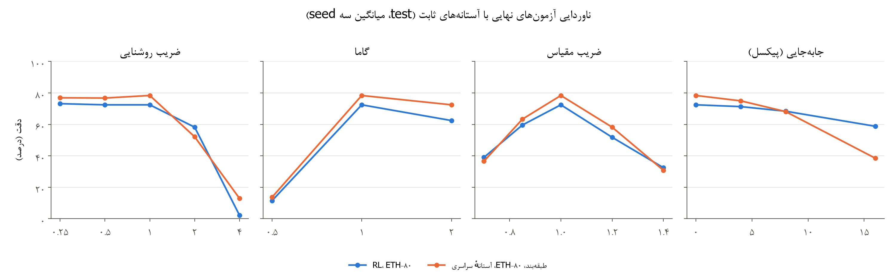

| تغییر تصویر | RL، ETH-80، متوازن | طبقه‌بند، ETH-80، آستانهٔ سراسری | RL، Caltech، آستانهٔ سراسری |
|---|---|---|---|
| بدون تغییر | 72.4 ± 2.2 | 78.4 ± 3.6 | 55.3 ± 4.0 |
| روشنایی ×0.25 | 73.2 ± 2.8 | 76.9 ± 3.3 | 50.9 ± 1.9 |
| روشنایی ×0.5 | 72.4 ± 1.2 | 76.8 ± 2.4 | 54.8 ± 2.8 |
| روشنایی ×2 | 58.2 ± 2.7 | 52.1 ± 5.5 | 50.1 ± 1.9 |
| روشنایی ×4 | 2.2 ± 0.4 | 12.9 ± 0.6 | 40.7 ± 0.8 |
| گامای 0.5 | **11.5 ± 1.9** | 13.7 ± 1.7 | 25.4 ± 4.9 |
| گامای 2 | 62.4 ± 7.0 | 72.4 ± 2.8 | 54.5 ± 1.1 |
| مقیاس 0.7 | 39.0 ± 2.4 | 36.6 ± 1.3 | 25.5 ± 6.0 |
| مقیاس 0.85 | 59.6 ± 4.0 | 63.3 ± 5.0 | 38.2 ± 4.3 |
| مقیاس 1.2 | 51.8 ± 3.1 | 58.2 ± 3.3 | 28.6 ± 2.5 |
| مقیاس 1.4 | 32.4 ± 3.1 | 30.8 ± 3.5 | 24.2 ± 3.0 |
| جابه‌جایی 4 پیکسل | 71.3 ± 2.7 | 75.0 ± 1.9 | 55.0 ± 2.1 |
| جابه‌جایی 8 پیکسل | 68.4 ± 3.3 | 68.1 ± 3.3 | 48.4 ± 5.8 |
| جابه‌جایی 16 پیکسل | 58.8 ± 0.8 | 38.5 ± 3.6 | 31.2 ± 3.1 |

*جدول: ناوردایی (test، میانگین ± انحراف معیار سه seed، 400 تصویر؛ درصد). روشنایی بیشتر از 1 در 255 بریده می‌شود.*

**تفسیر:**
- **روشنایی کمتر** تقریباً بی‌اثر است. این همان قضیهٔ ناوردایی بخش ۳-۴ است.
- **روشنایی ×2 و ×4** پیکسل‌ها را در 255 می‌بُرد و اطلاعات رنگ از دست می‌رود. این ضعف تصویر 8 بیتی است. با این حال سقوط تا زیر شانس نشان می‌دهد که آستانهٔ ثابت تعداد اسپایک‌ها را از کنترل خارج می‌کند.
- **گامای 0.5 بزرگ‌ترین خطای طراحی بود:** با آستانه‌های ثابت، تعداد اسپایک‌ها 20 برابر کم شد و دقت به حدود 11 درصد رسید (بخش ۱۰-۳).
- **مقیاس:** ضریب‌های 0.7 و 1.4 بیشتر از 0.85 و 1.2 آسیب می‌زنند. این همان «جای خالی هرم گام 2» است که سند طرح پیش‌بینی کرده بود.
- **جابه‌جایی:** RL در جابه‌جایی 16 پیکسل بهتر از طبقه‌بند مانده است (58.8 در برابر 38.5)، چون طبقه‌بند با شبکهٔ مکانی 4×4 به مکان حساس است.

### ۷-۵ سه روش کنترل تضاد: آستانهٔ ثابت، تطبیق سراسری، نرمال‌سازی محلی

برای رفع شکنندگی در برابر گاما سه روش ساخته و با آزمون ناوردایی روی validation سنجیده شدند. ریاضی آن‌ها در بخش ۳-۵ آمده است.

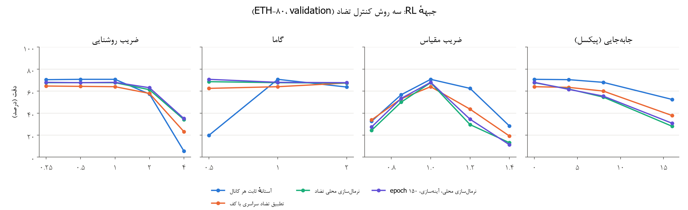

| تغییر تصویر | آستانهٔ ثابت هر کانال | تطبیق سراسری با کف | نرمال‌سازی محلی | نرمال‌سازی محلی، آینه‌سازی، 150 epoch | فقط magno (تا مقیاس 0.7) |
|---|---|---|---|---|---|
| بدون تغییر | **70.7** | 64.0 | 67.7 | 68.0 | 72.0 |
| روشنایی ×0.25 | 70.4 | 64.6 | 67.7 | 68.0 | 71.3 |
| روشنایی ×0.5 | 70.7 | 64.3 | 67.7 | 67.7 | 72.3 |
| روشنایی ×2 | 57.3 | 57.9 | 61.3 | **63.1** | 56.1 |
| روشنایی ×4 | 5.5 | 23.2 | 34.2 | **35.1** | 10.1 |
| گامای 0.5 | 19.8 | 62.5 | 68.6 | **70.7** | 27.4 |
| گامای 2 | 63.7 | 67.4 | 67.4 | **67.7** | 57.3 |
| مقیاس 0.7 | 32.6 | **33.8** | 24.4 | 27.4 | 31.4 |
| مقیاس 0.85 | **56.7** | 53.1 | 50.0 | 53.4 | — |
| مقیاس 1.2 | **62.5** | 43.6 | 29.6 | 34.5 | — |
| مقیاس 1.4 | **28.4** | 19.2 | 13.1 | 11.3 | — |
| جابه‌جایی 4 پیکسل | **70.4** | 63.4 | 61.9 | 61.6 | — |
| جابه‌جایی 8 پیکسل | **68.0** | 60.1 | 54.6 | 55.5 | — |
| جابه‌جایی 16 پیکسل | **52.4** | 37.8 | 28.1 | 30.8 | — |
| میانگین 13 تغییر | 50.7 | 50.1 | 48.3 | 49.7 | — |

*جدول: جبههٔ RL، اثر روش کنترل تضاد بر ناوردایی (ETH-80، validation، یک seed؛ درصد)*

**نتیجهٔ صادقانه:**
- **پایداری نوری حل شد:** نرمال‌سازی محلی تضاد شکنندگی در برابر گاما و روشنایی را حل کرد. با گامای 0.5 دقت عملاً با تصویر اصلی برابر است (70.7 در برابر 68.0).
- **پایداری هندسی ضعیف‌تر شد:** مقیاس 1.2 از 62.5 به 30 درصد و جابه‌جایی 16 پیکسل از 52 به 28 درصد رسید.
- **علت از لایهٔ تصمیم است، نه شبیه‌ساز شبکیه.** طبق قضیهٔ بخش ۳-۵-۱ و سنجش کد ورودی، جابه‌جایی کد نرمال‌شده را دقیقاً جابه‌جا می‌کند (همپوشانی 1.00). ولی پنجرهٔ هر نورون تصمیم کل تصویر را می‌پوشاند، پس آن نورون یک الگوی ثابت را در یک مکان ثابت می‌سنجد. کد قبلی ناحیه‌های رنگی پر بود و پس از جابه‌جایی هنوز با الگو هم‌پوشانی داشت. کد تازه لبه‌های نازک است و با 16 پیکسل جابه‌جایی دیگر روی الگو نمی‌افتد.
- **راه پیشنهادی:** تحمل مکانی در لایهٔ تصمیم، همان کاری که IT می‌کند: پنجرهٔ کانولوشنی و اولین اسپایک در هر مکان. این آزمایش (پنجرهٔ 12×12 روی نقشهٔ 16×16) در epoch 90 قطع شد و تا آن لحظه 62.5 درصد داشت.
- **راه دوم (پیشنهاد بخش ۳-۵-۱):** شبیه‌ساز «دومسیره». کانال‌های رنگ سطح (یاخته‌های تک‌رقیب) و کانال‌های لبهٔ نرمال‌شده (یاخته‌های دورقیب V1) هر دو به شبکه داده شوند. این شبیه‌ساز پیاده و آزمون واحد شده است (`retina.filters.dual`)، ولی کمپین آن (`phase1_v2c`) پیش از اجرا قطع شد.

### ۷-۶ کانال magno به‌تنهایی: کد رویدادی شبیه DVS

کاربر پیشنهاد کرد که فقط کانال magno استفاده شود. در این حالت (`retina.channels: m`) فقط رویدادهای ON و OFF تغییر روشنایی در چهار microsaccade (گام‌های 0، 3، 6 و 9، هر کدام یک پیکسل) به شبکه می‌رسند:
$$ |\ell_Y(t) - \ell_Y^{ref}| \ge C, \qquad C = 0.2/\ln 2 \approx 0.29\ \text{octave} $$
این دقیقاً همان روشی است که دیتاست‌های N-MNIST و N-Caltech101 با آن ساخته شدند: یک دوربین رویدادمحور روی پایهٔ متحرک.

| سنجه | ETH-80 | Caltech چهاردسته‌ای |
|---|---|---|
| دقت validation فقط magno | 71.95 (P+K: 71.34) | 80.83 (P+K: 81.67، خاکستری: 87.50) |
| اسپایک ورودی هر تصویر | 2055 (P+K: 8673) | 3218 (P+K: 6172) |
| اسپایک ورودی لایهٔ تصمیم | 327 (P+K: 317) | 581 (P+K: 497) |

*جدول: کانال magno به‌تنهایی در برابر شبیه‌ساز رنگی (RL، validation)*

**تحلیل:**
- **ETH-80:** کد رویدادی با یک‌چهارم اسپایک ورودی هم‌دقت شبیه‌ساز رنگی است. چون هزینهٔ انرژی تراشه با تعداد اسپایک‌ها متناسب است (بخش ۹)، این بهترین نسبت دقت به انرژی فاز ۱ است.
- **ناوردایی ناتمام:** آزمون ناوردایی این اجرا تا مقیاس 0.7 پیش رفت. کد رویدادی در برابر گاما هم شکننده است (27.4 درصد با گامای 0.5)، چون آستانهٔ $C$ ثابت است و گاما تغییرهای لگاریتمی روشنایی را $\gamma$ برابر می‌کند. اصلاح طبیعی آن تقسیم آستانهٔ $C$ بر انرژی تغییرهای محلی است، که همان نرمال‌سازی محلی برای کانال گذراست.

## ۸. جبههٔ دوم: سنجش ویژگی‌ها با طبقه‌بند

### ۸-۱ غربال روی validation (ETH-80)

**شبکه:** S1 (12) → C1 → S2 (32، دو گروه WTA) → C2 → S3 (64) → C3 → S4 (128) → C4، ورودی 128×128 و هرم سه‌سطحی. SVM خطی روی پتانسیل نهایی لایه‌ها در شبکهٔ مکانی 4×4.

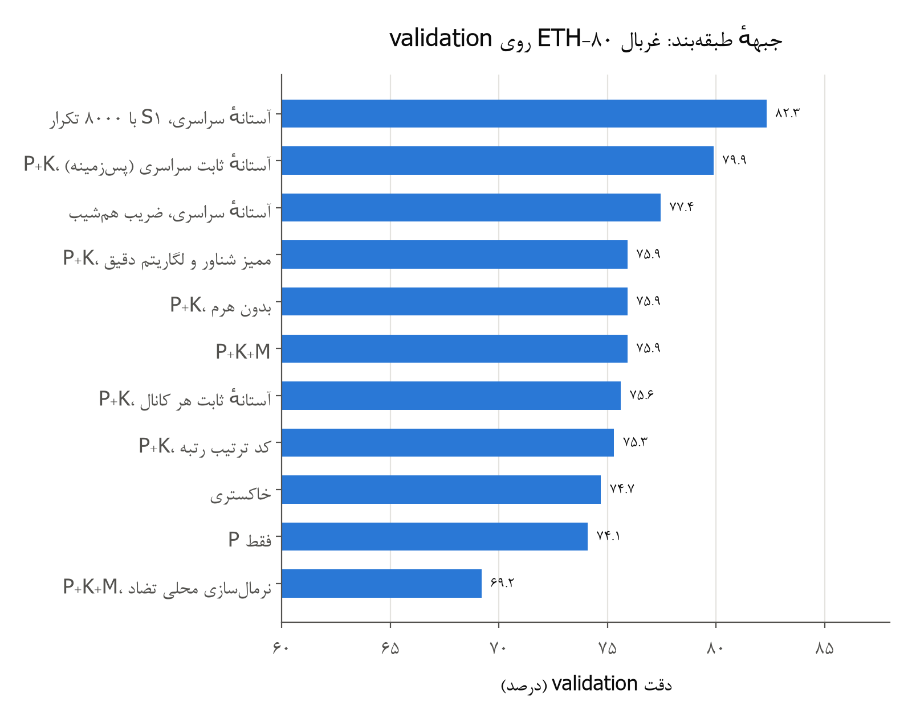

| پیکربندی | کانال‌ها | اسپایک ورودی | خوانش اول (S4، آینه‌سازی) | بهترین خوانش | $C_l$ لایهٔ S1 |
|---|---|---|---|---|---|
| متوازن، کد لگاریتمی، هرم سه‌سطحی | P+K | 8673 | 73.48 | 75.61 | 0.080 |
| همان | خاکستری | 3733 | 71.34 | 74.70 | 0.042 |
| همان | فقط P | 6554 | 71.65 | 74.09 | 0.063 |
| همان | P+K+M | 10729 | 75.00 | **75.91** | 0.070 |
| کد ترتیب رتبه | P+K | 8673 | 75.30 | 75.30 | 0.083 |
| ممیز شناور و لگاریتم دقیق | P+K | 8685 | 72.56 | 75.91 | 0.041 |
| بدون هرم | P+K | 6334 | 71.95 | 75.91 | 0.066 |
| آستانهٔ سراسری | P+K | 14589 | 78.96 | **79.88** | 0.204 |
| آستانهٔ سراسری، ضریب هم‌شیب | P+K | 14589 | 76.52 | 77.44 | 0.183 |
| آستانهٔ سراسری، S1 با 8000 تکرار | P+K | 14589 | 80.49 | **82.32** | — |
| نرمال‌سازی محلی تضاد | P+K+M | 11806 | 69.21 | 69.21 | — |

*جدول: غربال جبههٔ طبقه‌بند (validation، یک seed؛ درصد). بهترین خوانش در بیشتر پیکربندی‌ها پتانسیل S3 و S4 روی شبکهٔ 4×4 بود.*

**یافته‌ها:**
- **حالت بی‌ضرب** با لگاریتم Mitchell و وزن 16 بیتی، با بهترین خوانش، دقیقاً هم‌سطح ممیز شناور بود (75.61 و 75.91).
- **رنگ، هرم و magno** اثرهای کوچکی دارند که از خطای معیار validation (حدود 2.3 درصد) کمترند.
- **آستانهٔ سراسری** بهترین عدد غربال را داد، ولی از سایه‌نمای پس‌زمینه (بخش ۱۰-۱).
- **بودجهٔ 8000 تکرار برای S1** بهترین عدد طبقه‌بند فاز ۱ را داد (82.32). همان روند را تأیید می‌کند که S1 در 3000 تکرار همگرا نشده است (بخش ۵-۲).
- **نرمال‌سازی محلی** در جبههٔ طبقه‌بند هم دقت پایه را کم کرد (69.21)، چون رنگ سطح را حذف می‌کند.

### ۸-۲ آزمون نهایی ETH-80 (تقسیم ۵/۵، سه seed)

| پیکربندی | خوانش | دقت test | اسپایک ورودی |
|---|---|---|---|
| آستانهٔ سراسری، P+K (برگزیدهٔ قاعدهٔ انتخاب؛ مصنوع پس‌زمینه) | S3 و S4، شبکهٔ 4×4 | 78.19 ± 3.08 (78.17، 75.12، 81.28) | حدود 13900 |
| متوازن، خاکستری (کنترل) | S4، آینه‌سازی | 75.02 ± 0.51 (75.18، 74.45، 75.43) | حدود 4680 |
| فاز ۰: DoG خاکستری، 800 نقشه، H-ASIZH | | 84.25 ± 3.49 | |

*جدول: جبههٔ طبقه‌بند روی ETH-80 (test)*

آزمون نهایی شبیه‌ساز متوازن P+K+M (`phase1_bal/final_svm_bal`) پیش از پایان آموزش به دستور کاربر متوقف شد. شبکهٔ فاز ۱ فقط 128 نقشه در IT و 136 هزار وزن دارد، در حالی که شبکهٔ فاز ۰ 800 نقشه داشت. نسخهٔ دو برابر پهن‌تر (`configs/phase1_eth80_big.yaml`) ساخته شد ولی اجرا نشد.

### ۸-۳ ناوردایی طبقه‌بند با نرمال‌سازی محلی (validation)

| تغییر | بدون تغییر | روشنایی ×2 | روشنایی ×4 | گامای 0.5 | گامای 2 | مقیاس 0.7 | مقیاس 1.4 | جابه‌جایی 16 |
|---|---|---|---|---|---|---|---|---|
| دقت | 69.2 | 62.5 | 27.7 | **57.3** | 66.8 | 43.3 | **49.1** | **54.3** |

*جدول: طبقه‌بند با نرمال‌سازی محلی تضاد (ETH-80، validation؛ درصد)*

در جبههٔ طبقه‌بند، نرمال‌سازی محلی هم پایداری نوری را بالا برد (گامای 0.5: 57 درصد در برابر 14 درصد در آزمون نهایی آستانهٔ سراسری) و هم پایداری هندسی را (مقیاس 1.4: 49 درصد در برابر 31 درصد؛ جابه‌جایی 16 پیکسل: 54 درصد در برابر 39 درصد). این تأیید می‌کند که افت هندسی جبههٔ RL از پنجرهٔ تمام‌تصویر لایهٔ تصمیم است، نه از شبیه‌ساز شبکیه.

## ۹. هزینهٔ سخت‌افزاری

### ۹-۱ شمار عمل‌ها با اسپایک‌های واقعی

مقایسهٔ شبکهٔ اسپایکی رویدادمحور با همان شبکه در محاسبهٔ متراکم. اعداد برای هر تصویر و روی سه سطح هرم هستند. SOP یک جمع است و MAC یک ضرب‌وجمع:

| پیکربندی | SOP رویدادمحور (میلیون) | MAC متراکم (میلیون) | نسبت |
|---|---|---|---|
| P+K، آستانهٔ سراسری | 12.39 | 183.9 | 14.8 |
| P+K، متوازن | 8.01 | 183.9 | 23.0 |
| خاکستری، متوازن | 8.10 | 158.1 | 19.5 |
| P+K+M، متوازن | 8.26 | 196.8 | 23.8 |

*جدول: هزینهٔ محاسبهٔ مسیر شکمی برای هر تصویر*

**برآورد انرژی محاسبه:** طبق جدول Horowitz (ISSCC 2014، فناوری 45 نانومتر)، یک جمع صحیح 32 بیتی حدود 0.1 پیکوژول است. یک ضرب‌وجمع 16 بیتی حدود 0.9 پیکوژول است (درون‌یابی بین ضرب 8 بیتی 0.2 و 32 بیتی 3.1 پیکوژول). پس هر عمل رویدادمحور حدود 9 برابر کم‌مصرف‌تر است، و با نسبت تعداد عمل‌ها، انرژی محاسبه حدود دو مرتبهٔ بزرگی کمتر می‌شود. این برآورد دسترسی به حافظه را در نظر نمی‌گیرد.

### ۹-۲ ابعاد

- **وزن‌ها:** مسیر شکمی 136 تا 137 هزار وزن 16 بیتی دارد، یعنی حدود 270 کیلوبایت. لایهٔ تصمیم RL روی C1 با پنجرهٔ 16×16×12 و 80 نقشه 246 هزار وزن دارد، یعنی بیشتر از کل مسیر شکمی. پنجرهٔ 32 این عدد را چهار برابر می‌کند و پنجرهٔ کانولوشنی 12 آن را به 138 هزار کم می‌کند.
- **انباشتگرها:** 24 تا 29 بیت، طبق جدول بخش ۵-۶. هرگز سرریز نمی‌شوند.
- **سرعت شبیه‌سازی:** آموزش S1 تا S4 روی GPU لپ‌تاپ 7 تا 14 دقیقه طول کشید و یک اجرای RL کامل (80 epoch) حدود 25 دقیقه.

## ۱۰. نقطه‌های خطا: یافته‌ها، تحلیل و رفع

### ۱۰-۱ کانال K و پس‌زمینهٔ آبی ETH-80

بهترین پیکربندی غربال طبقه‌بند (آستانهٔ سراسری) با قاعدهٔ انتخاب به آزمون نهایی رفت و 78.19 درصد گرفت. شکل نمونهٔ شبیه‌ساز شبکیه علت این دقت را نشان داد:

| دیتاست و شبیه‌ساز شبکیه | اسپایک ورودی هر تصویر (سطح 128) | P (چهار کانال) | K ON | K OFF |
|---|---|---|---|---|
| ETH-80، آستانهٔ سراسری | 10802 | 2.2 درصد | **97.7 درصد** | 0.2 درصد |
| ETH-80، متوازن | 7440 | 68.2 درصد | 15.2 درصد | 16.4 درصد |
| Caltech، آستانهٔ سراسری | **643** | 74.9 درصد | 7.3 درصد | 17.8 درصد |
| Caltech، متوازن | 6533 | 66.2 درصد | 13.1 درصد | 20.6 درصد |

*جدول: سهم کانال‌ها از اسپایک‌های ورودی (60 تصویر از هر دیتاست)*

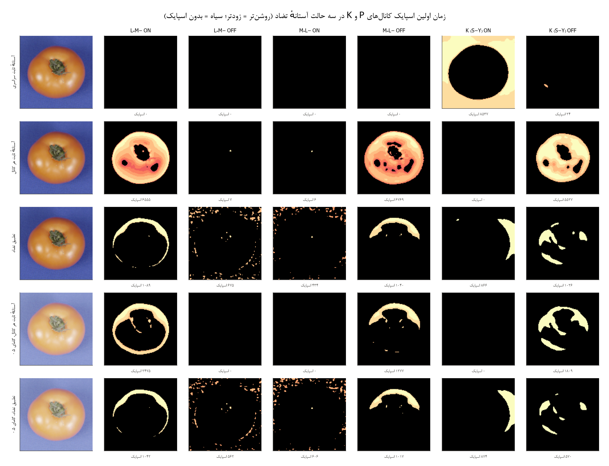

**تحلیل:** پس‌زمینهٔ همهٔ تصویرهای ETH-80 آبی یکنواخت است. در این پس‌زمینه $S-Y$ بزرگ و $Y$ کم است، پس پاسخ نرمال‌شدهٔ K ON از هر کانال دیگری قوی‌تر است. وقتی همهٔ کانال‌ها یک $\ell_{max}$ و یک آستانه دارند، K ON همهٔ زمان‌های زودرس را می‌گیرد. کد حاصل سایه‌نمای شیء روی پس‌زمینه است، که برای ETH-80 اطلاعات شکل خوبی دارد ولی در تصویرهای طبیعی کار نمی‌کند (Caltech: 643 اسپایک و دقت RL برابر 55 درصد). **تصمیم D27:** این پیکربندی از معماری کنار گذاشته شد و عددش صادقانه گزارش شد.

### ۱۰-۲ آستانهٔ سراسری و کانال خاکستری

اولین مقایسهٔ رنگ و خاکستری با آستانهٔ سراسری انجام شد. کانال خاکستری فقط حدود 4 اسپایک در هر تصویر داشت و دقت 24.7 درصد گرفت. این مقایسه منصفانه نبود و با آستانه‌های جدای هر کانال تکرار شد.

### ۱۰-۳ شکنندگی آستانهٔ ثابت در برابر گاما

آستانهٔ ثابت فقط در برابر ضرب روشنایی ناورداست. گاما دامنهٔ تضاد را تغییر می‌دهد. روی 30 تصویر، گامای 0.5 تعداد اسپایک‌ها را از 6881 به 349 رساند و گامای 2 به 40216. دقت RL با گامای 0.5 به 11.5 درصد افتاد.
- **رفع اول، تطبیق تضاد سراسری (D28):** گاما را حل کرد، ولی دقت پایه و تحمل هندسی را کم کرد.
- **رفع دوم، نرمال‌سازی محلی تضاد (D29):** گاما را بهتر حل کرد و کد ورودی را در برابر جابه‌جایی دقیقاً حفظ کرد. افت هندسی باقی‌مانده از لایهٔ تصمیم است (بخش ۷-۵).

### ۱۰-۴ خطاهای ریاضی سند طرح

| مورد | سند طرح | مقدار درست | آزمون واحد |
|---|---|---|---|
| کران ناوردایی روشنایی با Mitchell | 0.0861 اکتاو | 0.172 اکتاو (خطای صورت و مخرج در دو جهت مخالف) | `test_brightness_invariance_…` |
| کران جابه‌جایی زمان اسپایک | یک گام | $\lceil 0.344/\Delta \rceil$ گام: یک گام با $\Delta=1/2$، دو گام با $\Delta=1/4$ (پیکربندی نهایی) | `test_latency_shift_bound_…` |
| سرعت همگرایی STDP بی‌ضرب | بررسی نشده | ضریب هم‌قله نزدیک مرزها دو برابر کندتر است | `test_slope_matched_soft_bound_…` |

### ۱۰-۵ خطاهای اجرا و تنظیم

| خطا | نشانه | علت | رفع |
|---|---|---|---|
| ورودی پرتراکم | نیمی از یاخته‌ها اسپایک می‌زدند | نبود آستانهٔ تضاد | آستانهٔ تضاد (بخش ۳-۵) |
| کف H-ASIZH | S1 خاموش شد | $\theta \ge \theta_0$، ولی پتانسیل‌ها بعد از STDP کم می‌شوند | هموستازی دوطرفهٔ نرخ (بخش ۵-۵) |
| نرخ‌های توان دو | $a^+ = a^-$ و ویژگی‌های بی‌کیفیت | 0.004 و 0.003 هر دو به $2^{-8}$ گرد می‌شوند | دو توان دو (بخش ۵-۴) |
| کلید ناشناختهٔ magno | خطای اجرا | نام کلیدهای سند طرح با تابع یکی نبود | نگاشت کلیدها در اجراکننده |
| شش اجرای کنترل Caltech | شکست با `TypeError` | پیکربندی Caltech کلید `train_instances` را از پیکربندی پایهٔ ETH-80 به ارث می‌برد | بارگذار فقط کلیدهای پذیرفتنی خودش را می‌گیرد |
| آموزش ناکامل لایهٔ تصمیم | epoch انتخاب‌شده = epoch آخر | 80 epoch کافی نیست | 150 epoch (بخش ۷-۱) |
| شماره‌گذاری فهرست‌ها در Word | شمارهٔ فهرست‌ها از یک فهرست به فهرست بعد ادامه پیدا می‌کرد | یک شماره‌گذاری برای همهٔ فهرست‌ها | هر فهرست شماره‌گذاری خودش را دارد |

*جدول: خطاهای اجرا و تنظیم در فاز ۱*

## ۱۱. وضعیت معماری فاز ۱ و کارهای ناتمام

### ۱۱-۱ بهترین پیکربندی هر جبهه تا این لحظه

**جبههٔ RL (اصلی):**
- **شبیه‌ساز شبکیه:** متوازن، یعنی آستانهٔ تضاد ثابت هر کانال برای حدود 7 درصد اسپایک و مرجع زمان جدا برای هر کانال، با کانال‌های P+K یا فقط magno. فیلترهای دوجمله‌ای، لگاریتم Mitchell، $\Delta = 1/4$ و $T = 15$. هرم سه‌سطحی برای آموزش S1، و فقط سطح 128 برای تصمیم.
- **V1:** S1 با 12 نقشهٔ 5×5، STDP بی‌ضرب (نرخ‌های CSD، ضریب هم‌قله، وزن 16 بیتی)، k-WTA با شعاع 2، هموستازی دوطرفهٔ نرخ و آستانهٔ خودکار 5 درصد. سپس C1 (2×2) و pooling 4×4.
- **تصمیم:** R-STDP اولین اسپایک، 10 نقشه برای هر دسته، پنجرهٔ 16×16، نرخ تطبیقی کلسیمی نورون‌به‌نورون با $\lambda = 0.9$ و dropout برابر 0.4.
- **نتیجه:** ETH-80 test 72.86 ± 2.22 درصد؛ Caltech چهاردسته‌ای (خاکستری) test 89.42 ± 1.18 درصد.

**جبههٔ طبقه‌بند:** شبیه‌ساز متوازن P+K+M، چهار لایه تا IT، و SVM روی S3 و S4 در شبکهٔ 4×4. بهترین عدد validation 75.91 بود. با آستانهٔ سراسری و S1 طولانی 82.32 شد، ولی آن عدد از مصنوع پس‌زمینه است.

**شبیه‌ساز پیشنهادی برای ادامه:** نرمال‌سازی محلی تضاد برای پایداری نوری، به‌علاوهٔ یکی از دو راه زیر برای حفظ دقت پایه و تحمل هندسی:
1. شبیه‌ساز دومسیره: کانال‌های رنگ سطح و کانال‌های لبه با هم.
2. لایهٔ تصمیم کانولوشنی: تحمل مکانی مثل IT.

### ۱۱-۲ اجراهای قطع‌شده و برنامه‌ریزی‌شده

| کمپین و اجرا | وضعیت | آخرین عدد |
|---|---|---|
| `phase1_bal/final_svm_bal` (P+K+M متوازن، test) | قطع پس از آموزش S4 | — |
| `phase1_adapt/a_rl_adapt` (تطبیق بدون کف) | قطع در epoch 60 | 64.33 |
| `phase1_adapt2/a_svm_adapt_f2` | قطع پس از آموزش S4 | — |
| `phase1_v2b/r2_lcn7_k12_flip150` (تصمیم کانولوشنی) | قطع در epoch 90 از 150 | 62.50 |
| `phase1_v2b/r2_base_k12_flip150` | اجرا نشد | — |
| `phase1_v2c` (شبیه‌ساز دومسیره، سه اجرا) | اجرا نشد | — |
| `phase1_v2` (S1 با 24 نقشه، شبکهٔ پهن‌تر، پایهٔ طبقه‌بند) | اجرا نشد | — |
| `phase1_mag/m_eth_rl` (فقط magno روی ETH-80) | تمام تا epoch 80؛ ناوردایی تا مقیاس 0.7 | 71.95 |
| `phase1_mag/m_eth_svm` | اجرا نشد | — |

### ۱۱-۳ گام‌های بعدی پیشنهادی (به ترتیب اولویت)

1. **آزمون نهایی جبههٔ RL با پروتکل Mozafari:** leave-one-out با ده دور، روی بهترین پیکربندی‌ها (P+K متوازن و فقط magno). این تنها مقایسهٔ مستقیم با عدد 89.5 درصد مقاله است.
2. **تکمیل غربال‌های قطع‌شده:** شبیه‌ساز دومسیره و لایهٔ تصمیم کانولوشنی، با آزمون ناوردایی.
3. **نرمال‌سازی محلی برای کانال magno:** تقسیم آستانهٔ رویداد بر انرژی تغییرهای محلی، برای پایداری کد رویدادی در برابر گاما.
4. **S1 با 8000 تکرار و لایهٔ تصمیم با 150 epoch:** هر دو در غربال نشانهٔ بهبود داشتند.
5. **یادگیری از پیوستگی زمانی:** STDP با رد زمانی روی 41 نمای پشت‌سرهم هر شیء ETH-80، شبیه قاعدهٔ trace (Földiák 1991)، برای ناوردایی به زاویهٔ دید.
6. **ساختن گزارش Word نهایی فاز ۱** و بستن دروازهٔ ۱ با تأیید کاربر.

## ۱۲. جمع‌بندی فاز ۱

فاز ۱ شبیه‌ساز شبکیهٔ سه‌کانالهٔ سخت‌افزارآگاه و مسیر شکمی رنگی تا IT را ساخت. **بخش‌های موفق:**
- **سخت‌افزار:** هر جزء فقط با جمع، shift، مقایسه و شمارنده ساخته شد، بی‌آنکه دقتی از دست برود.
- **ریاضی:** کران‌ها اثبات شدند و برای هر کدام آزمون واحد نوشته شد.
- **خطاهای پنهان:** سه خطای پنهان (مصنوع کانال K، شکنندگی گاما، کران‌های غلط سند طرح) با آزمون‌های کنترل و ناوردایی پیدا شدند.
- **راه‌حل‌ها:** نرمال‌سازی محلی تضاد شکنندگی نوری را حل کرد. کانال magno نشان داد که کد رویدادی با یک‌چهارم اسپایک همان دقت را می‌دهد.

**بخش‌های ناتمام:**
- **هدف 85 درصد:** روی Caltech برآورده شد، ولی روی ETH-80 هنوز نه.
- **پایداری هندسی:** با کد لبه‌ای، تحمل هندسی لایهٔ تصمیم هنوز ضعیف است.
- **آزمون‌های نهایی نسخهٔ دوم:** هنوز اجرا نشده‌اند.


---

# بخش ۵. دفتر تصمیم‌ها، بازتولید، نقشهٔ فایل‌ها و جزئیات انتشار

## ۵-۱ دفتر تصمیم‌ها (خلاصهٔ فارسی؛ متن کامل انگلیسی در `code/biovision-snn/DECISIONS.md`)

| شماره | تصمیم |
|---|---|
| D1 تا D8 | راه‌اندازی سرور HPC دانشگاه (kut، 14 هسته، بدون GPU و بدون اینترنت)، بودجهٔ دیسک 60 گیگابایت، Git Bash روی لپ‌تاپ، ورود SSH فقط با کلید، Miniforge و Python 3.14، اجرا با tmux |
| D9 تا D13 | ساختار مخزن، نسخهٔ ثابت SpykeTorch برای مقایسه، دانلود همهٔ داده روی لپ‌تاپ و انتقال بعدی، فهرست بسته‌ها، دیتاست‌های آماده‌شده |
| D14 و D15 | استفاده از GPU لپ‌تاپ (RTX 3050، 4 گیگابایت). به تصمیم کاربر همهٔ فازها روی لپ‌تاپ اجرا می‌شوند و HPC پشتیبان اختیاری است |
| D16 | تنظیمات بازتولید فاز ۰: مقدارهای مقاله، و انتخاب ما هر جا مقاله ساکت است |
| D17 | بهبودهای فاز ۰ و پروتکل صادقانه: انتخاب فقط روی validation؛ test با پروتکل خود هر مقاله |
| D18 | نورون LIF (ایدهٔ کاربر) آزموده شد و برای تصویرهای ایستا پذیرفته نشد (Caltech: از 98.8 به 75 تا 80 درصد) |
| D19 | روش‌های مقالهٔ ۲۰۱۶ (چندمقیاسی، برنامهٔ نرخ، 600 به‌روزرسانی) و امتیازدهی چندخوانشی |
| D20 | SDSP با دروازهٔ کلسیمی و R-STDP کلسیمی (درخواست کاربر) |
| D21 | دینامیک آستانهٔ H-ASIZH (مقالهٔ کاربر) در TTFS، سرعت، حل‌کنندهٔ SVM، پروتکل‌ها و کمپین‌ها |
| D22 | دو جبهه: یادگیری تقویتی جبههٔ اصلی است؛ حالت محاسبهٔ فقط shift و add (تصمیم کاربر) |
| D23 | جبههٔ RL نسخهٔ ۲: شبکهٔ Mozafari پایه شد؛ R-SDSP؛ ورودی پرتراکم لایهٔ تصمیم |
| D24 | R-STDP توجه‌محور برای لایهٔ پنهان (AGREL در TTFS)، از فاز ۰ شروع شد |
| D25 | بستن سریع فاز ۰ به دستور کاربر |
| D26 | طراحی سخت‌افزارآگاه فاز ۱: فیلتر دوجمله‌ای، لگاریتم Mitchell، نرمال‌سازی با تفریق، کد تأخیر با shift، هرم گام 2، magno، نرخ CSD، هموستازی نرخ؛ تصویر 128 برای بودجهٔ 24 ساعته |
| D27 | آستانهٔ سراسری پس‌زمینهٔ ETH-80 را کد می‌کند؛ شبیه‌ساز متوازن برای آزمون‌های نهایی؛ رفع خطای بارگذار Caltech؛ ضریب هم‌شیب؛ اصلاح کران‌های سند طرح |
| D28 | تطبیق تضاد هر تصویر در شبیه‌ساز شبکیه، با کف دو اکتاو |
| D29 | نسخهٔ دوم فاز ۱ (درخواست کاربر: «سیستمی بهتر از چشم»): نرمال‌سازی محلی تضاد، آینه‌سازی، 150 epoch، شبکهٔ پهن‌تر، شبیه‌ساز دومسیره و فقط magno |

## ۵-۲ بازتولید

**محیط:** Python 3.12 روی ویندوز با PyTorch 2.14 و CUDA 12.6 (نسخهٔ دقیق بسته‌ها در `env/requirements-lock-laptop.txt`). دیتاست‌ها با `biovision/data/prepare_phase0.py` در پوشهٔ `work/proc` آماده می‌شوند.

یک آزمایش:
```
python -m biovision.experiments.phase0 --config configs/phase1_eth80_rlc1.yaml --seed 0 \
    --set validation.instances=1 --set "rstdp.calcium={lam: 0.9}"
```

یک کمپین (قابل ازسرگیری):
```
python tools/campaign.py campaigns/phase1_main.yaml
```

جدول همهٔ اجراها، شکل‌ها و گزارش‌ها:
```
python tools/collect_all_runs.py
python tools/phase1_figures.py
python tools/build_phase1_report.py
```

آزمون‌های واحد:
```
python -m pytest -q
```

**هر عدد این سند** از یک ردیف `results/all_runs.csv` می‌آید. هر ردیف ستون‌های `campaign`، `stage`، `group` و `run` دارد که مسیر پوشهٔ اجرا در `code/biovision-snn-runs/` را می‌سازند. در آن پوشه `cmd.json` دستور دقیق اجرا، `log.txt` لاگ کامل، `metrics.json` همهٔ سنجه‌ها و `campaign.log` کمپین ترتیب رویدادها را دارند.

## ۵-۳ نقشهٔ فایل‌ها

| مسیر در این مخزن | محتوا |
|---|---|
| `code/biovision-snn/biovision/` | بستهٔ پایتون (بخش ۱) |
| `code/biovision-snn/configs/`، `campaigns/` | همهٔ پیکربندی‌ها و کمپین‌های فاز ۰ و ۱ |
| `code/biovision-snn/tests/` | 108 آزمون واحد |
| `code/biovision-snn/tools/` | اجراکنندهٔ کمپین، شکل‌ها، سازندهٔ Word، جمع‌آوری نتیجه‌ها |
| `code/biovision-snn/docs/` | سند طرح فاز ۱ (`phase1_design_fa.md`)، مرور قاعده‌های یادگیری، تحلیل مقاله‌ها |
| `code/biovision-snn/reports/phase0/` | گزارش Word نهایی فاز ۰، متن منبع، شکل‌ها، `numbers.json`، `results_all.csv`، `REPORT.md` |
| `code/biovision-snn/reports/phase1/` | متن منبع گزارش فاز ۱ (روش‌ها، نتیجه‌ها)، شکل‌ها، پیش‌نویس Word |
| `code/biovision-snn/results/` | `all_runs.csv` (136 اجرا) و `invariance.csv` |
| `code/biovision-snn/CLAUDE_BioVision.md` | دستورالعمل پروژه (بخش ۵-۴) |
| `code/biovision-snn-runs/<campaign>/` | سوابق خام همهٔ اجراهای 19 کمپین |

## ۵-۴ جزئیات انتشار

- **مبنای snapshot:** پوشهٔ `code/biovision-snn/` کپی درخت کاری مخزن پروژه روی شاخهٔ `phase-1` است. پیش از کپی، همهٔ تغییرهای آخرین جلسه در مخزن کاری commit شدند. شناسهٔ commit در `code/biovision-snn/SNAPSHOT.md` آمده است.
- **CLAUDE.md:** در مخزن کاری نام این فایل `CLAUDE.md` است. اینجا به `CLAUDE_BioVision.md` تغییر نام داده شد تا طبق یادداشت 18 دستورالعمل جلسه‌های کاری روی این مخزن نشود.
- **کتابخانه‌های بیرونی:** پوشهٔ `third_party/` مخزن کاری (SpykeTorch و psee_loader) منتشر نشد. این‌ها کد ما نیستند و کد ما آن‌ها را import نمی‌کند. فقط پیاده‌سازی SpykeTorch برای مقایسه خوانده شد. نشانی آن‌ها در `SNAPSHOT.md` آمده است.
- **اطلاعات سرور:** این مخزن عمومی است. برای همین فایل فهرست سرویس‌ها و درگاه‌های باز سرور دانشگاه (`docs/hpc_inventory.txt`) منتشر نشد، و نشانی IP داخلی سرور در `DECISIONS.md` و `tools/hpc.env` با `<HPC-IP>` جایگزین شد. هیچ رمز یا کلیدی در کد نبود.
- **داده و وزن‌ها:** دیتاست‌ها (به دلیل حجم و مجوز)، وزن‌های آموزش‌دیده (236 فایل `.pt`) و شکل‌های هر اجرا (304 فایل) منتشر نشدند. همهٔ عددها و لاگ‌ها منتشر شدند.
