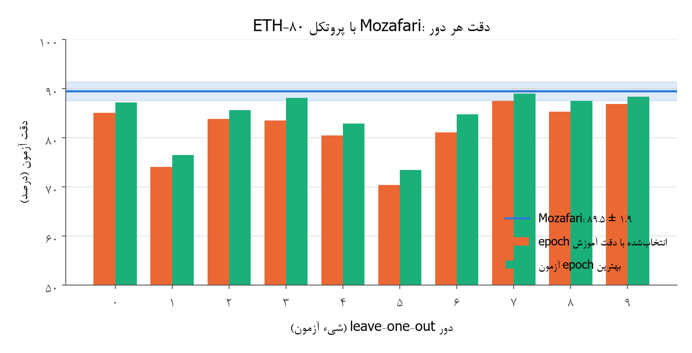
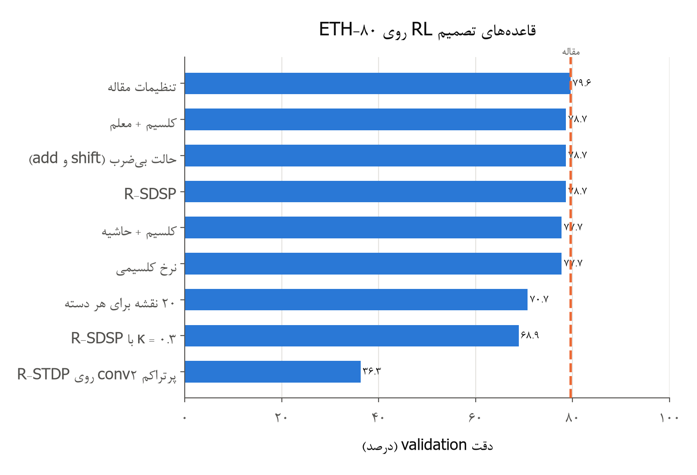
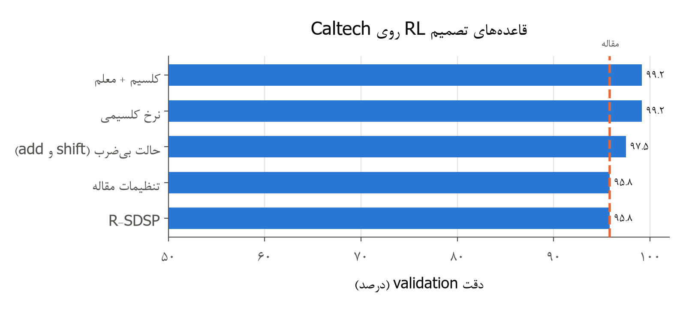
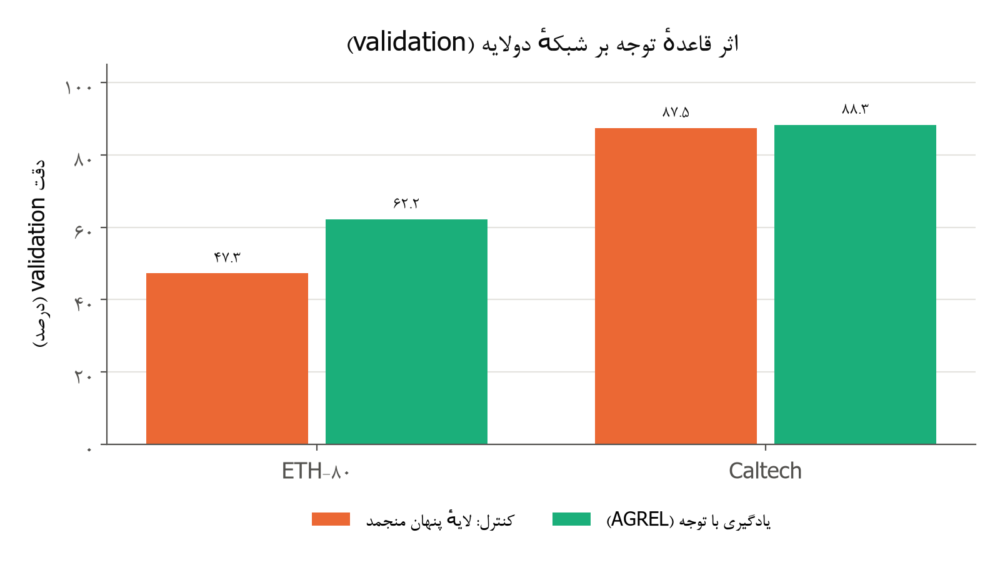
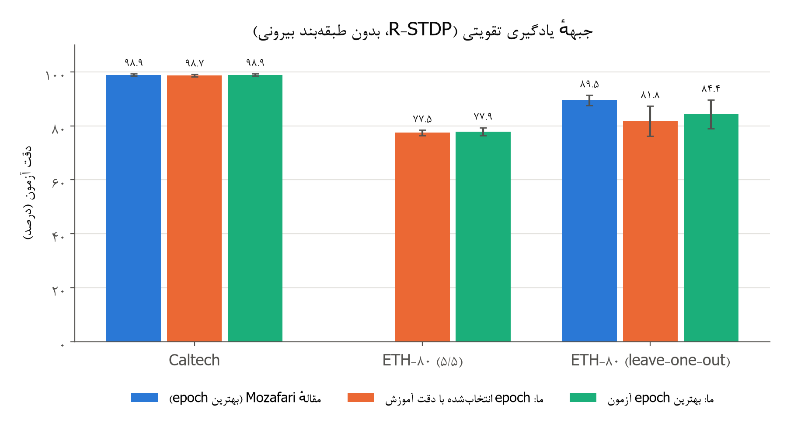
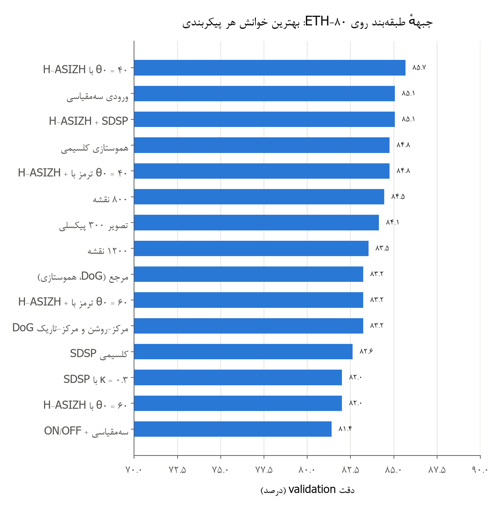
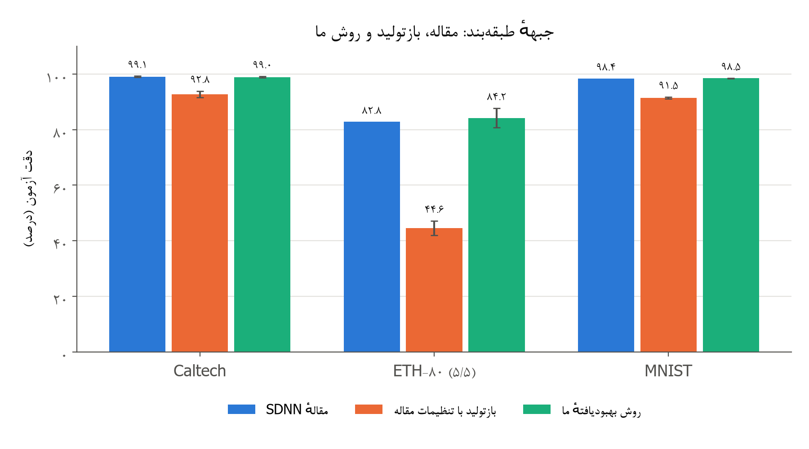
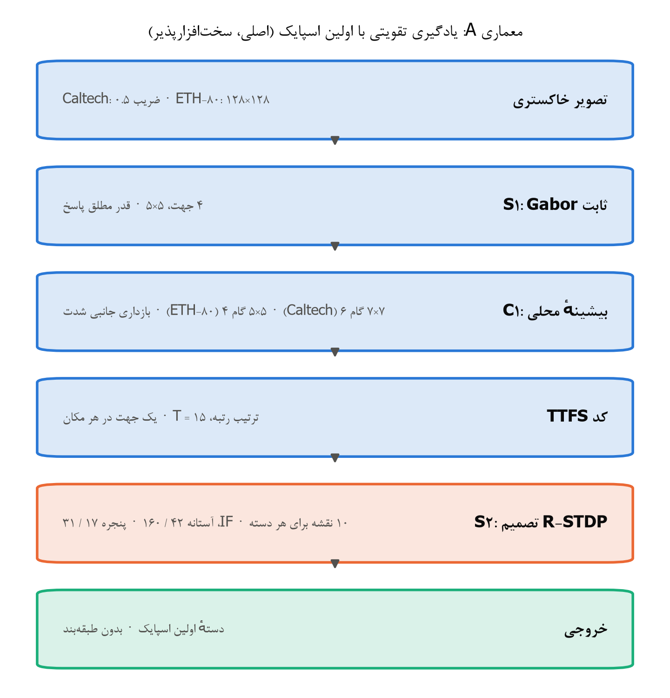
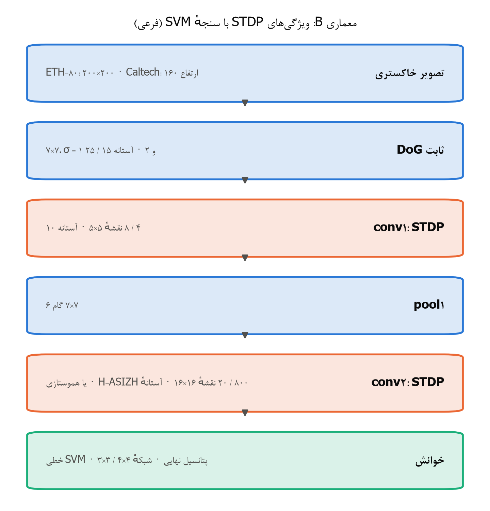

گزارش فاز ۰ پروژه‌ی BioVision‑SNN

بازتولید و بهبود شبکه‌های اسپایکی تیم خردپیشه و گنج‌تابش

یادگیری تقویتی سخت‌افزارپذیر، قاعده‌های کلسیمی و قاعده‌ی توجه

**فهرست مطالب**

[۱. خلاصه 5](#خلاصه)

[۲. هدف فاز ۰ و جایگاه آن در طرح BioVision‑SNN
6](#هدف-فاز-۰-و-جایگاه-آن-در-طرح-biovisionsnn)

[۳. سه مقاله‌ی مبنا و سازوکارهای مشترک آن‌ها
6](#سه-مقالهی-مبنا-و-سازوکارهای-مشترک-آنها)

[۳-۱ مقاله‌ی ۲۰۱۶: یادگیری بدون نظارت ویژگی‌ها با ورودی چندمقیاسی
6](#مقالهی-۲۰۱۶-یادگیری-بدون-نظارت-ویژگیها-با-ورودی-چندمقیاسی)

[۳-۲ مقاله‌ی ۲۰۱۸: شبکه‌ی عمیق کانولوشنی اسپایکی با STDP
(SDNN)
7](#مقالهی-۲۰۱۸-شبکهی-عمیق-کانولوشنی-اسپایکی-با-stdp-sdnn)

[۳-۳ مقاله‌ی Mozafari و همکاران ۲۰۱۸: دسته‌بندی با اولین
اسپایک و R‑STDP
7](#مقالهی-mozafari-و-همکاران-۲۰۱۸-دستهبندی-با-اولین-اسپایک-و-rstdp)

[۳-۴ سازوکارهای مشترک سه مقاله و وضعیت آن‌ها در پیاده‌سازی ما
8](#سازوکارهای-مشترک-سه-مقاله-و-وضعیت-آنها-در-پیادهسازی-ما)

[۴. مدل ریاضی و فرمول‌ها 8](#مدل-ریاضی-و-فرمولها)

[۴-۱ ورودی: فیلتر DoG و فیلتر Gabor
8](#ورودی-فیلتر-dog-و-فیلتر-gabor)

[۴-۲ تبدیل شدت به تأخیر و کدگذاری ترتیب رتبه
9](#تبدیل-شدت-به-تأخیر-و-کدگذاری-ترتیب-رتبه)

[۴-۳ نورون IF، بازداری جانبی و pooling
9](#نورون-if-بازداری-جانبی-و-pooling)

[۴-۴ یادگیری STDP مسطح و شاخص همگرایی
10](#یادگیری-stdp-مسطح-و-شاخص-همگرایی)

[۴-۵ برنامه‌ی نرخ یادگیری و توقف یادگیری در مقاله‌ی ۲۰۱۶
10](#برنامهی-نرخ-یادگیری-و-توقف-یادگیری-در-مقالهی-۲۰۱۶)

[۴-۶ خوانش و طبقه‌بند 11](#خوانش-و-طبقهبند)

[۴-۷ یادگیری تقویتی R‑STDP، نرخ تطبیقی و
dropout 11](#یادگیری-تقویتی-rstdp-نرخ-تطبیقی-و-dropout)

[۴-۸ سازوکارهای تازه‌ی ما: هموستازی، آستانه‌ی
H‑ASIZH، SDSP کلسیمی و R‑STDP کلسیمی
12](#سازوکارهای-تازهی-ما-هموستازی-آستانهی-hasizh-sdsp-کلسیمی-و-rstdp-کلسیمی)

[۴-۹ حالت سخت‌افزاری: یادگیری فقط با shift و
add 14](#حالت-سختافزاری-یادگیری-فقط-با-shift-و-add)

[۴-۱۰ قاعده‌ی توجه: یادگیری تقویتی لایه‌ی پنهان (AGREL
برای TTFS)
15](#قاعدهی-توجه-یادگیری-تقویتی-لایهی-پنهان-agrel-برای-ttfs)

[۵. پیاده‌سازی و درستی‌سنجی 15](#پیادهسازی-و-درستیسنجی)

[۶. پروتکل ارزیابی و cross‑validation
16](#پروتکل-ارزیابی-و-crossvalidation)

[۷. مرور قاعده‌های یادگیری زیستی
17](#مرور-قاعدههای-یادگیری-زیستی)

[۷-۱ جدول مقایسه 17](#جدول-مقایسه)

[۷-۲ نتیجه‌گیری برای پروژه 19](#نتیجهگیری-برای-پروژه)

[۷-۳ منابع 19](#منابع)

[۸. جبهه‌ی اول (اصلی): یادگیری تقویتی بدون طبقه‌بند بیرونی
20](#جبههی-اول-اصلی-یادگیری-تقویتی-بدون-طبقهبند-بیرونی)

[۸-۱ بازتولید شبکه‌ی Mozafari
20](#بازتولید-شبکهی-mozafari)

[۸-۲ قاعده‌های تازه‌ی تصمیم روی validation
22](#قاعدههای-تازهی-تصمیم-روی-validation)

[۸-۳ هزینه‌ی حالت سخت‌افزاری بی‌ضرب
24](#هزینهی-حالت-سختافزاری-بیضرب)

[۸-۴ قاعده‌ی توجه (AGREL): یادگیری تقویتی لایه‌ی پنهان
24](#قاعدهی-توجه-agrel-یادگیری-تقویتی-لایهی-پنهان)

[۸-۵ معماری برگزیده‌ی جبهه‌ی RL
26](#معماری-برگزیدهی-جبههی-rl)

[۹. جبهه‌ی دوم: طبقه‌بند SVM و KNN
27](#جبههی-دوم-طبقهبند-svm-و-knn)

[۹-۱ بازتولید با تنظیمات مقاله‌ها
27](#بازتولید-با-تنظیمات-مقالهها)

[۹-۲ بهبودها و دلیل هر کدام 28](#بهبودها-و-دلیل-هر-کدام)

[۹-۳ نتیجه‌ی منفی: نورون LIF
30](#نتیجهی-منفی-نورون-lif)

[۱۰. هزینه‌ی محاسبه: اسپایک، وزن و سرعت
30](#هزینهی-محاسبه-اسپایک-وزن-و-سرعت)

[۱۱. معماری‌های نهایی برگزیده: جمع‌بندی ۱۴۱ آزمایش
31](#معماریهای-نهایی-برگزیده-جمعبندی-۱۴۱-آزمایش)

[۱۱-۱ دو معیار طراحی: وفاداری زیستی و سخت‌افزار بی‌ضرب
31](#دو-معیار-طراحی-وفاداری-زیستی-و-سختافزار-بیضرب)

[۱۱-۲ دفتر ویژگی‌ها: از مقاله‌ها، افزوده‌های ما و کنار گذاشته‌ها
32](#دفتر-ویژگیها-از-مقالهها-افزودههای-ما-و-کنار-گذاشتهها)

[۱۱-۳ معماری A (اصلی): یادگیری تقویتی با اولین اسپایک
33](#معماری-a-اصلی-یادگیری-تقویتی-با-اولین-اسپایک)

[۱۱-۴ معماری B (فرعی): ویژگی‌های STDP با
سنجه‌ی SVM
35](#معماری-b-فرعی-ویژگیهای-stdp-با-سنجهی-svm)

[۱۱-۵ معماری پیشنهادی برای شروع فاز ۱
37](#معماری-پیشنهادی-برای-شروع-فاز-۱)

[۱۲. جمع‌بندی، محدودیت‌ها و دروازه‌ی ۰
37](#جمعبندی-محدودیتها-و-دروازهی-۰)

[منابع و مسیر نتیجه‌ها 38](#منابع-و-مسیر-نتیجهها)

# ۱. خلاصه

در فاز ۰ پروژه‌ی BioVision‑SNN سه مقاله‌ی تیم خردپیشه و
گنج‌تابش با ماژول‌های خودمان بازتولید شدند:

-   Kheradpisheh و همکاران ۲۰۱۶، با ورودی چندمقیاسی و
    STDP؛

-   Kheradpisheh و همکاران ۲۰۱۸، شبکه‌ی SDNN؛

-   Mozafari و همکاران ۲۰۱۸، با تصمیم اولین اسپایک و
    R‑STDP.

بعد از بازتولید، سازوکارهای تازه‌ای برای بهتر کردن این شبکه‌ها آزموده
شدند. کار در دو جبهه انجام شد. جبهه‌ی اصلی یادگیری تقویتی بدون طبقه‌بند
بیرونی است، چون هدف نهایی تراشه‌ای است که فقط با shift
و add یاد می‌گیرد. جبهه‌ی دوم سنجش ویژگی‌ها با
SVM است، به روش مقاله‌های SDNN و ۲۰۱۶. همه‌ی انتخاب‌ها فقط
روی validation انجام شد و هر عدد نهایی با پروتکل همان
مقاله‌ای که با آن مقایسه می‌شود روی test سنجیده
شد.

**جدول ۱: خلاصه‌ی نتیجه‌های نهایی (دقت آزمون، درصد؛ میانگین ± انحراف
معیار)**

  ------------------------------------------------------------------------------------------------------------
  **جبهه و دیتاست**         **عدد                **بازتولید با        **روش برگزیده‌ی
                                         مقاله**   تنظیمات               ما**
                                                               مقاله**   
  -------------------------------------- --------------------- --------------------- -------------------------
  یادگیری تقویتی: Caltech   [۹۸٫۹ ±               ۹۸٫۵۱ ± ۰٫۶۴         ۹۸٫۶۵ ± ۰٫۴۹
  (Mozafari)   ۰٫۴       (بهترین   (]epoch
                                                               epoch)   انتخاب‌شده)؛ ۹۸٫۹۴ ± ۰٫۳۷
                                                                                     (بهترین
                                                                                     epoch)

  یادگیری تقویتی:           [۸۹٫۵ ±               ۸۴٫۳۶ ± ۵٫۳۱         همان تنظیمات مقاله برنده
  ETH‑80، leave‑one‑out     ۱٫۹       (بهترین   شد؛ ۸۱٫۸۳ ± ۵٫۵۸
  (Mozafari)                         epoch)   (]epoch
                                                                                     انتخاب‌شده)

  طبقه‌بند: Caltech          ۹۹٫۱ ±               ۹۲٫۸۰ ±              ۹۸٫۹۶ ± ۰٫۲۵
  (SDNN)       ۰٫۲       ۱٫۱۵      

  طبقه‌بند: MNIST            ۹۸٫۴     ۹۱٫۴۶ ±              ۹۸٫۵۲ ± ۰٫۰۶
  (SDNN)                             ۰٫۳۶      

  طبقه‌بند: ETH‑80، ۵/۵     ۸۲٫۸     ۴۴٫۵۵ ±              ۸۴٫۲۵ ± ۳٫۴۹
  (SDNN)                              ۲٫۶۰      
  ------------------------------------------------------------------------------------------------------------

مهم‌ترین یافته‌ها:

-   **حالت بی‌ضرب:** یادگیری فقط با shift و add
    (حالت سخت‌افزاری) دقت لایه‌ی تصمیم را تقریباً تغییر نمی‌دهد.
    روی ETH‑80 فقط ۰٫۹ درصد کم کرد و روی
    Caltech 1.7 درصد هم اضافه کرد.

-   **نرخ کلسیمی:** نرخ تطبیقی کلسیمی نورون‌به‌نورون، که قاعده‌ی تازه‌ی ما
    و برگرفته از سازوکار کلسیم در مقاله‌ی H‑ASIZH
    است، Caltech را روی validation 3.3 درصد
    بهتر کرد. در آزمون نهایی هم با عدد Mozafari برابر
    شد.

-   **قاعده‌ی توجه:** قاعده‌ی توجه (AGREL) با خطای پیش‌بینی
    پاداش، یادگیری تقویتی لایه‌ی پنهان را ممکن کرد و روی
    ETH‑80 حدود ۱۵ درصد بهتر از کنترل بود. با این حال شبکه‌ی دولایه هنوز
    از شبکه‌ی تک‌لایه‌ی Mozafari عقب است.

-   **H‑ASIZH در جبهه‌ی طبقه‌بند:** در این جبهه، دینامیک
    آستانه‌ی H‑ASIZH با آستانه‌ی استراحت پایین‌تر بهترین
    پیکربندی ETH‑80 روی validation بود (۸۵٫۶۷
    درصد).

-   **علت فاصله‌ی بازتولیدها:** بازتولید با تنظیمات مقاله‌ها در همه‌ی
    موارد پایین‌تر از عدد منتشرشده بود. علت‌ها پیدا شدند: عدم توازن دسته‌ها
    در STDP، خوانش سراسری که مکان را دور می‌ریزد، ورودی تُنُک
    در ETH‑80، و جزئیات نگفته در مقاله‌ها. این علت‌ها در بخش
    ۹ توضیح داده شده‌اند.

# ۲. هدف فاز ۰ و جایگاه آن در طرح BioVision‑SNN

طرح BioVision‑SNN یک سامانه‌ی بینایی زیستی‌الهام با نورون‌های
اسپایکی می‌سازد که مانند YOLO هم «چه چیزی» و هم «کجا» را
تشخیص دهد. در این سامانه هر نورون در هر موج حداکثر یک اسپایک می‌زند
(کدگذاری TTFS) و یادگیری فقط با قاعده‌های محلی
STDP و R‑STDP انجام می‌شود. ادعای نهایی طرح ترکیبی از چند
ویژگی است: دقت قابل قبول، تأخیر کمتر از ۱۰۰ میلی‌ثانیه، تعداد بسیار کم
اسپایک، خروجی‌های اضافه (عمق، حرکت و پایداری هویت) و تحمل
خطا.

فاز ۰ پایه‌ی همه‌ی فازهای بعدی است. هدف آن این است که ثابت کنیم ابزارها و
پیاده‌سازی یادگیری ما درست است، پیش از آنکه چیزی را تغییر دهیم. برای این
کار شبکه‌های تیم خردپیشه و گنج‌تابش را با ماژول‌های خودمان بازتولید می‌کنیم
و عددهای خود را با عددهای منتشرشده مقایسه می‌کنیم. پس از بازتولید، هدف
دوم این فاز شکست دادن همان عددهاست، به‌ویژه روی دیتاست دشوار
ETH‑80.

> قاعده‌ی اصلی گزارش: هر عدد این گزارش با پیکربندی،
> commit، seed و پروتکل ارزیابی‌اش همراه است. اختلاف
> بازتولید با مقاله صادقانه گفته می‌شود، چه کمتر باشد و چه بیشتر، و
> نتیجه‌های منفی هم گزارش می‌شوند.

# ۳. سه مقاله‌ی مبنا و سازوکارهای مشترک آن‌ها

## ۳-۱ مقاله‌ی ۲۰۱۶: یادگیری بدون نظارت ویژگی‌ها با ورودی چندمقیاسی

مقاله‌ی Kheradpisheh, Ganjtabesh, Masquelier
(Neurocomputing 2016) یک شبکه‌ی پنج‌لایه با
ساختار S1، C1، S2، C2
و طبقه‌بند دارد. لایه‌ی S1 چهار فیلتر ثابت Gabor
با اندازه‌ی ۵×۵ در چهار جهت دارد. جهت‌ها ۲۲٫۵ درجه چرخیده‌اند تا سوگیری به
لبه‌های افقی و عمودی کم شود، و در هر مکان فقط قوی‌ترین جهت اسپایک
می‌زند.

مهم‌ترین ایده‌ی این مقاله ورودی چندمقیاسی است. به‌جای اینکه کرنل‌ها در
اندازه‌های مختلف ساخته شوند، خود تصویر در پنج مقیاس (۱۰۰، ۷۱، ۵۰، ۳۰ و ۲۵
درصد) به شبکه داده می‌شود. وزن‌های S2 بین همه‌ی مقیاس‌ها مشترک
است، و همین ناوردایی به مقیاس را از همان ورودی در ساختار شبکه می‌سازد.
لایه‌ی C1 روی پنجره‌ی ۷×۷ با گام ۶ بیشینه می‌گیرد. هر
نورون S2 یک الگوی ۱۶×۱۶×۴ است با آستانه‌ی ۶۴. در یادگیری هر
نقشه یک برنده دارد و در هر مقیاس حداکثر دو برنده مجاز است.

یادگیری با نرخ پویا انجام می‌شود: $a^{+}$ از
$2^{- 6}$ شروع می‌شود، بعد از هر ۴۰۰ اسپایک یادگیری دو برابر می‌شود و
حداکثر به $2^{- 2}$ می‌رسد. نسبت
$\frac{a^{+}}{a^{-}}$ ثابت و برابر $\frac{4}{3}$ است.
یادگیری وقتی متوقف می‌شود که در هر نقشه‌ی S2 دقیقاً ۶۰۰ اسپایک
یادگیری رخ داده باشد. خروجی هر نقشه، بیشینه‌ی پتانسیل نهایی آن روی همه‌ی
مکان‌ها و همه‌ی مقیاس‌هاست، و یک SVM خطی یک‌به‌یک
(one‑versus‑one) روی این ویژگی‌ها آموزش می‌بیند.

نتیجه‌ی مهم این مقاله برای ما وابستگی دقت به تعداد ویژگی‌هاست.
روی ETH‑80 با ۵۰۰، ۷۵۰، ۱۰۰۰ و ۱۲۵۰ ویژگی دقت به‌ترتیب ۷۵٫۳،
۷۹٫۳، ۸۰٫۷ و ۸۱٫۱ درصد بوده است. روی ۳D‑Object با ۴۰۰ ویژگی
به ۹۶ درصد رسیده است. تقسیم داده در ETH‑80 این بوده است:
پنج شیء از هر دسته برای آموزش و پنج شیء دیگر برای آزمون، با تصویرهای ۳۰۰
پیکسلی.

## ۳-۲ مقاله‌ی ۲۰۱۸: شبکه‌ی عمیق کانولوشنی اسپایکی با STDP (SDNN)

مقاله‌ی Kheradpisheh, Ganjtabesh, Thorpe, Masquelier
(Neural Networks 2018) همان شبکه‌ای است که فاز ۰ باید
بازتولیدش کند. ورودی با فیلتر DoG در دو کانال
ON و OFF پردازش می‌شود. زمان اسپایک هر سلول با شدت پاسخ آن
رابطه‌ی معکوس دارد، و اسپایک‌ها در بسته‌های هم‌اندازه در ۳۰ گام زمانی پخش
می‌شوند.

شبکه سه لایه‌ی کانولوشنی با نورون IF بدون نشت دارد و بین
آن‌ها لایه‌های pooling قرار دارند. هر سه لایه‌ی کانولوشنی
با STDP مسطح یاد می‌گیرند. معماری Caltech این
است: ۴ نقشه‌ی ۵×۵ با آستانه‌ی ۱۰، سپس pooling 7×7 با گام ۶،
سپس ۲۰ نقشه‌ی ۱۶×۱۶ با آستانه‌ی ۶۰، سپس pooling 2×2، و در
پایان ۱۰ نقشه‌ی ۵×۵ با آستانه‌ی ۲. در ETH‑80 لایه‌های دوم و
سوم ۴۰۰ نقشه دارند. نرخ‌های یادگیری $a^{+} = 0.004$
و $a^{-} = 0.003$ هستند. یادگیری هر لایه وقتی متوقف می‌شود
که شاخص همگرایی آن کمتر از ۰٫۰۱ شود.

برای خوانش، آستانه‌ی آخرین لایه بی‌نهایت گذاشته می‌شود و بیشینه‌ی پتانسیل
نهایی هر نقشه به یک SVM خطی داده می‌شود. عددهای
گزارش‌شده: Caltech صورت/موتور ۹۹٫۱ ± ۰٫۲ درصد،
ETH‑80 برابر ۸۲٫۸ درصد، و MNIST برابر ۹۸٫۴ درصد.
در ETH‑80 هر تصویر به‌طور میانگین حدود ۹۱۰۰ اسپایک دارد و
در MNIST حدود ۶۰۰ اسپایک.

## ۳-۳ مقاله‌ی Mozafari و همکاران ۲۰۱۸: دسته‌بندی با اولین اسپایک و R‑STDP

مقاله‌ی Mozafari, Kheradpisheh, Masquelier, Nowzari‑Dalini,
Ganjtabesh (IEEE TNNLS 2018) طبقه‌بند بیرونی را حذف می‌کند.
ورودی S1 چهار فیلتر Gabor است و C1
بیشینه‌ی محلی می‌گیرد. در C1 دو نوع بازداری جانبی وجود دارد:
در هر مکان فقط یک جهت اسپایک می‌زند، و تأخیر اسپایک همسایه‌های هم‌جهت بسته
به فاصله زیاد می‌شود.

نقشه‌های S2 از پیش به دسته‌ها تقسیم شده‌اند، مثلاً ده نقشه
برای هر دسته. تصمیم شبکه دسته‌ی نقشه‌ای است که زودتر از همه اسپایک بزند.
اگر تصمیم درست باشد، نورون برنده STDP معمولی می‌گیرد
(پاداش). اگر غلط باشد، anti‑STDP می‌گیرد (تنبیه). دو سازوکار
جلوی بیش‌برازش را می‌گیرند: نرخ یادگیری تطبیقی و dropout. نرخ
تطبیقی یعنی هرچه شبکه همگراتر شود، تنبیه خطا شدیدتر و پاداش ضعیف‌تر
می‌شود.

پروتکل این مقاله با دو مقاله‌ی دیگر فرق دارد. در ETH‑80 از
روش leave‑one‑out استفاده شده است: در هر دور نُه شیء از هر
دسته برای آموزش و یک شیء برای آزمون، در ده دور. عدد گزارش‌شده بهترین دقت
آزمون در طول epochها است. نتیجه‌ها: Caltech
برابر ۹۸٫۹ ± ۰٫۴ درصد، ETH‑80 برابر ۸۹٫۵ ± ۱٫۹ درصد،
و NORB برابر ۸۸٫۴ درصد.

## ۳-۴ سازوکارهای مشترک سه مقاله و وضعیت آن‌ها در پیاده‌سازی ما

**جدول ۲: سازوکارهای مقاله‌های مبنا و وضعیت آن‌ها در کد ما**

  ----------------------------------------------------------------------------------
  **سازوکار**          **مقاله**   **وضعیت در کد
                                                             ما**
  --------------------------------- ------------------------ -----------------------
  ورودی چندمقیاسی با وزن           ۲۰۱۶        پیاده‌شده
  مشترک                                          (تصمیم
                                                             D19)

  فیلتر ثابت DoG،     ۲۰۱۸        پیاده‌شده
  تبدیل شدت به تأخیر و کدگذاری                               
  ترتیب رتبه                                     

  فیلتر ثابت Gabor با ۲۰۱۶ و      پیاده‌شده
  بازداری جانبی شدت     Mozafari                 

  نورون IF بدون نشت و هر سه       پیاده‌شده
  حداکثر یک اسپایک                                           
  (TTFS)                            

  بازداری جانبی WTA    هر سه       پیاده‌شده
  در هر مکان و k‑WTA                            
  در یادگیری                                    

  STDP مسطح با ضریب    ۲۰۱۶ و ۲۰۱۸ پیاده‌شده
  $w(1 - w)$                                                 

  پاداش با STDP و     Mozafari                 پیاده‌شده
  تنبیه با anti‑STDP                             

  نرخ یادگیری تطبیقی   Mozafari                 پیاده‌شده

  Dropout روی نورون‌های             Mozafari                 پیاده‌شده
  تصمیم                                          

  توقف یادگیری با شاخص همگرایی یا  ۲۰۱۸ و ۲۰۱۶ پیاده‌شده
  ۶۰۰ اسپایک برای هر                                         
  نقشه                                           

  SVM خطی یک‌به‌یک       ۲۰۱۶        پیاده‌شده

  پروتکل‌های تقسیم ۵/۵              هر سه       پیاده‌شده
  و leave‑one‑out                                
  ----------------------------------------------------------------------------------

# ۴. مدل ریاضی و فرمول‌ها

در این بخش همه‌ی فرمول‌هایی که در شبکه به کار رفته‌اند آمده است. برای هر
فرمول توضیح داده‌ایم که هر نماد چیست و چرا به کار رفته است. فرمول‌های ۱ تا
۱۵ از مقاله‌های مبنا هستند. فرمول‌های بعد از آن یا بهبودهای ما هستند، یا
از مقاله‌ی H‑ASIZH (Roshani و همکاران)
آمده‌اند.

## ۴-۱ ورودی: فیلتر DoG و فیلتر Gabor

فیلتر تفاضل دو گاوسی (DoG) پاسخ سلول‌های مرکز‌پیرامون شبکیه
را شبیه‌سازی می‌کند:

  -------------------------------------------------------------------------------------------------------------------------------------------------------------------------------------
  $$DoG(x,y) = \frac{1}{2\pi\sigma_{1}^{2}}e^{- \frac{x^{2} + y^{2}}{2\sigma_{1}^{2}}} - \frac{1}{2\pi\sigma_{2}^{2}}e^{- \frac{x^{2} + y^{2}}{2\sigma_{2}^{2}}}$$   (۱)
  ------------------------------------------------------------------------------------------------------------------------------------------------------------------ ------------------

  -------------------------------------------------------------------------------------------------------------------------------------------------------------------------------------

در این فرمول $(x,y)$ مکان نسبت به مرکز کرنل
است. $\sigma_{1}$ و $\sigma_{2}$ پهنای گاوسی
مرکز و پیرامون هستند (در SDNN برابر ۱ و ۲ پیکسل، روی کرنل
۷×۷). کانال ON با $\sigma_{1} < \sigma_{2}$ به
لکه‌ی روشن در زمینه‌ی تاریک پاسخ می‌دهد و کانال OFF برعکس.
پاسخ کانولوشن تصویر با این کرنل را $r$ می‌نامیم. سلولی
که $r$ آن از آستانه‌ی ورودی کمتر باشد اصلاً اسپایک نمی‌زند، و
این ورودی را تُنُک نگه می‌دارد.

فیلتر Gabor در مقاله‌ی ۲۰۱۶ و Mozafari لبه‌های
جهت‌دار را مانند سلول‌های ساده‌ی V1 پیدا می‌کند:

  ----------------------------------------------------------------------------------------------------------------------------------------------------------------------------------------------------------------------------------------------------------
  $$G_{\theta}(x,y) = \exp\text{ }( - \frac{X^{2} + \gamma^{2}Y^{2}}{2\sigma^{2}})\cos\text{ }(\frac{2\pi}{\lambda}X),\text{  }X = x\cos\text{ }\theta + y\sin\text{ }\theta,\text{  }Y = - x\sin\text{ }\theta + y\cos\text{ }\theta$$   (۲)
  --------------------------------------------------------------------------------------------------------------------------------------------------------------------------------------------------------------------------------------- ------------------

  ----------------------------------------------------------------------------------------------------------------------------------------------------------------------------------------------------------------------------------------------------------

در این فرمول $\theta$ جهت لبه است. $\lambda$
طول موج است (۲٫۵ در Mozafari) و $\sigma$
پهنای مؤثر است (برابر ۲). $\gamma$ نسبت کشیدگی است. جهت‌ها
از این رابطه به دست می‌آیند:
$\theta_{l} = (l - 1)\frac{\pi}{4} + \frac{\pi}{8}$ برای
$l = 1,\ldots,4$، یعنی ۲۲٫۵، ۶۷٫۵، ۱۱۲٫۵ و ۱۵۷٫۵ درجه. قدر مطلق پاسخ
گرفته می‌شود تا لبه‌ی روشن‌به‌تاریک و تاریک‌به‌روشن یکسان دیده
شوند.

## ۴-۲ تبدیل شدت به تأخیر و کدگذاری ترتیب رتبه

در کدگذاری TTFS هر سلول حداکثر یک بار اسپایک می‌زند، و هرچه
پاسخش قوی‌تر باشد زودتر. SDNN زمان اسپایک را با رابطه‌ی معکوس
تعریف می‌کند:

  -----------------------------------------------------------------------------------
  $$t_{i} = \frac{1}{r_{i}}$$                                      (۳)
  ---------------------------------------------------------------- ------------------

  -----------------------------------------------------------------------------------

برای اجرای موازی، سلول‌ها بر اساس رتبه‌ی پاسخ مرتب می‌شوند و
در $T$ بسته‌ی هم‌اندازه پخش می‌شوند. اگر $N$ سلول
فعال داشته باشیم و رتبه‌ی سلول $i$ (از قوی‌ترین)
$\rho_{i}$ باشد، گام زمانی آن این است:

  ----------------------------------------------------------------------------------------------------------------------
  $$t_{i} = \lfloor\frac{T\text{ }\rho_{i}}{N}\rfloor,\text{  }\rho_{i} \in \{ 0,1,\ldots,N - 1\}$$   (۴)
  --------------------------------------------------------------------------------------------------- ------------------

  ----------------------------------------------------------------------------------------------------------------------

پس فقط ترتیب پاسخ‌ها مهم است و مقدار دقیق آن‌ها نه. در SDNN
مقدار $T$ برابر ۳۰ است. این کدگذاری تنها راه انتقال
اطلاعات در شبکه‌ی ماست، و برای همین هر خطای زمانی مستقیم کد را خراب
می‌کند.

## ۴-۳ نورون IF، بازداری جانبی و pooling

نورون‌های لایه‌های کانولوشنی از نوع IF بدون نشت هستند.
پتانسیل نورون $i$ در هر گام این‌طور به‌روز می‌شود:

  ------------------------------------------------------------------------------------------
  $$V_{i}(t) = V_{i}(t - 1) + \sum_{j}^{}{W_{ji}\text{ }S_{j}(t - 1)}$$   (۵)
  ----------------------------------------------------------------------- ------------------

  ------------------------------------------------------------------------------------------

در این فرمول $W_{ji}$ وزن سیناپس از نورون
پیش‌سیناپسی $j$ است، و $S_{j}(t - 1)$ برابر ۱
است اگر نورون $j$ در گام قبل اسپایک زده باشد و در غیر این
صورت ۰. وزن‌ها در یک نقشه مشترک‌اند (weight sharing)، یعنی
همه‌ی نورون‌های یک نقشه یک ویژگی را در مکان‌های مختلف جست‌وجو می‌کنند. وقتی
پتانسیل به آستانه برسد، نورون اسپایک می‌زند و پتانسیلش صفر
می‌شود:

  ------------------------------------------------------------------------------------------------------
  $$S_{i}(t) = 1,\text{  }V_{i}(t) \leftarrow 0\text{  if  }V_{i}(t) \geq V_{thr}$$   (۶)
  ----------------------------------------------------------------------------------- ------------------

  ------------------------------------------------------------------------------------------------------

هر نورون در هر تصویر حداکثر یک بار اسپایک می‌زند. بازداری جانبی دو نوع
است. در استنتاج، در هر مکان فقط زودترین نقشه اسپایک می‌زند
(feature‑wise WTA) و بقیه‌ی نقشه‌ها در آن مکان تا تصویر بعد
ساکت می‌شوند. در یادگیری، رقابت k‑WTA برقرار است: زودترین
نورون برنده می‌شود، کل نقشه‌اش و همه‌ی نقشه‌ها در همسایگی به
شعاع $r$ بازداری می‌شوند، و این کار تا $k$
برنده ادامه پیدا می‌کند. این رقابت باعث می‌شود نقشه‌های مختلف ویژگی‌های
مختلف یاد بگیرند.

لایه‌ی pooling در کدگذاری TTFS بسیار ساده است:
بیشینه یعنی زودترین اسپایک.

  -----------------------------------------------------------------------------------
  $$t_{i}^{pool} = \min_{j \in P(i)}t_{j}$$                        (۷)
  ---------------------------------------------------------------- ------------------

  -----------------------------------------------------------------------------------

در این فرمول $P(i)$ پنجره‌ی ورودی نورون pooling
است. این لایه یاد نمی‌گیرد و فقط ناوردایی محلی به جابه‌جایی می‌سازد و
اطلاعات را فشرده می‌کند.

## ۴-۴ یادگیری STDP مسطح و شاخص همگرایی

قاعده‌ی STDP مسطح فقط به ترتیب اسپایک‌ها نگاه می‌کند و نه به
فاصله‌ی زمانی آن‌ها:

  -----------------------------------------------------------------------------------
  $$\Delta w_{ij} = \{\begin{matrix}                               (۸)
  a^{+}w_{ij}(1 - w_{ij}) & t_{j} - t_{i} \leq 0 \\                
   - a^{-}w_{ij}(1 - w_{ij}) & t_{j} - t_{i} > 0                   
  \end{matrix}$$                                                   
  ---------------------------------------------------------------- ------------------

  -----------------------------------------------------------------------------------

در این فرمول $i$ نورون پس‌سیناپسی برنده و $j$
نورون پیش‌سیناپسی است. اگر نورون پیش‌سیناپسی قبل از نورون پس‌سیناپسی یا
هم‌زمان با آن اسپایک بزند، وزن تقویت می‌شود (LTP). اگر دیرتر
بزند یا اصلاً نزند، وزن تضعیف می‌شود (LTD). ضریب
$w(1 - w)$ دو کار می‌کند: وزن را در بازه‌ی
$\lbrack 0,1\rbrack$ نگه می‌دارد، و وزن‌ها را به سمت ۰ یا ۱ می‌راند. فرض
پنهان این قاعده این است که کل موج ورودی در بازه‌ی کوتاهی (۲۰ تا ۳۰
میلی‌ثانیه) فشرده است. برای همین ورودی‌ای که قبل از پس‌سیناپس نیامده، در
عمل بعد از آن می‌آید.

برای تشخیص پایان یادگیری، شاخص همگرایی لایه‌ی $l$ تعریف
می‌شود:

  ----------------------------------------------------------------------------------------------
  $$C_{l} = \frac{1}{n_{w}}\sum_{f}^{}{\sum_{i}^{}{w_{f,i}(1 - w_{f,i})}}$$   (۹)
  --------------------------------------------------------------------------- ------------------

  ----------------------------------------------------------------------------------------------

در این فرمول $n_{w}$ تعداد کل وزن‌های لایه است. وقتی همه‌ی
وزن‌ها نزدیک ۰ یا ۱ باشند، $C_{l}$ به صفر میل می‌کند.
در SDNN یادگیری لایه وقتی متوقف می‌شود که
$C_{l} < 0.01$ شود.

## ۴-۵ برنامه‌ی نرخ یادگیری و توقف یادگیری در مقاله‌ی ۲۰۱۶

در مقاله‌ی ۲۰۱۶ نرخ یادگیری هر نقشه به تعداد یادگیری‌های قبلی همان نقشه
بستگی دارد. اگر نقشه‌ی $m$ تا کنون $n_{m}$ بار
یاد گرفته باشد:

  --------------------------------------------------------------------------------------------------------------------------------------------------------
  $$a_{m}^{+} = \min(2^{- 6} \cdot 2^{\lfloor n_{m}/400\rfloor},\text{ }2^{- 2}),\text{  }a_{m}^{-} = \frac{3}{4}\text{ }a_{m}^{+}$$   (۱۰)
  ------------------------------------------------------------------------------------------------------------------------------------ -------------------

  --------------------------------------------------------------------------------------------------------------------------------------------------------

دلیل این برنامه این است که شروع با نرخ بزرگ نتیجه‌های نامنظم می‌دهد، و
نرخ کوچک ثابت یادگیری را خیلی کند می‌کند. هر نقشه بعد از
$n_{m} = 600$ یادگیری منجمد می‌شود ولی همچنان در رقابت شرکت می‌کند و بقیه
را بازداری می‌کند. نتیجه این است که همه‌ی نقشه‌ها به یک اندازه آموزش
می‌بینند و هیچ نقشه‌ای غالب نمی‌شود.

## ۴-۶ خوانش و طبقه‌بند

برای خوانش، آستانه‌ی آخرین لایه بی‌نهایت گذاشته می‌شود تا هیچ نورونی
اسپایک نزند، و پتانسیل نهایی هر نورون بعد از پخش کامل موج خوانده می‌شود.
ویژگی مقاله برای نقشه‌ی $m$ بیشینه‌ی این پتانسیل روی همه‌ی
مکان‌ها و (در ۲۰۱۶) همه‌ی مقیاس‌هاست:

  ------------------------------------------------------------------------------------
  $$f_{m} = \max_{s}\text{ }\max_{(x,y)}V_{m}^{(s)}(x,y,T)$$       (۱۱)
  ---------------------------------------------------------------- -------------------

  ------------------------------------------------------------------------------------

این پتانسیل نهایی در عمل تعداد اسپایک‌های زودهنگامی است که بین ورودی
فعلی و الگوی ذخیره‌شده در وزن‌ها مشترک است. خوانش ما مکان درشت را نگه
می‌دارد: نقشه به یک شبکه‌ی $g \times g$ تقسیم می‌شود و بیشینه
در هر خانه جدا گرفته می‌شود:

  ------------------------------------------------------------------------------------------------------------------------
  $$f_{m,c} = \max_{s}\text{ }\max_{(x,y) \in R_{c}}V_{m}^{(s)}(x,y,T),\text{  }c = 1,\ldots,g^{2}$$   (۱۲)
  ---------------------------------------------------------------------------------------------------- -------------------

  ------------------------------------------------------------------------------------------------------------------------

بعد هر ویژگی با میانگین و انحراف معیار داده‌ی آموزش استاندارد
می‌شود:
$\overset{\sim}{f} = (f - \mu_{train})/\sigma_{train}$. طبقه‌بند
یک SVM خطی یک‌در‌برابر‌همه است با همان تابع هدف
LinearSVC:

  ------------------------------------------------------------------------------------------------------------------------------------------------------------------------
  $$\min_{w_{c},b_{c}}\text{ }\frac{1}{2}(\| w_{c}\|^{2} + b_{c}^{2}) + C\sum_{n}^{}{\max{(0,\text{ }1 - y_{n,c}(w_{c}^{\top}x_{n} + b_{c}))}^{2}}$$   (۱۳)
  ---------------------------------------------------------------------------------------------------------------------------------------------------- -------------------

  ------------------------------------------------------------------------------------------------------------------------------------------------------------------------

در این فرمول $y_{n,c}$ برابر ۱ است اگر نمونه‌ی
$n$ از دسته‌ی $c$ باشد و در غیر این صورت -۱.
ضریب $C$ با cross‑validation گروهی داخل داده‌ی
آموزش انتخاب می‌شود (بخش ۶). SVM یک ابزار ارزیابی است و بخشی
از شبکه‌ی اسپایکی نیست. در مسیر R‑STDP هیچ طبقه‌بند بیرونی
وجود ندارد.

## ۴-۷ یادگیری تقویتی R‑STDP، نرخ تطبیقی و dropout

در مسیر Mozafari، تصمیم کلاس اولین نقشه‌ای است که اسپایک
بزند: $\widehat{y} = g({argmin}_{i}\text{ }t_{i})$، که در
آن $g(i) = \lfloor(i - 1)/k\rfloor + 1$ نقشه را به دسته‌اش
نسبت می‌دهد. فقط نورون برنده یاد می‌گیرد:

  ----------------------------------------------------------------------------------------------------------------
  $$\Delta w_{ij} = \{\begin{matrix}                                                           (۱۴)
  a_{r}^{+}w_{ij}(1 - w_{ij})\text{  or  } - a_{r}^{-}w_{ij}(1 - w_{ij}) & \text{reward} \\    
   - a_{p}^{+}w_{ij}(1 - w_{ij})\text{  or  }a_{p}^{-}w_{ij}(1 - w_{ij}) & \text{punishment}   
  \end{matrix}$$                                                                               
  -------------------------------------------------------------------------------------------- -------------------

  ----------------------------------------------------------------------------------------------------------------

در حالت پاداش، ورودی‌های علّی (زودتر از پس‌سیناپس) تقویت و بقیه تضعیف
می‌شوند، یعنی همان STDP. در حالت تنبیه جهت عوض می‌شود
(anti‑STDP): ورودی‌های علّی تضعیف و بقیه تقویت می‌شوند. پس
نورونی که به‌اشتباه زود اسپایک زده، در تصویرهای مشابه دیرتر اسپایک
می‌زند.

نرخ تطبیقی Mozafari بعد از هر epoch بر اساس
تعداد تصمیم‌های درست $N_{hit}$ و غلط $N_{miss}$
در epoch قبل تنظیم می‌شود:

  ---------------------------------------------------------------------------------------------------------------------------------
  $$a_{r} \leftarrow a_{r} \cdot \frac{N_{miss}}{N},\text{  }a_{p} \leftarrow a_{p} \cdot \frac{N_{hit}}{N}$$   (۱۵)
  ------------------------------------------------------------------------------------------------------------- -------------------

  ---------------------------------------------------------------------------------------------------------------------------------

یعنی وقتی شبکه دقیق‌تر می‌شود، پاداش ضعیف‌تر و تنبیه قوی‌تر می‌شود. این جلوی
بیش‌برازش را می‌گیرد، چون تأثیر نمونه‌های درست و غلط متوازن می‌شود. در
پیاده‌سازی SpykeTorch (که ما دنبال کرده‌ایم) ضریب‌ها از ۲۰
درصد کمتر نمی‌شوند: $0.8\text{ }N_{miss}/N + 0.2$
و $0.8\text{ }N_{hit}/N + 0.2$. در dropout،
در هر epoch بخشی از نقشه‌ها (۴۰ تا ۵۰ درصد) به‌تصادف خاموش
می‌شوند تا شبکه به چند نورون خاص وابسته نشود.

## ۴-۸ سازوکارهای تازه‌ی ما: هموستازی، آستانه‌ی H‑ASIZH، SDSP کلسیمی و R‑STDP کلسیمی

### هموستازی ساده (بخش ۵٫۲ سند طرح)

آستانه‌ی هر نقشه در یادگیری با فعالیتش تنظیم می‌شود:

  ---------------------------------------------------------------------------------------
  $$\theta_{i} \leftarrow \theta_{i} + \eta\text{ }(z_{i} - \rho)$$   (۱۶)
  ------------------------------------------------------------------- -------------------

  ---------------------------------------------------------------------------------------

در این فرمول $z_{i}$ برابر ۱ است اگر نقشه‌ی $i$
روی این تصویر اسپایک زده باشد، $\rho$ احتمال هدف اسپایک
و $\eta$ نرخ تنظیم است. نقشه‌ی پرکار آستانه‌ی بالاتر می‌گیرد و
نقشه‌ی کم‌کار آستانه‌ی پایین‌تر. هدف این است که هیچ نقشه‌ای مرده یا غالب
نشود.

### آستانه‌ی H‑ASIZH (Roshani و همکاران)

در مقاله‌ی H‑ASIZH آستانه‌ی نورون Izhikevich یک
متغیر حالت کُند است که با بازخورد منفی، یک خرابی دائمی (جریان انگلی ناشی
از stuck‑at) را بدون ناظر بیرونی جبران می‌کند:

  -----------------------------------------------------------------------------------------------------------------
  $$\frac{d\theta}{dt} = \alpha(\theta_{0} - \theta) + \gamma\sum_{k}^{}{\delta(t - t_{k})}$$   (۱۷)
  --------------------------------------------------------------------------------------------- -------------------

  -----------------------------------------------------------------------------------------------------------------

در این فرمول $\theta_{0}$ آستانه‌ی استراحت است. جمله‌ی
نشت $\alpha(\theta_{0} - \theta)$ آستانه را وقتی نورون آرام
است به $\theta_{0}$ برمی‌گرداند. جمله‌ی جریمه‌ی
$\gamma$ با هر اسپایک ($t_{k}$ زمان اسپایک‌هاست) آستانه را
بالا می‌برد، تا تخلیه‌ی ناشی از خرابی خودش را خفه کند. در آن مقاله
ترمز $\beta$ هم پرش متغیر بازیابی هنگام reset
را به نسبت $\theta - \theta_{0}$ بزرگ‌تر می‌کند:

  ------------------------------------------------------------------------------------
  $$U \leftarrow U + d + \beta\text{ }(\theta - \theta_{0})$$      (۱۸)
  ---------------------------------------------------------------- -------------------

  ------------------------------------------------------------------------------------

بهینه‌ی سخت‌افزاری مقاله $\alpha = 2^{- 6}$،
$\gamma = 2^{- 3}$ و $\beta = 2^{3}$ است.
اثبات Lyapunov مقاله نشان می‌دهد نرخ اسپایک به‌طور یکنواخت و
نهایی کران‌دار می‌ماند. اگر $r^{*}$ نرخ تعادل باشد، آستانه‌ی
تعادل از
$\alpha(\theta_{0} - \theta^{*}) + \gamma r^{*} = 0$ به دست می‌آید، و
تابع Lyapunov و مشتق آن این‌ها هستند:

  -----------------------------------------------------------------------------------------------------------------------------------------------------------------------------------------------------------------
  $$\mathcal{V}(\theta) = \frac{1}{2}(\theta - \theta^{*})^{2},\text{  }\overset{˙}{\mathcal{V}} = (\theta - \theta^{*})\lbrack - \alpha(\theta - \theta^{*}) + \gamma(r(t) - r^{*})\rbrack$$   (۱۹)
  --------------------------------------------------------------------------------------------------------------------------------------------------------------------------------------------- -------------------

  -----------------------------------------------------------------------------------------------------------------------------------------------------------------------------------------------------------------

چون نرخ اسپایک با آستانه نزولی است
($\partial r/\partial\theta < 0$)، دو جمله‌ی داخل کروشه
هم‌علامت‌اند و $\overset{˙}{\mathcal{V}} < 0$ است. پس آستانه
به $\theta^{*}$ همگرا می‌شود.

ما این دینامیک را به لایه‌های کانولوشنی TTFS آوردیم، با یک
گام به‌ازای هر تصویر (چون هر نورون در هر موج حداکثر یک اسپایک
دارد):

  --------------------------------------------------------------------------------------------------------------------
  $$\theta_{i} \leftarrow \theta_{i} + \alpha(\theta_{0,i} - \theta_{i}) + \gamma\text{ }z_{i}$$   (۲۰)
  ------------------------------------------------------------------------------------------------ -------------------

  --------------------------------------------------------------------------------------------------------------------

دو ویژگی این شکل گسسته برای یادگیری مهم است. اول، آستانه همیشه بین دو
کران می‌ماند:
$\theta_{0} \leq \theta_{i} \leq \theta_{0} + \gamma/\alpha$. دوم،
اختلاف $\theta_{i} - \theta_{0}$ یک ردِ نمایی از اسپایک‌های
نقشه با ضریب $1 - \alpha$ است. خود مقاله‌ی
H‑ASIZH هم گفته است که این سه پارامتر نظیر سازوکار کلسیم درون‌سلولی
هستند. بنابراین ما «کلسیم» هر نقشه را این‌طور تعریف می‌کنیم:

  ---------------------------------------------------------------------------------------------------------------
  $$C_{i} = \frac{\alpha}{\gamma}\text{ }(\theta_{i} - \theta_{0}) \in \lbrack 0,1\rbrack$$   (۲۱)
  ------------------------------------------------------------------------------------------- -------------------

  ---------------------------------------------------------------------------------------------------------------

این مقدار در حالت پایا همان احتمال اسپایک نقشه در هر تصویر است
($\theta^{*} = \theta_{0} + \frac{\gamma}{\alpha}r^{*}$).
ترمز $\beta$ را هم از متغیر بازیابی به قاعده‌ی یادگیری منتقل
کردیم: هرچه کلسیم یک نقشه بیشتر باشد، تضعیف سیناپسی آن قوی‌تر
است.

  ------------------------------------------------------------------------------------
  $$a_{i}^{-} = a^{-}(1 + \beta\text{ }C_{i})$$                    (۲۲)
  ---------------------------------------------------------------- -------------------

  ------------------------------------------------------------------------------------

دلیل این انتقال این است که در شبکه‌ی ما خطر اصلی «نقشه‌ی غالب» است. مثلاً
روی Caltech همه‌ی نقشه‌های conv2 آشکارساز
موتورسیکلت شده بودند. نقشه‌ای که زیاد اسپایک می‌زند، با این ترمز انتخابی‌تر
می‌شود.

### قاعده‌ی SDSP با کلسیم (Brader، Senn و Fusi ۲۰۰۷، بازنویسی برای TTFS)

در SDSP تغییر وزن با اسپایک پیش‌سیناپسی رخ می‌دهد. جهت تغییر
به پتانسیل پس‌سیناپسی $V$ در همان لحظه و به کلسیم
پس‌سیناپسی $C$ بستگی دارد. کلسیم ردِ کُندِ اسپایک‌های پس‌سیناپسی
است:

  ----------------------------------------------------------------------------------------------------
  $$\frac{dC}{dt} = - \frac{C}{\tau_{C}} + J_{C}\sum_{k}^{}{\delta(t - t_{k})}$$   (۲۳)
  -------------------------------------------------------------------------------- -------------------

  ----------------------------------------------------------------------------------------------------

اگر $V$ بالا باشد و $C$ در پنجره‌ی تقویت باشد،
وزن بالا می‌پرد. اگر $V$ پایین باشد و $C$ در
پنجره‌ی تضعیف باشد، وزن پایین می‌پرد. ورودی ساکت هیچ تغییری نمی‌کند. خاصیت
مهم این قاعده «توقف یادگیری» است: نورونی که از قبل خیلی فعال است، دیگر
تقویت نمی‌شود.

شکل TTFS ما برای برنده‌ی $i$ با اسپایک
در $t_{i}$ و هر ورودی $j$ با اسپایک
در $t_{j}$ این است:

  -------------------------------------------------------------------------------------------------------------------------------------------------------
  $$\Delta w_{ij} = \{\begin{matrix}                                                                                                  (۲۴)
  a^{+}w_{ij}(1 - w_{ij}) & t_{j} \leq t_{i},\text{ }V_{i}(t_{j}^{-}) \geq \kappa\text{ }\theta_{i},\text{ }C_{i} < C^{\uparrow} \\   
   - a_{i}^{-}\text{ }w_{ij}(1 - w_{ij}) & \text{otherwise},\text{ }C_{i} > C^{\downarrow}                                            
  \end{matrix}$$                                                                                                                      
  ----------------------------------------------------------------------------------------------------------------------------------- -------------------

  -------------------------------------------------------------------------------------------------------------------------------------------------------

در این فرمول $V_{i}(t_{j}^{-})$ پتانسیل برنده درست پیش از
رسیدن اسپایک $j$ است. $\theta_{i}$ همان
آستانه‌ی متغیر H‑ASIZH است، پس آستانه‌ی متغیر مستقیم وارد
قاعده‌ی یادگیری می‌شود. $\kappa$ کسری از آستانه است که
دروازه‌ی پتانسیل را تعیین می‌کند. $C^{\uparrow}$
و $C^{\downarrow}$ پنجره‌های کلسیم هستند. بعد از اسپایک
پس‌سیناپسی پتانسیل صفر می‌شود، پس ورودی‌هایی که بعد از آن می‌رسند تضعیف
می‌شوند. اگر $\kappa = 0$ باشد، تضعیف ورودی‌های ساکت فعال
باشد و پنجره‌ها باز باشند، این قاعده دقیقاً همان STDP مسطح
است. پس SDSP ما تعمیم STDP مقاله است و آزمون
آن مقایسه‌ای منصفانه است.

### نرخ تطبیقی کلسیمی در R‑STDP

سه گزینه‌ی تازه به لایه‌ی تصمیم R‑STDP اضافه
کردیم:

-   **نرخ تطبیقی نورون‌به‌نورون:** هر نورون تصمیم دو ردِ کلسیمی برای
    تصمیم‌های درست و غلط خودش دارد:
    $h_{i} \leftarrow \lambda h_{i} + (1 - \lambda)\lbrack\text{correct}\rbrack$
    و
    $m_{i} \leftarrow \lambda m_{i} + (1 - \lambda)\lbrack\text{wrong}\rbrack$.
    نرخ پاداش و تنبیه همان فرمول Mozafari است، ولی با
    نسبت‌های خود همان نورون: $h_{i}/(h_{i} + m_{i})$. نورونی
    که همگرا شده و هنوز خطا می‌کند، شدیدتر از نورون تازه‌کار تنبیه
    می‌شود.

-   **توقف یادگیری با حاشیه:** تصمیم درستی که اولین اسپایکش بیش
    از $d$ گام زودتر از اولین اسپایک همه‌ی دسته‌های دیگر
    باشد، دیگر پاداش نمی‌گیرد. این مثل حاشیه در SVM
    است.

-   **سیگنال معلم:** وقتی تصمیم غلط است، علاوه بر تنبیه نورون غلط،
    زودترین نورون دسته‌ی درست هم STDP ضعیف (با
    ضریب $s$) می‌گیرد. این همان جریان معلم در
    SDSP است.

### یادگیری تقویتی با SDSP (R‑SDSP)

در R‑SDSP، تغییر وزن نورون برنده‌ی لایه‌ی تصمیم همان
پرش‌های SDSP است، ولی علامت آن با پاداش تعیین می‌شود: پاداش
همان پرش‌ها را اعمال می‌کند و تنبیه همان پرش‌ها را با علامت معکوس. کلسیمِ هر
نورون تصمیم ردِ تعداد دفعاتی است که آن نورون برنده شده است:

  ------------------------------------------------------------------------------------------------------------------------
  $$C_{i} \leftarrow \lambda C_{i} + (1 - \lambda)\text{ }\lbrack\text{ }i = \text{winner }\rbrack$$   (۲۵)
  ---------------------------------------------------------------------------------------------------- -------------------

  ------------------------------------------------------------------------------------------------------------------------

اگر $C_{i}$ از $C^{\uparrow}$ بیشتر شود،
تقویت آن نورون متوقف می‌شود. یعنی نورونی که بیش از سهم خود برنده می‌شود،
دیگر قوی‌تر نمی‌شود و یک نورون نمی‌تواند همه‌ی تصمیم‌های یک دسته را در اختیار
بگیرد. اگر پنجره‌ها باز باشند، R‑SDSP دقیقاً همان
R‑STDP است و این با آزمون واحد تأیید شده است.

## ۴-۹ حالت سخت‌افزاری: یادگیری فقط با shift و add

هدف نهایی BioVision تراشه‌ای است که یادگیری و تصمیم را فقط
با shift، جمع و مقایسه انجام دهد و هیچ ضرب‌کننده‌ای نداشته
باشد. سه جایگزینی این کار را ممکن می‌کند. اول، ضریب نرم‌کران
$w(1 - w)$ که یک ضرب است، با تابع قطعه‌خطی زیر عوض می‌شود:

  ------------------------------------------------------------------------------------
  $$s(w) = \frac{1}{2}\min(w,\text{ }1 - w)$$                      (۲۶)
  ---------------------------------------------------------------- -------------------

  ------------------------------------------------------------------------------------

این تابع همان صفرها ($w = 0$ و $w = 1$) و
همان قله‌ی $0.25$ را در $w = 0.5$ دارد و فقط به
یک مقایسه، یک تفریق و یک shift یک‌بیتی نیاز دارد. دوم، همه‌ی
نرخ‌های یادگیری و ضریب‌های تطبیقی به نزدیک‌ترین توان دو گرد
می‌شوند:

  ------------------------------------------------------------------------------------
  $$\widehat{a} = 2^{round(\log_{2}a)}$$                           (۲۷)
  ---------------------------------------------------------------- -------------------

  ------------------------------------------------------------------------------------

پس ضرب $\widehat{a}\text{ }s(w)$ یک shift
است. سوم، وزن‌ها اعداد ممیز ثابت با $b$ بیت کسری (در
اینجا $b = 16$) هستند و بعد از هر به‌روزرسانی برش
می‌خورند: $w \leftarrow \lfloor 2^{b}w\rfloor/2^{b}$، که
همان shift به راست است. پتانسیل نورون IF جمع
وزن‌هاست و آستانه یک مقایسه است، پس بقیه‌ی مسیر هم بی‌ضرب است. در
آستانه‌ی H‑ASIZH هم $\alpha = 2^{- 6}$ است
و $\gamma$ و $\beta$ توان دو هستند، پس تنظیم
آستانه نیز فقط shift و add است.

## ۴-۱۰ قاعده‌ی توجه: یادگیری تقویتی لایه‌ی پنهان (AGREL برای TTFS)

در شبکه‌ی Mozafari فقط یک لایه با پاداش یاد می‌گیرد. برای
اینکه لایه‌ی پنهان هم با پاداش یاد بگیرد، باید مشخص شود کدام واحدهای
پنهان در تصمیم سهم داشته‌اند. این همان مسئله‌ی اختصاص اعتبار است.
در AGREL (Roelfsema و van Ooyen)
پاسخ این است: بازخورد توجه فقط از واحد خروجی انتخاب‌شده به لایه‌های پایین
برمی‌گردد، و یک سیگنال پاداش سراسری شدت یادگیری را تعیین می‌کند.
شکل TTFS ما این است: اگر نورون تصمیم $o$ در
زمان $t_{o}$ برنده شده باشد، واحد pooling
پنهان $u$ در میدان دید آن «مورد توجه» است اگر

  ------------------------------------------------------------------------------------
  $$t_{u} \leq t_{o}\text{  and  }W_{o,u} \geq g$$                 (۲۸)
  ---------------------------------------------------------------- -------------------

  ------------------------------------------------------------------------------------

یعنی پیش از تصمیم اسپایک زده باشد و سیناپس قوی به نورون برنده داشته
باشد. $g$ آستانه‌ی دروازه‌ی توجه است. حداکثر $K$
واحد از نقشه‌های متفاوت انتخاب می‌شوند، از راه پنجره‌ی pooling
به نورون پنهانی که اسپایک را ساخته برگردانده می‌شوند، و
R‑STDP با همان علامت تصمیم می‌گیرند. واحدهای پنهانی که در تصمیم سهم
نداشته‌اند تغییر نمی‌کنند. شدت یادگیری با خطای پیش‌بینی پاداش تعیین
می‌شود:

  -----------------------------------------------------------------------------------------------------------------------------------------
  $$\delta = r - \overline{r},\text{  }\overline{r} \leftarrow \lambda_{r}\overline{r} + (1 - \lambda_{r})\text{ }r$$   (۲۹)
  --------------------------------------------------------------------------------------------------------------------- -------------------

  -----------------------------------------------------------------------------------------------------------------------------------------

در این فرمول $r = 1$ برای تصمیم درست و $r = 0$
برای تصمیم غلط است و $\overline{r}$ پاداش مورد انتظار است.
در شروع آموزش که خطا عادی است ($\overline{r} \approx 1/8$)،
تصمیم غلط لایه‌ی پنهان را تقریباً تنبیه نمی‌کند. وقتی شبکه خوب شده است
($\overline{r}$ بزرگ)، خطا سنگین تنبیه می‌شود. این همان منطق
نرخ تطبیقی Mozafari است، این بار برای لایه‌ی پنهان. در
سخت‌افزار دروازه‌ی توجه فقط مقایسه‌ی یک وزن ذخیره‌شده با یک عدد ثابت است و
به‌روزرسانی $\overline{r}$ با
$\lambda_{r} = 1 - 2^{- k}$ یک shift و یک جمع
است.

# ۵. پیاده‌سازی و درستی‌سنجی

همه‌ی شبکه با ماژول‌های خودمان در PyTorch روی
GPU لپ‌تاپ (RTX 3050 با ۴ گیگابایت حافظه) پیاده شده است.
موج اسپایک به شکل یک تانسور زمانی $\lbrack T,N,C,H,W\rbrack$
ساخته می‌شود و پتانسیل همه‌ی گام‌ها با یک کانولوشن به دست می‌آید. اجزای
اصلی این‌ها هستند:

-   engine/sdnn.py: لایه‌های کانولوشن و pooling،
    نورون IF و LIF،
    WTA، k‑WTA، STDP، SDSP،
    هموستازی و H‑ASIZH؛

-   learning/: STDP مسطح، SDSP،
    R‑STDP و شاخص همگرایی؛

-   retina/: DoG، Gabor و کدگذاری ترتیب
    رتبه؛

-   eval/probes.py: SVM خطی، انتخاب $C$
    با cross‑validation و KNN.

درستی کد با ۹۳ آزمون واحد سنجیده شده است. نمونه‌هایی از این
آزمون‌ها:

-   STDP مسطح دقیقاً فرمول بخش ۴-۴ را اجرا می‌کند.

-   SDSP با $\kappa = 0$ همان STDP
    است.

-   آستانه‌ی H‑ASIZH همیشه در کران
    $\lbrack\theta_{0},\theta_{0} + \gamma/\alpha\rbrack$
    می‌ماند.

-   برنامه‌ی نرخ ۲۰۱۶ نرخ را درست دو برابر و نقشه را در سقف یادگیری
    منجمد می‌کند.

-   نسخه‌های برداری k‑WTA و STDP دقیقاً همان
    نتیجه‌ی نسخه‌های حلقه‌ای را می‌دهند.

برای سرعت، انتخاب برنده‌های k‑WTA و به‌روزرسانی وزن همه‌ی
برنده‌ها برداری شد. نتیجه‌ی ریاضی تغییر نکرد و هر گام یادگیری از حدود ۲۳۳
به ۲۲٫۵ میلی‌ثانیه رسید، یعنی حدود ده برابر سریع‌تر. حل‌کننده‌ی
SVM هم برای ویژگی‌های بزرگ استانداردشده با L‑BFGS روی تابع
هدف اولیه جایگزین شد، چون حل‌کننده‌ی دوگان liblinear روی این
داده‌ها تا ده‌ها دقیقه طول می‌کشید. تابع هدف هر دو یکی است و اکیداً محدب
است، پس جواب یکتاست. روی داده‌ی آزمایشی هر دو حل‌کننده در ۱۰۰ درصد نمونه‌ها
پیش‌بینی یکسان دادند.

یک اجراکننده‌ی خودکار (tools/campaign.py) آزمایش‌ها را
مرحله‌به‌مرحله اجرا می‌کند:

1.  پیکربندی‌های نامزد را روی validation غربال
    می‌کند.

2.  بهترین‌ها را با تقسیم دوم تأیید می‌کند.

3.  برگزیده را خودکار با پروتکل نهایی روی test
    می‌سنجد.

همه‌ی نتیجه‌ها در یک فایل CSV جمع می‌شوند و همین فایل منبع
جدول‌های این گزارش است.

# ۶. پروتکل ارزیابی و cross‑validation

یکی از دلیل‌های احتمالی فاصله‌ی عددهای ما با مقاله، پروتکل ارزیابی است.
این پروتکل‌ها را از متن خود مقاله‌ها بیرون آوردیم:

**جدول ۳: پروتکل ارزیابی هر مقاله، برگرفته از متن خود
مقاله‌ها**

  -------------------------------------------------------------------------------------------------
  **مقاله**   **دیتاست**   **پروتکل در متن      **عدد
                                                     مقاله**   گزارش‌شده**
  ------------------------ ------------------------- --------------------- ------------------------
  SDNN ۲۰۱۸   Caltech                   ۲۰۰ تصویر تصادفی از  ۹۹٫۱ ± ۰٫۲
                                                     هر دسته برای آموزش و  
                                                     بقیه برای آزمون؛      
                                                     ارتفاع                
                                                     ۱۶۰؛ $C$  
                                                     با جست‌وجوی شبکه‌ای    
                                                     در        
                                                     $(0,10\rbrack$        

  SDNN ۲۰۱۸   ETH‑80                    پنج شیء تصادفی از هر ۸۲٫۸
                                                     دسته برای آموزش و پنج 
                                                     شیء دیگر برای آزمون   
                                                     (یک                   
                                                     تقسیم)؛   
                                                     $C = 1.2$             

  SDNN ۲۰۱۸   MNIST                     ۶۰ هزار تصویر آموزش  ۹۸٫۴
                                                     و ۱۰ هزار تصویر       
                                                     آزمون     

  مقاله‌ی ۲۰۱۶ ETH‑80                    تقسیم ۵/۵؛ ارتفاع    ۸۱٫۱
                                                     ۳۰۰؛ پنج مقیاس؛ ۱۲۵۰  
                                                     ویژگی؛    
                                                     SVM                   
                                                     یک‌به‌یک   

  Mozafari                 Caltech                   ۴۳۵ تصویر از هر      ۹۸٫۹ ± ۰٫۴
  ۲۰۱۸                                  دسته، ۲۰۰ تصویر برای  
                                                     آموزش؛ کوچک‌سازی با    
                                                     ضریب ۰٫۵؛             
                                                     بهترین    
                                                     epoch                 
                                                     آزمون    

  Mozafari                 ETH‑80                    leave‑one‑out: نُه    ۸۹٫۵ ± ۱٫۹
  ۲۰۱۸                                  شیء آموزش و یک شیء    
                                                     آزمون، ده دور؛        
                                                     بهترین    
                                                     epoch                 
                                                     آزمون    
  -------------------------------------------------------------------------------------------------

سه نکته از این جدول بیرون می‌آید:

-   **تقسیم واحد:** مقاله‌های ۲۰۱۶ و ۲۰۱۸ همان یک تقسیم تصادفی را
    «cross‑validation استاندارد» نامیده‌اند. نتیجه‌ی یک تقسیم
    واحد می‌تواند چند درصد بالا یا پایین باشد، به‌ویژه در
    ETH‑80 که فقط پنج شیء آزمون در هر دسته دارد.

-   **انتخاب** $C$**:** ضریب $C$ با جست‌وجو
    تنظیم شده و مقاله نگفته است روی کدام داده.

-   **بهترین epoch:** Mozafari
    بهترین epoch آزمون را گزارش کرده است، که برآوردی
    خوش‌بینانه است.

پروتکل ما سخت‌گیرانه‌تر است:

4.  همه‌ی جست‌وجوها فقط روی validation انجام می‌شوند.
    در ETH‑80 validation شامل اشیای کنارگذاشته از داده‌ی
    آموزش است و اشیای آزمون اصلاً بارگذاری نمی‌شوند.

5.  ضریب $C$ با cross‑validation گروهی داخل
    داده‌ی آموزش انتخاب می‌شود. گروه‌ها اشیا هستند تا نماهای یک شیء هم‌زمان
    در آموزش و ارزیابی نیفتند.

6.  پیکربندی برگزیده با پروتکل همان مقاله‌ای که با آن مقایسه می‌شود
    روی test سنجیده می‌شود: سه تقسیم تصادفی ۵/۵
    برای SDNN و ۲۰۱۶، و leave‑one‑out ده‌دوری
    برای Mozafari. نتیجه به شکل میانگین ± انحراف معیار
    گزارش می‌شود.

7.  برای مسیر R‑STDP سه عدد جدا گزارش می‌شود:
    epoch آخر، epoch انتخاب‌شده با دقت آموزش، و
    بهترین epoch آزمون (خوش‌بینانه، مانند
    مقاله).

# ۷. مرور قاعده‌های یادگیری زیستی

> نوشته‌شده در ۲۰۲۶-۱۰-۱۹ به درخواست کاربر. معیار انتخاب سه چیز است:
> واقعاً زیستی باشد (محلی، بدون پس‌انتشار خطا)، با کدگذاری
> TTFS (یک اسپایک برای هر نورون در هر موج) سازگار باشد، و روی تراشه فقط
> با shift، add و مقایسه پیاده شود
> (تصمیم D22).

## ۷-۱ جدول مقایسه

  -------------------------------------------------------------------------------------------------------------------------------------------------------------------------------------------------------------------
  **قاعده**            **پایه‌ی زیستی**        **عامل سوم (پاداش یا  **سازگاری با TTFS**      **هزینه‌ی سخت‌افزاری**               **وضعیت در پروژه**
                                                                        آموزش)**                                                                                         
  --------------------------------- ----------------------------------- ---------------------- ------------------------------------- ----------------------------------------------- --------------------------------
  STDP [مسطح                        ترتیب اسپایک پیش و پس  ندارد     کامل؛ برای همین طراحی                ضریب ‏$w(1 - w)$؛ در حالت بی‌ضرب    پیاده و پایه‌ی همه‌ی لایه‌های
  (Kheradpisheh                                                                    شده                       ‏$\frac{1}{2}\min(w,1 - w)$          ویژگی]
  2018)                                                                                                                                                                 

  STDP نمایی (Bi       [پنجره‌ی زمانی                       ندارد     [نیمه؛ فاصله‌ی زمانی در موج فشرده      جدول ثابت (LUT) برای              در سند طرح برای حرکت (فاز
  و Poo)  ‏$e^{- \Delta t/\tau}$                          تقریباً بی‌معناست           ‏]$\Delta t$ صحیح        ۳)]

  R‑STDP (Florian      دوپامین تعدیل‌کننده‌ی    [پاداش و تنبیه         [کامل                                 مثل STDP؛ نرخ‌های توان             پیاده؛ **جبهه‌ی
  2007؛ Mozafari       STDP                                سراسری     (Mozafari)   دو]                                  اصلی**]
  2018)                                                                                                                                                                 

  R‑STDP [با ردِ شایستگی             [ردِ سیناپسی که دوپامین دیررس آن را  پاداش با              در تصویر ثابت با پاداش فوری          یک شمارنده‌ی نزولی برای هر سیناپس   برای ویدیو و حرکت (فاز
  (Izhikevich           تثبیت می‌کند             تأخیر      همان] R‑STDP                                                               ۳)]
  2007)                                                                           است                                                                      

  SDSP (Brader, Senn,  [پرش وزن در اسپایک پیش، بسته به     جریان                 با بازنویسی ما کامل      مقایسه با آستانه‌ها؛ بی‌ضرب          پیاده
  Fusi 2007)           پتانسیل و کلسیم                     معلم                                                                                             (D20)
                                    پس‌سیناپسی]                                                                                                                            

  R‑SDSP (پیشنهاد سند              SDSP با علامت پاداش    پاداش و               کامل                     بی‌ضرب                              پیاده (D23)؛ در
  طرح)                                                      تنبیه                                                                                            حال آزمون

  قاعده‌ی کلسیمی        کلسیم سیناپسی و دو آستانه‌ی         ندارد     با بازنویسی؛ هم‌ارز STDP  جدول ثابت و مقایسه                 نامزد آزمون
  Graupner و Brunel    ‏$\theta_{p}$ و                                با پنجره‌ی زمانی محدود                                                    
  (۲۰۱۲)               ‏$\theta_{d}$                                                                                                                         

  BCM                               [آستانه‌ی لغزان وابسته به فعالیت     ندارد     با بازنویسی (کلسیم = احتمال          ضرب در ‏$(1 - C)$؛ با کلسیم        نزدیک به ترمز
                                    میانگین                                        اسپایک)                   کوانتیده بی‌ضرب]                      H‑ASIZH ما

  هموستازی آستانه و    کلسیم درون‌سلولی و آستانه‌ی          ندارد     کامل                     ‏$\alpha = 2^{- 6}$:   پیاده
  H‑ASIZH (Roshani و  متغیر                                                                                shift و add                        (D21)
  همکاران)                                                                                                                                                               

  Tempotron و ReSuMe   ردِ شایستگی و سیگنال                برچسب     کامل (تصمیم با اسپایک یا             مثل STDP                           گزینه‌ی «معلم» ما
                                    آموزش                                          سکوت)                                                                     (D20)

  AGREL، Q‑AGREL       [پاداش سراسری + بازخورد توجه از     [پاداش و               [نیمه؛ نیاز به مسیر                   ضرب در وزن بازخورد؛ با وزن دودویی              **نامزد مهم** برای یادگیری
  و BrainProp          واحد انتخاب‌شده به لایه‌های           توجه       بازخورد                   بی‌ضرب]                               تقویتی لایه‌های عمیق]
  (Roelfsema           پایین]                                                                                                                                
  2005؛ Pozzi                                                                                                                                                           
  2020)                                                                                                                                                                 

  BTSP (Bittner        پتانسیل plateau [و     [ورودی                 برای حافظه‌ی اپیزودی، نه              ساده                               برای حافظه‌ی کاری (فاز
  2017)                پنجره‌ی چندثانیه‌ای، یادگیری          آموزنده    دسته‌بندی                                                                  ۴)]
                                    یک‌باره]                                                                                                                               

  e‑prop (Bellec       ردِ شایستگی × سیگنال                خطای                  برای شبکه‌ی بازگشتی       ضرب                                خارج از معیار
  2020)                یادگیری                 پخش‌شده                                                                                           

  پس‌انتشار زمانی                   زیستی نیست             گرادیان               کامل                     ضرب و تقسیم                        فقط برای مقایسه؛ خارج از
  (S4NN،                                       خطا                                                                                              معیار
  BS4NN،                                                                                                                                                                
  STiDi‑BP)                                                                                                                                                             
  -------------------------------------------------------------------------------------------------------------------------------------------------------------------------------------------------------------------

## ۷-۲ نتیجه‌گیری برای پروژه

-   **قاعده‌ی یادگیری ویژگی‌ها:** STDP مسطح با هموستازی
    همچنان بهترین نتیجه را داده است. SDSP و
    H‑ASIZH در حال آزمون‌اند. در این آزمون‌ها H‑ASIZH با
    ‏$\theta_{0}$ پایین‌تر تنظیم شده، چون آستانه‌ای که هرگز
    پایین نمی‌آید نقشه‌های خاموش را زنده نمی‌کند.

-   **لایه‌ی تصمیم (جبهه‌ی اصلی):** چهار نامزد در کمپین
    rl_main مقایسه می‌شوند:

- R‑STDP با نرخ تطبیقی و dropout؛

- R‑STDP با نرخ کلسیمی نورون‌به‌نورون؛

- R‑STDP با سیگنال معلم (شبیه
ReSuMe)؛

- R‑SDSP با توقف یادگیری کلسیمی.

-   **ردِ شایستگی (Izhikevich و
    Florian):** در دسته‌بندی تصویر ثابت با پاداش فوری چیزی
    اضافه نمی‌کند، چون ردِ شایستگی همان STDP همین تصویر است.
    جای آن در فاز ۳ است، وقتی پاداش با تأخیر می‌آید.

-   **قدم بعدی پیشنهادی:** یادگیری تقویتی لایه‌های عمیق با بازخورد توجه
    (AGREL و BrainProp). Mozafari
    2019 نشان داده است که R‑STDP در لایه‌های بالاتر
    ویژگی‌هایی یاد می‌گیرد که برای تکلیف تشخیصی‌اند، و روی
    MNIST بدون طبقه‌بند بیرونی به ۹۷٫۲٪ رسیده است. BrainProp
    نشان داده است که یادگیری تقویتی با بازخورد توجه می‌تواند به دقت
    پس‌انتشار برسد.

## ۷-۳ منابع

-   Florian (۲۰۰۷), \*Reinforcement Learning Through
    Modulation of Spike‑Timing‑Dependent Synaptic
    Plasticity\*, Neural Computation.

-   Izhikevich (۲۰۰۷), \*Solving the distal reward problem
    through linkage of STDP and dopamine signaling\*,
    Cerebral Cortex.

-   Brader, Senn, Fusi (۲۰۰۷), \*Learning real‑world
    stimuli in a neural network with spike‑driven synaptic
    dynamics\*, Neural Computation.

-   Graupner, Brunel (۲۰۱۲), \*Calcium‑based plasticity
    model explains sensitivity of synaptic changes to spike pattern,
    rate, and dendritic location\*, PNAS.

-   Roelfsema, van Ooyen (۲۰۰۵), \*Attention‑Gated
    Reinforcement Learning of Internal Representations for
    Classification\*, Neural Computation.

-   Pozzi, Bohté, Roelfsema (۲۰۲۰),
    \*Attention‑Gated Brain Propagation\*.

-   Mozafari et al. (۲۰۱۸), \*First‑Spike‑Based Visual
    Categorization Using Reward‑Modulated STDP\*, IEEE
    TNNLS.

-   Mozafari et al. (۲۰۱۹), \*Bio‑inspired digit
    recognition using reward‑modulated STDP in deep convolutional
    networks\*, Pattern Recognition.

-   Bittner et al. (۲۰۱۷), \*Behavioral time scale synaptic
    plasticity underlies CA1 place fields\*,
    Science.

-   Gütig, Sompolinsky (۲۰۰۶), \*The
    tempotron\*, Nature Neuroscience.

-   Khacef et al. (۲۰۲۲), \*Spike‑based local synaptic
    plasticity: a survey of computational models and
    neuromorphic circuits\*, Neuromorphic Computing and
    Engineering.

-   Quintana et al. (۲۰۲۲), \*Bio‑plausible digital
    implementation of a reward modulated STDP synapse\*,
    Neural Computing and Applications.

-   Roshani, Ansari, Manzuri Shalmani (۲۰۲۶),
    \*H‑ASIZH\*, submitted to IEEE
    TCAS‑I.

# ۸. جبهه‌ی اول (اصلی): یادگیری تقویتی بدون طبقه‌بند بیرونی

هدف نهایی BioVision تراشه‌ای است که هم یاد بگیرد و هم تصمیم
بگیرد. برای همین جبهه‌ی اصلی این فاز شبکه‌هایی است که تصمیمشان با اولین
اسپایک گرفته می‌شود و فقط با پاداش و تنبیه یاد می‌گیرند
(R‑STDP و قاعده‌های تازه‌ی ما). در این جبهه هیچ
SVM یا KNN وجود ندارد. همه‌ی عددهای این بخش با پروتکل خود
مقاله‌ی Mozafari به دست آمده‌اند. برای هر آزمون سه عدد
داریم:

-   **epoch انتخاب‌شده:** epochی که دقت آموزش
    در آن بیشینه است. این روش منصفانه است.

-   **epoch آخر.**

-   **بهترین epoch آزمون:** همان روش گزارش
    مقاله، که خوش‌بینانه است.

## ۸-۱ بازتولید شبکه‌ی Mozafari

شبکه‌ی بازتولیدشده این ساختار را دارد:

-   لایه‌ی ثابت Gabor با چهار جهت و پنجره‌ی ۵×۵؛

-   لایه‌ی C1 با بیشینه‌ی محلی و بازداری جانبی
    شدت؛

-   لایه‌ی S2 با نقشه‌های اختصاصی هر دسته (ده نقشه برای هر
    دسته)، نورون IF و آموزش با R‑STDP، نرخ
    تطبیقی و dropout.

تصمیم شبکه دسته‌ی اولین نقشه‌ای است که اسپایک بزند. پارامترها همان جدول
ضمیمه‌ی مقاله‌اند. در Caltech پنجره‌ی S2 برابر
۱۷×۱۷، آستانه ۴۲ و dropout برابر ۰٫۵ است. در
ETH‑80 پنجره‌ی S2 برابر ۳۱×۳۱، آستانه ۱۶۰ و
dropout برابر ۰٫۴ است.

**جدول ۵: بازتولید شبکه‌ی Mozafari با تنظیمات و پروتکل خود
مقاله (دقت آزمون، درصد)**

  ---------------------------------------------------------------------------------------------------------------------
  **دیتاست و            **مقاله‌ی   **ما: epoch   **ما:   **ما:
  پروتکل**   Mozafari**              انتخاب‌شده**   epoch                بهترین
                                                                            آخر**   epoch
                                                                                                 آزمون**
  ---------------------- ----------------------- -------------------------- -------------------- ----------------------
  Caltech، ۴۳۵ تصویر از ۹۸٫۹ ± ۰٫۴ ۹۶٫۵۲ ± ۰٫۶۱  ۹۷٫۰۲ ±             ۹۸٫۵۱ ±
  هر دسته،                                                                  ۰٫۹۸     ۰٫۶۴
  سه seed                                                                            

  ETH‑80،   ۸۹٫۵ ± ۱٫۹ ۸۱٫۸۳ ± ۵٫۵۸  ۸۱٫۰۴ ±             ۸۴٫۳۶ ±
  leave‑one‑out، ده                                                        ۵٫۱۰     ۵٫۳۱
  دور                                                                                

  ETH‑80، تقسیم ۵/۵،    گزارش نشده ۷۷٫۴۸ ± ۱٫۰۰  ۷۷٫۵۸ ±             ۷۷٫۸۷ ±
  سه seed                                                       ۱٫۹۱     ۱٫۴۹
  ---------------------------------------------------------------------------------------------------------------------

**شکل ۱: دقت هر دور leave‑one‑out روی ETH‑80
در برابر عدد Mozafari. نوار آبی پهنای میانگین ± انحراف
معیار مقاله است.**

در ETH‑80 بازتولید ما حتی با روش خوش‌بینانه‌ی خود مقاله چند
درصد پایین‌تر از ۸۹٫۵ است. دلیل‌های محتمل این‌ها هستند:

8.  **پراکندگی بین دورها:** دقت دورها بین حدود ۷۰ و ۸۷ درصد است. علتش
    این است که در هر دور فقط یک شیء از هر دسته آزمون می‌شود و بعضی اشیا
    (مثلاً یک سگ یا اسب خاص) به دسته‌های هم‌شکل خیلی شبیه‌اند. مقاله نگفته
    است که انحراف معیار ۱٫۹ درصد بر روی دورهاست یا بر روی
    تکرارها.

9.  **جزئیات نگفته:** تعداد epochها و ترتیب نمونه‌ها، و
    پیاده‌سازی دقیق Gabor و بازداری C1 در مقاله
    کامل نیامده است. ما پیاده‌سازی SpykeTorch را دنبال
    کرده‌ایم.

10. **گزارش بهترین epoch:** عدد مقاله
    بهترین epoch آزمون است. در روش منصفانه‌ی ما دقت چند درصد
    پایین‌تر است.

در Caltech، با همان روش گزارش مقاله (بهترین
epoch)، عدد ما با مقاله برابر است.

## ۸-۲ قاعده‌های تازه‌ی تصمیم روی validation

همه‌ی قاعده‌ها روی validation مقایسه شدند. در
ETH‑80 validation شامل یک شیء کنارگذاشته از داده‌ی آموزش در هر دسته است.
در Caltech شامل ۳۰ درصد تصویرهای آموزش است.

**شکل ۲: دقت validation قاعده‌های تصمیم RL
روی ETH‑80. خط‌چین نارنجی تنظیمات مقاله است.**

**شکل ۳: دقت validation قاعده‌های تصمیم RL
روی Caltech**

**جدول ۶: دقت validation قاعده‌های تصمیم
(درصد)**

  -------------------------------------------------------------------------------------------------
  **قاعده**     **ETH‑80**           **Caltech**              **تفسیر**
  -------------------------- -------------------- ------------------------ ------------------------
  تنظیمات مقاله             ۷۹٫۵۷   ۹۵٫۸۳       معیار
  (R‑STDP، نرخ                                                
  تطبیقی،                                                      
  dropout)                                                    

  نرخ تطبیقی کلسیمی         ۷۷٫۷۴   **۹۹٫۱۷**   بهترین روی
  نورون‌به‌نورون                                                 Caltech

  کلسیم + سیگنال            ۷۸٫۶۶   ۹۹٫۱۷       معلم افت
  معلم                                                         ETH‑80 را جبران
                                                                           می‌کند

  کلسیم + حاشیه‌ی توقف       ۷۷٫۷۴   آزموده نشد  اثر نداشت
  یادگیری                                                      

  R‑SDSP (توقف یادگیری      ۷۸٫۶۶   ۹۵٫۸۳       هم‌سطح مقاله
  کلسیمی)                                                      

  R‑SDSP با دروازه‌ی         ۶۸٫۹۰   آزموده نشد  بدتر
  پتانسیل                                                      
  $\kappa = 0.3$                                                           

  ۲۰ نقشه برای هر           ۷۰٫۷۳   آزموده نشد  بدتر
  دسته                                                         

  حالت بی‌ضرب                ۷۸٫۶۶   ۹۷٫۵۰       هزینه‌ی کم یا
  (shift                                                       هیچ
  و                                                           
  add)                                                        

  R‑STDP روی    ۳۶٫۲۸   آزموده نشد  شکست
  conv2 پرتراکم                                                           
  شبکه‌ی STDP                                                   
  -------------------------------------------------------------------------------------------------

توضیح نتیجه‌ها:

-   **نرخ کلسیمی روی Caltech:**
    در Caltech فقط دو دسته وجود دارد. نرخ تطبیقی
    سراسری Mozafari همه‌ی نورون‌ها را با یک ضریب تنبیه می‌کند،
    حتی نورون تازه‌کاری که هنوز چیزی یاد نگرفته است. نرخ کلسیمی هر نورون
    را بر اساس سابقه‌ی خودش تنبیه می‌کند. نورون همگراشده‌ای که خطا می‌کند
    سخت تنبیه می‌شود و نورون تازه‌کار آسوده‌تر یاد می‌گیرد. نتیجه ۳٫۳ درصد
    بهبود روی validation بود و در آزمون نهایی هم‌سطح مقاله
    شد.

-   **نرخ کلسیمی روی ETH‑80:** در
    ETH‑80 با هشت دسته، هر نورون کمتر برنده می‌شود و ردِ کلسیمی آن (با
    ضریب ۰٫۹) پرنوسان است. چند تنبیه پشت‌سرهم نورونی را که همگرا شده بود
    به هم می‌ریزد. سیگنال معلم بخشی از این افت را جبران می‌کند، چون نورون
    درست را هم‌زمان تقویت می‌کند.

-   **دروازه‌ی پتانسیل R‑SDSP:**
    با $\kappa = 0.3$ ورودی‌هایی که خیلی زود می‌رسند (وقتی
    پتانسیل هنوز پایین است) تضعیف می‌شوند. ولی در کدگذاری ترتیب رتبه همین
    ورودی‌های زودرس پرارزش‌ترین اطلاعات را دارند. پس این دروازه
    با TTFS ناسازگار است.

-   **نقشه‌ی بیشتر برای هر دسته:** وقتی نقشه‌ها بیشتر می‌شوند، هر نقشه
    به‌روزرسانی کمتری می‌گیرد و در همان تعداد epoch کمتر
    همگرا می‌شود.

-   **R‑STDP روی conv2:** شبکه‌ی
    STDP ‏۸۰۰‌نقشه‌ای بعد از آستانه و WTA فقط حدود ۲۰۰ اسپایک
    از ۵۱ هزار ورودی ممکن تولید می‌کند. این کد برای اینکه یک نورون تصمیم
    بتواند الگو یاد بگیرد بیش از حد تُنُک است.

## ۸-۳ هزینه‌ی حالت سخت‌افزاری بی‌ضرب

در حالت بی‌ضرب همه‌ی نرخ‌ها توان دو شدند. مثلاً ۰٫۰۰۴ به
$2^{- 8} = 0.0039$ و ۰٫۰۱ به $2^{- 7} = 0.0078$ رسید. ضریب
نرم‌کران قطعه‌خطی شد و وزن‌ها ممیز ثابت ۱۶ بیتی شدند. دقت
validation روی ETH‑80 فقط ۰٫۹ درصد (سه تصویر) کم شد و
روی Caltech 1.7 درصد بیشتر شد. پس محدودیت
سخت‌افزاری BioVision، یعنی یادگیری فقط با shift
و add، به دقت لایه‌ی تصمیم آسیب جدی نمی‌زند. دلیلش این است
که قاعده‌ی STDP مسطح از ابتدا فقط به علامت ترتیب اسپایک‌ها
وابسته است و نه به مقدار دقیق نرخ.

## ۸-۴ قاعده‌ی توجه (AGREL): یادگیری تقویتی لایه‌ی پنهان

قاعده‌ی توجه روی یک شبکه‌ی دولایه آزموده شد:

-   **ورودی:** Gabor C1؛

-   **لایه‌ی پنهان:** ۶۴ نقشه‌ی ۵×۵ که اول با STDP پیش‌آموزش
    دید؛

-   **pooling:** پنجره‌ی ۳×۳؛

-   **لایه‌ی تصمیم:** R‑STDP.

در آزمایش کنترل همین شبکه با لایه‌ی پنهانِ منجمد بعد از STDP
آموزش دید.

**شکل ۴: اثر قاعده‌ی توجه بر شبکه‌ی دولایه روی validation**

**جدول ۷: اثر قاعده‌ی توجه (دقت validation،
درصد)**

  ---------------------------------------------------------------------------
  **آزمایش**   **ETH‑80**               **Caltech**
  ------------------------- ------------------------ ------------------------
  کنترل: لایه‌ی پنهان       ۴۷٫۲۶       ۸۷٫۵۰
  منجمد                                  

  توجه با علامت خام پاداش  فروپاشی: ۸۷ درصد        آزموده نشد
  (نسخه‌ی اول)   تصمیم‌ها ساکت 

  توجه + خطای پیش‌بینی      **۶۲٫۲۰**   **۸۸٫۳۳**
  پاداش                                  

  توجه + خطای پیش‌بینی      ۶۰٫۰۶       آزموده نشد
  پاداش، فقط                                         
  پاداش                                  

  توجه با      ۵۴٫۵۷       آزموده نشد
  $K = 8$ و شدت                                     
  ۰٫۲                                    

  توجه با ۱۲۸ نقشه‌ی        ۵۷٫۰۱       آزموده نشد
  پنهان                                  
  ---------------------------------------------------------------------------

یافته‌ها:

-   **نسخه‌ی اول فرو ریخت.** در شروع آموزش هفت تصمیم از هشت تصمیم غلط
    است. وقتی علامت خام پاداش به لایه‌ی پنهان می‌رسد، این لایه
    پشت‌سرهم anti‑STDP می‌گیرد، ورودی‌های علّی‌اش ضعیف می‌شوند و
    خاموش می‌شود.

-   **خطای پیش‌بینی پاداش مشکل را حل کرد.** با
    $\delta = r - \overline{r}$ (فرمول بخش ۴-۱۰)، خطایی که انتظارش
    می‌رود تنبیه سنگینی ندارد.

-   **توجه روی ETH‑80 حدود ۱۵ درصد دقت اضافه
    کرد.** این نشان می‌دهد که اعتبار تصمیم واقعاً به واحدهای
    پنهان درست می‌رسد. روی Caltech که ویژگی‌های
    STDP بدون نظارت از قبل کافی‌اند، اثر کوچک بود (یک
    تصویر).

-   **شبکه‌ی دولایه هنوز از شبکه‌ی تک‌لایه‌ی Mozafari عقب
    است** (۶۲٫۲ در برابر ۷۹٫۶ روی ETH‑80). علت
    اصلی این است که نورون تصمیم Mozafari کل شیء را در
    پنجره‌ی ۳۱×۳۱ می‌بیند و الگوی کامل شیء را یاد می‌گیرد. ویژگی‌های ۵×۵ بعد
    از pooling این شکل کلی را از دست می‌دهند.

این نتیجه نشان می‌دهد که قاعده‌ی توجه درست کار می‌کند و با سخت‌افزار بی‌ضرب
سازگار است. پس برای فاز ۴ که بازخورد و توجه از بالا به پایین دارد، پایه‌ی
آزموده‌شده‌ای است. معماری لایه‌ی پنهان آن هنوز باید بهتر شود.

## ۸-۵ معماری برگزیده‌ی جبهه‌ی RL

معماری برگزیده‌ی این جبهه این است:

-   **ورودی:** Gabor ثابت و C1 با بازداری
    جانبی.

-   **لایه‌ی تصمیم:** R‑STDP با نقشه‌های اختصاصی هر دسته و
    تصمیم با اولین اسپایک.

-   **سازوکارهای ضد بیش‌برازش:** نرخ تطبیقی و
    dropout.

-   **نرخ یادگیری:**

- در Caltech، نرخ تطبیقی کلسیمی نورون‌به‌نورون (قاعده‌ی تازه‌ی
ما)؛

- در ETH‑80، نرخ تطبیقی سراسری مقاله.

-   **سازگاری سخت‌افزاری:** این معماری در حالت بی‌ضرب تقریباً همان دقت را
    دارد.

نتیجه‌ی آزمون نهایی:

**جدول ۸: نتیجه‌ی نهایی جبهه‌ی یادگیری تقویتی (دقت آزمون،
درصد)**

  ---------------------------------------------------------------------------------------------------
  **دیتاست**   **مقاله‌ی   **ما: epoch   **ما:
                            Mozafari                انتخاب‌شده**   بهترین
                            (بهترین                               epoch
                            epoch)**                              آزمون**
  ------------------------- ----------------------- -------------------------- ----------------------
  Caltech، سه  ۹۸٫۹ ± ۰٫۴ ۹۸٫۶۵ ± ۰٫۴۹  ۹۸٫۹۴ ±
  seed، نرخ                                                                   ۰٫۳۷
  کلسیمی                                                           

  ETH‑80،      ۸۹٫۵ ± ۱٫۹ ۸۱٫۸۳ ± ۵٫۵۸  ۸۴٫۳۶ ±
  leave‑one‑out                                                                ۵٫۳۱
  ---------------------------------------------------------------------------------------------------

**شکل ۵: مقایسه‌ی جبهه‌ی یادگیری تقویتی با مقاله‌ی Mozafari**

# ۹. جبهه‌ی دوم: طبقه‌بند SVM و KNN

در این جبهه، ویژگی‌های شبکه‌ی اسپایکی با یک SVM خطی سنجیده
می‌شوند. این ویژگی‌ها پتانسیل نهایی آخرین لایه با آستانه‌ی بی‌نهایت هستند.
این کار روش مقاله‌های SDNN و ۲۰۱۶ است. SVM روی
تراشه نمی‌رود و فقط ابزار سنجش کیفیت ویژگی‌هاست.

## ۹-۱ بازتولید با تنظیمات مقاله‌ها

**جدول ۹: بازتولید با تنظیمات مقاله‌ها (دقت آزمون، درصد)**

  ---------------------------------------------------------------------------------------------------
  **دیتاست**            **عدد                **بازتولید ما با     **همان وزن‌ها با
                                     مقاله**   تنظیمات               خوانش
                                                           مقاله**   ما**
  ---------------------------------- --------------------- --------------------- --------------------
  Caltech                            ۹۹٫۱ ±               ۹۲٫۸۰ ±              ---
  (SDNN)   ۰٫۲       ۱٫۱۵      

  MNIST                              ۹۸٫۴     ۹۱٫۴۶ ±              ۹۸٫۵۲ ±
  (SDNN)                         ۰٫۳۶      ۰٫۰۶

  ETH‑80 (SDNN،        ۸۲٫۸     ۴۴٫۵۵ ±              ۶۹٫۵۳ ±
  ۵/۵)                                         ۲٫۶۰      ۲٫۰۳

  ETH‑80 (مقاله‌ی ۲۰۱۶، ۵/۵، ۱۲۵۰    ۸۱٫۱     ۷۷٫۰۷                ۸۳٫۹۶
  ویژگی)                                       (یک       
                                                           seed)    
  ---------------------------------------------------------------------------------------------------

بازتولید با تنظیمات مقاله در هر چهار مورد پایین‌تر از عدد منتشرشده است.
با بررسی اسپایک‌ها و ویژگی‌ها، این دلیل‌ها را پیدا کردیم:

11. **عدم توازن دسته‌ها در یادگیری STDP
    (Caltech):** تصویرهای موتورسیکلت حدود دو
    برابر صورت‌ها لبه دارند. در نتیجه هر بیست نقشه‌ی conv2
    آشکارساز موتورسیکلت شدند و صورت‌ها فقط با «نبودِ موتورسیکلت» شناخته
    می‌شدند.

12. **خوانش سراسری مکان را دور می‌ریزد:** بیشینه روی کل تصویر می‌گوید یک
    ویژگی کجا بوده یا نه، ولی نمی‌گوید کجا. روی MNIST همین
    وزن‌ها با خوانش مکان‌دار از ۹۱٫۵ به ۹۸٫۵ درصد می‌رسند. با این حال،
    مقاله با همین خوانش سراسری ۹۸٫۴ درصد گزارش کرده است. پس یکی از
    جزئیات نگفته‌ی پیاده‌سازی آن‌ها با ما فرق دارد.

13. **ورودی خیلی تُنُک در ETH‑80:** مقاله
    اندازه‌ی تصویر را نگفته است. با تصویر ۱۶۰ پیکسلی و
    آستانه‌ی DoG برابر ۵۰، هر تصویر فقط حدود ۷۸۰ اسپایک
    ورودی دارد، در حالی که مقاله کل اسپایک‌های هر تصویر را حدود ۹۱۰۰
    گزارش کرده است. با این ورودی، ۴۰۰ نقشه‌ی conv2
    و conv3 یاد نمی‌گیرند.

14. **پروتکل:** مقاله‌ها یک تقسیم تصادفی دارند و ضریب $C$
    با جست‌وجو تنظیم شده است. ما سه تقسیم و انتخاب $C$ داخل
    داده‌ی آموزش را به کار برده‌ایم.

## ۹-۲ بهبودها و دلیل هر کدام

**Caltech:**

**جدول ۱۰: زنجیره‌ی بهبود Caltech (دقت آزمون،
درصد)**

  -----------------------------------------------------------------------------------------
  **قدم**                      **دقت**    **دلیل**
  ----------------------------------------- ----------------------- -----------------------
  تنظیمات مقاله                ۹۲٫۸ ± ۱٫۱ نقطه‌ی شروع

  آستانه‌ی DoG برابر ۲۵ و شعاع ۹۵٫۳ (seed ورودی پرتراکم‌تر و
  بازداری ۴ در conv2            0)         رقابت قوی‌تر

  هموستازی آستانه                          ۹۶٫۳ (seed نقشه‌های موتورسیکلت
  ($\rho = 0.5$)   0)         دیگر غالب
                                                                    نمی‌شوند

  خوانش conv2 با شبکه‌ی ۳×۳ و  ۹۸٫۴۸ ±                مکان ویژگی حفظ
  استانداردسازی                 ۰٫۵۹        می‌شود

  ۸ نقشه در conv1 (برگزیده    ۹۸٫۹۶ ±                لبه‌های متنوع‌تر در
  روی validation)  ۰٫۲۵        لایه‌ی اول
  -----------------------------------------------------------------------------------------

**MNIST:** همان شبکه‌ی مقاله با خوانش conv2
روی شبکه‌ی ۵×۵، که روی validation انتخاب شد، با
سه seed به ۹۸٫۵۲ ± ۰٫۰۶ درصد رسید. عدد مقاله ۹۸٫۴ درصد است،
پس این عدد از مقاله بیشتر است.

**ETH‑80:** سه دور غربال روی validation انجام
شد.

**شکل ۶: بهترین خوانش هر پیکربندی ETH‑80 روی
validation**

-   **مهم‌ترین قدم‌ها:**

- تصویر ۲۰۰ پیکسلی و آستانه‌ی DoG برابر ۱۵، یعنی حدود ۲۸۰۰
اسپایک ورودی به‌جای حدود ۷۸۰؛

- هموستازی؛

- خوانش مکان‌دار conv2. این سه قدم با هم دقت را از حدود ۴۴
درصد (تنظیمات مقاله، روی test) به حدود ۸۳ درصد
(روی validation) رساندند.

-   **تعداد ویژگی:** مانند مقاله‌ی ۲۰۱۶، نقشه‌ی بیشتر کمک کرد: ۸۰۰ نقشه
    ۸۴٫۴۵ درصد گرفت.

-   **H‑ASIZH:** بهترین پیکربندی روی
    validation دینامیک آستانه‌ی H‑ASIZH از
    مقاله‌ی Roshani و همکاران بود، با آستانه‌ی استراحت ۴۰
    و $\gamma/\alpha = 64$. این پیکربندی با آینه‌سازی
    تصویرهای آموزش ۸۵٫۶۷ درصد گرفت. همین قاعده با آستانه‌ی استراحت ۶۰
    بدتر از مرجع بود، چون آستانه هرگز پایین‌تر از ۶۰ نمی‌رفت و نقشه‌های
    کم‌کار زنده نمی‌شدند.

-   **ورودی سه‌مقیاسی:** ایده‌ی مقاله‌ی ۲۰۱۶، ۸۵٫۰۶ درصد گرفت.

**نتیجه‌ی نهایی ETH‑80 (۵/۵، سه seed، پیکربندی
برگزیده با دو تقسیم validation):** ۸۴٫۲۵ ±
۳٫۴۹ درصد، در برابر ۸۲٫۸ درصد SDNN و ۸۱٫۱ درصد مقاله‌ی
۲۰۱۶.

**شکل ۷: مقایسه‌ی جبهه‌ی طبقه‌بند با مقاله‌ی SDNN**

## ۹-۳ نتیجه‌ی منفی: نورون LIF

به پیشنهاد کاربر، نورون LIF با آستانه‌ی تطبیقی هم آزموده شد
(تصمیم D18). نشت در لایه‌های پایین کد ترتیب رتبه را از بین
می‌برد، چون ورودی‌های زودرس محو می‌شوند. روی Caltech
دقت validation از ۹۸٫۷۵ به ۷۵ تا ۸۰ درصد افت کرد. در لایه‌ی
سوم LIF بی‌اثر بود. پس برای تصویر ثابت نورون IF
نگه داشته شد. LIF برای فاز ۳ (رویدادها و ویدیو) دوباره
بررسی می‌شود.

# ۱۰. هزینه‌ی محاسبه: اسپایک، وزن و سرعت

**جدول ۱۱: هزینه‌ی محاسبه در شبکه‌های برگزیده**

  --------------------------------------------------------------------------------------------
  **شبکه**   **اسپایک در هر       **تعداد وزن قابل       **تصویر در ثانیه
                          تصویر**   یادگیری**   (استخراج
                                                                        ویژگی)**
  ----------------------- --------------------- ----------------------- ----------------------
  Caltech، طبقه‌بند، روش  حدود                 ۴۶ هزار    ۶۶
  ما          ۱۴۰۰۰                             

  Caltech، طبقه‌بند،      حدود                 ۲۶ هزار    ۵۲
  تنظیمات                 ۷۱۰۰                              
  مقاله                                                     

  MNIST،                 حدود ۷۵۵ (مقاله حدود ۷۶ هزار    ۱۱۳
  طبقه‌بند     ۶۰۰)                              

  ETH‑80، طبقه‌بند، ۸۰۰   حدود ۵۱۰۰ (مقاله     ۸۱۹ هزار   ۲۵
  نقشه        حدود                                          
                          ۹۱۰۰)                             

  Caltech،   حدود ۷۲۰ ۲۳ هزار    ---
  RL (ورودی                                                
  C1)                                                      

  ETH‑80، RL حدود ۹۶۰ ۳۰۸ هزار   ---
  (ورودی                                                   
  C1)                                                      
  --------------------------------------------------------------------------------------------

شبکه‌ی RL با کمتر از هزار اسپایک ورودی برای هر تصویر تصمیم
می‌گیرد. تصمیم هم با اولین اسپایک گرفته می‌شود، پس پخش موج می‌تواند همان
لحظه متوقف شود. این همان ویژگی کم‌مصرفی است که BioVision
لازم دارد. سرعت‌ها روی GPU لپ‌تاپ و هم‌زمان با دو یا سه کار
دیگر اندازه گرفته شده‌اند، پس فقط برای مقایسه‌ی نسبی معتبرند.

# ۱۱. معماری‌های نهایی برگزیده: جمع‌بندی ۱۴۱ آزمایش

در فاز ۰ در مجموع ۱۴۱ اجرای کامل آموزش و ارزیابی انجام شد و ۲۱۷ نوع
خوانش سنجیده شد. درستی کد با ۹۹ آزمون واحد بررسی شد و ۲۵ تصمیم طراحی در
فایل تصمیم‌ها ثبت شد. این بخش نتیجه‌ی همه‌ی این آزمایش‌ها را جمع می‌کند و به
سه سؤال پاسخ می‌دهد:

-   کدام ویژگی‌ها از مقاله‌ها بودند؛

-   کدام ویژگی‌ها را ما اضافه کردیم و ماندند؛

-   کدام ویژگی‌ها آزموده و کنار گذاشته شدند.

در پایان دو معماری نهایی با همه‌ی جزئیات تعریف می‌شود. معماری اصلی،
معماری یادگیری تقویتی است، چون SVM و KNN در
سامانه‌ی نهایی و روی تراشه به کار نمی‌روند.

## ۱۱-۱ دو معیار طراحی: وفاداری زیستی و سخت‌افزار بی‌ضرب

هر جزء معماری باید دو شرط را با هم داشته باشد. شرط اول این است که معادل
زیستی داشته باشد و فقط از اطلاعات محلی استفاده کند. شرط دوم این است که
روی FPGA و در کد VHDL شتاب‌دهنده بدون ضرب‌کننده
ساخته شود، یعنی فقط با shift، جمع و مقایسه.

**جدول ۱۲: اجزای معماری، معادل زیستی و عمل سخت‌افزاری آن‌ها**

  --------------------------------------------------------------------------------------------------
  **جزء**              **معادل                 **عمل سخت‌افزاری**
                                    زیستی**      
  --------------------------------- ------------------------ ---------------------------------------
  فیلتر ثابت DoG       سلول‌های مرکز‌پیرامون     ضریب‌های ثابت؛ ضرب در عدد ثابت
  یا Gabor             شبکیه و سلول             با shift و جمع
                                    ساده V1      (نمایش CSD)

  کدگذاری ترتیب رتبه               زمان اولین اسپایک       شمارش و مقایسه
  (TTFS)   شبکیه        

  نورون IF با حداکثر  نورون                   جمع وزن‌ها و مقایسه با
  یک اسپایک             انباشتگر     آستانه

  WTA و k‑WTA          بازداری                 مقایسه (زودترین اسپایک)
                                    جانبی        

  pooling                           سلول پیچیده کمینه‌ی زمان اسپایک
                                                             (مقایسه)

  STDP و R‑STDP        پلاستیسیته‌ی وابسته به   ضریب قطعه‌خطی
                                    زمان و                   $\frac{1}{2}\min(w,1 - w)$ و نرخ توان
                                    دوپامین      دو: shift، تفریق و
                                                             مقایسه

  آستانه‌ی H‑ASIZH و   کلسیم درون‌سلولی و تطبیق $\alpha = 2^{- 6}$ و
  کلسیم                 آستانه       $\gamma$ توان دو: shift و
                                                             جمع

  نرخ تطبیقی کلسیمی    ردِ پاداش هر             میانگین نمایی با
                                    نورون        $\lambda = 1 - 2^{- k}$:
                                                             shift و جمع

  Dropout                           نوفه‌ی                   ثبات‌گر شیفت با بازخورد خطی
                                    سیناپسی      (LFSR)

  SVM خطی و KNN        **ندارد**   **ضرب‌کننده لازم دارد؛ فقط ابزار سنجش
                                                             است**
  --------------------------------------------------------------------------------------------------

فقط یک بخش هنوز اثرش بر دقت سنجیده نشده است: کوانتیده کردن ضریب‌های ثابت
فیلترهای ورودی به مجموع چند توان دو. این بخش در فاز ۱ آزموده
می‌شود.

## ۱۱-۲ دفتر ویژگی‌ها: از مقاله‌ها، افزوده‌های ما و کنار گذاشته‌ها

**جدول ۱۳: دفتر ویژگی‌ها و شاهد عددی هر تصمیم (دقت به
درصد)**

  --------------------------------------------------------------------------------------------------------------------------------
  **ویژگی**     **منشأ**                **شاهد عددی**              **تصمیم**
  -------------------------- ------------------------------------ --------------------------------------- ------------------------
  فیلتر ثابت    مقاله‌ها                 پایه‌ی همه‌ی نتیجه‌ها         نگه داشته
  DoG و Gabor                                                                                شد

  کد ترتیب رتبه،            مقاله‌ها                 پایه‌ی همه‌ی نتیجه‌ها         نگه داشته
  نورون                                                                                       شد
  IF، WTA                                                                                    
  و k‑WTA                                                                                    

  STDP مسطح و توقف          مقاله‌ها                 SDSP هم‌ارز آن بهتر نبود (۸۲٫۶ در برابر نگه داشته
  یادگیری                                             ۸۳٫۲)                       شد

  ورودی چندمقیاسی با وزن    مقاله‌ی ۲۰۱۶             ETH‑80: از ۸۳٫۲ به ۸۵٫۱                نگه داشته شد؛ هرم فاز
  مشترک                                               (validation)   ۱

  تعداد ویژگی               مقاله‌ی ۲۰۱۶             ETH‑80: ۸۰۰ نقشه ۸۴٫۵، ولی ۱۲۰۰ نقشه   ۸۰۰ نقشه
  بیشتر                                               ۸۳٫۵                        

  R‑STDP، نرخ تطبیقی        Mozafari                             Caltech: ۹۸٫۵۱ با بهترین   نگه داشته شد؛ جبهه‌ی
  و dropout                                           epoch، در برابر ۹۸٫۹       اصلی

  خوانش سراسری (بیشینه‌ی کل  مقاله‌ها                 MNIST: ۹۱٫۵ در برابر ۹۸٫۵ با خوانش     جایگزین شد
  تصویر)                                              مکان‌دار                     

  هموستازی                  ما (سند طرح)            Caltech: از ۹۵٫۳ به ۹۶٫۳   نگه داشته
  آستانه                                                                                      شد

  آستانه‌ی       ما (مقاله‌ی Roshani [و   ETH‑80: ۸۵٫۷ و ۹۱٫۵ روی دو تقسیم،      نگه داشته
  H‑ASIZH با    همکاران)                 بهترین پیکربندی             شد]
  $\theta_{0}$                                                                                            
  پایین                                                                                      

  ترمز $\beta$  ما                                  با $\theta_{0} = 60$ یک   اختیاری
  در پلاستیسیته (H‑ASIZH)   درصد بهتر؛ با               
                                                                  $\theta_{0} = 40$ بی‌اثر    

  نرخ تطبیقی کلسیمی         ما                      Caltech: از ۹۶٫۵۲ به ۹۸٫۶۵             برای
  نورون‌به‌نورون                                        روی test؛      Caltech
                                                                  ETH‑80: ۱٫۸ درصد بدتر روی  
                                                                  validation                              

  حالت سخت‌افزاری            ما                      ETH‑80 0.9 درصد کمتر؛      پیش‌فرض
  بی‌ضرب                                               Caltech 1.7 درصد بیشتر     

  قاعده‌ی توجه با خطای       ما (AGREL) شبکه‌ی دولایه‌ی ETH‑80: از  برای لایه‌های عمیق فاز
  پیش‌بینی پاداش                                       ۴۷٫۳ به ۶۲٫۲                ۱

  آینه‌سازی تصویرهای آموزش   ما                      ETH‑80: از ۰٫۶ تا ۴٫۶ درصد             فقط در جبهه‌ی
  طبقه‌بند                                             بهتر                        طبقه‌بند

  نورون LIF     پیشنهاد کاربر           Caltech: از ۹۸٫۸ به ۷۵ تا              کنار گذاشته
                                                                  ۸۰                          شد

  R‑SDSP                     ما (سند طرح)            برابر مقاله در Caltech،   بدون مزیت
                                                                  ۰٫۹ درصد کمتر در ETH‑80     

  دروازه‌ی                   ما                      ETH‑80: ۶۸٫۹ در برابر ۷۹٫۶ کنار گذاشته
  پتانسیل SDSP                                                                                شد
  با                                                                                         
  $\kappa = 0.3$                                                                                          

  کانال DoG     ما                      ETH‑80: بدون تغییر (۸۳٫۲)  بدون مزیت
  مرکز‌تاریک                                                                                  

  ۲۰ نقشه برای هر           ما                      ETH‑80: ۷۰٫۷ در برابر ۷۹٫۶ کنار گذاشته
  دسته                                                                                        شد

  R‑STDP روی اسپایک‌های      ما                      ETH‑80: ۳۶٫۳               کنار گذاشته
  تُنُک conv2                                                                                   شد

  بودجه‌ی برابر اسپایک       ما                      Caltech: ۶۶٫۰ در برابر                 کنار گذاشته
  ورودی                                               ۹۲٫۸                        شد

  خوانش هرمی    ما                      ETH‑80: ۸۰٫۵ در برابر ۸۲٫۶ کنار گذاشته
                                                                                                          شد
  --------------------------------------------------------------------------------------------------------------------------------

## ۱۱-۳ معماری A (اصلی): یادگیری تقویتی با اولین اسپایک

این معماری در فاز ۰ بهترین معماری کاملاً زیستی و سخت‌افزارپذیر است. هیچ
طبقه‌بند بیرونی ندارد و تصمیمش همان دسته‌ی اولین نورونی است که اسپایک
می‌زند. یادگیری آن فقط با پاداش و تنبیه است و در حالت بی‌ضرب با همان دقت
کار می‌کند.

**شکل ۸: معماری A: یادگیری تقویتی با اولین اسپایک. جریان
داده از راست به چپ است.**

**جدول ۱۴: مشخصات کامل معماری A**

  -------------------------------------------------------------------------------------------------------------------------------------------------------
  **مرحله**   **تعریف**                                  **Caltech**                 **ETH‑80**
  ------------------------ ------------------------------------------------------- --------------------------- ------------------------------------------
  ورودی       تصویر خاکستری                              ۴۳۵ تصویر از هر دسته،      تصویر ۱۲۸×۱۲۸
                                                                                   کوچک‌سازی با ضریب            
                                                                                   ۰٫۵             

  S1                       Gabor ثابت ۵×۵ در ۴ جهت                                همان           همان
                           (${22.5}^{\circ} + k \cdot 45^{\circ}$)،                               
                           قدر مطلق پاسخ                                                           

  C1                       بیشینه‌ی محلی + بازداری جانبی شدت با ضریب‌های ۰٫۱۵،      پنجره‌ی ۷، گام              پنجره‌ی ۵، گام ۴
                           ۰٫۱۲، ۰٫۱۰، ۰٫۰۷ و ۰٫۰۵                     ۶               

  کدگذاری     ترتیب رتبه در $T = 15$ گام؛ در هر مکان    همان           همان
                           فقط یک جهت                                                              

  S2 (تصمیم)  نورون IF، ۱۰ نقشه‌ی اختصاصی برای هر دسته،  پنجره‌ی ۱۷×۱۷، آستانه       پنجره‌ی ۳۱×۳۱، آستانه ۱۶۰
                           تصمیم = اولین اسپایک                        ۴۲              

  نرخ پاداش   $a_{r}^{+}$ و $a_{r}^{-}$                  ۰٫۰۰۵ و ۰٫۰۰۲۵ ۰٫۰۱ و ۰٫۰۰۳۵

  نرخ تنبیه   $a_{p}^{-}$ و $a_{p}^{+}$                  ۰٫۰۰۵ و ۰٫۰۰۰۵ ۰٫۰۱ و ۰٫۰۰۰۶

  نرخ تطبیقی  ضریب نرخ‌ها با سابقه‌ی درست و غلط            کلسیمی                     سراسری در هر epoch
                                                                                   نورون‌به‌نورون،   (مقاله)
                                                                                   $\lambda = 0.9$             

  Dropout و                                                           ۰٫۵ و ۳۰۰      ۰٫۴ و ۱۵۰
  epoch                                                                                                        

  وزن قابل                                                                        ۲۳ هزار        ۳۰۸ هزار
  یادگیری                                                                                          

  [حالت                    وزن ممیز ثابت ۱۶ بیتی، نرخ‌های توان دو، ضریب            هزینه‌ی دقت ≤ ۱             هزینه‌ی دقت ≤ ۱ درصد
  سخت‌افزاری    قطعه‌خطی                                     درصد]            

  دقت آزمون،                                                          ۹۸٫۶۵ ± ۰٫۴۹   ۸۱٫۸۳ ± ۵٫۵۸
  epoch                                                                                                        (leave‑one‑out)
  انتخاب‌شده                                                                                       

  دقت آزمون،                                                                      ۹۸٫۹۴ ± ۰٫۳۷ (مقاله ۹۸٫۹ ± ۸۴٫۳۶ ± ۵٫۳۱ (مقاله ۸۹٫۵ ±
  بهترین epoch                                                         ۰٫۴)            ۱٫۹)
  -------------------------------------------------------------------------------------------------------------------------------------------------------

دو نکته‌ی سخت‌افزاری دیگر برای کد VHDL مهم است:

-   در سخت‌افزار $\lambda = 1 - 2^{- 3} = 0.875$ نزدیک‌ترین
    مقدار shift و add به ۰٫۹ است.

-   نسبت $h_{i}/(h_{i} + m_{i})$ در نرخ کلسیمی را می‌شود با
    تفریق در حوزه‌ی لگاریتم و آشکارساز اولین بیت یک ساخت، چون خروجی آن به
    هر حال به توان دو گرد می‌شود. هر دو مورد در فاز ۱ آزموده
    می‌شوند.

## ۱۱-۴ معماری B (فرعی): ویژگی‌های STDP با سنجه‌ی SVM

این معماری بهترین ویژگی‌های بدون نظارت را می‌سازد. لایه‌های
STDP آن کاملاً زیستی و بی‌ضرب هستند، ولی خوانش SVM هیچ‌کدام
از این دو نیست. پس این معماری فقط نشان می‌دهد ویژگی‌ها چقدر اطلاعات دارند
و روی تراشه نمی‌رود. در فاز ۰ تلاش برای جایگزینی SVM
با R‑STDP روی همین ویژگی‌ها شکست خورد (۳۶٫۳ درصد)، چون
کد conv2 خیلی تُنُک است. قاعده‌ی توجه راه پیشنهادی ما برای این
جایگزینی است.

**شکل ۹: معماری B: ویژگی‌های STDP با
سنجه‌ی SVM**

**جدول ۱۵: مشخصات کامل معماری B**

  ------------------------------------------------------------------------------------------------------------------
  **مرحله**   **ETH‑80**                                      **Caltech**
  ------------------------ ----------------------------------------------- -----------------------------------------
  ورودی       خاکستری ۲۰۰×۲۰۰                    خاکستری، ارتفاع ۱۶۰

  شبکیه       DoG مرکز‌روشن ۷×۷، $\sigma = 1$ و  همان، آستانه ۲۵
                           ۲، آستانه ۱۵، ترتیب رتبه در ۳۰ گام  

  conv1                    ۴ نقشه‌ی ۵×۵، آستانه ۱۰، STDP مسطح ۸ نقشه
                           ($a^{+} = 0.004$،      
                           $a^{-} = 0.003$) تا $C_{l} < 0.01$ 

  pool1                    ۷×۷ گام ۶                          همان

  conv2                    ۸۰۰ نقشه‌ی ۱۶×۱۶، آستانه‌ی H‑ASIZH   ۲۰ نقشه، آستانه ۶۰، هموستازی
                           ($\theta_{0} = 40$،   ($\eta = 0.5$،
                           $\alpha = 2^{- 6}$،                $\rho = 0.5$)، شعاع ۴
                           $\gamma = 1$)، k‑WTA با شعاع ۱،   
                           ۳۰ هزار تکرار                       

  خوانش       پتانسیل نهایی conv2، بیشینه در    شبکه‌ی ۳×۳، استانداردسازی،
                           شبکه‌ی ۴×۴ (۱۲۸۰۰ ویژگی)،                        $C = 1.0$
                           استانداردسازی، SVM خطی             
                           با $C = 1.2$ و تصویرهای آینه‌ای     
                           آموزش                               

  وزن قابل                ۸۱۹ هزار                           ۴۶ هزار
  یادگیری                                                      

  دقت آزمون   ۸۴٫۲۵ ± ۳٫۴۹ (۵/۵، مقاله ۸۲٫۸)     ۹۸٫۹۶ ± ۰٫۲۵ (مقاله ۹۹٫۱ ±
                                                                           ۰٫۲)
  ------------------------------------------------------------------------------------------------------------------

## ۱۱-۵ معماری پیشنهادی برای شروع فاز ۱

معماری پیشنهادی فاز ۱ ترکیب ویژگی‌هایی است که در فاز ۰
ماندند:

15. **ورودی:** شبیه‌ساز شبکیه‌ی سه‌کاناله (P، K
    و M) از سند طرح، با نرمال‌سازی تقسیمی و هرم سه‌مقیاسی با
    وزن مشترک (ایده‌ی ۲۰۱۶ که در فاز ۰ کمک کرد).

16. **لایه‌های ویژگی V1 تا IT:**
    STDP مسطح با k‑WTA، با
    آستانه‌ی H‑ASIZH با $\theta_{0}$ پایین در
    همه‌ی لایه‌ها.

17. **حالت بی‌ضرب از روز اول:** همه‌ی یادگیری‌ها و تصمیم‌ها فقط
    با shift، جمع و مقایسه.

18. **خوانش اصلی:** تصمیم R‑STDP با اولین اسپایک، با نرخ
    کلسیمی نورون‌به‌نورون و dropout، مکان‌دار و
    بدون pooling سراسری.

19. **تنظیم لایه‌ی IT با قاعده‌ی توجه:** قاعده‌ی
    توجه (AGREL) با خطای پیش‌بینی پاداش، همان
    «STDP و سپس تنظیم با R‑STDP» سند
    طرح.

20. **SVM فقط سنجه:** SVM فقط برای مقایسه با
    فاز ۰ به کار می‌رود.

# ۱۲. جمع‌بندی، محدودیت‌ها و دروازه‌ی ۰

**آنچه به دست آمد:**

-   **جبهه‌ی RL (اصلی):**

- در Caltech به عدد Mozafari رسیدیم. با نرخ
کلسیمی نورون‌به‌نورون دقت ۹۸٫۶۵ ± ۰٫۴۹ با epoch انتخاب‌شده و
۹۸٫۹۴ ± ۰٫۳۷ با بهترین epoch بود، در برابر ۹۸٫۹ ±
۰٫۴.

- حالت سخت‌افزاری بی‌ضرب تقریباً هیچ هزینه‌ای نداشت.

- قاعده‌ی توجه یادگیری تقویتی لایه‌ی پنهان را ممکن کرد و روی
ETH‑80 حدود ۱۵ درصد بهبود داد.

-   **جبهه‌ی طبقه‌بند:**

- در MNIST مقاله را شکست دادیم: ۹۸٫۵۲ ± ۰٫۰۶ در برابر
۹۸٫۴.

- در Caltech هم‌سطح مقاله شدیم: ۹۸٫۹۶ ± ۰٫۲۵ در برابر ۹۹٫۱
± ۰٫۲.

- در ETH‑80 با پروتکل ۵/۵ به ۸۴٫۲۵ ± ۳٫۴۹ رسیدیم، در برابر
۸۲٫۸.

**آنچه به دست نیامد:**

-   **ETH‑80 در جبهه‌ی RL:** با
    پروتکل leave‑one‑out به ۸۹٫۵ درصد Mozafari
    نرسیدیم.

-   **هدف ۹۰ درصد:** هدف بالای ۹۰ درصد برای ETH‑80 در این
    فاز محقق نشد.

-   **بازتولید با تنظیمات مقاله‌ها:** در همه‌ی دیتاست‌ها پایین‌تر از عدد
    منتشرشده درآمد. دلیل‌ها در بخش ۹-۱ آمده است.

**محدودیت‌ها:**

-   **یک تقسیم validation:** همه‌ی غربال‌ها با
    یک تقسیم validation انجام شدند. اختلاف‌های کمتر از حدود
    یک درصد (سه تصویر در ETH‑80) معنادار
    نیستند.

-   **محاسبه:** محاسبه روی یک GPU لپ‌تاپ انجام
    شد.

-   **آزمون نشده‌ها:** بعضی ترکیب‌ها آزموده نشدند، مثلاً قاعده‌ی توجه با
    میدان دید بزرگ‌تر.

**دروازه‌ی ۰:** بازتولید در محدوده‌ی دو درصد مقاله در Caltech
(هر دو جبهه) و MNIST برقرار است و فاصله‌ی
ETH‑80 توضیح داده شده است. دروازه‌ی ۰ در تاریخ ۲۰۲۶-۱۰-۲۰ به دستور کاربر
بسته شد («فاز ۰ را هرچه سریع‌تر ببند و برویم سراغ فاز بعدی»). کار با
معماری پیشنهادی بخش ۱۱-۵ به فاز ۱ می‌رود.

# منابع و مسیر نتیجه‌ها

**منابع اصلی:**

-   Kheradpisheh, Ganjtabesh, Masquelier (۲۰۱۶),
    \*Bio‑inspired unsupervised learning of visual features
    leads to robust invariant object recognition\*,
    Neurocomputing (arXiv 1504.03871).

-   Kheradpisheh, Ganjtabesh, Thorpe, Masquelier (۲۰۱۸),
    \*STDP‑based spiking deep convolutional neural networks
    for object recognition\*, Neural Networks
    (arXiv 1611.01421).

-   Mozafari, Kheradpisheh, Masquelier, Nowzari‑Dalini, Ganjtabesh
    (۲۰۱۸), \*First‑spike‑based visual categorization using
    reward‑modulated STDP\*, IEEE TNNLS (arXiv
    1705.09132).

-   Mozafari, Ganjtabesh, Nowzari‑Dalini, Masquelier (۲۰۱۹),
    \*SpykeTorch\*, Frontiers in
    Neuroscience.

-   Roshani, Ansari, Manzuri Shalmani (۲۰۲۶),
    \*H‑ASIZH: A Highly Reliable Digital
    Izhikevich Neuron Core Using Adaptive Threshold Control for Fault
    Accommodation\*, submitted to IEEE TCAS‑I.

-   بقیه‌ی منابع قاعده‌های یادگیری در بخش ۷-۳ آمده‌اند.

**مسیر نتیجه‌ها:** همه‌ی اجراها در پوشه‌ی work/campaigns
هستند. هر اجرا پیکربندی کامل، commit، seed،
دقت، اسپایک‌ها، وزن‌ها، منحنی همگرایی و شکل ویژگی‌های یادگرفته را ذخیره
کرده است. جدول یکجای همه‌ی نتیجه‌ها
reports/phase0/results_all.csv است و همه‌ی تصمیم‌های پروژه
(D1 تا D24) در DECISIONS.md ثبت
شده‌اند.
