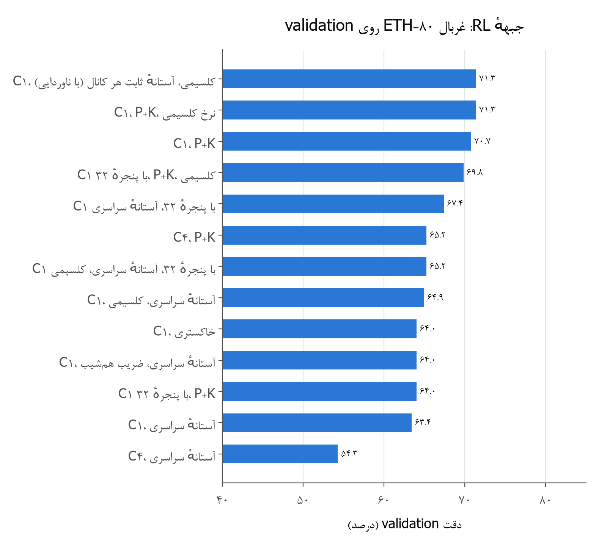
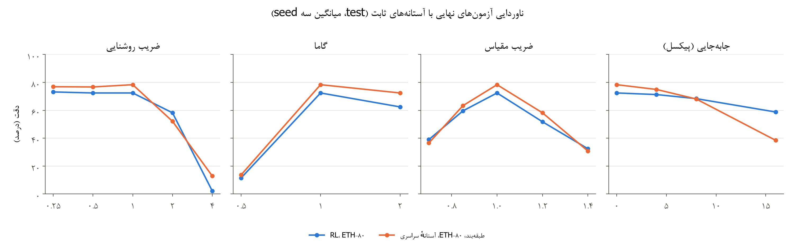
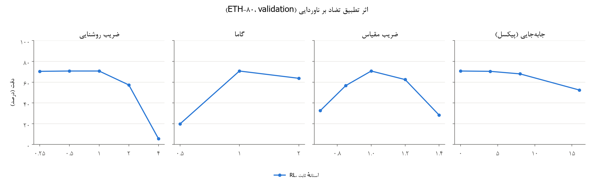
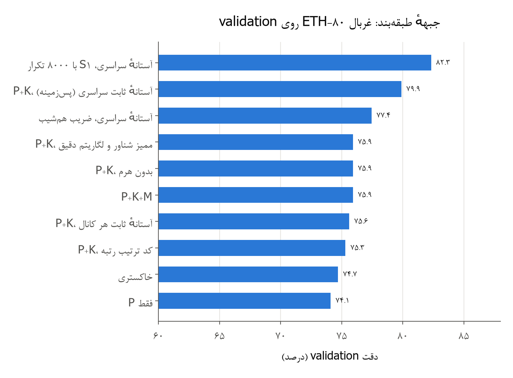
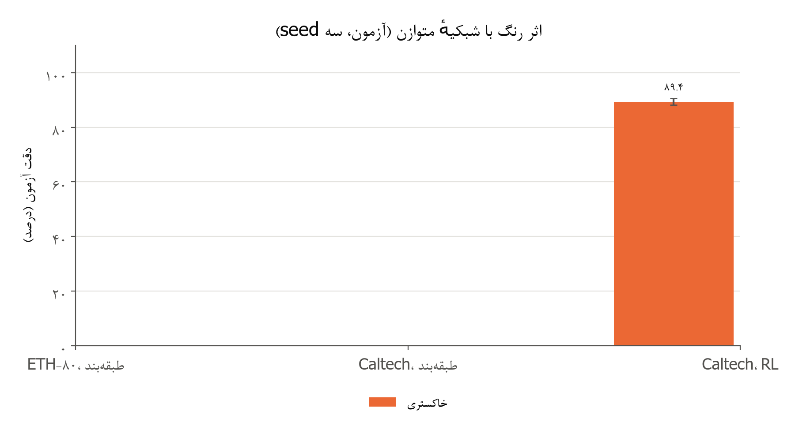
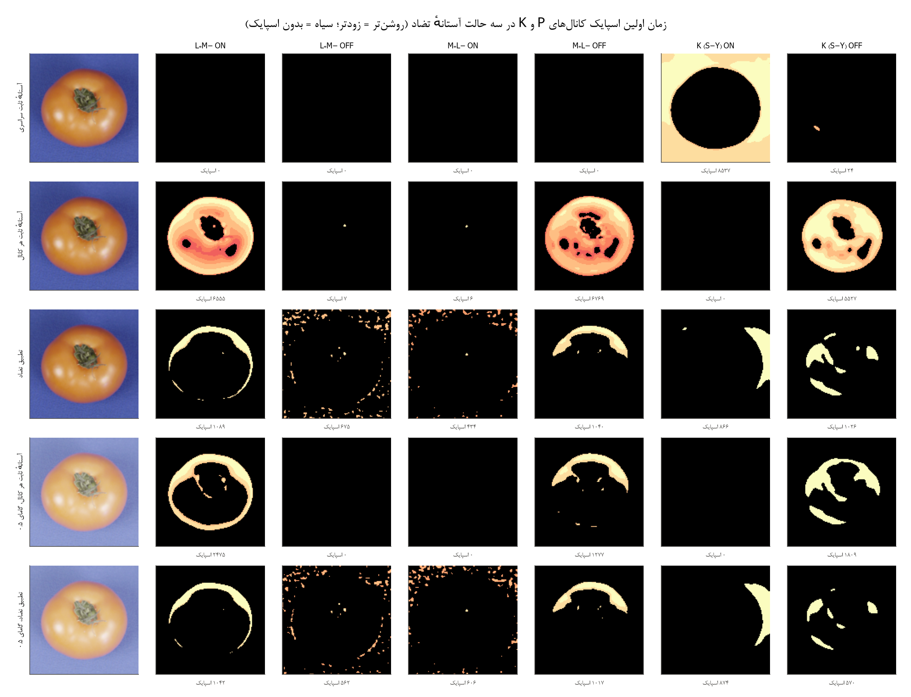

گزارش فاز ۱ پروژه‌ی BioVision‑SNN

مسیر شکمی رنگی تا IT روی شبکیه‌ی لگاریتمی

طراحی سخت‌افزارآگاه بی‌ضرب، تحلیل ریاضی و آزمون‌های ناوردایی

**فهرست مطالب**

# بخش summary در حال نوشتن

# ۲. هدف فاز ۱ و دو معیار طراحی

هدف فاز ۱ طبق سند طرح ساختن مسیر شکمی رنگی تا ناحیه‌ی IT
است. این مسیر سه بخش دارد:

-   یک شبیه‌ساز شبکیه با سه کانال P، K
    و M؛

-   چهار لایه‌ی یادگیرنده که به ترتیب نقش V1،
    V2، V4 و IT را دارند؛

-   دو خوانش: لایه‌ی تصمیم R‑STDP با اولین اسپایک (جبهه‌ی
    اصلی) و SVM خطی (فقط برای سنجش ویژگی‌ها).

در این فاز دو پرسش اصلی داریم. پرسش اول این است که آیا رنگ و هرم مقیاس
دقت را بالا می‌برند. پرسش دوم این است که شبکه در برابر تغییر روشنایی،
گاما، مقیاس و جابه‌جایی چقدر پایدار است.

همه‌ی تصمیم‌های این فاز با دو معیار گرفته شدند که کاربر در شروع فاز تعیین
کرد:

1.  **وفاداری زیستی:** هر جزء معادل زیستی دارد و فقط از اطلاعات محلی
    استفاده می‌کند.

2.  **سخت‌افزار بی‌ضرب:** هر جزء روی FPGA و در
    کد VHDL شتاب‌دهنده فقط با جمع، تفریق،
    shift، مقایسه، شمارنده و جدول کوچک ساخته می‌شود. هیچ ضرب‌کننده یا
    تقسیم‌کننده‌ی عمومی در مسیر شبکه نیست. هدف کمترین توان مصرفی و بیشترین
    سرعت است.

برای اینکه نتیجه‌ها در بودجه‌ی ۲۴ ساعته به دست بیایند، اندازه‌ی تصویر در
همه‌ی آزمایش‌های این فاز ۱۲۸×۱۲۸ است. همه‌ی انتخاب‌ها فقط روی
validation انجام شد و test فقط یک بار و برای پیکربندی
برگزیده اجرا شد.

> قاعده‌ی گزارش مثل فاز ۰ است: هر عدد با پیکربندی، seed و
> پروتکل ارزیابی‌اش ثبت شده است. نتیجه‌های منفی و خطاهایی که در طراحی
> خودمان پیدا شد هم گزارش می‌شوند.

# ۳. شبیه‌ساز شبکیه در حوزه‌ی لگاریتم

شبکیه‌ی فاز ۰ فیلتر DoG ممیز شناور و کد ترتیب رتبه داشت.
شبکیه‌ی فاز ۱ از پایه دوباره طراحی شد تا دو کار را با هم انجام دهد: رنگ
را مثل شبکیه‌ی نخستی‌ها کد کند و فقط با عمل‌های بی‌ضرب ساخته شود. همه‌ی
محاسبه‌ها در حوزه‌ی لگاریتم انجام می‌شوند، چون در این حوزه ضرب و تقسیم به
جمع و تفریق تبدیل می‌شوند. گیرنده‌های نوری چشم هم پاسخ تقریباً لگاریتمی
دارند (قانون Weber--Fechner).

## ۳-۱ فیلترهای دوجمله‌ای به‌جای گاوسی

فیلتر دوجمله‌ای مرتبه‌ی $n$ همان $n$ بار
کانولوشن پشت‌سرهم فیلتر دوتایی $\lbrack 1,1\rbrack/2$
است:

  ---------------------------------------------------------------------------------------------------------------------------------------------------------------------------------
  $$B_{n} = {(\frac{1}{2}\lbrack 1,1\rbrack)}^{*n},\text{  }B_{n}\lbrack k\rbrack = (\binom{n}{k})2^{- n},\text{  }Var(B_{n}) = \frac{n}{4}$$   (۱)
  --------------------------------------------------------------------------------------------------------------------------------------------- -----------------------------------

  ---------------------------------------------------------------------------------------------------------------------------------------------------------------------------------

**اثبات واریانس:** هر فیلتر $\frac{1}{2}\lbrack 1,1\rbrack$
توزیع یک متغیر برنولی با واریانس $\frac{1}{4}$ است.
کانولوشن توزیع‌ها همان توزیع جمع متغیرهای مستقل است، پس واریانس‌ها جمع
می‌شوند و واریانس $B_{n}$ برابر $\frac{n}{4}$
می‌شود. طبق قضیه‌ی حد مرکزی، $B_{n}$ به گاوسی با
$\sigma = \sqrt{n}/2$ میل می‌کند.

هر مرحله‌ی این کانولوشن یک جمع دو پیکسل همسایه و یک shift
یک‌بیتی است، پس فیلتر بدون هیچ ضربی ساخته می‌شود. فیلتر دوبعدی جداپذیر
است و اول روی سطرها و بعد روی ستون‌ها اعمال می‌شود. یاخته‌های افقی شبکیه هم
همین میانگین‌گیری پیاپی همسایه‌ها را از راه اتصال‌های الکتریکی
(gap junction) انجام می‌دهند.

**جدول ۱: فیلترهای دوجمله‌ای شبکیه (همه فقط با جمع و
shift)**

  -----------------------------------------------------------------------------------------------------
  **فیلتر**   **مرتبه‌ی**   $\sigma$                   **نقش
                           $n$                       **(پیکسل)**   زیستی**
  ------------------------ ------------------------- -------------------------- -----------------------
  مرکز        ۴            ۱             مرکز میدان پذیرای
                                                                                یاخته‌ی
                                                                                گانگلیونی
                                                                                midget

  پیرامون     ۳۶           ۳             پیرامون (یاخته‌های
                                                                                افقی)

  کانال K     ۱۶           ۲             یاخته‌ی
                                                                                bistratified
                                                                                آبی‌زرد

  حوضچه‌ی                  ۳۶           ۳             کنترل بهره‌ی محلی
  نرمال‌سازی                                                         روشنایی
  -----------------------------------------------------------------------------------------------------

## ۳-۲ مخروط‌ها و کانال‌های رنگی

سه مخروط از سه رنگ تصویر گرفته می‌شوند:
$L \approx R$، $M \approx G$ و $S \approx B$.
روشنایی $Y = (L + M)/2$ با یک جمع و یک shift
ساخته می‌شود. پاسخ‌های تفاضلی هر کانال این‌ها هستند:

  ----------------------------------------------------------------------------------------------------------------------------------------------------
  $$D_{L + M -} = B_{4}*L - B_{36}*M,\text{  }D_{M + L -} = B_{4}*M - B_{36}*L,\text{  }D_{K} = B_{16}*(S - Y)$$   (۲)
  ---------------------------------------------------------------------------------------------------------------- -----------------------------------

  ----------------------------------------------------------------------------------------------------------------------------------------------------

هر پاسخ تفاضلی دو یاخته‌ی ON و OFF دارد:
یاخته‌ی ON به $D^{+} = \max(D,0)$ پاسخ می‌دهد و
یاخته‌ی OFF به $\max( - D,0)$. این کانال‌ها در
غربال مقایسه شدند:

-   **خاکستری (کنترل):** $B_{4}*Y - B_{36}*Y$
    با ON و OFF، یعنی دو کانال. این
    همان DoG فاز ۰ است.

-   **فقط P:** دو جفت رقیب قرمز‌سبز، یعنی چهار
    کانال.

-   **P+K:** P به‌اضافه‌ی جفت آبی‌زرد، یعنی شش
    کانال. این پیکربندی اصلی است.

-   **P+K+M:** P+K به‌اضافه‌ی دو کانال
    گذرای magno (بخش ۳-۸)، یعنی هشت کانال.

## ۳-۳ لگاریتم بیتی Mitchell

هر عدد مثبت به شکل $x = 2^{k}(1 + f)$ با
$0 \leq f < 1$ نوشته می‌شود. در این نمایش $k$ مکان اولین
بیت یک است و $f$ بیت‌های بعد از آن. تقریب
Mitchell این است:

  -----------------------------------------------------------------------
  $$\log_{2}x \approx k + f$$         (۳)
  ----------------------------------- -----------------------------------

  -----------------------------------------------------------------------

پس محاسبه‌ی لگاریتم فقط یک priority encoder و خواندن
بیت‌هاست.

**قضیه‌ی کران خطا:** خطای تقریب $e(f) = \log_{2}(1 + f) - f$
است. داریم $e(0) = e(1) = 0$ و مشتق آن
$e^{\prime}(f) = \frac{1}{(1 + f)\ln\text{ }2} - 1$ فقط در
$f^{*} = 1/\ln\text{ }2 - 1 \approx 0.4427$ صفر می‌شود. چون
$e$ مقعر است، این نقطه بیشینه است:

  ------------------------------------------------------------------------------------------------------------------------------------------------------------------------
  $$0 \leq e(f) \leq e(f^{*}) = \log_{2}\text{ }(\frac{1}{\ln\text{ }2}) - \frac{1}{\ln\text{ }2} + 1 \approx 0.0861\text{ octave}$$   (۴)
  ------------------------------------------------------------------------------------------------------------------------------------ -----------------------------------

  ------------------------------------------------------------------------------------------------------------------------------------------------------------------------

این کران در آزمون واحد با دقت $10^{- 3}$ بررسی شده
است.

## ۳-۴ نرمال‌سازی تقسیمی با یک تفریق

پاسخ نرمال‌شده‌ی هر کانال در حوزه‌ی لگاریتم این است:

  ------------------------------------------------------------------------------------------------------
  $$\ell = \log_{2}D^{+} - \log_{2}\text{ }(\epsilon + B_{36}*Y)$$   (۵)
  ------------------------------------------------------------------ -----------------------------------

  ------------------------------------------------------------------------------------------------------

یعنی تقسیم پاسخ بر روشنایی محلی (نرمال‌سازی تقسیمی Carandini
و Heeger) به یک تفریق تبدیل می‌شود.

**قضیه‌ی ناوردایی به روشنایی:** فرض کنید روشنایی کل تصویر در
$s > 0$ ضرب شود. چون هر فیلتر خطی است، $D \rightarrow sD$
و $B*Y \rightarrow s\text{ }B*Y$. پس با لگاریتم دقیق
و $\epsilon \rightarrow 0$:

  -------------------------------------------------------------------------------------------------------------------
  $$\ell(s) = \log_{2}s + \log_{2}D^{+} - \log_{2}s - \log_{2}(B*Y) = \ell(1)$$   (۶)
  ------------------------------------------------------------------------------- -----------------------------------

  -------------------------------------------------------------------------------------------------------------------

با لگاریتم Mitchell هر جمله خطایی در
$\lbrack 0,0.0861\rbrack$ دارد. تغییر روشنایی خطای صورت و خطای مخرج را
هر کدام حداکثر ۰٫۰۸۶۱ جابه‌جا می‌کند، پس

  ------------------------------------------------------------------------------------------------------------------------------
  $$|\ell_{Mitchell}(s) - \ell_{Mitchell}(1)| \leq 2 \times 0.0861 = 0.172\text{ octave}$$   (۷)
  ------------------------------------------------------------------------------------------ -----------------------------------

  ------------------------------------------------------------------------------------------------------------------------------

اگر $s$ توانی از دو باشد، mantissa تغییر
نمی‌کند و ناوردایی دقیق است. هر دو حالت در آزمون واحد بررسی شده‌اند. تنها
منبع دیگر خطا $\epsilon = 1/256$ است که در تصویرهای خیلی
تاریک اثر دارد.

> اصلاح نسبت به سند طرح: در سند طرح کران این بخش ۰٫۰۸۶۱ نوشته شده بود.
> کران درست ۰٫۱۷۲ است، چون خطای صورت و مخرج می‌توانند در دو جهت مخالف
> تغییر کنند.

## ۳-۵ آستانه‌ی تضاد یاخته‌های گانگلیونی

یاخته‌ی گانگلیونی فقط وقتی اسپایک می‌زند که تضاد نرمال‌شده از یک آستانه
بیشتر باشد: $\ell \geq \ell_{\min}$. این فقط یک مقایسه‌گر
است. بدون این آستانه نیمی از همه‌ی یاخته‌ها اسپایک می‌زدند و کد تُنُک نبود.
در این فاز سه روش برای تعیین آستانه ساخته و آزموده شد. هر روش از خطایی
که در روش قبلی پیدا شد بیرون آمد:

1.  **آستانه‌ی ثابت سراسری:** $\ell_{\min} = - 0.5$ اکتاو
    برای همه‌ی کانال‌ها، و یک $\ell_{\max}$ مشترک برای زمان
    اسپایک. این روش کانال خاکستری را تقریباً خاموش می‌کرد (حدود ۴ اسپایک
    در هر تصویر)، چون تضاد DoG روشنایی خیلی کمتر از پاسخ‌های
    رقیب L/M است. خطای بزرگ‌تر آن در بخش ۱۰-۱ آمده است:
    در ETH‑80 کد آن تقریباً فقط سایه‌نمای شیء روی پس‌زمینه‌ی
    آبی است.

2.  **آستانه‌ی ثابت هر کانال (شبکیه‌ی متوازن):** برای هر کانال یک آستانه‌ی
    جدا، طوری که روی تصویرهای آموزش حدود ۷ درصد یاخته‌های آن کانال اسپایک
    بزنند. زمان اسپایک هر کانال هم نسبت به $\ell_{\max}$
    همان کانال حساب می‌شود، چون هر نوع یاخته‌ی گانگلیونی کنترل بهره‌ی خودش
    را دارد. آستانه یک بار و بیرون از تراشه حساب می‌شود و در سخت‌افزار یک
    ثابت است. خطای این روش در آزمون ناوردایی پیدا شد: تغییر گاما بیشتر
    یاخته‌ها را زیر آستانه‌ی ثابت می‌برد یا همه را بالای آن (بخش
    ۱۰-۳).

3.  **تطبیق تضاد:** آستانه‌ی هر کانال در هر تصویر طوری تنظیم می‌شود که
    حداکثر ۷ درصد یاخته‌های آن کانال اسپایک بزنند. این همان تطبیق تضاد در
    شبکیه است (contrast adaptation). آستانه حداکثر دو اکتاو
    زیر آستانه‌ی ثابت روش ۲ پایین می‌رود، چون بازه‌ی تطبیق در شبکیه هم
    محدود است. بدون این کف، کانالی که در تصویر هیچ سیگنالی ندارد مجبور
    می‌شد ۷ درصد یاخته‌هایش را با نوفه فعال کند.

**پیاده‌سازی سخت‌افزاری تطبیق تضاد:** پاسخ‌های هر کانال روی شبکه‌ای با
گام $\frac{\Delta}{4}$ زیر $\ell_{\max}$
کوانتیده و در یک هیستوگرام شمرده می‌شوند. جمع پیشوندی هیستوگرام از
قوی‌ترین خانه شروع می‌شود و اولین خانه‌ای که جمع از $0.07N$
بیشتر شود آستانه را می‌دهد. پس فقط شمارنده و مقایسه لازم است و آستانه
حداکثر یک خانه ($\frac{\Delta}{4}$) با مقدار دقیق فاصله
دارد:

  -------------------------------------------------------------------------------------------------------------------------------------------------------------------------------------------------------------------------------------------------------------------------
  $$\ell_{\min}^{(c)} = \max\text{ }(\ell_{\max}^{(c)} - \frac{\Delta}{4}\lfloor\frac{\ell_{\max}^{(c)} - \ell_{(k)}^{(c)}}{\frac{\Delta}{4}}\rfloor,\text{  }{\overline{\ell}}_{\min}^{(c)} - 2),\text{  }k = \lfloor 0.07N\rfloor$$   (۸)
  ------------------------------------------------------------------------------------------------------------------------------------------------------------------------------------------------------------------------------------- -----------------------------------

  -------------------------------------------------------------------------------------------------------------------------------------------------------------------------------------------------------------------------------------------------------------------------

در این فرمول $\ell_{(k)}^{(c)}$ پاسخ $k$ام از
نظر قدرت در کانال $c$ است و
${\overline{\ell}}_{\min}^{(c)}$ آستانه‌ی ثابت روش ۲.

**گزاره (ناوردایی مجموعه‌ی فعال):** اگر تبدیل تصویر ترتیب پاسخ‌های یک
کانال را حفظ کند، مجموعه‌ی $k$ یاخته‌ی قوی‌تر تغییر نمی‌کند، جز
در مرز یک خانه‌ی هیستوگرام و به شرط اینکه کف فعال نشود. ضرب روشنایی در یک
عدد ترتیب را دقیقاً حفظ می‌کند. گاما ترتیب پاسخ‌های DoG را فقط
تقریباً حفظ می‌کند، چون DoG روی شدت خطی حساب می‌شود. روی ۳۰
تصویر ETH‑80، همپوشانی مجموعه‌ی فعال با گامای ۰٫۵ برابر ۰٫۷۷
بود، در حالی که با آستانه‌ی ثابت فقط ۰٫۰۴ بود.

## ۳-۶ کدگذاری زمان اولین اسپایک و لم جابه‌جایی

زمان اسپایک هر یاخته با کوانتیده کردن فاصله‌ی آن تا قوی‌ترین پاسخ به دست
می‌آید:

  -------------------------------------------------------------------------------------------------------------------
  $$t = \lfloor\frac{\ell_{\max} - \ell}{\Delta}\rfloor,\text{  }t \leq T - 1$$   (۹)
  ------------------------------------------------------------------------------- -----------------------------------

  -------------------------------------------------------------------------------------------------------------------

در این فرمول $\ell_{\max}$ با یک درخت مقایسه‌گر پیدا می‌شود.
با $\Delta = 2^{- 2}$ تقسیم یک shift دوبیتی
است. با $T = 15$ گام، کد یک بازه‌ی پویای
$T\Delta = 3.75$ اکتاوی را می‌پوشاند. نگاشت یکنوا و نزولی است، پس پاسخ
قوی‌تر زودتر اسپایک می‌زند، درست مثل یاخته‌های گانگلیونی.

**لم جابه‌جایی زمان در برابر روشنایی:** طبق بخش ۳-۴ هر پاسخ حداکثر ۰٫۱۷۲
اکتاو جابه‌جا می‌شود. بیشینه‌ی پاسخ‌ها هم حداکثر به همین اندازه جابه‌جا
می‌شود، چون
$|\max_{i}(x_{i} + d_{i}) - \max_{i}x_{i}| \leq \max_{i}|d_{i}|$. پس
فاصله‌ی $\ell_{\max} - \ell$ حداکثر
$4 \times 0.0861 = 0.344$ اکتاو تغییر می‌کند و زمان هر اسپایک حداکثر این
مقدار گام جابه‌جا می‌شود:

  -----------------------------------------------------------------------------------------------------------
  $$|\Delta t| \leq \lceil\frac{0.344}{\Delta}\rceil = \{\begin{matrix}   (۱۰)
  1 & \Delta = 1/2 \\                                                     
  2 & \Delta = 1/4                                                        
  \end{matrix}$$                                                          
  ----------------------------------------------------------------------- -----------------------------------

  -----------------------------------------------------------------------------------------------------------

هر دو حالت در آزمون واحد بررسی شده‌اند. با ضریب روشنایی توان دو جابه‌جایی
صفر است.

> اصلاح نسبت به سند طرح: سند طرح برای $\Delta = 0.5$ نوشته
> شده بود و نتیجه‌اش «حداکثر یک گام» بود. پیکربندی نهایی
> $\Delta = 0.25$ دارد، پس کران درست دو گام است. این خطا با آزمون واحد
> تازه پیدا و ثبت شد.

جایگزین این کد، کد ترتیب رتبه‌ی فاز ۰ است که اسپایک‌ها را در بسته‌های
هم‌اندازه پخش می‌کند. این کد در سخت‌افزار با یک هیستوگرام از
$\ell$ کوانتیده و جمع پیشوندی ساخته می‌شود. یعنی دو بار عبور روی تصویر و
فقط شمارنده لازم دارد. هر دو کد در غربال مقایسه شدند.

## ۳-۷ هرم مقیاس با گام ۲

هرم مقیاس جایگزین پنج مقیاس دلخواه مقاله‌ی ۲۰۱۶ است. هر سطح از سطح قبل
با جمع چهار پیکسل و shift دوبیتی ساخته می‌شود:

  -------------------------------------------------------------------------------------------------------------------
  $$I_{l + 1}(x,y) = (\sum_{i,j \in \{ 0,1\}}^{}{I_{l}(2x + i,2y + j)) \gg 2}$$   (۱۱)
  ------------------------------------------------------------------------------- -----------------------------------

  -------------------------------------------------------------------------------------------------------------------

سطح‌های ۱۲۸، ۶۴ و ۳۲ پیکسلی ساخته می‌شوند و شبکیه روی هر سطح جداگانه اجرا
می‌شود. وزن‌های S1 تا S4 بین سطح‌ها مشترک است. پس
شیئی که با ضریب $2^{- m}$ کوچک شده، در سطح $m$
با همان اندازه‌ی اصلی دیده می‌شود. ضریب‌های میانی مثل ۰٫۷ و ۱٫۴ به تحمل
جابه‌جایی لایه‌های pooling تکیه دارند و آزمون ناوردایی همین
را می‌سنجد.

## ۳-۸ کانال magno با microsaccade

کانال M به تغییر حساس است، نه به تضاد ثابت. چشم حتی هنگام
خیره شدن حرکت‌های ریز (microsaccade) دارد. در شبیه‌ساز، تصویر
در گام‌های ۰، ۳، ۶ و ۹ یک پیکسل جابه‌جا می‌شود. در سخت‌افزار این فقط
جابه‌جایی آدرس حافظه است. یک رویداد magno وقتی رخ می‌دهد که
لگاریتم روشنایی یک یاخته از آخرین رویدادش به اندازه‌ی $C$
تغییر کرده باشد:

  ----------------------------------------------------------------------------------------------------------------------------------------
  $$|\ell_{Y}(t) - \ell_{Y}^{ref}| \geq C,\text{  }C = 0.2/\ln\text{ }2 \approx 0.29\text{ octave}$$   (۱۲)
  ---------------------------------------------------------------------------------------------------- -----------------------------------

  ----------------------------------------------------------------------------------------------------------------------------------------

این یک تفریق و یک مقایسه است، همان سازوکار حسگرهای رویدادمحور
(DVS).

# ۴. مسیر شکمی رنگی تا IT

## ۴-۱ ساختار شبکه

ورودی شبکه زمان اسپایک‌های شش کانال P+K در سه سطح هرم است.
هر لایه‌ی S نورون IF بدون نشت دارد. هر نورون در
هر تصویر حداکثر یک اسپایک می‌زند و پتانسیلش فقط جمع وزن ورودی‌هایی است که
اسپایک زده‌اند. هر لایه‌ی C کمینه‌ی زمان اسپایک را روی پنجره‌ی
۲×۲ می‌گیرد، یعنی فقط مقایسه است.

**جدول ۲: ساختار مسیر شکمی فاز ۱ (ورودی ۱۲۸×۱۲۸، هرم ۱۲۸، ۶۴ و
۳۲)**

  ----------------------------------------------------------------------------------------------------------------------------------------------
  **لایه**   **ناحیه‌ی             **نقشه**   **کرنل**   **بازداری**   **تعداد سیناپس هر
                          زیستی**                                                                              نورون**
  ----------------------- --------------------- ----------------------- ----------------------- -------------------------- ---------------------
  S1                      V1                    ۱۲         ۵×۵        WTA                        ۱۵۰
                                                                                                ویژگی‌محور،    
                                                                                                k‑WTA با شعاع             
                                                                                                ۲              

  C1                      V1 (یاخته‌ی           ۱۲         ۲×۲        ---           ---
                          پیچیده)                                                                              

  S2                      V2[، دو گروه رگه‌های   ۳۲ (دو گروه            ۵×۵        WTA جدا در هر گروه، شعاع  ۳۰۰
                          نازک و                ۱۶تایی)                             ۱              
                          کم‌رنگ]                                                                                

  C2                      V2                    ۳۲         ۲×۲        ---           ---

  S3                      V4                    ۶۴         ۵×۵        k‑WTA با شعاع             ۸۰۰
                                                                                                ۱              

  C3                      V4                    ۶۴         ۲×۲        ---           ---

  S4                      IT                    ۱۲۸        ۳×۳        k‑WTA                      ۵۷۶

  C4                      IT                    ۱۲۸        ۲×۲        ---           ---
  ----------------------------------------------------------------------------------------------------------------------------------------------

ویژگی‌های مشترک همه‌ی لایه‌های S:

-   **یادگیری:** STDP مسطح بی‌ضرب (بخش ۵) با
    $a^{+} = 2^{- 8} + 2^{- 13} \approx 0.0040$ و
    $a^{-} = 2^{- 8} - 2^{- 10} \approx 0.0029$؛ وزن اولیه
    $0.8 \pm 0.05$؛ وزن‌های ممیز ثابت ۱۶ بیتی.

-   **توقف یادگیری:** وقتی شاخص همگرایی $C_{l}$ کمتر از
    ۰٫۰۱ شود، یا تعداد به‌روزرسانی‌ها به ۳۰۰۰، ۶۰۰۰، ۸۰۰۰ و ۸۰۰۰ برسد
    (برای S1 تا S4).

-   **آستانه‌ی اولیه:** طبق بند ۵٫۴ سند طرح پروژه خودکار تنظیم می‌شود،
    طوری که با وزن‌های اولیه حدود ۵ درصد مکان‌ها اسپایک بزنند. این کار روی
    ۲۰۰ تصویر و یک بار انجام می‌شود.

-   **هموستازی:** هموستازی دوطرفه‌ی نرخ اسپایک (بخش ۵-۵).

## ۴-۲ خوانش‌ها

**جبهه‌ی اصلی، لایه‌ی تصمیم R‑STDP:** این لایه
همان لایه‌ی تصمیم Mozafari در فاز ۰ است. برای هر دسته ده
نقشه دارد و تصمیم شبکه دسته‌ی اولین نقشه‌ای است که اسپایک بزند. یادگیری با
پاداش (STDP) و تنبیه (anti‑STDP)، نرخ تطبیقی
و dropout انجام می‌شود. پنجره‌ی هر نورون کل تصویر را
می‌پوشاند. دو محل برای این لایه آزموده شد:

-   **روی C1:** خروجی C1 با
    یک pooling 4×4 دیگر به ۱۶×۱۶×۱۲ می‌رسد و لایه‌ی تصمیم
    کرنل ۱۶×۱۶ دارد. این همان معماری A فاز ۰ است، فقط
    با S1 یادگرفته و رنگی به‌جای Gabor
    ثابت.

-   **روی C4:** لایه‌ی تصمیم مستقیماً
    خروجی IT را می‌خواند (۸×۸×۱۲۸).

نرخ‌های R‑STDP همان مقادیر فاز ۰ برای ETH‑80
هستند ($a^{+} = 0.01$،
$a^{-} = 0.0035$، $p^{-} = 0.01$،
$p^{+} = 0.0006$، dropout برابر ۰٫۴ و ۸۰
epoch). آستانه‌ی تصمیم برابر ۰٫۲ برابر پتانسیل مورد انتظار با وزن‌های
اولیه است. گزینه‌ی نرخ کلسیمی نورون‌به‌نورون فاز ۰ هم با
$\lambda = 0.9$ آزموده شد.

**جبهه‌ی دوم، SVM:** پتانسیل نهایی
S4 روی یک شبکه‌ی ۴×۴ مکانی جمع می‌شود (خوانش مکان‌دار فاز ۰)، استاندارد
می‌شود و به یک SVM خطی با $C = 1$ داده می‌شود.
تصویرهای آینه‌ای آموزش هم اضافه می‌شوند. این خوانش فقط برای سنجش کیفیت
ویژگی‌هاست و روی تراشه به کار نمی‌رود.

# ۵. تحلیل ریاضی یادگیری بی‌ضرب

## ۵-۱ ماندن وزن‌ها در بازه‌ی صفر تا یک با STDP بی‌ضرب

STDP مسطح مقاله‌ها $\Delta w = \pm a\text{ }w(1 - w)$ است
که یک ضرب متغیر در متغیر دارد. در حالت سخت‌افزاری این ضرب با یک تابع
قطعه‌خطی جایگزین می‌شود:

  -------------------------------------------------------------------------------------------------------------------------
  $$\Delta w = \pm a\text{ }s\text{ }\min(w,1 - w),\text{  }s \in \{\frac{1}{2},1\}$$   (۱۳)
  ------------------------------------------------------------------------------------- -----------------------------------

  -------------------------------------------------------------------------------------------------------------------------

حالت $s = \frac{1}{2}$ («هم‌قله») همان بیشینه‌ی ۰٫۲۵
تابع $w(1 - w)$ را در $w = 0.5$ دارد.
حالت $s = 1$ («هم‌شیب») همان شیب تابع $w(1 - w)$
را در دو مرز $w = 0$ و $w = 1$ دارد.
نرخ $a$ مجموع دو توان دو است، پس هر به‌روزرسانی یک مقایسه،
یک تفریق، دو shift و دو جمع است.

**گزاره:** اگر $as < 1$ باشد، وزن هرگز از
بازه‌ی $\lbrack 0,1\rbrack$ بیرون نمی‌رود. **اثبات:** در
تقویت، $\Delta w \leq as(1 - w) < 1 - w$، پس
$w + \Delta w < 1$. در تضعیف،
$|\Delta w| \leq as\text{ }w < w$، پس
$w - |\Delta w| > 0$. نقطه‌های $w = 0$ و
$w = 1$ ثابت و جذب‌کننده‌اند.

## ۵-۲ لم سرعت همگرایی و خطایی که پیدا شد

نزدیک مرز $w = 1$ و برای سیناپسی که مدام تقویت می‌شود،
فاصله تا مرز $u = 1 - w$ این‌طور تغییر می‌کند:

  ---------------------------------------------------------------------------------------------------------------------------
  $$u_{n + 1} = u_{n}(1 - a\text{ }\phi),\text{  }\phi = \{\begin{matrix}                 (۱۴)
  w \approx 1 & \text{ممیز شناور} \\                                                      
  s & \text{بی‌ضرب}                                                                        
  \end{matrix}\text{  } \Rightarrow \text{  }u_{n} \approx u_{0}\text{ }e^{- a\phi n}$$   
  --------------------------------------------------------------------------------------- -----------------------------------

  ---------------------------------------------------------------------------------------------------------------------------

پس بعد از $n$ به‌روزرسانی، قاعده‌ی هم‌قله
($s = \frac{1}{2}$) دقیقاً همان‌جایی است که قاعده‌ی ممیز شناور
بعد از $\frac{n}{2}$ به‌روزرسانی بود. نزدیک
$w = 0$ هم همین نتیجه برقرار است. شاخص همگرایی $C_{l}$
میانگین $w(1 - w)$ است و نزدیک مرزها با $u$
متناسب است. پس قاعده‌ی هم‌قله با همان بودجه‌ی تکرار تقریباً دو
برابر $C_{l}$ بیشتری دارد.

داده‌های غربال همین را تأیید می‌کنند. لایه‌ی S1 با سقف ۳۰۰۰
به‌روزرسانی در حالت ممیز شناور به $C_{l} = 0.041$ رسید و در
حالت بی‌ضرب هم‌قله به $C_{l} = 0.080$، یعنی نسبت ۱٫۹۵.
هیچ‌کدام زیر ۰٫۰۱ نرفت، یعنی لایه‌ی S1 با سقف تکرار متوقف شد
و نه با معیار همگرایی.

دو راه برای رفع این مشکل وجود دارد:

1.  **ضریب هم‌شیب:** $s = 1$ همان سرعت ممیز شناور را نزدیک
    مرزها برمی‌گرداند و هیچ هزینه‌ی سخت‌افزاری ندارد (یک shift
    کمتر). در وسط بازه دو برابر سریع‌تر است، ولی طبق گزاره‌ی بخش ۵-۱ وزن
    در بازه می‌ماند. چون $\min(w,1 - w) \geq w(1 - w)$، این
    قاعده در همه‌ی بازه دست‌کم به سرعت قاعده‌ی ممیز شناور است.

2.  **بودجه‌ی تکرار بیشتر برای S1:** از ۳۰۰۰
    به ۸۰۰۰.

هر دو راه روی validation آزموده شدند. این دو آزمون با
شبکیه‌ی آستانه‌ی سراسری انجام شدند، چون در آن زمان آن شبکیه بهترین
بود:

**جدول ۳: اثر ضریب نرم‌کرانه و بودجه‌ی تکرار S1
(ETH‑80، validation، یک
seed)**

  -------------------------------------------------------------------------------------------
  **پیکربندی   $C_{l}$                **دقت   **بهترین
  S1**                      **لایه‌ی   validation (خوانش   خوانش**
                            S1**                   اول)**   
  ------------------------- ---------------------- -------------------- ---------------------
  ضریب هم‌قله، ۳۰۰۰ تکرار   ۰٫۲۰      ۷۸٫۹۶   ۷۹٫۸۸
  (پایه)                                                    

  ضریب هم‌شیب، ۳۰۰۰         ۰٫۱۸      ۷۶٫۵۲   ۷۷٫۴۴
  تکرار                                                     

  ضریب هم‌قله، ۸۰۰۰         ۰٫۱۴      ۸۰٫۴۹   ۸۲٫۳۲
  تکرار                                                     
  -------------------------------------------------------------------------------------------

نتیجه دو بخش دارد. اول اینکه لم درست است، ولی در این شبکیه
$C_{l}$ لایه‌ی S1 حتی با ضریب هم‌شیب حدود ۰٫۱۸ ماند. پس عامل
اصلی همگرا نشدن S1 این بود که بعضی نقشه‌ها کم برنده می‌شوند و
کم به‌روز می‌شوند، نه شیب ضریب. دوم اینکه بودجه‌ی تکرار بیشتر دقت را حدود
۱٫۵ درصد بالا برد، ولی این اختلاف در حد نوفه‌ی یک seed است
(خطای معیار validation با ۳۲۸ تصویر حدود ۲٫۳ درصد است).
ضریب هم‌قله پیش‌فرض ماند و بودجه‌ی ۸۰۰۰ تکرار برای S1 در فاز ۲
پیشنهاد می‌شود. این لم در آزمون واحد هم ثبت شده است.

## ۵-۳ گرد کردن وزن‌های ممیز ثابت

وزن‌ها ۱۶ بیت کسری دارند و بعد از هر به‌روزرسانی با حذف بیت‌های اضافه
(floor) گرد می‌شوند. حذف بیت در سخت‌افزار رایگان است، ولی دو
اثر دارد:

-   **توقف خودکار یادگیری:** تقویتی که از یک LSB
    ($2^{- 16}$) کوچک‌تر باشد صفر می‌شود. با
    $a \approx 2^{- 8}$ این یعنی وزن‌هایی که به فاصله‌ی
    $\frac{2^{- 8}}{s}$ از مرز رسیده‌اند منجمد می‌شوند. این همان توقف
    یادگیری است که بدون هزینه به دست می‌آید.

-   **سوگیری به سمت تضعیف:** floor همیشه به سمت پایین گرد
    می‌کند. پس هر تضعیف، هر قدر کوچک، حداقل یک LSB وزن را کم
    می‌کند. اندازه‌ی این سوگیری حداکثر
    $2^{- 16} \approx 1.5 \times 10^{- 5}$ در هر رویداد است، یعنی در
    وسط بازه حدود ۶۴ برابر کوچک‌تر از گام یادگیری
    ($2^{- 8} \times 0.25 = 2^{- 10}$). اثرش بر دقت ناچیز
    است. اگر لازم شد، گرد کردن به نزدیک‌ترین عدد فقط یک جمع با
    نصف LSB لازم دارد.

## ۵-۴ نرخ یادگیری با دو توان دو

اولین نسخه‌ی حالت بی‌ضرب هر نرخ را به نزدیک‌ترین توان دو گرد می‌کرد.
اما $0.004$ و $0.003$ هر دو به
$2^{- 8}$ گرد می‌شوند. در این حالت $a^{+} = a^{-}$ است و
نسبت $\frac{4}{3}$ که شکل‌گیری ویژگی به آن وابسته است از بین
می‌رود. اولین آزمایش‌های فاز ۱ با این خطا ویژگی‌های بی‌کیفیت
داشتند.

راه‌حل نمایش هر نرخ با دو توان دو علامت‌دار (CSD) است. ضرب
در چنین نرخی دو shift و یک جمع است. وقتی توان دوی نزدیک‌تر
در مقیاس لگاریتمی انتخاب شود، نسبت $\frac{a}{q}$ در
بازه‌ی $\lbrack 2^{- 1/2},2^{\frac{1}{2}}\rbrack$ است. پس
خطای نسبی هر مرحله حداکثر $\sqrt{2} - 1 \approx 0.414$ است
و بعد از دو مرحله حداکثر ${0.414}^{2} \approx 0.17$. خطای
واقعی نرخ‌های ما خیلی کمتر است:

**جدول ۴: نرخ‌های STDP در حالت بی‌ضرب**

  ---------------------------------------------------------------------------------------------------
  **نرخ**   **مقدار              **دو توان دو**       **خطای
                         مقاله**                                     نسبی**
  ---------------------- --------------------- --------------------------------- --------------------
  $a^{+}$                ۰٫۰۰۴    $2^{- 8} + 2^{- 13} = 0.004028$   ۰٫۷
                                                                                 درصد

  $a^{-}$                ۰٫۰۰۳    $2^{- 8} - 2^{- 10} = 0.002930$   ۲٫۳
                                                                                 درصد

  نسبت      ۱٫۳۳۳    ۱٫۳۷۵                ۳٫۱
                                                                                 درصد
  ---------------------------------------------------------------------------------------------------

## ۵-۵ هموستازی آستانه: چرا H‑ASIZH در S1 شکست خورد و چه جایش آمد

قاعده‌ی H‑ASIZH مقاله‌ی کاربر این است:

  -----------------------------------------------------------------------------------------------------------
  $$\theta \leftarrow \theta + \alpha(\theta_{0} - \theta) + \gamma z$$   (۱۵)
  ----------------------------------------------------------------------- -----------------------------------

  -----------------------------------------------------------------------------------------------------------

با $\alpha = 2^{- 6}$ و $\gamma$ توان دو، این
قاعده فقط shift و جمع است. **گزاره:** اگر
$\theta$ در
$\lbrack\theta_{0},\theta_{0} + \gamma/\alpha\rbrack$ باشد، همان‌جا
می‌ماند. **اثبات:** اگر $\theta \geq \theta_{0}$
و $z \geq 0$، آنگاه
$\theta^{\prime} - \theta_{0} = (1 - \alpha)(\theta - \theta_{0}) + \gamma z \geq 0$.
اگر $z \leq 1$ و
$\theta \leq \theta_{0} + \gamma/\alpha$، آنگاه
$\theta^{\prime} - \theta_{0} \leq (1 - \alpha)\gamma/\alpha + \gamma = \gamma/\alpha$.

همین کف $\theta \geq \theta_{0}$ در S1 فاز ۱
مشکل ساخت. آستانه‌ی $\theta_{0}$ روی وزن‌های اولیه (حدود ۰٫۸)
تنظیم می‌شود. وقتی STDP همگرا می‌شود، بیشتر وزن‌ها به ۰ و
تعداد کمی به ۱ می‌روند، پس پتانسیل یک ورودی معمولی کم می‌شود. آستانه
نمی‌تواند زیر $\theta_{0}$ برود و S1 خاموش شد.
در فاز ۰ این مشکل پیش نیامد، چون آنجا آستانه‌ها از مقاله آمده بودند و نه
از تنظیم روی وزن‌های اولیه.

جایگزین فاز ۱ هموستازی دوطرفه‌ی نرخ اسپایک است:

  -------------------------------------------------------------------------------------------------------------------------------------------------------------------
  $$\theta_{i} \leftarrow \theta_{i} + \eta\text{ }\theta_{0}\text{ }\frac{z_{i} - \rho}{\rho},\text{  }\eta = \rho = 2^{- 5}$$   (۱۶)
  ------------------------------------------------------------------------------------------------------------------------------- -----------------------------------

  -------------------------------------------------------------------------------------------------------------------------------------------------------------------

در این قاعده $z_{i}$ کسری از مکان‌های نقشه‌ی $i$
است که در این تصویر اسپایک زده‌اند. **نقطه‌ی ثابت و پایداری:** نقطه‌ی
ثابت $E\lbrack z_{i}\rbrack = \rho$ است. اگر نزدیک نقطه‌ی
ثابت $z \approx \rho - g(\theta - \theta^{*})$
با $g > 0$ باشد (آستانه‌ی بالاتر، اسپایک کمتر)، خطا این‌طور
تغییر می‌کند:

  -------------------------------------------------------------------------------------------------------------
  $$e_{n + 1} = (1 - \frac{\eta\text{ }\theta_{0}\text{ }g}{\rho})e_{n}$$   (۱۷)
  ------------------------------------------------------------------------- -----------------------------------

  -------------------------------------------------------------------------------------------------------------

پس قاعده وقتی پایدار است که $0 < \eta\theta_{0}g/\rho < 2$
باشد. با $\eta = \rho$ این شرط ساده‌تر می‌شود:
$\theta_{0}g < 2$.

**پیاده‌سازی بی‌ضرب:** اگر $c$ تعداد اسپایک‌های نقشه
و $N$ تعداد مکان‌هایش باشد، $z = c/N$ است.
چون $\eta = \rho$:

  ------------------------------------------------------------------------------------------------------
  $$\Delta\theta = \theta_{0}\frac{c}{N} - \frac{\theta_{0}}{32}$$   (۱۸)
  ------------------------------------------------------------------ -----------------------------------

  ------------------------------------------------------------------------------------------------------

پس هر اسپایک یک مقدار ثابت $\frac{\theta_{0}}{N}$ را به
آستانه اضافه می‌کند و در پایان هر تصویر یک مقدار ثابت
$\frac{\theta_{0}}{32}$ کم می‌شود (یک shift
پنج‌بیتی). $N$ در همه‌ی لایه‌ها و همه‌ی سطح‌های هرم توان دو است
(برای S1: $2^{14}$، $2^{12}$
و $2^{10}$)، پس $\frac{\theta_{0}}{N}$ هم
یک shift است. هیچ ضربی لازم نیست.

## ۵-۶ پهنای بیت انباشتگرها

پتانسیل نورون IF جمع وزن‌های ورودی‌هایی است که اسپایک
زده‌اند. با وزن $b$ بیتی و $N$
سیناپس، $V \leq N(1 - 2^{- b})$. پس انباشتگر
$b + \lceil\log_{2}N\rceil$ بیت لازم دارد و هرگز سرریز
نمی‌شود:

**جدول ۵: پهنای بیت انباشتگر هر لایه**

  ----------------------------------------------------------------------------
  **لایه**   **تعداد سیناپس هر      **بیت انباشتگر
                          نورون**     (با**
                                                  $b = 16$**)**
  ----------------------- ----------------------- ----------------------------
  S1: ۵×۵×۶  ۱۵۰        ۲۴

  S2: ۵×۵×۱۲ ۳۰۰        ۲۵

  S3: ۵×۵×۳۲ ۸۰۰        ۲۶

  S4: ۳×۳×۶۴ ۵۷۶        ۲۶

  تصمیم روی  ۳۰۷۲       ۲۸
  C1:                                            
  ۱۶×۱۶×۱۲                            

  تصمیم روی  ۸۱۹۲       ۲۹
  C4:                                            
  ۸×۸×۱۲۸                             
  ----------------------------------------------------------------------------

## ۵-۷ هزینه‌ی رویدادمحور

در TTFS هر نورون حداکثر یک اسپایک دارد. هر اسپایک ورودی یک
لایه به $k^{2}M$ نورون آن لایه می‌رسد و هر رسیدن یک جمع است.
پس تعداد عمل‌های سیناپسی (SOP) هر تصویر این است:

  -----------------------------------------------------------------------------------------------------------------
  $$SOP = \sum_{\ell}^{}{n_{\ell}^{in}\text{ }k_{\ell}^{2}\text{ }M_{\ell}}$$   (۱۹)
  ----------------------------------------------------------------------------- -----------------------------------

  -----------------------------------------------------------------------------------------------------------------

در این فرمول $n^{in}$ تعداد اسپایک‌های ورودی
لایه، $k$ اندازه‌ی کرنل و $M$ تعداد نقشه است.
شبکه‌ی کانولوشنی هم‌اندازه با محاسبه‌ی متراکم
$\sum_{\ell}^{}{H_{\ell}W_{\ell}k_{\ell}^{2}C_{\ell}M_{\ell}}$ عمل
ضرب‌وجمع (MAC) لازم دارد. نسبت این دو در بخش ۹ با تعداد
واقعی اسپایک‌ها حساب شده است.

# ۶. پروتکل آزمایش

**داده:**

-   **ETH‑80 رنگی:** هشت دسته و ده شیء از هر دسته، هر شیء
    از ۴۱ زاویه. تقسیم ۵/۵: پنج شیء برای آموزش و پنج شیء برای آزمون
    (۱۶۴۰ و ۱۶۴۰ تصویر). تصویرها ۱۲۸×۱۲۸ هستند.

-   **Caltech‑101 رنگی، چهار دسته:**
    Faces، Motorbikes، airplanes
    و Leopards. از هر دسته ۲۰۰ تصویر تصادفی گرفته شد (۱۰۰
    برای آموزش و ۱۰۰ برای آزمون) و با حفظ نسبت ابعاد در قاب ۱۲۸×۱۲۸ قرار
    گرفت.

**انتخاب:** غربال روی validation انجام شد. در
ETH‑80 یک شیء از پنج شیء آموزش هر دسته کنار گذاشته شد (۱۳۱۲ تصویر آموزش
و ۳۲۸ تصویر validation). در هر جبهه بهترین
پیکربندی validation با سه seed روی
test اجرا شد.

**آزمون‌های کنترل:** اثر رنگ با اجرای همان شبکه روی کانال خاکستری سنجیده
شد. Caltech با بهترین تنظیمات شبکیه و با همان شبکه اجرا شد،
بدون هیچ تنظیم دوباره.

**آزمون ناوردایی:** طبقه‌بند یا لایه‌ی تصمیمی که روی تصویرهای عادی آموزش
دیده، بدون آموزش دوباره روی تصویرهای تغییریافته‌ی test
سنجیده شد (۴۰۰ تصویر از test):

-   **روشنایی:** ضریب ۰٫۲۵، ۰٫۵، ۲ و ۴ (با بریدن در ۲۵۵)؛

-   **گاما:** ۰٫۵ و ۲؛

-   **مقیاس:** ضریب ۰٫۷، ۰٫۸۵، ۱٫۲ و ۱٫۴ حول مرکز تصویر؛

-   **جابه‌جایی افقی:** ۴، ۸ و ۱۶ پیکسل، معادل ۸، ۱۶ و ۳۲ پیکسل در تصویر
    ۲۵۶ پیکسلی سند طرح.

# ۷. جبهه‌ی اول (اصلی): یادگیری تقویتی با اولین اسپایک

در این جبهه هیچ SVM یا KNN وجود ندارد. تصمیم
شبکه دسته‌ی اولین نورونی است که اسپایک می‌زند، و یادگیری فقط با پاداش و
تنبیه انجام می‌شود. همه‌ی یادگیری‌ها در حالت بی‌ضرب انجام شدند. در هر آزمون
نهایی epochی گزارش می‌شود که دقت آموزش در آن بیشینه است (روش
منصفانه). بهترین epoch آزمون (روش مقاله‌ها) جداگانه آمده
است.

## ۷-۱ غربال روی validation

**شکل ۱: دقت validation پیکربندی‌های جبهه‌ی RL
روی ETH‑80**

**جدول ۶: غربال جبهه‌ی RL روی ETH‑80
(validation، یک شیء کنارگذاشته از هر دسته، یک
seed؛ درصد)**

  -----------------------------------------------------------------------------
  **پیکربندی**   **شبکیه**   **دقت
                                                       validation**
  --------------------------- ------------------------ ------------------------
  تصمیم روی C1، متوازن      ۷۰٫۷۳
  پنجره‌ی ۱۶، P+K                           

  تصمیم روی C1، متوازن      **۷۱٫۳۴**
  پنجره‌ی ۱۶،                               
  P+K، نرخ                                            
  کلسیمی                                   

  تصمیم روی C1، متوازن      ۶۴٫۰۲
  پنجره‌ی ۱۶،                                           
  خاکستری                                  

  تصمیم روی C4، متوازن      ۶۵٫۲۴
  پنجره‌ی ۸، P+K                            

  تصمیم روی C1، متوازن      ۶۴٫۰۲
  پنجره‌ی ۳۲، P+K                           

  تصمیم روی C1، متوازن      ۶۹٫۸۲
  پنجره‌ی ۳۲،                               
  P+K، نرخ                                            
  کلسیمی                                   

  تصمیم روی C1، آستانه‌ی                 ۶۳٫۴۱
  پنجره‌ی ۱۶، P+K  سراسری       

  تصمیم روی C1، آستانه‌ی                 ۶۴٫۹۴
  پنجره‌ی ۱۶،      سراسری       
  P+K، نرخ                                            
  کلسیمی                                   

  تصمیم روی C1، آستانه‌ی                 ۶۴٫۰۲
  پنجره‌ی ۱۶، ضریب             سراسری       
  هم‌شیب                                    

  تصمیم روی C1، آستانه‌ی                 ۶۷٫۳۸
  پنجره‌ی ۳۲، P+K  سراسری       

  تصمیم روی C1، آستانه‌ی                 ۶۵٫۲۴
  پنجره‌ی ۳۲، نرخ              سراسری       
  کلسیمی                                   

  تصمیم روی C4، آستانه‌ی                 ۵۴٫۲۷
  پنجره‌ی ۸، P+K   سراسری       
  -----------------------------------------------------------------------------

پنج یافته‌ی این غربال:

-   **رنگ در جبهه‌ی RL واقعاً کمک می‌کند:** با
    شبکیه‌ی متوازن، P+K حدود ۶٫۷ درصد از خاکستری بهتر است
    (۷۰٫۷۳ در برابر ۶۴٫۰۲). این بزرگ‌ترین اثر غربال RL
    است.

-   **آستانه‌ی سراسری در جبهه‌ی RL بد است:**
    همان سایه‌نمای پس‌زمینه‌ای که SVM را بالا برد (بخش ۱۰-۱)،
    لایه‌ی تصمیم RL را حدود ۷ درصد پایین آورد. علتش این است
    که در این شبکیه تقریباً همه‌ی اسپایک‌ها از یک کانال می‌آیند. پس اولین
    اسپایک‌ها همیشه از لبه‌ی پس‌زمینه‌اند و اطلاعات رنگ و بافت شیء به لایه‌ی
    تصمیم نمی‌رسد.

-   **تصمیم روی C4 ضعیف‌تر از تصمیم روی C1
    است:** ۶۵٫۲۴ در برابر ۷۰٫۷۳. این همان یافته‌ی فاز ۰
    است. R‑STDP روی کد خیلی تُنُک لایه‌های عمیق (حدود ۳۰۰
    اسپایک S4 در هر تصویر) سیگنال کافی ندارد. راه پیشنهادی
    فاز ۰، یعنی قاعده‌ی توجه برای لایه‌های پنهان، برای فاز ۲
    می‌ماند.

-   **نرخ کلسیمی:** نرخ کلسیمی نورون‌به‌نورون ۰٫۶ درصد بهتر بود که در حد
    نوفه است. چون بهترین validation بود، طبق قاعده‌ی انتخاب
    به آزمون نهایی رفت.

-   **پنجره‌ی ۳۲:** با آستانه‌ی سراسری، پنجره‌ی ۳۲×۳۲ (شبیه
    هندسه‌ی Mozafari) حدود ۴ درصد بهتر از پنجره‌ی ۱۶ بود. با
    شبکیه‌ی متوازن نتیجه ۶۴٫۰۲ است.

## ۷-۲ آزمون نهایی ETH‑80

**جدول ۷: جبهه‌ی RL روی ETH‑80 با تقسیم ۵/۵
(test، سه seed؛ درصد)**

  -----------------------------------------------------------------------------------------------------
  **شبکه**    **epoch                    **بهترین   **seedها**
                           انتخاب‌شده**   epoch                   
                                                      آزمون**    
  ------------------------ -------------------------- ----------------------- -------------------------
  فاز ۱: S1   ۷۲٫۸۷ ± ۲٫۲۲  ۷۲٫۸۷ ±                ۷۴٫۰۲، ۷۰٫۳۰،
  رنگی                                               ۲٫۲۲        ۷۴٫۲۷
  یادگرفته،                                                       
  C1، تصمیم                                                      
  R‑STDP با نرخ                                                              
  کلسیمی                                                          

  فاز ۰:      ۷۷٫۴۸ ± ۱٫۰۰  ۷۷٫۸۷ ±                ---
  Gabor ثابت                                         ۱٫۴۹        
  خاکستری،                                                        
  C1، تصمیم                                                      
  R‑STDP                                                                      
  (تنظیمات                                                       
  Mozafari)                                                      
  -----------------------------------------------------------------------------------------------------

در هر سه seed، epoch انتخاب‌شده
همان epoch آخر (۸۰) بود و دقت آزمون هنوز بالا می‌رفت. پس
لایه‌ی تصمیم کامل آموزش ندیده است. Mozafari برای
ETH‑80 از ۱۵۰ epoch استفاده کرده بود (بخش
۱۰-۵).

**مقایسه‌ی صادقانه با فاز ۰:** شبکه‌ی RL فاز ۱ حدود ۴٫۶ درصد
پایین‌تر از شبکه‌ی فاز ۰ است. سه تفاوت این فاصله را توضیح
می‌دهند:

1.  **ورودی تصمیم:** در فاز ۰ ورودی تصمیم چهار نقشه‌ی Gabor
    با بازداری جانبی شدت روی شبکه‌ی ۳۱×۳۱ بود. در فاز ۱ دوازده
    نقشه‌ی S1 یادگرفته روی شبکه‌ی ۱۶×۱۶ است، که فقط حدود ۴۰۰
    اسپایک در هر تصویر به لایه‌ی تصمیم می‌دهد.

2.  **تصویرها:** فاز ۰ از نسخه‌ی close128 دیتاست استفاده
    کرد که شیء کادر را پر می‌کند. فاز ۱ از نسخه‌ی cropped256
    که به ۱۲۸ کوچک شده است.

3.  **تعداد epoch:** ۱۵۰ در برابر
    ۸۰.

پس این مقایسه فقط ارزش جهت‌دهی دارد. مقایسه‌ی منصفانه‌ی رنگ و خاکستری درون
خود فاز ۱ است.

## ۷-۳ آزمون نهایی Caltech چهاردسته‌ای

**جدول ۸: جبهه‌ی RL روی Caltech چهاردسته‌ای
(Faces، Motorbikes،
airplanes، Leopards؛ test، سه
seed؛ درصد؛ سطح شانس ۲۵ درصد)**

  -----------------------------------------------------------------------
  **شبکیه**              **دقت test**
  ----------------------------------- -----------------------------------
  متوازن، P+K            در حال اجرا

  متوازن، خاکستری        ۸۹٫۴۲ ± ۱٫۱۸

  آستانه‌ی سراسری، P+K    ۵۵٫۳۳ ± ۳٫۹۶
  -----------------------------------------------------------------------

## ۷-۴ ناوردایی جبهه‌ی RL

**شکل ۲: ناوردایی آزمون‌های نهایی با آستانه‌های ثابت. محور افقی ضریب
تغییر و محور عمودی دقت test است.**

**جدول ۹: ناوردایی آزمون‌های نهایی با آستانه‌های ثابت (test،
میانگین ± انحراف معیار سه seed؛ ۴۰۰ تصویر؛
درصد)**

  -------------------------------------------------------------------------------------------------------------------
  **تغییر              **RL،   **طبقه‌بند،   **طبقه‌بند،   **RL،
  تصویر**   ETH‑80**             ETH‑80، آستانه‌ی          ETH‑80،                  Caltech**
                                             سراسری**      متوازن**      
  --------------------- -------------------- ------------------------- ------------------------- --------------------
  بدون                 ۷۲٫۴۴ ±             ۷۸٫۳۷ ± ۳٫۶۰ ؟            ؟
  تغییر     ۲٫۲۰                                                         

  روشنایی              ۷۳٫۱۷ ±             ۷۶٫۹۱ ± ۳٫۳۳ ؟            ؟
  ×۰٫۲۵     ۲٫۷۷                                                         

  روشنایی              ۷۲٫۴۴ ±             ۷۶٫۷۵ ± ۲٫۴۴ ؟            ؟
  ×۰٫۵      ۱٫۲۲                                                         

  روشنایی              ۵۸٫۲۱ ±             ۵۲٫۱۱ ± ۵٫۴۹ ؟            ؟
  ×۲        ۲٫۶۸                                                         

  روشنایی              ۲٫۲۰ ±              ۱۲٫۹۳ ± ۰٫۶۵ ؟            ؟
  ×۴        ۰٫۴۲                                                         

  گامای                ۱۱٫۴۶ ±             ۱۳٫۶۶ ± ۱٫۷۱ ؟            ؟
  ۰٫۵       ۱٫۹۰                                                         

  گامای ۲  ۶۲٫۴۴ ±             ۷۲٫۴۴ ± ۲٫۸۱ ؟            ؟
                        ۶٫۹۷                                                         

  مقیاس                ۳۹٫۰۲ ±             ۳۶٫۵۹ ± ۱٫۲۷ ؟            ؟
  ۰٫۷       ۲٫۳۵                                                         

  مقیاس                ۵۹٫۵۹ ±             ۶۳٫۳۳ ± ۵٫۰۲ ؟            ؟
  ۰٫۸۵      ۳٫۹۷                                                         

  مقیاس                ۵۱٫۷۹ ±             ۵۸٫۲۱ ± ۳٫۲۵ ؟            ؟
  ۱٫۲       ۳٫۰۵                                                         

  مقیاس                ۳۲٫۴۴ ±             ۳۰٫۸۱ ± ۳٫۵۴ ؟            ؟
  ۱٫۴       ۳٫۱۱                                                         

  جابه‌جایی ۴           ۷۱٫۳۰ ±             ۷۴٫۹۶ ± ۱٫۸۹ ؟            ؟
  پیکسل     ۲٫۷۴                                                         

  جابه‌جایی ۸           ۶۸٫۳۷ ±             ۶۸٫۱۳ ± ۳٫۲۹ ؟            ؟
  پیکسل     ۳٫۲۸                                                         

  جابه‌جایی ۱۶          ۵۸٫۷۸ ±             ۳۸٫۴۶ ± ۳٫۶۲ ؟            ؟
  پیکسل     ۰٫۸۴                                                         
  -------------------------------------------------------------------------------------------------------------------

تفسیر این جدول:

-   **روشنایی کمتر:** کاهش روشنایی تقریباً بی‌اثر است. این همان قضیه‌ی
    ناوردایی بخش ۳-۴ است: تقسیم در حوزه‌ی لگاریتم یک تفریق است و ضریب
    روشنایی حذف می‌شود.

-   **روشنایی بیشتر:** با ضریب ۲ و ۴ پیکسل‌های روشن در ۲۵۵ بریده می‌شوند
    و اطلاعات رنگ آن‌ها از دست می‌رود. این ضعف تصویر ۸ بیتی است، نه شبکیه.
    با این حال افت تا سطح شانس (و در RL زیر شانس، چون شبکه
    ساکت می‌ماند) نشان می‌دهد که آستانه‌ی ثابت تعداد اسپایک‌ها را از کنترل
    خارج می‌کند.

-   **گاما:** تغییر گاما یک ضرب نیست، پس قضیه‌ی بخش ۳-۴ آن را پوشش
    نمی‌دهد. با گامای ۰٫۵ تضادها فشرده می‌شوند و بیشتر یاخته‌ها زیر آستانه‌ی
    ثابت می‌روند (روی ۳۰ تصویر، تعداد اسپایک‌ها از ۶۸۸۱ به ۳۴۹ رسید). دقت
    به حدود ۱۰ درصد افتاد. این بزرگ‌ترین خطای طراحی بود که آزمون‌های فاز ۱
    پیدا کردند (بخش ۱۰-۳).

-   **مقیاس:** افت در ۰٫۷ و ۱٫۴ بیشتر از ۰٫۸۵ و ۱٫۲ است. هرم گام ۲
    ضریب‌های ۰٫۵ و ۲ را دقیقاً پوشش می‌دهد، ولی ضریب‌های میانی به
    تحمل pooling تکیه دارند. این همان «جای خالی هرم» است که
    سند طرح پیش‌بینی کرده بود.

-   **جابه‌جایی:** RL در جابه‌جایی ۱۶ پیکسل بهتر از طبقه‌بند
    مانده است. طبقه‌بند با خوانش شبکه‌ی ۴×۴ به مکان حساس است، ولی تصمیم
    اولین اسپایک روی پنجره‌ی کل تصویر فقط به زودترین اسپایک توجه
    دارد.

## ۷-۵ تطبیق تضاد: رفع شکنندگی در برابر گاما و روشنایی

**شکل ۳: اثر تطبیق تضاد بر ناوردایی روی validation ETH‑80**

**جدول ۱۰: جبهه‌ی RL، اثر تطبیق تضاد بر ناوردایی
(ETH‑80، validation، یک seed؛
درصد)**

  ----------------------------------------------------------------------------------------------------------
  **[تغییر              **RL[، آستانه‌ی       **RL، تطبیق         **RL، تطبیق تضاد با  **RL، تطبیق تضاد و
  تصویر**   ثابت**   تضاد**   کف ۲                  کد
                                                                  اکتاو]**   رتبه]**
  --------------------- -------------------- -------------------- --------------------- --------------------
  بدون                 ۷۰٫۷۳   ؟       ؟        ؟
  تغییر                                                                     

  روشنایی              ۷۰٫۴۳   ؟       ؟        ؟
  ×۰٫۲۵                                                                     

  روشنایی              ۵۷٫۳۲   ؟       ؟        ؟
  ×۲                                                                        

  روشنایی              ۵٫۴۹    ؟       ؟        ؟
  ×۴                                                                        

  گامای                ۱۹٫۸۲   ؟       ؟        ؟
  ۰٫۵                                                                       

  گامای ۲  ۶۳٫۷۲   ؟       ؟        ؟

  مقیاس                ۵۶٫۷۱   ؟       ؟        ؟
  ۰٫۸۵                                                                      

  جابه‌جایی ۸           ۶۷٫۹۹   ؟       ؟        ؟
  پیکسل                                                                     
  ----------------------------------------------------------------------------------------------------------

\\ADAPT_RL_TEXT\\

# ۸. جبهه‌ی دوم: سنجش ویژگی‌ها با طبقه‌بند

این جبهه فقط کیفیت ویژگی‌های مسیر شکمی را می‌سنجد. خوانش آن
SVM خطی است که ضرب‌کننده لازم دارد و روی تراشه به کار
نمی‌رود.

## ۸-۱ غربال روی validation

**شکل ۴: دقت validation پیکربندی‌های جبهه‌ی طبقه‌بند
روی ETH‑80 (بهترین خوانش هر پیکربندی)**

**جدول ۱۱: غربال جبهه‌ی طبقه‌بند روی ETH‑80
(validation، یک seed؛ درصد). بهترین خوانش در
بیشتر پیکربندی‌ها پتانسیل S3 و S4 روی شبکه‌ی ۴×۴
بود.**

  ---------------------------------------------------------------------------------------------------
  **پیکربندی           **کانال‌ها**   **خوانش اول              **بهترین
  شبکیه**                              (S4،         خوانش**
                                                   آینه‌سازی)**   
  --------------------- -------------------------- ------------------------- ------------------------
  آستانه‌ی ثابت هر      P+K                        ۷۳٫۴۸        ۷۵٫۶۱
  کانال، کد لگاریتمی،                                                        
  هرم                                                                        
  سه‌سطحی                                                         

  همان     خاکستری       ۷۱٫۳۴        ۷۴٫۷۰

  همان     فقط P         ۷۱٫۶۵        ۷۴٫۰۹

  همان     P+K+M                      ۷۵٫۰۰        **۷۵٫۹۱**

  کد ترتیب             P+K                        ۷۵٫۳۰        ۷۵٫۳۰
  رتبه                                                           

  ممیز شناور و لگاریتم P+K                        ۷۲٫۵۶        ۷۵٫۹۱
  دقیق (بدون حالت                                                            
  بی‌ضرب)                                                         

  بدون هرم (فقط سطح    P+K                        ۷۱٫۹۵        ۷۵٫۹۱
  ۱۲۸)                                                           

  آستانه‌ی ثابت         P+K                        ۷۸٫۹۶        ۷۹٫۸۸
  سراسری                                                         
  ---------------------------------------------------------------------------------------------------

یافته‌های این غربال:

-   **حالت بی‌ضرب هزینه ندارد:** شبکه‌ی بی‌ضرب با لگاریتم
    Mitchell 73.48 گرفت و نسخه‌ی ممیز شناور با لگاریتم دقیق ۷۲٫۵۶.
    اختلاف در حد نوفه است.

-   **رنگ و هرم اثر کوچک دارند:** با شبکیه‌ی متوازن، P+K با
    بهترین خوانش ۷۵٫۶۱ گرفت و خاکستری ۷۴٫۷۰. هرم هم حدود ۱٫۵ درصد اثر
    داشت. همه‌ی این اختلاف‌ها کمتر از خطای معیار validation
    (حدود ۲٫۳ درصد) هستند و برای همین آزمون نهایی رنگ و خاکستری با
    سه seed انجام شد.

-   **کانال magno:** P+K+M
    بهترین پیکربندی متوازن بود (۷۵٫۹۱). رویدادهای
    microsaccade لبه‌های روشنایی را مستقل از رنگ اضافه
    می‌کنند.

-   **آستانه‌ی سراسری:** بهترین عدد غربال (۷۹٫۸۸) از سایه‌نمای پس‌زمینه‌ی
    آبی ETH‑80 آمد، نه از ویژگی‌های شیء (بخش
    ۱۰-۱).

## ۸-۲ آزمون نهایی ETH‑80

**جدول ۱۲: جبهه‌ی طبقه‌بند روی ETH‑80 با تقسیم ۵/۵
(test، سه seed؛ درصد)**

  -----------------------------------------------------------------------
  **شبکیه و              **دقت      **اسپایک ورودی هر
  خوانش**     test**                  تصویر**
  ----------------------- ----------------------- -----------------------
  متوازن،    در حال                 ؟
  P+K+M،                 اجرا        
  خوانش S3                            
  و S4                               

  متوازن، خاکستری، همان  در حال                 ؟
  خوانش       اجرا        

  متوازن، خاکستری،       ۷۵٫۰۲ ±                ۴,۶۸۱
  خوانش S4    ۰٫۵۱        
  با                                             
  آینه‌سازی                            

  آستانه‌ی                ۷۸٫۱۹ ±                ۱۳,۹۲۸
  سراسری، P+K ۳٫۰۸        
  (سایه‌نمای                                      
  پس‌زمینه)                            

  فاز ۰: DoG ۸۴٫۲۵ ±                ---
  خاکستری، ۸۰۰           ۳٫۴۹        
  نقشه،                               
  H‑ASIZH                                         
  -----------------------------------------------------------------------

شبکه‌ی فاز ۱ فقط ۱۲۸ نقشه در IT و ۱۳۶ هزار وزن دارد. شبکه‌ی
برگزیده‌ی فاز ۰ ۸۰۰ نقشه در لایه‌ی دوم داشت. شبکه‌ی فاز ۱ برای سرعت و
اندازه‌ی سخت‌افزار کوچک نگه داشته شد، و فاصله با فاز ۰ را باید با همین
تفاوت سنجید.

## ۸-۳ آزمون نهایی Caltech چهاردسته‌ای

**جدول ۱۳: جبهه‌ی طبقه‌بند روی Caltech چهاردسته‌ای
(test، سه seed؛ درصد)**

  -----------------------------------------------------------------------
  **شبکیه**              **دقت test**
  ----------------------------------- -----------------------------------
  متوازن، P+K+M          در حال اجرا

  متوازن، خاکستری        در حال اجرا
  -----------------------------------------------------------------------

**شکل ۵: اثر رنگ با شبکیه‌ی متوازن در سه آزمون نهایی**

## ۸-۴ تطبیق تضاد در جبهه‌ی طبقه‌بند

**جدول ۱۴: جبهه‌ی طبقه‌بند، اثر تطبیق تضاد بر ناوردایی
(ETH‑80، validation، یک seed؛
درصد)**

  ----------------------------------------------------------------------------------------------------------
  **[تغییر              **[آستانه‌ی           **تطبیق             **تطبیق تضاد با کف ۲ **تطبیق تضاد و کد
  تصویر**   ثابت**   تضاد**   اکتاو]**   رتبه]**
  --------------------- -------------------- -------------------- --------------------- --------------------
  بدون                 ؟       ؟       ؟        ؟
  تغییر                                                                     

  روشنایی              ؟       ؟       ؟        ؟
  ×۰٫۲۵                                                                     

  روشنایی              ؟       ؟       ؟        ؟
  ×۲                                                                        

  روشنایی              ؟       ؟       ؟        ؟
  ×۴                                                                        

  گامای                ؟       ؟       ؟        ؟
  ۰٫۵                                                                       

  گامای ۲  ؟       ؟       ؟        ؟

  مقیاس                ؟       ؟       ؟        ؟
  ۰٫۸۵                                                                      

  جابه‌جایی ۸           ؟       ؟       ؟        ؟
  پیکسل                                                                     
  ----------------------------------------------------------------------------------------------------------

\\ADAPT_SVM_TEXT\\

# ۹. هزینه‌ی سخت‌افزاری

## ۹-۱ شمار عمل‌ها

با عددهای واقعی اسپایک در آزمون نهایی ETH‑80 (شبیه‌ساز
شبکیه‌ی متوازن P+K+M و سه سطح هرم)، هزینه‌ی هر تصویر این
است:

**جدول ۱۵: هزینه‌ی محاسبه‌ی مسیر شکمی برای هر تصویر**

  --------------------------------------------------------------------------
  **سنجه**   **شبکه‌ی اسپایکی           **همان شبکه با محاسبه‌ی
                          رویدادمحور**   متراکم**
  ----------------------- -------------------------- -----------------------
  عمل‌ها (میلیون در هر    ؟ جمع         ؟ ضرب‌وجمع
  تصویر)                                 

  نسبت       ۱             ؟

  ضرب‌کننده   ندارد         دارد
  --------------------------------------------------------------------------

**برآورد انرژی محاسبه:** طبق جدول مشهور Horowitz
(ISSCC 2014، فناوری ۴۵ نانومتر)، یک جمع صحیح ۳۲ بیتی حدود
۰٫۱ پیکوژول انرژی دارد. یک ضرب صحیح ۸ بیتی ۰٫۲ و یک ضرب ۳۲ بیتی ۳٫۱
پیکوژول دارد، پس ضرب‌وجمع ۱۶ بیتی حدود ۰٫۹ پیکوژول است. یعنی هر عمل
رویدادمحور حدود ۹ برابر کم‌مصرف‌تر از یک ضرب‌وجمع است. با احتساب نسبت تعداد
عمل‌ها، انرژی محاسبه حدود دو مرتبه‌ی بزرگی کمتر از محاسبه‌ی متراکم می‌شود.
این برآورد دسترسی به حافظه را در نظر نمی‌گیرد، که در عمل سهم بزرگی از
انرژی است. تحلیل حافظه در فاز طراحی VHDL انجام
می‌شود.

## ۹-۲ ابعاد شبکه

-   **وزن‌ها:** مسیر شکمی ۱۳۷ هزار وزن ۱۶ بیتی دارد، یعنی حدود ۲۷۰
    کیلوبایت که در حافظه‌ی BRAM یک FPGA متوسط
    جا می‌شود. شبکه‌ی RL روی C1 فقط ۱۸۰۰
    وزن S1 دارد، ولی لایه‌ی تصمیم آن با پنجره‌ی ۱۶×۱۶×۱۲ و ۸۰
    نقشه (۱۰ نقشه برای هر دسته) ۲۴۶ هزار وزن دارد. پس در
    جبهه‌ی RL حافظه‌ی لایه‌ی تصمیم از کل مسیر شکمی بیشتر است.
    پنجره‌ی ۳۲ این عدد را چهار برابر می‌کند. این نکته در انتخاب هندسه‌ی
    تصمیم فاز ۲ مهم است.

-   **حالت بی‌ضرب در برابر ممیز شناور:** در غربال، اختلاف حالت بی‌ضرب و
    ممیز شناور در حد نوفه بود (بخش ۸-۱). یعنی هیچ هزینه‌ی دقتی برای حذف
    ضرب‌کننده‌ها پرداخت نشد.

-   **پهنای انباشتگرها:** طبق جدول بخش ۵-۶، از ۲۴ تا ۲۹
    بیت.

# ۱۰. نقطه‌های خطا: یافته‌ها، تحلیل و رفع

کاربر خواسته بود جاهایی که ممکن است خطا داشته باشند پیدا شوند. این بخش
همه‌ی خطاهای فاز ۱ را جمع می‌کند، چه خطاهای طراحی و چه خطاهای
اجرا.

## ۱۰-۱ کانال K و پس‌زمینه‌ی آبی ETH‑80

بهترین پیکربندی غربال طبقه‌بند (آستانه‌ی سراسری، ۷۹٫۸۸ درصد) با قاعده‌ی
انتخاب به آزمون نهایی رفت و ۷۸٫۱۹ ± ۳٫۰۸ درصد گرفت. شکل نمونه‌ی شبیه‌ساز
شبکیه علت این دقت را نشان داد. سهم هر کانال از اسپایک‌های ورودی روی ۶۰
تصویر اندازه گرفته شد:

**جدول ۱۶: سهم کانال‌ها از اسپایک‌های ورودی در دو شبیه‌ساز
شبکیه**

  -----------------------------------------------------------------------------------------------------------
  **دیتاست و           **اسپایک ورودی هر     **P (چهار             **K ON**             **K OFF**
  شبکیه**   تصویر (سطح             کانال)**                        
                        ۱۲۸)**                                                 
  --------------------- ---------------------- ---------------------- -------------------- ------------------
  ETH‑80، آستانه‌ی      ۱۰۸۰۲     ۲٫۲ درصد  **۹۷٫۷              ۰٫۲
  سراسری                                                  درصد**   درصد

  ETH‑80،              ۷۴۴۰      ۶۸٫۲ درصد ۱۵٫۲                ۱۶٫۴
  متوازن                                                  درصد     درصد

  Caltech، آستانه‌ی     **۶۴۳**   ۷۴٫۹ درصد ۷٫۳                 ۱۷٫۸
  سراسری                                                  درصد     درصد

  Caltech،             ۶۵۳۳      ۶۶٫۲ درصد ۱۳٫۱                ۲۰٫۶
  متوازن                                                  درصد     درصد
  -----------------------------------------------------------------------------------------------------------

**شکل ۶: زمان اولین اسپایک کانال‌های P و K
برای یک تصویر ETH‑80 در سه حالت آستانه‌ی تضاد و با گامای
۰٫۵**

**تحلیل:** پس‌زمینه‌ی همه‌ی تصویرهای ETH‑80 آبی یکنواخت است.
در این پس‌زمینه $S - Y$ بزرگ و روشنایی $Y$ کم
است، پس پاسخ نرمال‌شده‌ی K ON از هر کانال دیگری قوی‌تر است.
وقتی همه‌ی کانال‌ها یک $\ell_{\max}$ و یک آستانه
دارند، K ON همه‌ی زمان‌های زودرس را می‌گیرد و بقیه‌ی کانال‌ها
زیر آستانه می‌مانند. کد حاصل در عمل سایه‌نمای شیء روی پس‌زمینه است. این کد
برای ETH‑80 اطلاعات شکل خوبی دارد، ولی در تصویرهای طبیعی
کار نمی‌کند: در Caltech همین شبیه‌ساز فقط ۶۴۳ اسپایک در هر
تصویر می‌دهد.

**تصمیم:** این پیکربندی از معماری فاز ۱ کنار گذاشته شد، چون مصنوع
دیتاست است و با معیار زیستی هم نمی‌خواند (هر نوع یاخته‌ی گانگلیونی کنترل
بهره‌ی خودش را دارد). عدد آن صادقانه گزارش شد. آزمون‌های نهایی معماری با
شبیه‌ساز متوازن تکرار شدند. نکته‌ی جالب این است که همین سایه‌نما
جبهه‌ی RL را بدتر کرد (بخش ۷-۱).

## ۱۰-۲ آستانه‌ی ثابت سراسری و کانال خاکستری

اولین مقایسه‌ی رنگ و خاکستری با آستانه‌ی سراسری انجام شد و کانال خاکستری
فقط حدود ۴ اسپایک در هر تصویر داشت (دقت ۲۴٫۷ درصد). این مقایسه منصفانه
نبود و با آستانه‌های جدای هر کانال تکرار شد.

## ۱۰-۳ شکنندگی آستانه‌ی ثابت در برابر گاما

آزمون ناوردایی نشان داد که با گامای ۰٫۵ دقت به حدود ۱۰ درصد و با
روشنایی ×۴ به سطح شانس می‌افتد (بخش ۷-۴). **تحلیل:** آستانه‌ی ثابت فقط
برای ضرب روشنایی ناورداست. گاما دامنه‌ی تضاد را تغییر می‌دهد: با گامای ۰٫۵
تعداد اسپایک‌ها ۲۰ برابر کم شد و با گامای ۲ تقریباً ۶ برابر زیاد شد.
**رفع:** تطبیق تضاد با کف دو اکتاو (بخش ۳-۵).

## ۱۰-۴ خطاهای ریاضی سند طرح

-   **کران ناوردایی روشنایی:** ۰٫۱۷۲ اکتاو، نه ۰٫۰۸۶۱ (بخش
    ۳-۴).

-   **کران جابه‌جایی زمان:** دو گام با $\Delta = 1/4$، نه
    یک گام (بخش ۳-۶).

-   **سرعت همگرایی ضریب هم‌قله:** دو برابر کندتر نزدیک مرزها (بخش
    ۵-۲).

برای هر سه مورد آزمون واحد نوشته شد. حالا ۱۰۷ آزمون واحد پروژه همه با
موفقیت اجرا می‌شوند.

## ۱۰-۵ خطاهای اجرا و تنظیم

**جدول ۱۷: خطاهای اجرا و تنظیم در فاز ۱**

  ---------------------------------------------------------------------------------------------------
  **خطا**    **نشانه**   **علت**       **رفع**
  ----------------------- ------------------------ -------------------------- -----------------------
  [نرخ‌های توان            $a^{+} = a^{-}$،        ۰٫۰۰۴ و ۰٫۰۰۳ هر دو       دو توان دو (بخش
  دو          ویژگی‌های                 به $2^{- 8}$   ۵-۴)
                          بی‌کیفیت]      گرد می‌شوند    

  کف H‑ASIZH S1 خاموش شد $\theta \geq \theta_{0}$   هموستازی دوطرفه‌ی نرخ
                                                   ولی پتانسیل‌ها بعد         (بخش ۵-۵)
                                                   از STDP کم    
                                                   می‌شوند         

  [ورودی                  نیمی از یاخته‌ها اسپایک  نبود آستانه‌ی              آستانه‌ی تضاد (بخش
  پرتراکم     می‌زدند       تضاد           ۳-۵)]

  کلید                   خطای اجرا   نام کلیدهای سند طرح با    نگاشت کلیدها در
  ناشناخته‌ی                            تابع یکی نبود  اجراکننده
  magno                                                                       

  اجراهای    شکست شش اجرای           پیکربندی      بارگذار فقط کلیدهای
  Caltech                 کنترل        Caltech کلید  خودش را
                                                   train_instances را از     می‌گیرد
                                                   پیکربندی پایه‌ی 
                                                   ETH‑80 به ارث             
                                                   می‌برد          

  آموزش ناکامل لایه‌ی     epoch انتخاب‌شده         ۸۰ epoch      ۱۵۰ epoch
  تصمیم       همان epoch   کافی نیست     مثل
                          آخر                                    Mozafari برای فاز
                                                                              ۲
  ---------------------------------------------------------------------------------------------------

# بخش architecture در حال نوشتن
