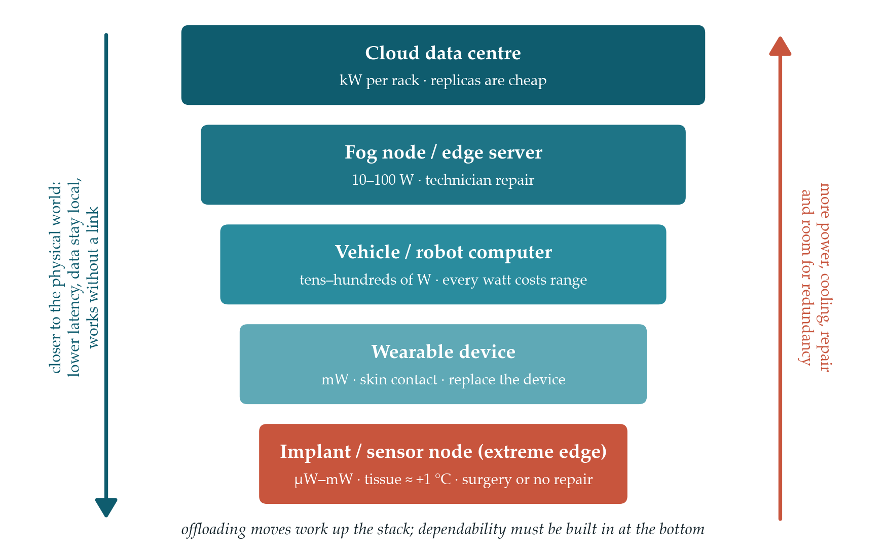
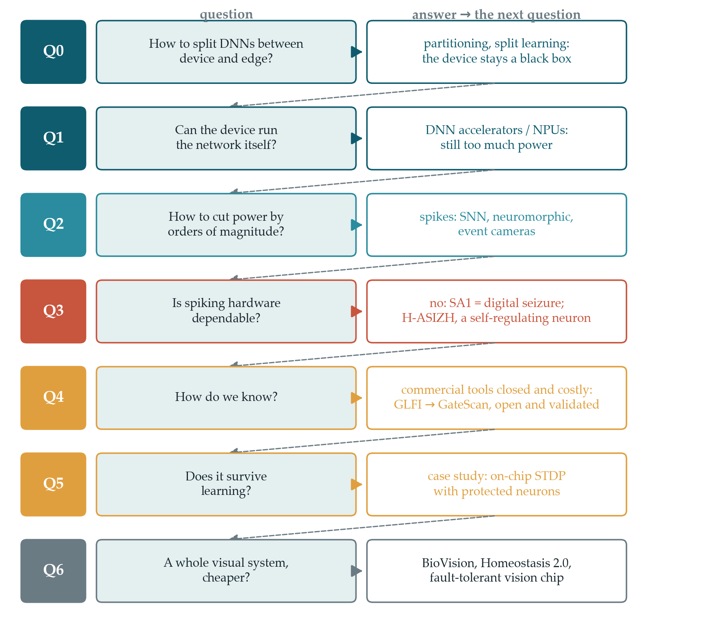

# Chapter 1 --- Introduction and Literature Review

## 1.1 Prologue: Where Should Intelligence Live?

A camera is no longer a device that takes pictures. Inside a car, a
drone, a pair of smart glasses or a retinal prosthesis, it is the first
stage of a decision. Image and video are the heaviest data streams that
sensors produce, and deep learning has turned these streams into
decisions with an accuracy that was out of reach a decade ago \[1, 2\].
Once a camera starts making decisions, the hard question is no longer
how to recognise what it sees. It is where the recognising should
happen: in a distant data centre, in a fog node down the street, in an
edge server at the base station, or on the device that holds the sensor.

This thesis began on the systems side of that question. Our first
problems were the standard problems of edge intelligence: how to
partition a deep neural network (DNN) between a weak device and a
stronger edge server, how to train a model with split learning without
moving raw data, and how to decide when a task should be offloaded
\[3--5\]. These are good problems, and the community has solved many of
them well. Yet the longer we worked on them, the clearer one pattern
became. Almost every system-level technique treats the end device as a
black box with a fixed capability that always computes correctly. When
the device is too weak, the answer is to move work away from it. We had
a local problem, a device that could not do its job, and to solve it we
built larger systems at larger scales and became absorbed in them. In
the process, the device at the bottom of the stack was forgotten.

This chapter retraces that path from the top down. It starts with the
cloud and walks down through the fog and the edge to the end device, and
then goes inside the device: to its accelerator, to its spiking neurons,
and finally to its transistors. At each step a question appears, and its
answer forces the next step. The argument is not that the system-level
view is wrong. Offloading, partitioning and collaborative learning solve
real problems and will remain essential. The argument is that this view
is incomplete, and that the part it leaves out is precisely the part
that safety-critical applications cannot do without.

> **Thesis statement.** For mission- and safety-critical image and video
> processing, the system can share the load but it cannot share the
> responsibility: the closed perception--decision loop must be
> dependable on the device itself. As computation moves from the cloud
> to the extreme edge, fault tolerance has to move with it, from the
> system to the accelerator and from the accelerator to the neuron.

## 1.2 The Computing Continuum: From the Cloud to the Extreme Edge

### 1.2.1 The cloud: abundance at a distance

Cloud computing gave applications the illusion of infinite computing
resources on demand, removed the need for up-front investment, and let
users pay for resources only while they used them \[6\]. For deep
learning this abundance was decisive. Modern networks are trained on
very large data sets with very large compute budgets, and the energy and
carbon cost of this training has itself become a research topic \[7,
8\]. Data centres also became the first home of domain-specific DNN
hardware: Google\'s Tensor Processing Unit, deployed in production data
centres from 2015, ran inference on average 15--30 times faster than its
contemporary CPUs and GPUs, with 30--80 times higher TOPS per watt
\[9\].

The cloud\'s weakness is distance. Capra *et al.* note in their survey
of DNN acceleration that cloud computing depends on an Internet
connection and is therefore not ideal for applications that cannot
tolerate interruptions of service, such as self-driving vehicles. They
also note that transmitting data between client and server makes it more
vulnerable to breaches, and that latency-constrained applications are
better served by near-sensor computing than by sending data over the
Internet \[10\].

### 1.2.2 Cloudlets, fog and edge: bringing the cloud closer

The systems community answered the distance problem by moving computing
resources towards the data. Satyanarayanan *et al.* proposed
*cloudlets*: virtual-machine-based, resource-rich computers one wireless
hop away from mobile users, built to avoid the latency of wide-area
networks for interactive applications \[11\]. Bonomi *et al.* introduced
*fog computing* as an extension of the cloud to the edge of the network,
with low latency, location awareness, wide geographic distribution,
support for mobility and real-time interaction, and a very large number
of nodes \[12\]. Shi *et al.* defined *edge computing* as computing at
the edge of the network on behalf of cloud services and
Internet-of-Things (IoT) devices. They traced its motivation to the push
from cloud services, the pull from the IoT, and the shift of end devices
from data consumers to data producers, and they listed its open
challenges: programmability, naming, data abstraction, service
management, privacy and security, and optimisation metrics \[13, 14\].

The vision spread quickly. Chiang and Zhang surveyed the research
opportunities of fog computing for the IoT \[15\], and Satyanarayanan
described the emergence of edge computing as a new tier between the
cloud and the device \[16\]. Multi-access (mobile) edge computing (MEC)
put servers into the radio access network. Mao *et al.* surveyed MEC
from the communication perspective, where radio and computing resources
must be allocated jointly \[17\]. Mach and Becvar organised the field
around three problems: the offloading decision, the allocation of
computing resources, and mobility management \[18\]. Other surveys
covered MEC architectures \[19\] and fog computing \[20, 21\]. More
recent work treats cloud, fog, edge and devices as a single
*edge-to-cloud continuum* across which intelligence is distributed \[22,
23\].

### 1.2.3 The layered stack and its ladder of constraints

The result is a layered stack (Fig. 1.1). At the top sits the cloud,
then fog nodes and edge servers, then end devices such as phones and
vehicles, and at the bottom the *extreme edge*: sensor nodes, wearables
and implants. Moving down the stack brings computing closer to the
physical world. Latency to the sensor shrinks, data stay closer to their
owner, and the device can keep working without a network. Moving down
the stack also removes resources. The power budget falls from kilowatts
per server rack to milliwatts or microwatts. Cooling changes from
data-centre air handling to a sealed case, then to skin contact, then to
living tissue. Repair changes from a hot swap in seconds, to a
technician\'s visit, to replacing the device, to surgery. Redundancy
changes from a routine engineering decision to a physical impossibility.

{width="6.102362204724409in"
height="3.819212598425197in"}

**Fig. 1.1.** The edge-to-cloud continuum and its ladder of constraints.
Down the stack, proximity to the physical world increases while power,
thermal headroom, repairability and room for redundancy decrease.

Table 1.1 summarises this ladder. Its numbers are indicative orders of
magnitude, not specifications. The platform figures follow the
comparison of Capra *et al.*, who place CPUs at roughly 10--100 W, GPUs
at about 100 W, FPGAs at 1--10 W and ASIC accelerators at 0.1--1 W
\[10\]. The implant row follows the thermal literature on brain--machine
interfaces, which usually takes a tissue temperature rise of about 1 °C
as the safe limit \[24, 25\].

**Table 1.1.** The ladder of constraints across the computing continuum
(indicative orders of magnitude).

  --------------------------------------------------------------------------
  **Tier**       **Typical      **Thermal      **Repair**     **Room for
                 power budget** path**                        redundancy**
  -------------- -------------- -------------- -------------- --------------
  Cloud data     kW per rack    Forced air or  Hot swap,      Large:
  centre                        liquid cooling fleet          replicas and
                                               replacement    voting are an
                                                              accounting
                                                              decision

  Fog node /     10--100 W      Fans or sealed Technician     Moderate
  edge server                   enclosure      visit          

  Vehicle or     Tens to        Vehicle        Workshop       Limited: every
  robot computer hundreds of W, cooling loop                  watt costs
                 shared with                                  range
                 propulsion                                   

  Wearable       mW             Skin contact   Replace the    Small
  device                                       device         

  Implant /      µW to mW       Living tissue, Surgery or     Very small:
  sensor node                   about +1 °C    none           triplication
                                                              is physically
                                                              excluded
  --------------------------------------------------------------------------

The systems community\'s main response to the shrinking resources at the
bottom of this ladder was to move computation *up* the ladder. The next
section reviews this response.

## 1.3 Edge Intelligence and the Offloading Paradigm

### 1.3.1 From code offloading to an energy argument

Offloading started before deep learning. MAUI offloaded individual
methods of a smartphone application to remote servers to save battery
energy \[26\], and CloneCloud migrated threads to a clone of the phone
running in the cloud \[27\]. Kumar and Lu asked the decisive question
early: can offloading actually save energy? Their answer was
conditional. Offloading pays off when an application needs much
computation and little communication, and only when the wireless
bandwidth is high enough. Otherwise the energy spent sending data
exceeds the energy saved \[28\]. This condition runs through the rest of
the field.

### 1.3.2 Partitioning deep networks across the continuum

Deep networks made offloading attractive again, because their layers
form natural cut points. Neurosurgeon profiles a DNN layer by layer and
selects, at run time, the layer at which to split the computation
between the mobile device and the cloud, based on predicted latency,
energy and current network conditions \[29\]. Distributed deep neural
networks (DDNNs) map one network across cloud, edge and end devices and
add early exits, so that easy inputs are classified locally and only
hard ones travel upward \[30\]. Edgent combines partitioning with
*right-sizing*, which means exiting early to meet a latency target, and
adapts both to the available bandwidth \[31\]. DADS partitions networks
with general directed-acyclic-graph structure through a min-cut
formulation and adapts the cut to server load \[32\]. JointDNN extends
joint mobile--cloud execution to both training and inference \[33\], and
SPINN performs progressive inference with early exits across device and
cloud \[34\]. Matsubara *et al.* review this whole family as *split
computing and early exiting* \[35\].

Zhou *et al.* organise edge intelligence into levels that run from
cloud-based intelligence, through cloud--edge co-inference and in-edge
co-inference, to on-device inference and finally to training and
inference entirely on the device \[3\]. Chen and Ran \[4\] and Wang *et
al.* \[5\] review the same convergence of deep learning and edge
computing. In Zhou\'s scale, the top level of edge intelligence is the
one where nothing leaves the device.

### 1.3.3 Collaborative learning: split and federated

The same logic applies to training. In split learning, the first layers
of a network run on the data owner\'s device and only intermediate
activations, the *smashed data*, are sent to a server that holds the
remaining layers \[36\]. Its proponents present it as a way to train on
medical data without sharing raw patient records \[37\]. Federated
learning keeps the data on the devices and sends model updates to a
central aggregator \[38\]. Kairouz *et al.* survey its many open
problems \[39\], and SplitFed combines the two schemes \[40\]. Privacy,
however, is not automatic. Pasquini *et al.* showed that a malicious
server in split learning can hijack the training process and reconstruct
the clients\' private data \[41\].

### 1.3.4 What the system view optimises, and what it assumes

Taken together, this body of work optimises a well-defined set of
objectives: end-to-end latency, device energy, throughput, accuracy,
quality of service (QoS), quality of experience (QoE) and cost. The
variable it optimises over is *placement*: which layer, which node,
which exit, which round. Its assumptions are just as consistent. The
network is the uncertain element, and the device is a known, fixed and
correct resource, a black box whose only property of interest is how
fast it computes. Our own early work in this thesis lived entirely
inside these assumptions. The rest of this chapter examines what happens
when they are questioned.

## 1.4 The Price of Offloading: When the Environment Becomes Stochastic

A dedicated device that computes locally comes close to a deterministic
system. The same input follows the same path through the same circuit
and finishes within a bounded time. Offloading turns this closed system
into an open one. The task now crosses a wireless channel whose quality
varies, joins a queue on a server it shares with unknown users, depends
on the availability of that server, and enters a different security
domain. Each of these elements adds random variables, both to the
response time and to the question of whether a correct result arrives at
all. Offloading does not remove uncertainty from a weak device. It
trades the device\'s limited capability for a larger and more stochastic
failure space. Six arguments show what this trade costs when the task is
safety-critical.

### 1.4.1 Latency becomes a distribution

When an operation depends on many shared components, rare delays stop
being rare. Dean and Barroso showed how fan-out amplifies tail latency.
If a single server answers slowly in one case out of a hundred, a
request that must wait for one hundred such servers is slow in about 63%
of cases \[42\]. Wireless links add their own tails. Bennis *et al.*
argue that ultra-reliable low-latency communication cannot be designed
from averages and must be designed in terms of tails, risk and scale
\[43\]. A hard real-time loop, however, is judged by its worst case, not
its mean. Its correctness requires bounded worst-case execution and
communication times \[44, 45\]. Bounding those times over a shared,
contended network is much harder than bounding them on a dedicated chip.
The same lesson appears even inside the data centre. Jouppi *et al.*
note that the deterministic execution model of the TPU matched the
99th-percentile response-time requirement of their applications better
than the time-varying optimisations of CPUs and GPUs, which help average
throughput more than guaranteed latency \[9\].

### 1.4.2 Connectivity cannot be assumed

Offloading only helps while there is a link. Vehicles drive through
tunnels and rural areas, drones fly beyond coverage, and disasters take
networks down exactly when they are needed most. Body tissue attenuates
radio signals, which forces implants onto low-bandwidth links. As noted
above, Capra *et al.* consider cloud execution unsuitable for
applications that cannot tolerate service interruptions, and they name
self-driving vehicles as an example \[10\]. Liu *et al.* treat the
autonomous vehicle itself as an edge computing platform, with on-vehicle
computers handling the real-time tasks \[46\].

### 1.4.3 Moving data can cost more than processing it

Pottie and Kaiser quantified the trade-off for wireless sensors more
than two decades ago. Transmitting one kilobit over 100 m costs roughly
as much energy as executing three million instructions on a 100 MIPS/W
processor \[47\]. The same trade-off is behind Kumar and Lu\'s
conditional answer for mobile offloading \[28\]. It also explains why
Capra *et al.* list lower transmission energy and better data privacy as
reasons to compute at the edge \[10\]. Video is the worst case because
it is the largest stream a sensor can produce. In intracortical
brain--computer interfaces (BCIs), Even-Chen *et al.* showed that
wireless data transmission takes a large share of the power budget, and
that reducing what must be sent through on-implant processing opens
substantial power savings \[48\].

### 1.4.4 Every link is an attack surface

Each hop and each shared node is an additional point of attack. Roman
*et al.* catalogue the threats specific to mobile edge and fog
paradigms, including compromised or rogue nodes, interception of
traffic, denial of service and leakage of private data \[49\]. Split
learning shows that sending only intermediate features does not by
itself protect the data \[41\]. In vision and neural interfaces the data
are among the most sensitive a person can produce: video of a private
space, or the electrical activity of the brain. Local processing does
not make a system secure by itself, but it removes entire classes of
attack.

### 1.4.5 Safety certification needs a bounded system

Safety-critical domains are governed by functional safety standards. IEC
61508 is the generic standard \[50\], ISO 26262 adapts it to road
vehicles \[51\], IEC 62304 governs the life cycle of medical device
software \[52\], and DO-254 gives design assurance guidance for airborne
electronic hardware \[53\]. These standards ask for a hazard analysis,
safety goals derived from it, and evidence that hardware faults are
detected or controlled. For road vehicles, this evidence includes
quantitative hardware metrics such as the single-point fault metric and
the latent fault metric \[51\]. Koopman and Wagner describe how hard it
is to validate an autonomous vehicle even when all of its computing is
on board \[54\]. A safety case is far easier to build for a bounded,
dedicated system whose faults can be enumerated than for a chain that
runs through shared networks and servers owned by other parties.

### 1.4.6 What safety-critical practice actually does

Practice confirms these arguments. Architecture studies of autonomous
driving describe the processing pipeline of sensing, perception,
localisation, planning and control as a set of on-board computations
with tight latency constraints. They also show that the power and heat
of the on-board computer cut into the vehicle\'s driving range \[55,
56\]. Tesla\'s full self-driving computer integrates custom
neural-network accelerators on a board that carries two independent
systems-on-chip for redundancy \[57\]. Yurtsever *et al.* distinguish
*ego-only* systems, which carry all automated-driving operations on a
single self-sufficient vehicle, from connected multi-agent systems
\[58\]. In deployed systems, connectivity such as V2X communication,
cloud services, high-definition map updates, fleet learning,
over-the-air updates and remote assistance supplements the
perception--planning--control loop but does not close it \[46, 58\]. We
are not aware of a production autonomous vehicle whose safety-critical
control loop depends on offloaded inference.

Medicine shows the same pattern under much tighter constraints. An
implanted brain--machine interface must dissipate its power as heat
inside the body, and the commonly adopted safety margin is a temperature
rise of about 1 °C \[24\]. Kim *et al.* studied the thermal impact of an
active three-dimensional microelectrode array implanted in the brain.
Their experimentally validated model predicts that tissue temperature
rises linearly with the power dissipated by the device, at about 0.029
°C per milliwatt over the expected power range \[25\]. At that slope, a
one-degree margin leaves a power budget of only a few tens of milliwatts
for everything the implant does. Large-channel-count BCIs integrate the
amplification and digitisation of their channels on custom chips: in the
system described by Musk and Neuralink, each recording channel consumes
about 5.2 µW and the whole 256-channel chip about 6 mW \[59\]. Reviews
of neural interfaces with on-device computing argue that local machine
learning and neuromorphic processing are needed for closed-loop therapy,
for example to detect seizures, because closed-loop therapy needs low
latency, low power and privacy \[60, 61\]. Retinal prostheses face the
same constraints while also having to process visual input \[62, 63\].

### 1.4.7 A balanced position: improving the forgotten end

These arguments do not lead to the opposite extreme, that everything
must run locally. Offloading is the right choice for heavy,
delay-tolerant and non-critical work: training, fleet-level learning,
map building, analytics and long-term storage. A device that never
offloads also gives up the benefits that the continuum provides. The
real lesson is about balance. For two decades the research effort has
gone mostly into the upper layers of the stack, and the bottom layer has
been treated as a fixed constant. The two directions are complementary.
A system cannot be more dependable than the weakest local loop that it
must rely on when the link fails. Improving the local device is
therefore not a retreat from the system view. It is a first-class
research problem of its own, and it has to be developed alongside the
continuum, not instead of it.

The question that follows is direct: what does it take to make the
device at the bottom of the stack capable of doing its own
safety-critical job?

## 1.5 Strengthening the Device: From Deep Networks to Accelerators to Spikes

### 1.5.1 The cost of running a deep network locally

The obvious first step is to run the DNN on the device. Deep networks
are expensive, though. A single inference of a modern model may need
billions of multiply-and-accumulate (MAC) operations, and every MAC
needs operands fetched from memory \[10, 64\]. Fetching data costs more
than computing with it. In a 45 nm process, Horowitz estimated that a
32-bit integer addition costs about 0.1 pJ and a 32-bit floating-point
multiplication about 3.7 pJ, while a 32-bit read from off-chip DRAM
costs about 640 pJ \[65\]. Sze *et al.* showed that the efficiency of
DNN hardware is therefore decided mostly by how data move through the
memory hierarchy. They made the choice of *dataflow* the central design
decision \[64\]. Training is far more expensive than inference, which is
why it stays in the cloud for almost all deployed systems \[7, 8, 10\].

### 1.5.2 The end of free scaling

For decades the answer to \"the device is too slow\" was simply to wait
for the next technology node. Dennard scaling kept power density
constant as transistors shrank \[66\]. Once it ended, power became the
limiting factor. Esmaeilzadeh *et al.* projected that at 22 nm about 21%
of a fixed-size chip would have to be powered off, and that at 8 nm more
than half of it would stay *dark* \[67\]. Hennessy and Patterson
concluded that the main remaining path to higher performance per watt is
domain-specific architecture \[68\]. For deep learning, the device can
only become capable enough if its hardware is designed for the task.

### 1.5.3 DNN accelerators and neural processing units

The architecture community responded with a generation of DNN
accelerators. DianNao showed that a small-footprint accelerator for
neural networks has to be designed around its memory accesses \[69\].
Eyeriss introduced the row-stationary dataflow, which minimises data
movement, and ran the convolutional layers of AlexNet at 34.7 frames/s
with 278 mW \[70\]. The TPU brought systolic matrix units into the data
centre \[9\]. Reuther *et al.* surveyed the resulting landscape of
accelerators, which spans several orders of magnitude in both power and
performance \[71\]. Capra *et al.* review the matching hardware and
software optimisations: temporal versus spatial architectures, dataflow
mapping, quantisation, pruning and compression, hardware-aware neural
architecture search, approximate computing, and dedicated accelerators
for spiking networks \[10, 72\]. For the edge in particular, Shafique
*et al.* and Marchisio *et al.* argue for cross-layer optimisation that
spans the algorithm, the architecture and the circuit \[73, 74\].
System--algorithm co-design has pushed ImageNet-scale inference down to
off-the-shelf microcontrollers \[75\].

These advances changed what an end device can do. They did not close the
gap at the very bottom of the continuum. Capra *et al.* observe that the
power required by a high-end GPU lies far beyond the power envelope of
IoT edge platforms, many of which run on batteries or harvested energy
\[10\]. Even dedicated ASIC accelerators, at 0.1--1 W in their
comparison, sit orders of magnitude above the budget of an implant that
must stay within about 1 °C of body temperature \[24\]. A further gain
is needed, and it has to come from changing the computational
representation itself.

### 1.5.4 The bridge to spikes

The brain is the existence proof that such a gain is possible. Its
roughly 10¹¹ neurons and 10¹⁴ synapses expend about 20 W, whereas a
digital simulation of a network of similar size would consume megawatts
\[76\], and most of the brain\'s energy goes into signalling \[77\].
Neurons communicate with sparse, all-or-none events, and they compute
only when an event arrives. Maass called networks of spiking neurons the
*third generation* of neural network models and showed that they are
computationally at least as powerful as their predecessors \[78\].
Mead\'s programme of *neuromorphic electronic systems* set out to
exploit the same principles in silicon \[79\]. Roy *et al.* review how
spike-based machine intelligence can reduce energy through event-driven,
sparse computation and co-located memory and processing \[80\].

For this thesis the key point is that spiking neural networks (SNNs) are
not a rival to DNNs. They are a different hardware representation of the
same tasks, and several bridges connect the two worlds. Trained DNNs can
be converted into rate-coded SNNs with small accuracy loss \[81\]. SNNs
can be trained directly with surrogate gradients, which carry
gradient-based optimisation over to spiking neurons \[82\]. They can
also learn with local rules such as spike-timing-dependent plasticity
(STDP), which suit on-chip and unsupervised learning \[83, 84\].
Pfeiffer and Pfeil \[85\] and Tavanaei *et al.* \[86\] review the
opportunities and challenges of deep learning with spiking neurons, and
Rathi *et al.* survey SNN algorithms together with their hardware
\[87\]. The move from DNN to SNN is therefore a move along the same path
of strengthening the device. It keeps the learning capability of deep
networks and lowers the cost of every operation.

### 1.5.5 Neuromorphic processors

Neuromorphic hardware has matured from research prototypes into large
systems. IBM\'s TrueNorth integrates one million neurons and 256 million
synapses and draws tens of milliwatts in real-time operation \[88, 89\].
Intel\'s Loihi added programmable on-chip learning \[90\]. Davies *et
al.* later summarised its results: for suitable workloads, especially
sparse, recurrent and event-driven ones, it shows large gains in energy
and latency over conventional processors, while standard feed-forward
deep networks benefit less \[91\]. SpiNNaker took a many-core processor
approach to large-scale real-time simulation \[92\]. At the small end,
ODIN demonstrated an online-learning digital spiking processor in 0.086
mm² of 28 nm CMOS at 12.7 pJ per synaptic operation \[93\]. Bouvier *et
al.* survey the implementation challenges of SNN hardware \[94\].
Schuman *et al.* map out the algorithms and applications that suit
neuromorphic computing \[95\], and Mehonic and Kenyon argue that
brain-inspired computing needs a coordinated research plan to reach its
potential \[76\]. Indiveri *et al.* review the silicon neuron circuits
on which this hardware is built \[96\].

### 1.5.6 Event-based vision: sensor and processor speaking the same language

For image and video processing, which is the subject of this thesis,
spikes arrive at a particularly good moment, because the camera itself
has started to produce them. The dynamic vision sensor (DVS) of
Lichtsteiner, Posch and Delbruck reports per-pixel brightness changes
asynchronously, with 120 dB dynamic range and 15 µs latency \[97\].
Gallego *et al.* survey the field of event-based vision and its
advantages of high temporal resolution, low latency, high dynamic range
and low power \[98\]. Chen *et al.* review event-based neuromorphic
vision for autonomous driving and describe it as a paradigm shift for
bio-inspired visual sensing \[99\]. They list its benefits for vehicles:
energy-friendly sensing that processes only active pixels, low latency,
a dynamic range of about 120 dB compared with about 60 dB for
frame-based cameras, microsecond time resolution and no motion blur.
They are equally clear about its limits. Event sensors carry no colour
or texture, they are less mature than lidar, radar and cameras, and the
field still lacks large benchmarks \[99\]. An event camera feeding a
spiking processor gives a vision pipeline in which no stage converts the
data back into dense frames. It is the natural architecture for an
extreme-edge vision device.

### 1.5.7 Choosing a neuron for silicon

Every neuromorphic system rests on a neuron model, and the choice is a
trade-off between biological richness and hardware cost. The
Hodgkin--Huxley model describes the ionic currents of the membrane in
detail but is expensive to evaluate \[100\]. The leaky
integrate-and-fire model is cheap but reproduces few firing behaviours.
Izhikevich proposed a two-variable model that reproduces more than
twenty firing patterns of cortical neurons \[101\]. In his comparison of
spiking models, it needs about 13 floating-point operations per
millisecond of simulation, close to the integrate-and-fire neuron and
roughly a hundred times fewer than Hodgkin--Huxley \[102\]. A line of
digital designs made it cheaper still: dynamical digital silicon neurons
\[103\], multiplier-free piecewise-linear approximations \[104\], a
multiplierless noisy implementation \[105\], and high-accuracy
comb-exponential approximations \[106\]. The Izhikevich neuron is the
basis of this thesis\'s processing element. Its accelerator-level
organisation is treated in a later chapter, and this chapter stays with
the question that comes before it.

## 1.6 The New Bottleneck: Dependability of the Extreme-Edge Device

The device now has a path to the capability it needs: a dedicated
accelerator built from spiking neurons and fed by an event camera. Once
it no longer relies on the continuum, its own correctness becomes the
critical question. In the cloud, a wrong answer from one server can be
outvoted by another. A device that is alone has no one to outvote it.

### 1.6.1 A vocabulary for trust

Avizienis *et al.* define dependability as the ability of a system to
deliver a service that can justifiably be trusted. Its attributes are
availability, reliability, safety, confidentiality, integrity and
maintainability. Its threats form the chain *fault → error → failure*,
and its means are fault prevention, fault tolerance, fault removal and
fault forecasting \[107\]. The requirements listed for a safety-critical
extreme-edge device, namely real-time, reliable, safe, secure and
available, fit directly into this taxonomy, with timeliness added as the
property that real-time systems must guarantee \[45\]. To quantify how
often a fault actually becomes a failure, the architecture community
uses the architectural vulnerability factor (AVF), the probability that
a fault in a structure produces a visible error \[108\]. For a spiking
neuron, a failure is not a wrong bit. It is a wrong *rhythm*.

### 1.6.2 Silicon is becoming less reliable

The same scaling that made dense accelerators possible has made their
transistors less trustworthy. Borkar described the challenge of building
reliable systems from components affected by growing variability and
wear-out \[109\]. Radiation-induced soft errors from alpha particles and
neutrons became a concern across logic and memory \[110, 111\].
Permanent faults arise from manufacturing defects and from ageing
mechanisms such as electromigration, dielectric breakdown, hot-carrier
injection and bias temperature instability. These mechanisms accelerate
at higher temperature, and their prediction is an active area \[112,
113\]. Yield and reliability at 7 nm and below pose new challenges
\[114\], and robust system design has become a cross-layer problem
\[115\]. At the logic level, permanent defects are classically modelled
as stuck-at faults: a node is stuck at 0 (SA0) or stuck at 1 (SA1)
\[116, 117\]. These two arguments meet at the extreme edge. The devices
with the least room for protection are the ones that run hot, operate
unattended for long periods and cannot be repaired.

### 1.6.3 Even the cloud is not immune

Large operators now report that faulty hardware silently corrupts
computation in production. Hochschild *et al.* at Google described
\"mercurial\" cores that compute wrong results without any error
indication, observed at a rate of a few cores per several thousand
machines \[118\]. Dixit *et al.* reported silent data corruption at the
scale of Meta\'s fleet \[119\]. The cloud handles these faults with the
resources it has in abundance: fleet-wide screening, retirement of
suspect cores and re-execution elsewhere. None of these remedies exists
for a single implant or a single wearable. What the cloud treats as an
operational nuisance becomes, at the extreme edge, a failure with no
fallback.

### 1.6.4 Classical fault tolerance, and where it fits

The classical remedy is spatial redundancy. Von Neumann showed how
reliable organisms can be synthesised from unreliable components through
redundancy and *restoring organs* \[120\]. Lyons and Vanderkulk analysed
triple modular redundancy (TMR), in which three copies vote by majority
\[121\]. Defect tolerance became a design discipline of its own in VLSI
\[117\]. Comparisons on FPGAs confirmed that TMR is very effective and
also the most expensive option \[122\]. Selective hardening of neural
networks reduces that cost by protecting only their most critical parts
\[123\]. Cheng *et al.* explored how to combine soft-error resilience
techniques across layers. For general-purpose processor cores, they
found that a carefully optimised combination of selective circuit-level
hardening, logic-level parity checking and micro-architectural recovery
is highly cost-effective, whereas many other combinations are not
\[124\]. The lesson for this thesis is that effective protection
concentrates at the lower layers.

On the ladder of Section 1.2.3, TMR belongs to the top rungs. In a data
centre, tripling a computation is an accounting decision. In a
smartwatch it costs battery life the product cannot afford. In an
implant it triples the heat dissipated into tissue that tolerates about
one degree of warming \[24, 25\]. Fault tolerance has to scale down
along with the computation, and replication does not scale down. The
extreme edge needs mechanisms whose cost is a small fraction of the
circuit they protect.

### 1.6.5 Reliability of deep networks and their accelerators

Neural networks are often said to be inherently fault-tolerant.
Torres-Huitzil and Girau reviewed this claim and showed that the
tolerance is real but neither unconditional nor automatic \[125\]. In
accelerators the details decide everything. Li *et al.* showed that the
way errors propagate depends on the data type, the bit position and the
layer \[126\]. Reagen *et al.* built Ares to quantify DNN resilience
across these dimensions \[127\]. Zhang *et al.* found that even a few
permanent faults in a systolic-array accelerator can sharply degrade
accuracy, and proposed fault-aware pruning with retraining \[128\].
Hanif and Shafique salvaged faulty accelerators through saliency-driven
fault-aware mapping \[129\], and the same group framed reliability and
security together as the problem of building robust machine-learning
systems \[130, 131\]. Mittal \[132\] and Ruospo *et al.* \[133\] survey
the modelling, assessment and mitigation methods of this field.

### 1.6.6 Reliability of spiking hardware

SNN hardware fails in its own way. Vatajelu *et al.* outlined the
reliability problem of hardware-implemented SNNs \[134\]. El-Sayed *et
al.* derived neuron-level fault models from transistor-level analysis,
including dead neurons, saturated neurons and timing variations \[135\].
Spyrou *et al.* showed that the two failure polarities are far from
equal. Neurons that fall silent are often absorbed by the network,
whereas saturated neurons, which fire continuously, are much more
damaging, especially near the output \[136\]. Schuman *et al.* found
that SNNs tolerate some faults well but not all \[137\]. In our own
terms, an SA1 fault in the membrane datapath acts as a persistent
parasitic current. It drives the neuron into sustained discharge, a
*digital seizure*. An SA0 fault removes the drive and silences the cell.

### 1.6.7 System-, memory- and mapping-level fault tolerance for SNNs

A large share of SNN fault-tolerance work acts above the neuron. Putra,
Hanif and Shafique built a family of frameworks. SparkXD and EnforceSNN
trade a controlled error rate in approximate DRAM for energy savings
\[138, 139\]. ReSpawn combines fault-aware mapping and training to
handle unreliable memories \[140\]. SoftSNN protects SNN accelerators
against soft errors at low cost \[141\], and RescueSNN keeps execution
reliable under permanent faults in the compute engine \[142\]. These
build on their earlier optimisation framework for memory- and
energy-efficient SNNs \[143\]. Dang, Ben Abdallah and colleagues migrate
neurons away from faulty cores \[144\], map networks fault-tolerantly
onto 3-D networks-on-chip \[145\], and design 3-D NoC-based neuromorphic
systems with on-chip learning that route around damaged tiles \[146\].
Titirsha *et al.* place computation to respect the endurance of
non-volatile synapses \[147\].

These are strong results. Seen from the extreme edge, they share three
requirements: spare resources to move work onto, a map of where the
faults are, and the freedom to re-map at run time. All three treat the
neuron core as an atomic primitive that is either healthy or replaced.
Re-mapping also makes timing specific to one die\'s defect map, which
weakens the determinism that a certified real-time loop depends on.

### 1.6.8 Bio-inspired self-repair and homeostasis

Biology tolerates faults differently. Neurons and circuits keep stable
function despite variable components through compensation and
homeostasis \[148\]. Homeostatic plasticity stabilises firing through
local and global feedback \[149\]. Biological systems are also
*degenerate*: structurally different mechanisms can produce the same
function \[150\]. Hardware research has borrowed these ideas. Naeem *et
al.* studied astroglial networks as a substrate for self-repair \[151\].
SPANNER placed astrocyte-like monitors beside the neurons and restored
function by modulating synaptic release probability \[152\]. Rastogi *et
al.* examined the self-repair role of astrocytes in STDP-trained
networks \[153\], and Isik *et al.* turned astrocyte networks into a
design methodology for fault-tolerant computing \[154\]. Closest to this
thesis, Johnson *et al.* used homeostatic regulation for fault tolerance
on dynamic hardware, driven by an astrocyte network rather than by the
neuron\'s own state \[155\]. The common limitation is that the
supervisor is built from the same unreliable gates, on the same die, as
the circuit it protects. A fault in the supervisor can switch off the
protection, or even turn it against the circuit.

### 1.6.9 A cross-layer map of the literature

Table 1.2 places the reviewed work on the layers of the stack that this
chapter has followed. It does not compare numbers, because the works
optimise different quantities under different fault models. It compares
*where* each family acts, what it pays, and what it assumes about the
layer beneath it.

**Table 1.2.** Cross-layer map of fault-tolerance and dependability
work, from the continuum down to the neuron.

  ----------------------------------------------------------------------------------------------------
  **Layer**          **Representative   **What is     **How**          **Typical cost** **Assumption
                     work**             protected**                                     about the
                                                                                        layer below**
  ------------------ ------------------ ------------- ---------------- ---------------- --------------
  Continuum          \[29--31, 35, 39\] Latency,      Placement, early Communication;   The device
  (offloading,                          energy,       exit,            dependence on    computes
  partitioning,                         accuracy,     collaboration    servers and      correctly
  split and                             QoS/QoE                        links            
  federated                                                                             
  learning)                                                                             

  Data-centre fleet  \[118, 119\]       Correctness   Screening,       Spare machines   Abundant
                                        of results    retirement,                       redundancy
                                                      re-execution                      

  DNN accelerator    \[126--129, 132\]  Accuracy      Pruning,         Fault diagnosis  Faults can be
                                        under         fault-aware      and retraining   located
                                        PE/memory     mapping,                          
                                        faults        retraining                        

  SNN system,        \[140--142, 144,   Accuracy,     Approximate      Spare cores,     The neuron
  memory, mapping    145, 147\]         energy        memory,          fault maps       core is atomic
                                                      migration,                        
                                                      re-mapping                        

  Bio-inspired       \[151--155\]       Firing        External         Extra            The supervisor
  supervisor                            activity      astrocyte-like   supervisory      is fault-free
                                                      regulator        circuit          

  Circuit and logic  \[120--124\]       Logic values  Replication and  Up to about 3×   Power and area
  redundancy                                          voting,          area and power   are available
                                                      selective        for full TMR     
                                                      hardening                         

  Neuron-intrinsic   H-ASIZH            Bounded       Adaptive         A small fraction None external
  (this thesis)                         firing rate   threshold as a   of the core      
                                        under         state variable                    
                                        permanent     of the neuron                     
                                        faults                                          
  ----------------------------------------------------------------------------------------------------

The table shows the space has been explored at almost every layer: on,
around and above the neuron. The one place left is inside the neuron\'s
own dynamics.

## 1.7 Measuring Dependability: Fault Injection and the Tooling Gap

A fault-tolerance claim is only as strong as the evidence behind it.
Fault injection is the standard way to obtain that evidence. Hsueh *et
al.* classified injection techniques into hardware-based,
software-based, simulation-based and emulation-based approaches \[156\].
Simulation at the gate level is the most faithful option before silicon,
because it acts on the netlist that will actually be built. Leveugle *et
al.* showed how to size statistical campaigns so that the reported rates
carry a known error and confidence \[157\]. The stuck-at model and fault
simulation are the foundations of manufacturing test \[116\].

Industry has mature tools for this work. Synopsys offers a fault
simulator aimed at ISO 26262 and IEC 61508 compliance \[158\], alongside
its ATPG and functional-safety analysis tools \[159\]. They are
licensed, costly and closed, which makes them hard to use in academic
research, and their results are hard to reproduce outside a licensed
environment. Open frameworks exist. SHADOWFI evaluates faults in complex
IC designs using hyperscale computing \[160\]. RADSAFiE provides
netlist-level fault injection for FPGA-based systems \[161\]. Open
synthesis with Yosys makes gate-level netlists available to everyone
\[162\]. Still missing is an open, technology-agnostic, gate-level
campaign engine that keeps four-valued logic, so that unknown values are
not resolved optimistically, and whose verdicts can be cross-checked and
reproduced. Without one, robustness claims in neuromorphic hardware
often describe a model or a particular device rather than the circuit
\[157\].

## 1.8 Research Gaps

Reading the literature from the top of the stack down gives six gaps.
They are field-level gaps. Each one is a missing piece of the path to a
dependable extreme-edge vision device, rather than a missing feature of
one particular design.

> 1\. **The device behind the continuum is treated as an ideal black
> box.** Edge-intelligence research optimises placement, partitioning
> and collaboration while it assumes that the end device computes
> correctly. The dependability of the device itself falls outside its
> models, even though, for safety-critical tasks, that is the component
> the system cannot offload.
>
> 2\. **There is no dependable path for safety-critical vision at the
> extreme edge.** Local DNN inference exceeds the power and thermal
> envelopes of wearables and implants. Neuromorphic processing and
> event-based sensing offer the necessary efficiency, but their
> behaviour under permanent hardware faults is much less studied than
> their accuracy and energy.
>
> 3\. **Fault tolerance does not scale down.** Spatial redundancy
> assumes power and area budgets that the extreme edge does not have.
> System-level SNN fault tolerance relies on spare resources, fault maps
> and re-mapping. Bio-inspired supervisors are themselves unprotected.
>
> 4\. **The neuron is treated as a primitive, not as a design object.**
> Almost all mitigation acts on, around or above the neuron. Little work
> makes the neuron\'s own dynamics responsible for keeping its behaviour
> bounded, and even less proves such a bound.
>
> 5\. **Evaluation is often not physically faithful, and the tools are
> not accessible.** Many claims rest on high-level simulation or on
> two-valued gate-level campaigns. Faithful commercial tools are closed
> and costly, and the open tools cover only part of the need.
>
> 6\. **Dependability and learning are studied apart.** Fault tolerance
> is usually evaluated on fixed, pre-trained networks. Whether a
> protection mechanism remains compatible with on-chip learning, which
> an unattended extreme-edge device needs in order to adapt, is rarely
> tested.

## 1.9 The Research Journey: A Chain of Questions

The contributions of this thesis were not planned from the start as a
list. Each one appeared as the answer to a question raised by the one
before it. Fig. 1.2 draws this chain as a map, and the paragraphs below
follow it.

{width="6.102362204724409in"
height="5.592668416447944in"}

**Fig. 1.2.** The research journey of this thesis as a chain of
questions. Each answer raised the next question, leading from the
edge--fog continuum down to the neuron and the gate, and back up to a
complete vision device.

**Q0. How should DNN inference and training be split between a device
and the edge?** This is where the work began, with DNN partitioning and
split learning. The answer was that these techniques optimise QoS well,
but they treat the device as a black box. For safety-critical tasks the
loop has to remain on the device anyway (Sections 1.3--1.4).

**Q1. Can the device run the network itself, within its budget?**
Dedicated accelerators make local inference possible on many devices,
but at the extreme edge their power still exceeds the envelope by orders
of magnitude (Section 1.5.3).

**Q2. How can the power fall by orders of magnitude?** The answer is to
change the representation: spiking networks on neuromorphic hardware,
fed by event-based sensors (Sections 1.5.4--1.5.6).

**Q3. Is this spiking hardware dependable?** It is not by default. A
single stuck-at-1 fault can drive a neuron into a digital seizure, and
TMR is too expensive for the budget. The answer of this thesis is
*H-ASIZH*, a neuron that treats its firing threshold as a slow state
variable, absorbs the energy of a permanent fault, and keeps its firing
rate provably bounded (Section 1.6).

**Q4. How do we know?** A faithful measurement was needed, and the
commercial tools were closed and costly. The answer was to build an
open, gate-level, four-valued fault-injection framework, *GLFI*, and
then to grow it into *GateScan*, a validated and reproducible
fault-analysis engine that anyone can use (Section 1.7).

**Q5. Does the protection survive inside a learning system?** The answer
is a case study in which the protected neurons form a network that
learns on chip with STDP.

**Q6. Can a whole visual system be built this way, more cheaply?** This
question remains open. It is answered in part by the ongoing work on a
bio-inspired spiking vision system and on a lighter homeostatic
mechanism for simpler neuron models, as discussed in the closing
chapter.

Read from top to bottom, the chain is the thesis statement: fault
tolerance follows the computation down the stack. Read from bottom to
top, it is the plan for a dependable extreme-edge vision device.

## 1.10 Contributions and Organisation of the Thesis

The thesis makes the following contributions.

> 1\. **A system-level argument for device-level dependability.** A
> top-down analysis of the edge-to-cloud continuum shows why
> safety-critical image and video processing must close its loop
> locally, and why fault tolerance must therefore move down the stack.
>
> 2\. **An intrinsically fault-tolerant spiking neuron.** H-ASIZH
> reformulates the Izhikevich equations through an exact affine map into
> a shift-only domain and embeds a homeostatic threshold controller in
> the neuron\'s own dynamics. A Lyapunov analysis proves that the mean
> firing rate stays uniformly ultimately bounded under any persistent
> fault current.
>
> 3\. **A hardware-ready micro-architecture.** Multi-objective
> design-space exploration fixes the controller coefficients to powers
> of two. The resulting single-cycle, multiplier-free datapath performs
> all mitigation inside the neuron core and leaves routing and
> scheduling untouched.
>
> 4\. **Physically faithful, open fault analysis.** GLFI injects faults
> into the synthesised netlist with four-valued logic. In an exhaustive
> campaign over five architectures, the proposed core outperforms full
> triplication by more than a factor of four in reliability figure of
> merit while using about one-third less silicon. The framework has
> since grown into GateScan.
>
> 5\. **Compatibility with on-chip learning.** In a case study, a
> network built from the protected neurons learns on chip with STDP and
> keeps nearly all of its neurons active.

The remaining chapters follow the same path from the equation to the
silicon. Chapter 2 presents the background on spiking neuron models,
neuromorphic accelerators and hardware fault models in more depth.
Chapter 3 develops the mapped neuron model, the homeostatic controller
and its stability proof. Chapter 4 turns them into a micro-architecture.
Chapter 5 builds the gate-level fault-injection framework. Chapter 6
places the core inside a learning system. Chapter 7 reports the results,
and Chapter 8 concludes and outlines future work toward a fault-tolerant
bio-inspired vision chip.

## References

\[1\] Y. LeCun, Y. Bengio, and G. Hinton, "Deep learning," *Nature*,
vol. 521, no. 7553, pp. 436--444, 2015, doi: 10.1038/nature14539.

\[2\] A. Krizhevsky, I. Sutskever, and G. E. Hinton, "ImageNet
classification with deep convolutional neural networks," *Communications
of the ACM*, vol. 60, no. 6, pp. 84--90, 2017, doi: 10.1145/3065386.

\[3\] Z. Zhou, X. Chen, E. Li, L. Zeng, K. Luo, and J. Zhang, "Edge
Intelligence: Paving the Last Mile of Artificial Intelligence With Edge
Computing," *Proceedings of the IEEE*, vol. 107, no. 8, pp. 1738--1762,
2019, doi: 10.1109/jproc.2019.2918951.

\[4\] J. Chen and X. Ran, "Deep Learning With Edge Computing: A Review,"
*Proceedings of the IEEE*, vol. 107, no. 8, pp. 1655--1674, 2019, doi:
10.1109/jproc.2019.2921977.

\[5\] X. Wang, Y. Han, V. C. M. Leung, D. Niyato, X. Yan, and X. Chen,
"Convergence of Edge Computing and Deep Learning: A Comprehensive
Survey," *IEEE Communications Surveys & Tutorials*, vol. 22, no. 2, pp.
869--904, 2020, doi: 10.1109/comst.2020.2970550.

\[6\] M. Armbrust et al., "A view of cloud computing," *Communications
of the ACM*, vol. 53, no. 4, pp. 50--58, 2010, doi:
10.1145/1721654.1721672.

\[7\] E. Strubell, A. Ganesh, and A. McCallum, "Energy and Policy
Considerations for Deep Learning in NLP," in *Proceedings of the 57th
Annual Meeting of the Association for Computational Linguistics*, 2019,
pp. 3645--3650, doi: 10.18653/v1/p19-1355.

\[8\] R. Schwartz, J. Dodge, N. A. Smith, and O. Etzioni, "Green AI,"
*Communications of the ACM*, vol. 63, no. 12, pp. 54--63, 2020, doi:
10.1145/3381831.

\[9\] N. P. Jouppi et al., "In-Datacenter Performance Analysis of a
Tensor Processing Unit," in *Proceedings of the 44th Annual
International Symposium on Computer Architecture*, 2017, pp. 1--12, doi:
10.1145/3079856.3080246.

\[10\] M. Capra, B. Bussolino, A. Marchisio, G. Masera, M. Martina, and
M. Shafique, "Hardware and Software Optimizations for Accelerating Deep
Neural Networks: Survey of Current Trends, Challenges, and the Road
Ahead," *IEEE Access*, vol. 8, pp. 225134--225180, 2020, doi:
10.1109/access.2020.3039858.

\[11\] M. Satyanarayanan, P. Bahl, R. Caceres, and N. Davies, "The Case
for VM-Based Cloudlets in Mobile Computing," *IEEE Pervasive Computing*,
vol. 8, no. 4, pp. 14--23, 2009, doi: 10.1109/mprv.2009.82.

\[12\] F. Bonomi, R. Milito, J. Zhu, and S. Addepalli, "Fog computing
and its role in the internet of things," in *Proceedings of the first
edition of the MCC workshop on Mobile cloud computing*, 2012, pp.
13--16, doi: 10.1145/2342509.2342513.

\[13\] W. Shi, J. Cao, Q. Zhang, Y. Li, and L. Xu, "Edge Computing:
Vision and Challenges," *IEEE Internet of Things Journal*, vol. 3, no.
5, pp. 637--646, 2016, doi: 10.1109/jiot.2016.2579198.

\[14\] W. Shi and S. Dustdar, "The Promise of Edge Computing,"
*Computer*, vol. 49, no. 5, pp. 78--81, 2016, doi: 10.1109/mc.2016.145.

\[15\] M. Chiang and T. Zhang, "Fog and IoT: An Overview of Research
Opportunities," *IEEE Internet of Things Journal*, vol. 3, no. 6, pp.
854--864, 2016, doi: 10.1109/jiot.2016.2584538.

\[16\] M. Satyanarayanan, "The Emergence of Edge Computing," *Computer*,
vol. 50, no. 1, pp. 30--39, 2017, doi: 10.1109/mc.2017.9.

\[17\] Y. Mao, C. You, J. Zhang, K. Huang, and K. B. Letaief, "A Survey
on Mobile Edge Computing: The Communication Perspective," *IEEE
Communications Surveys & Tutorials*, vol. 19, no. 4, pp. 2322--2358,
2017, doi: 10.1109/comst.2017.2745201.

\[18\] P. Mach and Z. Becvar, "Mobile Edge Computing: A Survey on
Architecture and Computation Offloading," *IEEE Communications Surveys &
Tutorials*, vol. 19, no. 3, pp. 1628--1656, 2017, doi:
10.1109/comst.2017.2682318.

\[19\] N. Abbas, Y. Zhang, A. Taherkordi, and T. Skeie, "Mobile Edge
Computing: A Survey," *IEEE Internet of Things Journal*, vol. 5, no. 1,
pp. 450--465, 2018, doi: 10.1109/jiot.2017.2750180.

\[20\] C. Mouradian, D. Naboulsi, S. Yangui, R. H. Glitho, M. J. Morrow,
and P. A. Polakos, "A Comprehensive Survey on Fog Computing:
State-of-the-Art and Research Challenges," *IEEE Communications Surveys
& Tutorials*, vol. 20, no. 1, pp. 416--464, 2018, doi:
10.1109/comst.2017.2771153.

\[21\] M. Mukherjee, L. Shu, and Di Wang, "Survey of Fog Computing:
Fundamental, Network Applications, and Research Challenges," *IEEE
Communications Surveys & Tutorials*, vol. 20, no. 3, pp. 1826--1857,
2018, doi: 10.1109/comst.2018.2814571.

\[22\] B. Varghese and R. Buyya, "Next generation cloud computing: New
trends and research directions," *Future Generation Computer Systems*,
vol. 79, pp. 849--861, 2018, doi: 10.1016/j.future.2017.09.020.

\[23\] D. Rosendo, A. Costan, P. Valduriez, and G. Antoniu, "Distributed
intelligence on the Edge-to-Cloud Continuum: A systematic literature
review," *Journal of Parallel and Distributed Computing*, vol. 166, pp.
71--94, 2022, doi: 10.1016/j.jpdc.2022.04.004.

\[24\] P. D. Wolf, "Thermal considerations for the design of an
implanted cortical brain-machine interface (BMI)," in *Indwelling Neural
Implants: Strategies for Contending with the In Vivo Environment, W. M.
Reichert, Ed.* CRC Press, Boca Raton, FL, USA, 2008, ch. 3, pp. 63--86.

\[25\] S. Kim, P. Tathireddy, R. A. Normann, and F. Solzbacher, "Thermal
Impact of an Active 3-D Microelectrode Array Implanted in the Brain,"
*IEEE Transactions on Neural Systems and Rehabilitation Engineering*,
vol. 15, no. 4, pp. 493--501, 2007, doi: 10.1109/tnsre.2007.908429.

\[26\] E. Cuervo et al., "MAUI: making smartphones last longer with code
offload," in *Proceedings of the 8th international conference on Mobile
systems, applications, and services*, 2010, pp. 49--62, doi:
10.1145/1814433.1814441.

\[27\] B.-G. Chun, S. Ihm, P. Maniatis, M. Naik, and A. Patti,
"CloneCloud: elastic execution between mobile device and cloud," in
*Proceedings of the sixth conference on Computer systems*, 2011, pp.
301--314, doi: 10.1145/1966445.1966473.

\[28\] K. Kumar and Y.-H. Lu, "Cloud Computing for Mobile Users: Can
Offloading Computation Save Energy?," *Computer*, vol. 43, no. 4, pp.
51--56, 2010, doi: 10.1109/mc.2010.98.

\[29\] Y. Kang et al., "Neurosurgeon: Collaborative intelligence between
the cloud and mobile edge," in *Proceedings of the Twenty-Second
International Conference on Architectural Support for Programming
Languages and Operating Systems*, 2017, pp. 615--629, doi:
10.1145/3037697.3037698.

\[30\] S. Teerapittayanon, B. McDanel, and H. T. Kung, "Distributed Deep
Neural Networks Over the Cloud, the Edge and End Devices," in *2017 IEEE
37th International Conference on Distributed Computing Systems (ICDCS)*,
2017, pp. 328--339, doi: 10.1109/icdcs.2017.226.

\[31\] E. Li, L. Zeng, Z. Zhou, and X. Chen, "Edge AI: On-Demand
Accelerating Deep Neural Network Inference via Edge Computing," *IEEE
Transactions on Wireless Communications*, vol. 19, no. 1, pp. 447--457,
2020, doi: 10.1109/twc.2019.2946140.

\[32\] C. Hu, W. Bao, D. Wang, and F. Liu, "Dynamic Adaptive DNN Surgery
for Inference Acceleration on the Edge," in *IEEE INFOCOM 2019 - IEEE
Conference on Computer Communications*, 2019, pp. 1423--1431, doi:
10.1109/infocom.2019.8737614.

\[33\] A. E. Eshratifar, M. S. Abrishami, and M. Pedram, "JointDNN: An
Efficient Training and Inference Engine for Intelligent Mobile Cloud
Computing Services," *IEEE Transactions on Mobile Computing*, vol. 20,
no. 2, pp. 565--576, 2021, doi: 10.1109/tmc.2019.2947893.

\[34\] S. Laskaridis, S. I. Venieris, M. Almeida, I. Leontiadis, and N.
D. Lane, "SPINN: synergistic progressive inference of neural networks
over device and cloud," in *Proceedings of the 26th Annual International
Conference on Mobile Computing and Networking*, 2020, pp. 1--15, doi:
10.1145/3372224.3419194.

\[35\] Y. Matsubara, M. Levorato, and F. Restuccia, "Split Computing and
Early Exiting for Deep Learning Applications: Survey and Research
Challenges," *ACM Computing Surveys*, vol. 55, no. 5, pp. 1--30, 2023,
doi: 10.1145/3527155.

\[36\] O. Gupta and R. Raskar, "Distributed learning of deep neural
network over multiple agents," *Journal of Network and Computer
Applications*, vol. 116, pp. 1--8, 2018, doi:
10.1016/j.jnca.2018.05.003.

\[37\] P. Vepakomma, O. Gupta, T. Swedish, and R. Raskar, "Split
learning for health: Distributed deep learning without sharing raw
patient data," arXiv:1812.00564, 2018.

\[38\] B. McMahan, E. Moore, D. Ramage, S. Hampson, and B. A. y Arcas,
"Communication-efficient learning of deep networks from decentralized
data," in *Proc. 20th Int. Conf. Artificial Intelligence and Statistics
(AISTATS), PMLR vol. 54*, pp. 1273--1282, 2017.

\[39\] P. Kairouz and H. B. McMahan, "Advances and Open Problems in
Federated Learning," *Foundations and Trends® in Machine Learning*, vol.
14, no. 1-2, pp. 1--210, 2021, doi: 10.1561/2200000083.

\[40\] C. Thapa, P. C. M. Arachchige, S. Camtepe, and L. Sun, "SplitFed:
When Federated Learning Meets Split Learning," *Proceedings of the AAAI
Conference on Artificial Intelligence*, vol. 36, no. 8, pp. 8485--8493,
2022, doi: 10.1609/aaai.v36i8.20825.

\[41\] D. Pasquini, G. Ateniese, and M. Bernaschi, "Unleashing the
Tiger: Inference Attacks on Split Learning," in *Proceedings of the 2021
ACM SIGSAC Conference on Computer and Communications Security*, 2021,
pp. 2113--2129, doi: 10.1145/3460120.3485259.

\[42\] J. Dean and L. A. Barroso, "The tail at scale," *Communications
of the ACM*, vol. 56, no. 2, pp. 74--80, 2013, doi:
10.1145/2408776.2408794.

\[43\] M. Bennis, M. Debbah, and H. V. Poor, "Ultrareliable and
Low-Latency Wireless Communication: Tail, Risk, and Scale," *Proceedings
of the IEEE*, vol. 106, no. 10, pp. 1834--1853, 2018, doi:
10.1109/jproc.2018.2867029.

\[44\] G. C. Buttazzo, *Hard Real-Time Computing Systems*, 3rd ed..
Springer US, 2011, doi: 10.1007/978-1-4614-0676-1.

\[45\] H. Kopetz, *Real-time systems: Design principles for distributed
embedded applications*, 2nd ed.. Springer US, 2011, doi:
10.1007/978-1-4419-8237-7.

\[46\] S. Liu, L. Liu, J. Tang, B. Yu, Y. Wang, and W. Shi, "Edge
Computing for Autonomous Driving: Opportunities and Challenges,"
*Proceedings of the IEEE*, vol. 107, no. 8, pp. 1697--1716, 2019, doi:
10.1109/jproc.2019.2915983.

\[47\] G. J. Pottie and W. J. Kaiser, "Wireless integrated network
sensors," *Communications of the ACM*, vol. 43, no. 5, pp. 51--58, 2000,
doi: 10.1145/332833.332838.

\[48\] N. Even-Chen et al., "Power-saving design opportunities for
wireless intracortical brain--computer interfaces," *Nature Biomedical
Engineering*, vol. 4, no. 10, pp. 984--996, 2020, doi:
10.1038/s41551-020-0595-9.

\[49\] R. Roman, J. Lopez, and M. Mambo, "Mobile edge computing, Fog et
al.: A survey and analysis of security threats and challenges," *Future
Generation Computer Systems*, vol. 78, pp. 680--698, 2018, doi:
10.1016/j.future.2016.11.009.

\[50\] International Electrotechnical Commission, *Functional safety of
electrical/electronic/programmable electronic safety-related systems*,
IEC 61508:2010 (Parts 1--7), 2010.

\[51\] International Organization for Standardization, *Road vehicles
--- Functional safety*, ISO 26262:2018 (Parts 1--12), 2018.

\[52\] International Electrotechnical Commission, *Medical device
software --- Software life cycle processes*, IEC 62304:2006+AMD1:2015,
2015.

\[53\] RTCA, Inc., *Design assurance guidance for airborne electronic
hardware*, RTCA DO-254, 2000.

\[54\] P. Koopman and M. Wagner, "Autonomous Vehicle Safety: An
Interdisciplinary Challenge," *IEEE Intelligent Transportation Systems
Magazine*, vol. 9, no. 1, pp. 90--96, 2017, doi:
10.1109/mits.2016.2583491.

\[55\] S. Liu, J. Tang, Z. Zhang, and J.-L. Gaudiot, "Computer
Architectures for Autonomous Driving," *Computer*, vol. 50, no. 8, pp.
18--25, 2017, doi: 10.1109/mc.2017.3001256.

\[56\] S.-C. Lin et al., "The architectural implications of autonomous
driving: Constraints and acceleration," in *Proceedings of the
Twenty-Third International Conference on Architectural Support for
Programming Languages and Operating Systems*, 2018, pp. 751--766, doi:
10.1145/3173162.3173191.

\[57\] E. Talpes et al., "Compute Solution for Tesla\'s Full
Self-Driving Computer," *IEEE Micro*, vol. 40, no. 2, pp. 25--35, 2020,
doi: 10.1109/mm.2020.2975764.

\[58\] E. Yurtsever, J. Lambert, A. Carballo, and K. Takeda, "A Survey
of Autonomous Driving:\
Common Practices and Emerging Technologies," *IEEE Access*, vol. 8, pp.
58443--58469, 2020, doi: 10.1109/access.2020.2983149.

\[59\] E. Musk and Neuralink, "An Integrated Brain-Machine Interface
Platform With Thousands of Channels," *Journal of Medical Internet
Research*, vol. 21, no. 10, p. e16194, 2019, doi: 10.2196/16194.

\[60\] J. Yoo and M. Shoaran, "Neural interface systems with on-device
computing: machine learning and neuromorphic architectures," *Current
Opinion in Biotechnology*, vol. 72, pp. 95--101, 2021, doi:
10.1016/j.copbio.2021.10.012.

\[61\] M. Shoaran, B. A. Haghi, M. Taghavi, M. Farivar, and A.
Emami-Neyestanak, "Energy-Efficient Classification for
Resource-Constrained Biomedical Applications," *IEEE Journal on Emerging
and Selected Topics in Circuits and Systems*, vol. 8, no. 4, pp.
693--707, 2018, doi: 10.1109/jetcas.2018.2844733.

\[62\] J. D. Weiland and M. S. Humayun, "Retinal Prosthesis," *IEEE
Transactions on Biomedical Engineering*, vol. 61, no. 5, pp. 1412--1424,
2014, doi: 10.1109/tbme.2014.2314733.

\[63\] M. A. Lebedev and M. A. L. Nicolelis, "Brain--machine interfaces:
past, present and future," *Trends in Neurosciences*, vol. 29, no. 9,
pp. 536--546, 2006, doi: 10.1016/j.tins.2006.07.004.

\[64\] V. Sze, Y.-H. Chen, T.-J. Yang, and J. S. Emer, "Efficient
Processing of Deep Neural Networks: A Tutorial and Survey," *Proceedings
of the IEEE*, vol. 105, no. 12, pp. 2295--2329, 2017, doi:
10.1109/jproc.2017.2761740.

\[65\] M. Horowitz, "Computing\'s energy problem (and what we can do
about it)," in *2014 IEEE International Solid-State Circuits Conference
Digest of Technical Papers (ISSCC)*, 2014, pp. 10--14, doi:
10.1109/isscc.2014.6757323.

\[66\] R. H. Dennard, F. H. Gaensslen, H.-N. Yu, V. L. Rideout, E.
Bassous, and A. R. LeBlanc, "Design of ion-implanted MOSFET\'s with very
small physical dimensions," *IEEE Journal of Solid-State Circuits*, vol.
9, no. 5, pp. 256--268, 1974, doi: 10.1109/jssc.1974.1050511.

\[67\] H. Esmaeilzadeh, E. Blem, R. S. Amant, K. Sankaralingam, and D.
Burger, "Dark silicon and the end of multicore scaling," in *Proceedings
of the 38th annual international symposium on Computer architecture*,
2011, pp. 365--376, doi: 10.1145/2000064.2000108.

\[68\] J. L. Hennessy and D. A. Patterson, "A new golden age for
computer architecture," *Communications of the ACM*, vol. 62, no. 2, pp.
48--60, 2019, doi: 10.1145/3282307.

\[69\] T. Chen et al., "DianNao: a small-footprint high-throughput
accelerator for ubiquitous machine-learning," in *Proceedings of the
19th international conference on Architectural support for programming
languages and operating systems*, 2014, pp. 269--284, doi:
10.1145/2541940.2541967.

\[70\] Y.-H. Chen, T. Krishna, J. S. Emer, and V. Sze, "Eyeriss: An
Energy-Efficient Reconfigurable Accelerator for Deep Convolutional
Neural Networks," *IEEE Journal of Solid-State Circuits*, vol. 52, no.
1, pp. 127--138, 2017, doi: 10.1109/jssc.2016.2616357.

\[71\] A. Reuther, P. Michaleas, M. Jones, V. Gadepally, S. Samsi, and
J. Kepner, "Survey and Benchmarking of Machine Learning Accelerators,"
in *2019 IEEE High Performance Extreme Computing Conference (HPEC)*,
2019, pp. 1--9, doi: 10.1109/hpec.2019.8916327.

\[72\] S. Han, H. Mao, and W. J. Dally, "Deep compression: Compressing
deep neural networks with pruning, trained quantization and Huffman
coding," in *Proc. Int. Conf. Learning Representations (ICLR)*, 2016.

\[73\] M. Shafique et al., "An overview of next-generation architectures
for machine learning: Roadmap, opportunities and challenges in the IoT
era," in *2018 Design, Automation & Test in Europe Conference &
Exhibition (DATE)*, 2018, pp. 827--832, doi: 10.23919/date.2018.8342120.

\[74\] A. Marchisio et al., "Deep Learning for Edge Computing: Current
Trends, Cross-Layer Optimizations, and Open Research Challenges," in
*2019 IEEE Computer Society Annual Symposium on VLSI (ISVLSI)*, 2019,
pp. 553--559, doi: 10.1109/isvlsi.2019.00105.

\[75\] J. Lin, W.-M. Chen, Y. Lin, J. Cohn, C. Gan, and S. Han, "MCUNet:
Tiny deep learning on IoT devices," in *Advances in Neural Information
Processing Systems (NeurIPS)*, vol. 33, pp. 11711--11722, 2020.

\[76\] A. Mehonic and A. J. Kenyon, "Brain-inspired computing needs a
master plan," *Nature*, vol. 604, no. 7905, pp. 255--260, 2022, doi:
10.1038/s41586-021-04362-w.

\[77\] D. Attwell and S. B. Laughlin, "An Energy Budget for Signaling in
the Grey Matter of the Brain," *Journal of Cerebral Blood Flow &
Metabolism*, vol. 21, no. 10, pp. 1133--1145, 2001, doi:
10.1097/00004647-200110000-00001.

\[78\] W. Maass, "Networks of spiking neurons: The third generation of
neural network models," *Neural Networks*, vol. 10, no. 9, pp.
1659--1671, 1997, doi: 10.1016/s0893-6080(97)00011-7.

\[79\] C. Mead, "Neuromorphic electronic systems," *Proceedings of the
IEEE*, vol. 78, no. 10, pp. 1629--1636, 1990, doi: 10.1109/5.58356.

\[80\] K. Roy, A. Jaiswal, and P. Panda, "Towards spike-based machine
intelligence with neuromorphic computing," *Nature*, vol. 575, no. 7784,
pp. 607--617, 2019, doi: 10.1038/s41586-019-1677-2.

\[81\] B. Rueckauer, I.-A. Lungu, Y. Hu, M. Pfeiffer, and S.-C. Liu,
"Conversion of Continuous-Valued Deep Networks to Efficient Event-Driven
Networks for Image Classification," *Frontiers in Neuroscience*, vol.
11, Art. no. 682, 2017, doi: 10.3389/fnins.2017.00682.

\[82\] E. O. Neftci, H. Mostafa, and F. Zenke, "Surrogate Gradient
Learning in Spiking Neural Networks: Bringing the Power of
Gradient-Based Optimization to Spiking Neural Networks," *IEEE Signal
Processing Magazine*, vol. 36, no. 6, pp. 51--63, 2019, doi:
10.1109/msp.2019.2931595.

\[83\] P. U. Diehl and M. Cook, "Unsupervised learning of digit
recognition using spike-timing-dependent plasticity," *Frontiers in
Computational Neuroscience*, vol. 9, Art. no. 99, 2015, doi:
10.3389/fncom.2015.00099.

\[84\] S. R. Kheradpisheh, M. Ganjtabesh, S. J. Thorpe, and T.
Masquelier, "STDP-based spiking deep convolutional neural networks for
object recognition," *Neural Networks*, vol. 99, pp. 56--67, 2018, doi:
10.1016/j.neunet.2017.12.005.

\[85\] M. Pfeiffer and T. Pfeil, "Deep Learning With Spiking Neurons:
Opportunities and Challenges," *Frontiers in Neuroscience*, vol. 12,
Art. no. 774, 2018, doi: 10.3389/fnins.2018.00774.

\[86\] A. Tavanaei, M. Ghodrati, S. R. Kheradpisheh, T. Masquelier, and
A. Maida, "Deep learning in spiking neural networks," *Neural Networks*,
vol. 111, pp. 47--63, 2019, doi: 10.1016/j.neunet.2018.12.002.

\[87\] N. Rathi et al., "Exploring Neuromorphic Computing Based on
Spiking Neural Networks: Algorithms to Hardware," *ACM Computing
Surveys*, vol. 55, no. 12, pp. 1--49, 2023, doi: 10.1145/3571155.

\[88\] P. A. Merolla et al., "A million spiking-neuron integrated
circuit with a scalable communication network and interface," *Science*,
vol. 345, no. 6197, pp. 668--673, 2014, doi: 10.1126/science.1254642.

\[89\] F. Akopyan et al., "TrueNorth: Design and Tool Flow of a 65 mW 1
Million Neuron Programmable Neurosynaptic Chip," *IEEE Transactions on
Computer-Aided Design of Integrated Circuits and Systems*, vol. 34, no.
10, pp. 1537--1557, 2015, doi: 10.1109/tcad.2015.2474396.

\[90\] M. Davies et al., "Loihi: A Neuromorphic Manycore Processor with
On-Chip Learning," *IEEE Micro*, vol. 38, no. 1, pp. 82--99, 2018, doi:
10.1109/mm.2018.112130359.

\[91\] M. Davies et al., "Advancing Neuromorphic Computing With Loihi: A
Survey of Results and Outlook," *Proceedings of the IEEE*, vol. 109, no.
5, pp. 911--934, 2021, doi: 10.1109/jproc.2021.3067593.

\[92\] S. B. Furber, F. Galluppi, S. Temple, and L. A. Plana, "The
SpiNNaker Project," *Proceedings of the IEEE*, vol. 102, no. 5, pp.
652--665, 2014, doi: 10.1109/jproc.2014.2304638.

\[93\] C. Frenkel, M. Lefebvre, J.-D. Legat, and D. Bol, "A
0.086-mm\<formula\>\
\<tex\>\$\^2\$\</tex\>\
\</formula\> 12.7-pJ/SOP 64k-Synapse 256-Neuron Online-Learning Digital
Spiking Neuromorphic Processor in 28nm CMOS," *IEEE Transactions on
Biomedical Circuits and Systems*, pp. 1--1, 2018, doi:
10.1109/tbcas.2018.2880425.

\[94\] M. Bouvier et al., "Spiking Neural Networks Hardware
Implementations and Challenges," *ACM Journal on Emerging Technologies
in Computing Systems*, vol. 15, no. 2, pp. 1--35, 2019, doi:
10.1145/3304103.

\[95\] C. D. Schuman, S. R. Kulkarni, M. Parsa, J. P. Mitchell, P. Date,
and B. Kay, "Opportunities for neuromorphic computing algorithms and
applications," *Nature Computational Science*, vol. 2, no. 1, pp.
10--19, 2022, doi: 10.1038/s43588-021-00184-y.

\[96\] G. Indiveri et al., "Neuromorphic Silicon Neuron Circuits,"
*Frontiers in Neuroscience*, vol. 5, Art. no. 73, 2011, doi:
10.3389/fnins.2011.00073.

\[97\] P. Lichtsteiner, C. Posch, and T. Delbruck, "A 128\$\\times\$128
120 dB 15 \$\\mu\$s Latency Asynchronous Temporal Contrast Vision
Sensor," *IEEE Journal of Solid-State Circuits*, vol. 43, no. 2, pp.
566--576, 2008, doi: 10.1109/jssc.2007.914337.

\[98\] G. Gallego et al., "Event-Based Vision: A Survey," *IEEE
Transactions on Pattern Analysis and Machine Intelligence*, vol. 44, no.
1, pp. 154--180, 2022, doi: 10.1109/tpami.2020.3008413.

\[99\] G. Chen, H. Cao, J. Conradt, H. Tang, F. Rohrbein, and A. Knoll,
"Event-Based Neuromorphic Vision for Autonomous Driving: A Paradigm
Shift for Bio-Inspired Visual Sensing and Perception," *IEEE Signal
Processing Magazine*, vol. 37, no. 4, pp. 34--49, 2020, doi:
10.1109/msp.2020.2985815.

\[100\] A. L. Hodgkin and A. F. Huxley, "A quantitative description of
membrane current and its application to conduction and excitation in
nerve," *The Journal of Physiology*, vol. 117, no. 4, pp. 500--544,
1952, doi: 10.1113/jphysiol.1952.sp004764.

\[101\] E. M. Izhikevich, "Simple model of spiking neurons," *IEEE
Transactions on Neural Networks*, vol. 14, no. 6, pp. 1569--1572, 2003,
doi: 10.1109/tnn.2003.820440.

\[102\] E. M. Izhikevich, "Which Model to Use for Cortical Spiking
Neurons?," *IEEE Transactions on Neural Networks*, vol. 15, no. 5, pp.
1063--1070, 2004, doi: 10.1109/tnn.2004.832719.

\[103\] A. Cassidy and A. G. Andreou, "Dynamical digital silicon
neurons," in *2008 IEEE Biomedical Circuits and Systems Conference*,
2008, pp. 289--292, doi: 10.1109/biocas.2008.4696931.

\[104\] H. Soleimani, A. Ahmadi, and M. Bavandpour, "Biologically
Inspired Spiking Neurons: Piecewise Linear Models and Digital
Implementation," *IEEE Transactions on Circuits and Systems I: Regular
Papers*, vol. 59, no. 12, pp. 2991--3004, 2012, doi:
10.1109/tcsi.2012.2206463.

\[105\] S. Haghiri, A. Zahedi, A. Naderi, and A. Ahmadi, "Multiplierless
Implementation of Noisy Izhikevich Neuron With Low-Cost Digital Design,"
*IEEE Transactions on Biomedical Circuits and Systems*, vol. 12, no. 6,
pp. 1422--1430, 2018, doi: 10.1109/tbcas.2018.2868746.

\[106\] P. V. Sruthi and T. S. Bindiya, "Modeling of Izhikevich Spiking
Neurons With High Matching Accuracy Using Comb-Exp Functions and Its
Multiplier-Free Realization," *IEEE Transactions on Circuits and Systems
I: Regular Papers*, vol. 72, no. 10, pp. 5736--5747, 2025, doi:
10.1109/tcsi.2025.3557535.

\[107\] A. Avizienis, J. C. Laprie, B. Randell, and C. Landwehr, "Basic
concepts and taxonomy of dependable and secure computing," *IEEE
Transactions on Dependable and Secure Computing*, vol. 1, no. 1, pp.
11--33, 2004, doi: 10.1109/tdsc.2004.2.

\[108\] S. S. Mukherjee, C. Weaver, J. Emer, S. K. Reinhardt, and T.
Austin, "A systematic methodology to compute the architectural
vulnerability factors for a high-performance microprocessor," in
*Proceedings. 36th Annual IEEE/ACM International Symposium on
Microarchitecture, 2003. MICRO-36.*, 2003, pp. 29--40, doi:
10.1109/micro.2003.1253181.

\[109\] S. Borkar, "Designing Reliable Systems from Unreliable
Components: The Challenges of Transistor Variability and Degradation,"
*IEEE Micro*, vol. 25, no. 6, pp. 10--16, 2005, doi:
10.1109/mm.2005.110.

\[110\] R. C. Baumann, "Radiation-induced soft errors in advanced
semiconductor technologies," *IEEE Transactions on Device and Materials
Reliability*, vol. 5, no. 3, pp. 305--316, 2005, doi:
10.1109/tdmr.2005.853449.

\[111\] T. Karnik and P. Hazucha, "Characterization of soft errors
caused by single event upsets in CMOS processes," *IEEE Transactions on
Dependable and Secure Computing*, vol. 1, no. 2, pp. 128--143, 2004,
doi: 10.1109/tdsc.2004.14.

\[112\] I. Hill, P. Chanawala, R. Singh, S. A. Sheikholeslam, and A.
Ivanov, "CMOS Reliability From Past to Future: A Survey of Requirements,
Trends, and Prediction Methods," *IEEE Transactions on Device and
Materials Reliability*, vol. 22, no. 1, pp. 1--18, 2022, doi:
10.1109/tdmr.2021.3131345.

\[113\] J. Henkel et al., "Reliable on-chip systems in the nano-era:
Lessons learnt and future trends," in *Proceedings of the 50th Annual
Design Automation Conference*, 2013, pp. 1--10, doi:
10.1145/2463209.2488857.

\[114\] A. J. Strojwas, K. Doong, and D. Ciplickas, "Yield and
Reliability Challenges at 7nm and Below," in *2019 Electron Devices
Technology and Manufacturing Conference (EDTM)*, 2019, pp. 179--181,
doi: 10.1109/edtm.2019.8731146.

\[115\] S. Mitra, K. Brelsford, Y. M. Kim, H.-H. K. Lee, and Y. Li,
"Robust System Design to Overcome CMOS Reliability Challenges," *IEEE
Journal on Emerging and Selected Topics in Circuits and Systems*, vol.
1, no. 1, pp. 30--41, 2011, doi: 10.1109/jetcas.2011.2135630.

\[116\] M. L. Bushnell and V. D. Agrawal, *Essentials of Electronic
Testing for Digital, Memory and Mixed-Signal VLSI Circuits*. Kluwer
Academic Publishers, Boston, MA, USA, 2000, doi: 10.1007/b117406.

\[117\] I. Koren and Z. Koren, "Defect tolerance in VLSI circuits:
techniques and yield analysis," *Proceedings of the IEEE*, vol. 86, no.
9, pp. 1819--1838, 1998, doi: 10.1109/5.705525.

\[118\] P. H. Hochschild et al., "Cores that don\'t count," in
*Proceedings of the Workshop on Hot Topics in Operating Systems*, 2021,
pp. 9--16, doi: 10.1145/3458336.3465297.

\[119\] H. D. Dixit et al., "Silent data corruptions at scale,"
arXiv:2102.11245, 2021.

\[120\] J. von Neumann, "Probabilistic Logics and the Synthesis of
Reliable Organisms From Unreliable Components," in *Automata Studies.
(AM-34)*. Princeton University Press, 1956, pp. 43--98, doi:
10.1515/9781400882618-003.

\[121\] R. E. Lyons and W. Vanderkulk, "The Use of Triple-Modular
Redundancy to Improve Computer Reliability," *IBM Journal of Research
and Development*, vol. 6, no. 2, pp. 200--209, 1962, doi:
10.1147/rd.62.0200.

\[122\] K. S. Morgan, D. L. McMurtrey, B. H. Pratt, and M. J. Wirthlin,
"A Comparison of TMR With Alternative Fault-Tolerant Design Techniques
for FPGAs," *IEEE Transactions on Nuclear Science*, vol. 54, no. 6, pp.
2065--2072, 2007, doi: 10.1109/tns.2007.910871.

\[123\] F. Libano et al., "Selective Hardening for Neural Networks in
FPGAs," *IEEE Transactions on Nuclear Science*, vol. 66, no. 1, pp.
216--222, 2019, doi: 10.1109/tns.2018.2884460.

\[124\] E. Cheng et al., "CLEAR: Cross-layer exploration for
architecting resilience," in *Proceedings of the 53rd Annual Design
Automation Conference*, 2016, pp. 1--6, doi: 10.1145/2897937.2897996.

\[125\] C. Torres-Huitzil and B. Girau, "Fault and Error Tolerance in
Neural Networks: A Review," *IEEE Access*, vol. 5, pp. 17322--17341,
2017, doi: 10.1109/access.2017.2742698.

\[126\] G. Li et al., "Understanding error propagation in deep learning
neural network (DNN) accelerators and applications," in *Proceedings of
the International Conference for High Performance Computing, Networking,
Storage and Analysis*, 2017, pp. 1--12, doi: 10.1145/3126908.3126964.

\[127\] B. Reagen et al., "Ares: a framework for quantifying the
resilience of deep neural networks," in *Proceedings of the 55th Annual
Design Automation Conference*, 2018, pp. 1--6, doi:
10.1145/3195970.3195997.

\[128\] J. J. Zhang, T. Gu, K. Basu, and S. Garg, "Analyzing and
mitigating the impact of permanent faults on a systolic array based
neural network accelerator," in *2018 IEEE 36th VLSI Test Symposium
(VTS)*, 2018, pp. 1--6, doi: 10.1109/vts.2018.8368656.

\[129\] M. A. Hanif and M. Shafique, "SalvageDNN: salvaging deep neural
network accelerators with permanent faults through saliency-driven
fault-aware mapping," *Philosophical Transactions of the Royal Society
A: Mathematical, Physical and Engineering Sciences*, vol. 378, no. 2164,
p. 20190164, 2020, doi: 10.1098/rsta.2019.0164.

\[130\] M. A. Hanif, F. Khalid, R. V. W. Putra, S. Rehman, and M.
Shafique, "Robust Machine Learning Systems: Reliability and Security for
Deep Neural Networks," in *2018 IEEE 24th International Symposium on
On-Line Testing And Robust System Design (IOLTS)*, 2018, pp. 257--260,
doi: 10.1109/iolts.2018.8474192.

\[131\] M. Shafique et al., "Robust Machine Learning Systems:
Challenges,Current Trends, Perspectives, and the Road Ahead," *IEEE
Design & Test*, vol. 37, no. 2, pp. 30--57, 2020, doi:
10.1109/mdat.2020.2971217.

\[132\] S. Mittal, "A survey on modeling and improving reliability of
DNN algorithms and accelerators," *Journal of Systems Architecture*,
vol. 104, p. 101689, 2020, doi: 10.1016/j.sysarc.2019.101689.

\[133\] A. Ruospo, E. Sanchez, L. M. Luza, L. Dilillo, M. Traiola, and
A. Bosio, "A Survey on Deep Learning Resilience Assessment
Methodologies," *Computer*, vol. 56, no. 2, pp. 57--66, 2023, doi:
10.1109/mc.2022.3217841.

\[134\] E.-I. Vatajelu, G. Di Natale, and L. Anghel, "Special Session:
Reliability of Hardware-Implemented Spiking Neural Networks (SNN)," in
*2019 IEEE 37th VLSI Test Symposium (VTS)*, 2019, pp. 1--8, doi:
10.1109/vts.2019.8758653.

\[135\] S. A. El-Sayed et al., "Spiking Neuron Hardware-Level Fault
Modeling," in *2020 IEEE 26th International Symposium on On-Line Testing
and Robust System Design (IOLTS)*, 2020, pp. 1--4, doi:
10.1109/iolts50870.2020.9159745.

\[136\] T. Spyrou, S. A. El-Sayed, E. Afacan, L. A. Camunas-Mesa, B.
Linares-Barranco, and H.-G. Stratigopoulos, "Neuron Fault Tolerance in
Spiking Neural Networks," in *2021 Design, Automation & Test in Europe
Conference & Exhibition (DATE)*, 2021, pp. 743--748, doi:
10.23919/date51398.2021.9474081.

\[137\] C. D. Schuman et al., "Resilience and Robustness of Spiking
Neural Networks for Neuromorphic Systems," in *2020 International Joint
Conference on Neural Networks (IJCNN)*, 2020, pp. 1--10, doi:
10.1109/ijcnn48605.2020.9207560.

\[138\] R. V. W. Putra, M. A. Hanif, and M. Shafique, "SparkXD: A
Framework for Resilient and Energy-Efficient Spiking Neural Network
Inference using Approximate DRAM," in *2021 58th ACM/IEEE Design
Automation Conference (DAC)*, 2021, pp. 379--384, doi:
10.1109/dac18074.2021.9586332.

\[139\] R. V. W. Putra, M. A. Hanif, and M. Shafique, "EnforceSNN:
Enabling resilient and energy-efficient spiking neural network inference
considering approximate DRAMs for embedded systems," *Frontiers in
Neuroscience*, vol. 16, Art. no. 937782, 2022, doi:
10.3389/fnins.2022.937782.

\[140\] R. V. W. Putra, M. A. Hanif, and M. Shafique, "ReSpawn:
Energy-Efficient Fault-Tolerance for Spiking Neural Networks considering
Unreliable Memories," in *2021 IEEE/ACM International Conference On
Computer Aided Design (ICCAD)*, 2021, pp. 1--9, doi:
10.1109/iccad51958.2021.9643524.

\[141\] R. V. W. Putra, M. A. Hanif, and M. Shafique, "SoftSNN: low-cost
fault tolerance for spiking neural network accelerators under soft
errors," in *Proceedings of the 59th ACM/IEEE Design Automation
Conference*, 2022, pp. 151--156, doi: 10.1145/3489517.3530657.

\[142\] R. V. W. Putra, M. A. Hanif, and M. Shafique, "RescueSNN:
enabling reliable executions on spiking neural network accelerators
under permanent faults," *Frontiers in Neuroscience*, vol. 17, Art. no.
1159440, 2023, doi: 10.3389/fnins.2023.1159440.

\[143\] R. V. W. Putra and M. Shafique, "FSpiNN: An Optimization
Framework for Memory-Efficient and Energy-Efficient Spiking Neural
Networks," *IEEE Transactions on Computer-Aided Design of Integrated
Circuits and Systems*, vol. 39, no. 11, pp. 3601--3613, 2020, doi:
10.1109/tcad.2020.3013049.

\[144\] K. N. Dang, N. A. V. Doan, and A. B. Abdallah, "MigSpike: A
Migration Based Algorithms and Architecture for Scalable Robust
Neuromorphic Systems," *IEEE Transactions on Emerging Topics in
Computing*, pp. 1--1, 2021, doi: 10.1109/tetc.2021.3136028.

\[145\] W. Y. Yerima, O. M. Ikechukwu, K. N. Dang, and A. B. Abdallah,
"Fault-Tolerant Spiking Neural Network Mapping Algorithm and
Architecture to 3D-NoC-Based Neuromorphic Systems," *IEEE Access*, pp.
1--1, 2023, doi: 10.1109/access.2023.3278802.

\[146\] O. M. Ikechukwu, K. N. Dang, and A. B. Abdallah, "On the Design
of a Fault-Tolerant Scalable Three Dimensional NoC-Based Digital
Neuromorphic System With On-Chip Learning," *IEEE Access*, vol. 9, pp.
64331--64345, 2021, doi: 10.1109/access.2021.3071089.

\[147\] T. Titirsha et al., "Endurance-Aware Mapping of Spiking Neural
Networks to Neuromorphic Hardware," *IEEE Transactions on Parallel and
Distributed Systems*, vol. 33, no. 2, pp. 288--301, 2022, doi:
10.1109/tpds.2021.3065591.

\[148\] E. Marder and J.-M. Goaillard, "Variability, compensation and
homeostasis in neuron and network function," *Nature Reviews
Neuroscience*, vol. 7, no. 7, pp. 563--574, 2006, doi: 10.1038/nrn1949.

\[149\] G. Turrigiano, "Homeostatic Synaptic Plasticity: Local and
Global Mechanisms for Stabilizing Neuronal Function," *Cold Spring
Harbor Perspectives in Biology*, vol. 4, no. 1, pp. a005736--a005736,
2012, doi: 10.1101/cshperspect.a005736.

\[150\] G. M. Edelman and J. A. Gally, "Degeneracy and complexity in
biological systems," *Proceedings of the National Academy of Sciences*,
vol. 98, no. 24, pp. 13763--13768, 2001, doi: 10.1073/pnas.231499798.

\[151\] M. Naeem, L. J. McDaid, J. Harkin, J. J. Wade, and J. Marsland,
"On the role of astroglial syncytia in self-repairing spiking neural
networks," *IEEE Transactions on Neural Networks and Learning Systems*,
vol. 26, no. 10, pp. 2370--2380, 2015, doi: 10.1109/tnnls.2014.2382334.

\[152\] J. Liu, J. Harkin, L. P. Maguire, L. J. McDaid, and J. J. Wade,
"SPANNER: A Self-Repairing Spiking Neural Network Hardware
Architecture," *IEEE Transactions on Neural Networks and Learning
Systems*, vol. 29, no. 4, pp. 1287--1300, 2018, doi:
10.1109/tnnls.2017.2673021.

\[153\] M. Rastogi, S. Lu, N. Islam, and A. Sengupta, "On the
Self-Repair Role of Astrocytes in STDP Enabled Unsupervised SNNs,"
*Frontiers in Neuroscience*, vol. 14, Art. no. 603796, 2021, doi:
10.3389/fnins.2020.603796.

\[154\] M. Isik, A. Paul, M. L. Varshika, and A. Das, "A design
methodology for fault-tolerant computing using astrocyte neural
networks," in *Proceedings of the 19th ACM International Conference on
Computing Frontiers*, 2022, pp. 169--172, doi: 10.1145/3528416.3530232.

\[155\] A. P. Johnson et al., "Homeostatic Fault Tolerance in Spiking
Neural Networks: A Dynamic Hardware Perspective," *IEEE Transactions on
Circuits and Systems I: Regular Papers*, vol. 65, no. 2, pp. 687--699,
2018, doi: 10.1109/tcsi.2017.2726763.

\[156\] M.-C. Hsueh, T. K. Tsai, and R. K. Iyer, "Fault injection
techniques and tools," *Computer*, vol. 30, no. 4, pp. 75--82, 1997,
doi: 10.1109/2.585157.

\[157\] R. Leveugle, A. Calvez, P. Maistri, and P. Vanhauwaert,
"Statistical fault injection: Quantified error and confidence," in *2009
Design, Automation & Test in Europe Conference & Exhibition*, 2009, pp.
502--506, doi: 10.1109/date.2009.5090716.

\[158\] Synopsys, Inc., "Z01X functional safety assurance: High-speed
fault simulation for IEC 61508 and ISO 26262 compliance." \[Online\].
Available:
https://www.synopsys.com/verification/simulation/z01x-functional-safety.html
(accessed Oct. 29, 2026).

\[159\] Synopsys, Inc., "TestMAX family: ATPG (formerly TetraMAX) and
FuSa safety analysis." \[Online\]. Available:
https://www.synopsys.com/implementation-and-signoff/test-automation.html
(accessed Oct. 29, 2026).

\[160\] J.-D. Guerrero-Balaguera et al., "SHADOWFI: An Open-Source
Framework for Fault Evaluation of Complex IC Designs Using Hyperscale
Computing," *IEEE Access*, vol. 13, pp. 211382--211406, 2025, doi:
10.1109/access.2025.3641762.

\[161\] M. Monopoli, M. Biondi, P. Nannipieri, S. Moranti, and L.
Fanucci, "RADSAFiE: A Netlist-Level Fault Injection User Interface
Application for FPGA-Based Digital Systems," *IEEE Access*, vol. 13, pp.
28809--28823, 2025, doi: 10.1109/access.2025.3539932.

\[162\] C. Wolf and J. Glaser, "Yosys --- A free Verilog synthesis
suite," in *Proc. 21st Austrian Workshop on Microelectronics
(Austrochip)*, 2013.
