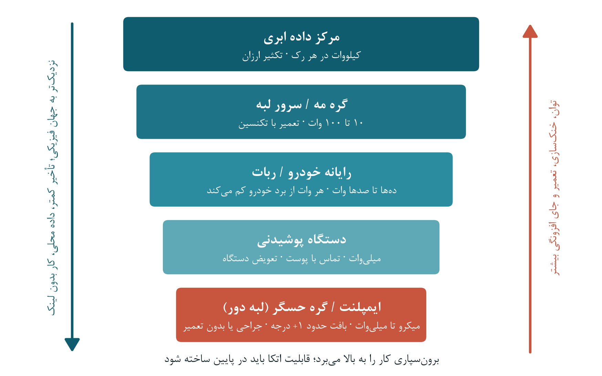
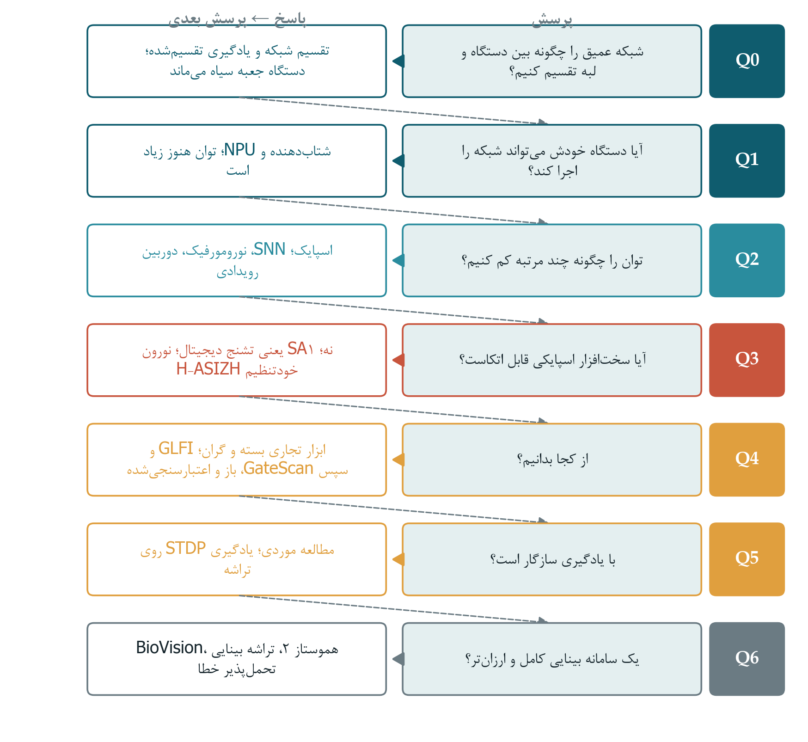

# [فصل ۱ --- مقدمه و مرور ادبیات]{dir="rtl"}

## [۱-۱ درآمد: هوش کجا باید زندگی کند؟]{dir="rtl"}

[دوربین دیگر فقط وسیله‌ای برای عکس گرفتن نیست. در خودرو، پهپاد، عینک
هوشمند یا پروتز شبکیه، دوربین نخستین حلقه از زنجیره‌ی یک تصمیم است.
[تصویر و ویدیو سنگین‌ترین جریان‌های داده‌ای هستند]{.mark} که حسگرها تولید
می‌کنند، و یادگیری عمیق این جریان‌ها را با دقتی به تصمیم تبدیل کرده است که
ده سال پیش دست‌نیافتنی بود \[۱، ۲\]. وقتی دوربین شروع به تصمیم‌گیری می‌کند،
پرسش دشوار دیگر این نیست که چیزی را که می‌بیند چگونه تشخیص دهد. پرسش این
است که این تشخیص کجا باید انجام شود: در یک مرکز داده‌ی دوردست، در یک گره
مه (]{dir="rtl"}fog[) در همان خیابان، در یک سرور لبه کنار ایستگاه پایه،
یا روی خود دستگاهی که حسگر را در خود دارد.]{dir="rtl"}

[این پایان‌نامه از سمت سیستمی همین پرسش آغاز شد. نخستین مسئله‌های ما همان
مسئله‌های رایج هوش لبه بودند: اینکه یک شبکه‌ی عصبی عمیق (]{dir="rtl"}DNN[)
را چگونه میان یک دستگاه ضعیف و یک سرور لبه‌ی قوی‌تر تقسیم کنیم، چگونه مدلی
را با یادگیری تقسیم‌شده (]{dir="rtl"}split learning[) و بدون جابه‌جا کردن
داده‌ی خام آموزش دهیم، و چه زمانی یک وظیفه باید برون‌سپاری
(]{dir="rtl"}offload[) شود \[۳--۵\]. این‌ها مسئله‌های خوبی هستند و جامعه‌ی
پژوهشی بسیاری از آن‌ها را به‌خوبی حل کرده است. اما هرچه بیشتر روی آن‌ها کار
کردیم، یک الگو روشن‌تر شد. تقریباً همه‌ی روش‌های سطح سیستم، دستگاه انتهایی
را جعبه‌ای سیاه با توانایی ثابت می‌بینند که همیشه درست محاسبه می‌کند. وقتی
دستگاه ضعیف است، پاسخ این است که کار را از آن دور کنیم. ما یک مشکل محلی
داشتیم، یعنی دستگاهی که نمی‌توانست کار خودش را انجام دهد، و برای حل آن
سامانه‌های بزرگ‌تری در مقیاس‌های بالاتر ساختیم و درگیر همان‌ها شدیم. در این
میان دستگاهی که در پایین پشته قرار داشت فراموش شد.]{dir="rtl"}

[این فصل همان مسیر را از بالا به پایین دوباره می‌پیماید. از ابر شروع
می‌کند، از مه و لبه پایین می‌آید تا به دستگاه انتهایی برسد، و سپس به درون
دستگاه می‌رود: به شتاب‌دهنده‌اش، به نورون‌های اسپایکی‌اش، و در نهایت به
ترانزیستورهایش. در هر گام پرسشی پیدا می‌شود که پاسخش گام بعدی را ناگزیر
می‌کند. ادعای این فصل این نیست که نگاه سیستمی نادرست است. برون‌سپاری،
تقسیم شبکه و یادگیری مشارکتی مسئله‌های واقعی را حل می‌کنند و همچنان ضروری
خواهند ماند. ادعا این است که این نگاه ناقص است، و بخشی که از قلم انداخته
دقیقاً همان بخشی است که کاربردهای ایمنی‌محور بدون آن کار
نمی‌کنند.]{dir="rtl"}

> [**گزاره‌ی اصلی پایان‌نامه.** در پردازش تصویر و ویدیوی مأموریت‌محور و
> ایمنی‌محور، سامانه می‌تواند بار را تقسیم کند اما مسئولیت را نمی‌تواند
> تقسیم کند: حلقه‌ی بسته‌ی ادراک و تصمیم باید روی خود دستگاه قابل اتکا
> باشد. با حرکت محاسبه از ابر به لبه‌ی دور، تحمل‌پذیری خطا نیز باید همراه
> آن حرکت کند؛ از سامانه به شتاب‌دهنده، و از شتاب‌دهنده به
> نورون.]{dir="rtl"}

## [۱-۲ پیوستار محاسباتی: از ابر تا لبه‌ی دور]{dir="rtl"}

### [۱-۲-۱ ابر: فراوانی منابع، اما از راه دور]{dir="rtl"}

[رایانش ابری این تصور را برای برنامه‌ها پدید آورد که منابع محاسباتی
بی‌پایان و در لحظه در دسترس‌اند، نیاز به سرمایه‌گذاری اولیه را از میان
برداشت، و به کاربران امکان داد فقط برای مدتی که از منابع استفاده می‌کنند
هزینه بپردازند \[۶\]. برای یادگیری عمیق این فراوانی تعیین‌کننده بود.
شبکه‌های امروزی روی مجموعه‌داده‌های بسیار بزرگ و با بودجه‌های محاسباتی بسیار
بزرگ آموزش می‌بینند، تا جایی که هزینه‌ی انرژی و کربن این آموزش خود به
موضوع پژوهش تبدیل شده است \[۷، ۸\]. مراکز داده نخستین خانه‌ی سخت‌افزارهای
ویژه‌ی]{dir="rtl"} DNN [نیز بودند: واحد پردازش تانسوری (]{dir="rtl"}TPU[)
گوگل که از سال ۲۰۱۵ در مراکز داده‌ی عملیاتی به کار رفت، استنتاج را به‌طور
میانگین ۱۵ تا ۳۰ برابر سریع‌تر از پردازنده‌های مرکزی و گرافیکی هم‌دوره‌اش
انجام می‌داد و بازده انرژی آن بر حسب]{dir="rtl"} TOPS [بر وات ۳۰ تا ۸۰
برابر بیشتر بود \[۹\].]{dir="rtl"}

[ضعف ابر، فاصله است.]{dir="rtl"} Capra [و همکاران در مرور خود بر
شتاب‌دهی]{dir="rtl"} DNN [یادآوری می‌کنند که رایانش ابری به اتصال اینترنت
وابسته است و به همین دلیل برای کاربردهایی که وقفه در سرویس را تاب
نمی‌آورند، مانند خودروهای خودران، مناسب نیست. آن‌ها همچنین اشاره می‌کنند که
انتقال داده میان کاربر و سرور، داده را در برابر نفوذ آسیب‌پذیرتر می‌کند و
کاربردهای حساس به تأخیر با پردازش نزدیک حسگر بهتر از ارسال داده از راه
اینترنت پاسخ می‌گیرند \[۱۰\].]{dir="rtl"}

### [۱-۲-۲ کلادلت، مه و لبه: نزدیک‌تر کردن ابر]{dir="rtl"}

[جامعه‌ی سیستم‌ها به مسئله‌ی فاصله این‌گونه پاسخ داد که منابع محاسباتی را به
سوی داده برد.]{dir="rtl"} Satyanarayanan [و همکاران «کلادلت»
(]{dir="rtl"}cloudlet[) را پیشنهاد کردند: رایانه‌هایی پرمنبع و مبتنی بر
ماشین مجازی که تنها یک گام بی‌سیم با کاربر همراه فاصله دارند و برای پرهیز
از تأخیر شبکه‌های گسترده در کاربردهای تعاملی ساخته شده‌اند
\[۱۱\].]{dir="rtl"} Bonomi [و همکاران «رایانش مه» (]{dir="rtl"}fog
computing[) را به‌عنوان گسترش ابر تا لبه‌ی شبکه معرفی کردند؛ با تأخیر کم،
آگاهی از مکان، توزیع جغرافیایی گسترده، پشتیبانی از جابه‌جایی و تعامل
بلادرنگ، و شمار بسیار زیادی گره \[۱۲\].]{dir="rtl"} Shi [و همکاران
«رایانش لبه» (]{dir="rtl"}edge computing[) را محاسبه در لبه‌ی شبکه از طرف
سرویس‌های ابری و دستگاه‌های اینترنت اشیا (]{dir="rtl"}IoT[) تعریف کردند.
آن‌ها انگیزه‌ی آن را در فشار سرویس‌های ابری، کشش اینترنت اشیا و تبدیل
دستگاه‌های انتهایی از مصرف‌کننده‌ی داده به تولیدکننده‌ی داده دیدند، و
چالش‌های بازش را برشمردند: برنامه‌پذیری، نام‌گذاری، انتزاع داده، مدیریت
سرویس، حریم خصوصی و امنیت، و معیارهای بهینه‌سازی \[۱۳، ۱۴\].]{dir="rtl"}

[این چشم‌انداز به‌سرعت گسترش یافت.]{dir="rtl"} Chiang [و]{dir="rtl"} Zhang
[فرصت‌های پژوهشی رایانش مه برای اینترنت اشیا را مرور کردند \[۱۵\]
و]{dir="rtl"} Satyanarayanan [پیدایش رایانش لبه را به‌عنوان لایه‌ای تازه
میان ابر و دستگاه توصیف کرد \[۱۶\]. رایانش لبه‌ی چنددسترسی یا همراه
(]{dir="rtl"}MEC[) سرورها را به درون شبکه‌ی دسترسی رادیویی
برد.]{dir="rtl"} Mao [و همکاران]{dir="rtl"} MEC [را از دیدگاه مخابراتی
مرور کردند؛ دیدگاهی که در آن منابع رادیویی و محاسباتی باید با هم تخصیص
یابند \[۱۷\].]{dir="rtl"} Mach [و]{dir="rtl"} Becvar [این حوزه را حول سه
مسئله سامان دادند: تصمیم به برون‌سپاری، تخصیص منابع محاسباتی، و مدیریت
جابه‌جایی \[۱۸\]. مرورهای دیگری نیز به معماری]{dir="rtl"} MEC [\[۱۹\] و
رایانش مه \[۲۰، ۲۱\] پرداختند. پژوهش‌های تازه‌تر ابر، مه، لبه و دستگاه‌ها
را یک «پیوستار لبه تا ابر» واحد می‌بینند که هوش در سراسر آن توزیع می‌شود
\[۲۲، ۲۳\].]{dir="rtl"}

### [۱-۲-۳ پشته‌ی لایه‌ای و نردبان محدودیت‌هایش]{dir="rtl"}

[نتیجه یک پشته‌ی لایه‌ای است (شکل ۱-۱). در بالای آن ابر قرار دارد، سپس
گره‌های مه و سرورهای لبه، سپس دستگاه‌های انتهایی مانند تلفن همراه و خودرو،
و در پایین «لبه‌ی دور» (]{dir="rtl"}extreme edge[): گره‌های حسگر،
دستگاه‌های پوشیدنی و ایمپلنت‌ها. پایین رفتن در این پشته محاسبه را به جهان
فیزیکی نزدیک‌تر می‌کند. تأخیر تا حسگر کم می‌شود، داده نزد صاحبش می‌ماند، و
دستگاه بدون شبکه هم به کار ادامه می‌دهد. اما پایین رفتن در پشته منابع را
هم کم می‌کند. بودجه‌ی توان از کیلووات در هر رک سرور به میلی‌وات یا میکرووات
می‌رسد. خنک‌سازی از هواسازی مرکز داده به یک بدنه‌ی بسته، سپس به تماس با
پوست، و سپس به بافت زنده تبدیل می‌شود. تعمیر از تعویض داغ در چند ثانیه،
به مراجعه‌ی تکنسین، به تعویض دستگاه، و سرانجام به جراحی می‌رسد. افزونگی هم
از یک تصمیم مهندسی معمولی به یک ناممکن فیزیکی تبدیل می‌شود.]{dir="rtl"}

{width="6.102362204724409in"
height="3.819212598425197in"}

[**شکل ۱-۱:** پیوستار لبه تا ابر و نردبان محدودیت‌هایش. با پایین رفتن در
پشته، نزدیکی به جهان فیزیکی بیشتر و توان، حاشیه‌ی حرارتی، امکان تعمیر و
جای افزونگی کمتر می‌شود.]{dir="rtl"}

[جدول ۱-۱ این نردبان را خلاصه می‌کند. عددهای آن مرتبه‌های بزرگی تقریبی‌اند،
نه مشخصات فنی. ارقام سکوهای سخت‌افزاری از مقایسه‌ی]{dir="rtl"} Capra [و
همکاران گرفته شده است که پردازنده‌ی مرکزی را در حدود ۱۰ تا ۱۰۰ وات،
پردازنده‌ی گرافیکی را در حدود ۱۰۰ وات،]{dir="rtl"} FPGA [را در ۱ تا ۱۰
وات و شتاب‌دهنده‌های]{dir="rtl"} ASIC [را در ۰٫۱ تا ۱ وات قرار می‌دهند
\[۱۰\]. ردیف ایمپلنت از ادبیات حرارتی واسط‌های مغز و ماشین پیروی می‌کند که
معمولاً افزایش حدود ۱ درجه‌ی سانتی‌گراد دمای بافت را حد ایمن می‌داند \[۲۴،
۲۵\].]{dir="rtl"}

[**جدول ۱-۱:** نردبان محدودیت‌ها در پیوستار محاسباتی (مرتبه‌های بزرگی
تقریبی).]{dir="rtl"}

  --------------------------------------------------------------------------------------------------------------------
  **[لایه]{dir="rtl"}**   **[بودجه‌ی توان         **[مسیر دفع          **[تعمیر]{dir="rtl"}**   **[جای
                          معمول]{dir="rtl"}**    گرما]{dir="rtl"}**                            افزونگی]{dir="rtl"}**
  ----------------------- ---------------------- -------------------- ------------------------ -----------------------
  [مرکز داده‌ی             [کیلووات در هر         [خنک‌سازی هوای اجباری [تعویض داغ، جایگزینی در  [زیاد: تکثیر و رأی‌گیری
  ابری]{dir="rtl"}        رک]{dir="rtl"}         یا مایع]{dir="rtl"}  ناوگان]{dir="rtl"}       یک تصمیم مالی
                                                                                               است]{dir="rtl"}

  [گره مه / سرور          [۱۰ تا ۱۰۰             [فن یا بدنه‌ی         [مراجعه‌ی                 [متوسط]{dir="rtl"}
  لبه]{dir="rtl"}         وات]{dir="rtl"}        بسته]{dir="rtl"}     تکنسین]{dir="rtl"}       

  [رایانه‌ی خودرو یا       [ده‌ها تا صدها وات،     [مدار خنک‌سازی        [تعمیرگاه]{dir="rtl"}    [محدود: هر وات از برد
  ربات]{dir="rtl"}        مشترک با               خودرو]{dir="rtl"}                             خودرو
                          پیشرانه]{dir="rtl"}                                                  می‌کاهد]{dir="rtl"}

  [دستگاه                 [میلی‌وات]{dir="rtl"}   [تماس با             [تعویض                   [کم]{dir="rtl"}
  پوشیدنی]{dir="rtl"}                            پوست]{dir="rtl"}     دستگاه]{dir="rtl"}       

  [ایمپلنت / گره          [میکرووات تا           [بافت زنده، حدود ۱+  [جراحی یا                [بسیار کم: سه‌برابرسازی
  حسگر]{dir="rtl"}        میلی‌وات]{dir="rtl"}    درجه]{dir="rtl"}     هیچ]{dir="rtl"}          از نظر فیزیکی منتفی
                                                                                               است]{dir="rtl"}
  --------------------------------------------------------------------------------------------------------------------

[پاسخ اصلی جامعه‌ی سیستم‌ها به کاهش منابع در پایین این نردبان، بالا بردن
محاسبه در همین نردبان بود. بخش بعد این پاسخ را مرور می‌کند.]{dir="rtl"}

## [۱-۳ هوش لبه و پارادایم برون‌سپاری]{dir="rtl"}

### [۱-۳-۱ از برون‌سپاری کد تا استدلال انرژی]{dir="rtl"}

[برون‌سپاری پیش از یادگیری عمیق آغاز شد.]{dir="rtl"} MAUI [متدهای منفرد
یک برنامه‌ی تلفن همراه را برای صرفه‌جویی در باتری به سرورهای دوردست
می‌فرستاد \[۲۶\] و]{dir="rtl"} CloneCloud [رشته‌های اجرا را به نسخه‌ای
همسان از تلفن که در ابر اجرا می‌شد منتقل می‌کرد \[۲۷\].]{dir="rtl"} Kumar
[و]{dir="rtl"} Lu [پرسش تعیین‌کننده را زود مطرح کردند: آیا برون‌سپاری
واقعاً انرژی را کم می‌کند؟ پاسخ آن‌ها مشروط بود. برون‌سپاری زمانی سودمند است
که برنامه محاسبه‌ی زیاد و ارتباط کم داشته باشد، و تنها وقتی که پهنای باند
بی‌سیم به اندازه‌ی کافی زیاد باشد. در غیر این صورت انرژی صرف‌شده برای ارسال
داده از انرژی صرفه‌جویی‌شده بیشتر می‌شود \[۲۸\]. این شرط در سراسر این حوزه
تکرار می‌شود.]{dir="rtl"}

### [۱-۳-۲ تقسیم شبکه‌های عمیق در طول پیوستار]{dir="rtl"}

[شبکه‌های عمیق برون‌سپاری را دوباره جذاب کردند، چون لایه‌هایشان نقطه‌های برش
طبیعی پدید می‌آورند.]{dir="rtl"} Neurosurgeon [یک]{dir="rtl"} DNN [را
لایه به لایه نمایه‌سازی می‌کند و در زمان اجرا لایه‌ای را برمی‌گزیند که
محاسبه در آن میان دستگاه همراه و ابر تقسیم شود؛ این انتخاب بر پایه‌ی
تأخیر و انرژی پیش‌بینی‌شده و وضعیت لحظه‌ای شبکه است \[۲۹\]. شبکه‌های عصبی
عمیق توزیع‌شده (]{dir="rtl"}DDNN[) یک شبکه را در ابر، لبه و دستگاه‌های
انتهایی پخش می‌کنند و خروجی‌های زودهنگام می‌افزایند تا ورودی‌های آسان به‌صورت
محلی دسته‌بندی شوند و فقط ورودی‌های دشوار به بالا بروند
\[۳۰\].]{dir="rtl"} Edgent [تقسیم شبکه را با «اندازه‌گزینی»
(]{dir="rtl"}right-sizing[)، یعنی خروج زودهنگام برای رسیدن به هدف تأخیر،
ترکیب می‌کند و هر دو را با پهنای باند در دسترس سازگار می‌کند
\[۳۱\].]{dir="rtl"} DADS [شبکه‌هایی با ساختار گراف جهت‌دار بی‌دور را با یک
صورت‌بندی برش کمینه تقسیم می‌کند و برش را با بار سرور سازگار می‌کند
\[۳۲\].]{dir="rtl"} JointDNN [اجرای مشترک دستگاه و ابر را به آموزش و
استنتاج هر دو گسترش می‌دهد \[۳۳\] و]{dir="rtl"} SPINN [استنتاج پیش‌رونده
با خروجی‌های زودهنگام را میان دستگاه و ابر انجام می‌دهد
\[۳۴\].]{dir="rtl"} Matsubara [و همکاران کل این خانواده را با عنوان
«محاسبات تقسیم‌شده و خروج زودهنگام» مرور کرده‌اند \[۳۵\].]{dir="rtl"}

Zhou [و همکاران هوش لبه را در سطح‌هایی سامان می‌دهند که از هوش مبتنی بر
ابر آغاز می‌شود، از استنتاج مشترک ابر و لبه و استنتاج مشترک درون لبه
می‌گذرد، به استنتاج روی دستگاه می‌رسد و سرانجام به آموزش و استنتاج کاملاً
روی دستگاه ختم می‌شود \[۳\].]{dir="rtl"} Chen [و]{dir="rtl"} Ran [\[۴\]
و]{dir="rtl"} Wang [و همکاران \[۵\] همین هم‌گرایی یادگیری عمیق و رایانش
لبه را مرور کرده‌اند. در مقیاس]{dir="rtl"} Zhou[، بالاترین سطح هوش لبه
سطحی است که در آن هیچ چیز از دستگاه بیرون نمی‌رود.]{dir="rtl"}

### [۱-۳-۳ یادگیری مشارکتی: تقسیم‌شده و فدرال]{dir="rtl"}

[همین منطق در آموزش هم به کار می‌رود. در یادگیری تقسیم‌شده، لایه‌های نخست
شبکه روی دستگاه صاحب داده اجرا می‌شوند و فقط فعال‌سازی‌های میانی، یعنی
«داده‌ی خردشده» (]{dir="rtl"}smashed data[)، به سروری فرستاده می‌شوند که
لایه‌های باقی‌مانده را در اختیار دارد \[۳۶\]. طرفداران این روش آن را راهی
برای آموزش روی داده‌ی پزشکی بدون اشتراک پرونده‌ی خام بیماران معرفی می‌کنند
\[۳۷\]. یادگیری فدرال داده را روی دستگاه‌ها نگه می‌دارد و به‌روزرسانی‌های
مدل را به یک تجمیع‌کننده‌ی مرکزی می‌فرستد \[۳۸\].]{dir="rtl"} Kairouz [و
همکاران مسئله‌های باز فراوان آن را مرور کرده‌اند \[۳۹\] و]{dir="rtl"}
SplitFed [دو روش را با هم ترکیب می‌کند \[۴۰\]. با این حال حریم خصوصی
خودبه‌خود تأمین نمی‌شود.]{dir="rtl"} Pasquini [و همکاران نشان دادند که یک
سرور بدخواه در یادگیری تقسیم‌شده می‌تواند فرایند آموزش را در دست بگیرد و
داده‌ی خصوصی کاربران را بازسازی کند \[۴۱\].]{dir="rtl"}

### [۱-۳-۴ نگاه سیستمی چه چیزی را بهینه می‌کند و چه چیزی را فرض می‌گیرد]{dir="rtl"}

[این مجموعه‌ی پژوهشی در کنار هم مجموعه‌ی روشنی از اهداف را بهینه می‌کند:
تأخیر سرتاسری، انرژی دستگاه، گذردهی، دقت، کیفیت سرویس
(]{dir="rtl"}QoS[)، کیفیت تجربه (]{dir="rtl"}QoE[) و هزینه. متغیری که
روی آن بهینه‌سازی می‌شود «جای‌گذاری» است: کدام لایه، کدام گره، کدام خروجی،
کدام دور. فرض‌های آن نیز به همان اندازه یکدست‌اند. شبکه عنصر نامطمئن است و
دستگاه منبعی شناخته‌شده، ثابت و درست است؛ جعبه‌ای سیاه که تنها ویژگی مهمش
سرعت محاسبه است. کارهای نخستین خود ما در این پایان‌نامه کاملاً درون همین
فرض‌ها بود. باقی این فصل بررسی می‌کند که وقتی این فرض‌ها زیر سؤال بروند چه
پیش می‌آید.]{dir="rtl"}

## [۱-۴ بهای برون‌سپاری: وقتی محیط تصادفی می‌شود]{dir="rtl"}

[دستگاه اختصاصی‌ای که محاسبه را به‌صورت محلی انجام می‌دهد به یک سامانه‌ی
قطعی نزدیک است. ورودی یکسان از مسیر یکسان در مدار یکسان می‌گذرد و در
زمانی کران‌دار تمام می‌شود. برون‌سپاری این سامانه‌ی بسته را به سامانه‌ای باز
تبدیل می‌کند. وظیفه اکنون از کانالی بی‌سیم می‌گذرد که کیفیتش تغییر می‌کند،
در صف سروری می‌نشیند که با کاربران ناشناس مشترک است، به در دسترس بودن آن
سرور وابسته می‌شود، و وارد حوزه‌ی امنیتی دیگری می‌شود. هر یک از این عناصر
متغیرهای تصادفی تازه‌ای می‌افزاید؛ هم به زمان پاسخ و هم به اینکه اصلاً
نتیجه‌ی درستی برسد یا نه. برون‌سپاری عدم قطعیت را از یک دستگاه ضعیف حذف
نمی‌کند. توانایی محدود دستگاه را با فضای شکستی بزرگ‌تر و تصادفی‌تر معاوضه
می‌کند. شش استدلال نشان می‌دهند که این معاوضه وقتی وظیفه ایمنی‌محور است چه
بهایی دارد.]{dir="rtl"}

### [۱-۴-۱ تأخیر به یک توزیع تبدیل می‌شود]{dir="rtl"}

[وقتی یک عملیات به اجزای مشترک فراوانی وابسته باشد، تأخیرهای نادر دیگر
نادر نیستند.]{dir="rtl"} Dean [و]{dir="rtl"} Barroso [نشان دادند که پخش
درخواست میان سرورهای متعدد، دنباله‌ی توزیع تأخیر را بزرگ‌نمایی می‌کند. اگر
یک سرور در یک مورد از هر صد مورد کند پاسخ دهد، درخواستی که باید منتظر صد
سرور از این دست بماند در حدود ۶۳ درصد موارد کند خواهد بود \[۴۲\].
پیوندهای بی‌سیم دنباله‌های خود را می‌افزایند.]{dir="rtl"} Bennis [و همکاران
استدلال می‌کنند که ارتباط فوق‌قابل‌اطمینان و کم‌تأخیر را نمی‌توان بر پایه‌ی
میانگین‌ها طراحی کرد و باید آن را بر حسب دنباله‌ها، ریسک و مقیاس طراحی کرد
\[۴۳\]. اما یک حلقه‌ی بلادرنگ سخت را با بدترین حالتش می‌سنجند، نه با
میانگینش. درستی آن به زمان‌های کران‌دار اجرا و ارتباط در بدترین حالت
وابسته است \[۴۴، ۴۵\]. کران‌دار کردن این زمان‌ها روی یک شبکه‌ی مشترک و
پرازدحام بسیار دشوارتر از کران‌دار کردن آن‌ها روی یک تراشه‌ی اختصاصی است.
همین درس حتی درون مرکز داده هم دیده می‌شود.]{dir="rtl"} Jouppi [و همکاران
یادآوری می‌کنند که مدل اجرای قطعی]{dir="rtl"} TPU [با الزام زمان پاسخ صدک
۹۹ام کاربردهایشان سازگارتر بود تا بهینه‌سازی‌های متغیر با زمان پردازنده‌های
مرکزی و گرافیکی، که بیشتر به گذردهی میانگین کمک می‌کنند تا به تأخیر
تضمین‌شده \[۹\].]{dir="rtl"}

### [۱-۴-۲ اتصال را نمی‌توان مفروض گرفت]{dir="rtl"}

[برون‌سپاری فقط تا زمانی کمک می‌کند که پیوندی وجود داشته باشد. خودروها از
تونل‌ها و مناطق روستایی می‌گذرند، پهپادها از محدوده‌ی پوشش بیرون می‌روند، و
بلایای طبیعی شبکه‌ها را درست در زمانی از کار می‌اندازند که بیش از همیشه به
آن‌ها نیاز است. بافت بدن امواج رادیویی را تضعیف می‌کند و ایمپلنت‌ها را به
پیوندهای کم‌پهنا وادار می‌کند. همان‌طور که پیش‌تر گفته شد،]{dir="rtl"} Capra
[و همکاران اجرای ابری را برای کاربردهایی که وقفه‌ی سرویس را تاب نمی‌آورند
نامناسب می‌دانند و خودروهای خودران را نمونه می‌آورند \[۱۰\].]{dir="rtl"}
Liu [و همکاران خود خودروی خودران را یک سکوی رایانش لبه می‌بینند که
رایانه‌های درون خودرو وظیفه‌های بلادرنگ آن را انجام می‌دهند
\[۴۶\].]{dir="rtl"}

### [۱-۴-۳ جابه‌جایی داده می‌تواند گران‌تر از پردازش آن باشد]{dir="rtl"}

Pottie [و]{dir="rtl"} Kaiser [بیش از دو دهه پیش این معاوضه را برای
حسگرهای بی‌سیم کمّی کردند. ارسال یک کیلوبیت داده تا فاصله‌ی ۱۰۰ متر تقریباً
به اندازه‌ی اجرای سه میلیون دستور روی پردازنده‌ای با بازده ۱۰۰]{dir="rtl"}
MIPS/W [انرژی مصرف می‌کند \[۴۷\]. پاسخ مشروط]{dir="rtl"} Kumar
[و]{dir="rtl"} Lu [درباره‌ی برون‌سپاری در دستگاه‌های همراه نیز از همین
معاوضه می‌آید \[۲۸\]. همین معاوضه توضیح می‌دهد که چرا]{dir="rtl"} Capra [و
همکاران کاهش انرژی ارسال و حفظ بهتر حریم داده را از دلایل محاسبه در لبه
برمی‌شمارند \[۱۰\]. ویدیو بدترین حالت است، چون بزرگ‌ترین جریانی است که یک
حسگر می‌تواند تولید کند.]{dir="rtl"} Even-Chen [و همکاران در واسط‌های مغز
و رایانه‌ی (]{dir="rtl"}BCI[) درون‌قشری نشان دادند که ارسال بی‌سیم داده سهم
بزرگی از بودجه‌ی توان را می‌گیرد و کاهش داده‌ی ارسالی با پردازش روی
ایمپلنت، صرفه‌جویی چشمگیری در توان پدید می‌آورد \[۴۸\].]{dir="rtl"}

### [۱-۴-۴ هر پیوند یک سطح حمله است]{dir="rtl"}

[هر گام ارتباطی و هر گره مشترک یک نقطه‌ی حمله‌ی تازه است.]{dir="rtl"}
Roman [و همکاران تهدیدهای ویژه‌ی پارادایم‌های لبه‌ی همراه و مه را فهرست
کرده‌اند، از جمله گره‌های آلوده یا جعلی، شنود ترافیک، حمله‌ی منع سرویس و
نشت داده‌ی خصوصی \[۴۹\]. یادگیری تقسیم‌شده نشان می‌دهد که فرستادن ویژگی‌های
میانی به‌تنهایی از داده محافظت نمی‌کند \[۴۱\]. در بینایی و واسط‌های عصبی،
داده‌ها جزو حساس‌ترین داده‌هایی هستند که یک انسان می‌تواند تولید کند: ویدیوی
یک فضای خصوصی، یا فعالیت الکتریکی مغز. پردازش محلی به‌تنهایی سامانه را
امن نمی‌کند، اما رده‌های کاملی از حمله را حذف می‌کند.]{dir="rtl"}

### [۱-۴-۵ گواهی ایمنی به یک سامانه‌ی کران‌دار نیاز دارد]{dir="rtl"}

[حوزه‌های ایمنی‌محور تحت استانداردهای ایمنی عملکردی قرار
دارند.]{dir="rtl"} IEC 61508 [استاندارد عمومی است \[۵۰\]،]{dir="rtl"}
ISO 26262 [آن را برای خودروهای جاده‌ای بومی می‌کند \[۵۱\]،]{dir="rtl"} IEC
62304 [چرخه‌ی عمر نرم‌افزار تجهیزات پزشکی را تنظیم می‌کند \[۵۲\]
و]{dir="rtl"} DO-254 [راهنمای تضمین طراحی برای سخت‌افزار الکترونیکی هوایی
است \[۵۳\]. این استانداردها تحلیل مخاطره، اهداف ایمنی برآمده از آن، و
شواهدی می‌خواهند که نشان دهد خطاهای سخت‌افزاری آشکار یا مهار می‌شوند. در
خودروهای جاده‌ای این شواهد شامل معیارهای کمّی سخت‌افزاری مانند معیار خطای
تک‌نقطه‌ای و معیار خطای پنهان است \[۵۱\].]{dir="rtl"} Koopman
[و]{dir="rtl"} Wagner [نشان می‌دهند که اعتبارسنجی یک خودروی خودران حتی
وقتی همه‌ی محاسباتش درون خودرو است چقدر دشوار است \[۵۴\]. ساختن پرونده‌ی
ایمنی برای یک سامانه‌ی کران‌دار و اختصاصی که خطاهایش قابل شمارش است بسیار
آسان‌تر از ساختن آن برای زنجیره‌ای است که از شبکه‌ها و سرورهای مشترک متعلق
به دیگران می‌گذرد.]{dir="rtl"}

### [۱-۴-۶ عمل در حوزه‌های ایمنی‌محور چه نشان می‌دهد]{dir="rtl"}

[تجربه‌ی عملی این استدلال‌ها را تأیید می‌کند. مطالعات معماری رانندگی
خودران، خط لوله‌ی پردازش شامل حس‌کردن، ادراک، مکان‌یابی، برنامه‌ریزی و کنترل
را مجموعه‌ای از محاسبات درون خودرو با محدودیت‌های تأخیر سخت‌گیرانه توصیف
می‌کنند. همین مطالعات نشان می‌دهند که توان و گرمای رایانه‌ی درون خودرو از
برد خودرو می‌کاهد \[۵۵، ۵۶\]. رایانه‌ی رانندگی کاملاً خودکار تسلا
شتاب‌دهنده‌های عصبی سفارشی را روی بردی یکپارچه می‌کند که برای افزونگی دو
سامانه‌ی روی تراشه‌ی مستقل دارد \[۵۷\].]{dir="rtl"} Yurtsever [و همکاران
سامانه‌های «فقط‌خودرو» (]{dir="rtl"}ego-only[)، که همه‌ی عملیات رانندگی
خودکار را روی یک خودروی خودکفا انجام می‌دهند، را از سامانه‌های متصل
چندعاملی جدا می‌کنند \[۵۸\]. در سامانه‌های به‌کاررفته، اتصال‌هایی مانند
ارتباط]{dir="rtl"} V2X[، سرویس‌های ابری، به‌روزرسانی نقشه‌های دقیق، یادگیری
ناوگانی، به‌روزرسانی از راه دور و کمک از راه دور، حلقه‌ی ادراک، برنامه‌ریزی
و کنترل را پشتیبانی می‌کنند اما آن را نمی‌بندند \[۴۶، ۵۸\]. ما خودروی
خودران تجاری‌ای سراغ نداریم که حلقه‌ی کنترل ایمنی‌محورش به استنتاج
برون‌سپاری‌شده وابسته باشد.]{dir="rtl"}

[پزشکی همین الگو را با محدودیت‌هایی بسیار سخت‌تر نشان می‌دهد. یک واسط مغز و
ماشین کاشتنی باید توان خود را به‌صورت گرما درون بدن دفع کند، و حاشیه‌ی
ایمنی رایج افزایش دمایی در حدود ۱ درجه‌ی سانتی‌گراد است
\[۲۴\].]{dir="rtl"} Kim [و همکاران اثر حرارتی یک آرایه‌ی میکروالکترود
سه‌بعدی فعال کاشته‌شده در مغز را بررسی کردند. مدل آن‌ها که با آزمایش تأیید
شده پیش‌بینی می‌کند که دمای بافت با توان دفع‌شده در دستگاه به‌صورت خطی بالا
می‌رود؛ با شیبی حدود ۰٫۰۲۹ درجه‌ی سانتی‌گراد بر هر میلی‌وات در گستره‌ی توان
مورد انتظار \[۲۵\]. با این شیب، حاشیه‌ی یک‌درجه‌ای برای همه‌ی کارهای ایمپلنت
تنها چند ده میلی‌وات بودجه‌ی توان باقی می‌گذارد. واسط‌های مغز و رایانه با
شمار کانال زیاد، تقویت و دیجیتال‌سازی کانال‌هایشان را روی تراشه‌های سفارشی
یکپارچه می‌کنند: در سامانه‌ای که]{dir="rtl"} Musk [و]{dir="rtl"} Neuralink
[توصیف کرده‌اند، هر کانال ثبت حدود ۵٫۲ میکرووات و کل تراشه‌ی ۲۵۶ کاناله
حدود ۶ میلی‌وات مصرف می‌کند \[۵۹\]. مرورهای واسط‌های عصبی با محاسبه‌ی روی
دستگاه استدلال می‌کنند که یادگیری ماشین محلی و پردازش نورومورفیک برای
درمان حلقه‌بسته، مثلاً برای آشکارسازی تشنج، لازم‌اند، چون درمان حلقه‌بسته به
تأخیر کم، توان کم و حریم خصوصی نیاز دارد \[۶۰، ۶۱\]. پروتزهای شبکیه با
همین محدودیت‌ها روبه‌رو هستند و افزون بر آن باید ورودی بینایی را هم پردازش
کنند \[۶۲، ۶۳\].]{dir="rtl"}

### [۱-۴-۷ موضعی متوازن: ارتقای انتهای فراموش‌شده]{dir="rtl"}

[این استدلال‌ها به سوی مقابل افراطی، یعنی اینکه همه چیز باید محلی اجرا
شود، نمی‌روند. برون‌سپاری برای کارهای سنگین، تحمل‌پذیر در برابر تأخیر و
غیرحیاتی انتخاب درستی است: آموزش، یادگیری در سطح ناوگان، ساخت نقشه،
تحلیل داده و ذخیره‌سازی بلندمدت. دستگاهی که هرگز برون‌سپاری نکند از
مزایایی که پیوستار فراهم می‌کند هم بی‌بهره می‌ماند. درس واقعی درباره‌ی توازن
است. در دو دهه‌ی گذشته تلاش پژوهشی بیشتر صرف لایه‌های بالای پشته شده و
لایه‌ی پایینی یک مقدار ثابت فرض شده است. این دو جهت مکمل یکدیگرند. هیچ
سامانه‌ای نمی‌تواند از ضعیف‌ترین حلقه‌ی محلی‌ای که هنگام قطع پیوند به آن تکیه
می‌کند قابل اتکاتر باشد. بنابراین ارتقای دستگاه محلی عقب‌نشینی از نگاه
سیستمی نیست. خودش یک مسئله‌ی پژوهشی درجه‌ی یک است و باید در کنار پیوستار
توسعه یابد، نه به جای آن.]{dir="rtl"}

[پرسشی که از اینجا برمی‌خیزد روشن است: دستگاهی که در پایین پشته قرار دارد
برای انجام کار ایمنی‌محور خودش به چه چیزی نیاز دارد؟]{dir="rtl"}

## [۱-۵ توانمندسازی دستگاه: از شبکه‌های عمیق تا شتاب‌دهنده‌ها و اسپایک‌ها]{dir="rtl"}

### [۱-۵-۱ هزینه‌ی اجرای محلی یک شبکه‌ی عمیق]{dir="rtl"}

[نخستین گام بدیهی این است که]{dir="rtl"} DNN [روی خود دستگاه اجرا شود.
اما شبکه‌های عمیق پرهزینه‌اند. یک استنتاج از یک مدل امروزی ممکن است به
میلیاردها عمل ضرب و انباشت (]{dir="rtl"}MAC[) نیاز داشته باشد و
هر]{dir="rtl"} MAC [به عملوندهایی نیاز دارد که باید از حافظه خوانده شوند
\[۱۰، ۶۴\]. خواندن داده گران‌تر از محاسبه با آن است.]{dir="rtl"} Horowitz
[در فناوری ۴۵ نانومتر برآورد کرد که یک جمع صحیح ۳۲بیتی حدود ۰٫۱ پیکوژول
و یک ضرب ممیز شناور ۳۲بیتی حدود ۳٫۷ پیکوژول انرژی می‌برد، در حالی که
خواندن ۳۲ بیت از]{dir="rtl"} DRAM [بیرون از تراشه حدود ۶۴۰ پیکوژول هزینه
دارد \[۶۵\].]{dir="rtl"} Sze [و همکاران نشان دادند که بازده
سخت‌افزار]{dir="rtl"} DNN [به همین دلیل بیش از هر چیز به چگونگی حرکت داده
در سلسله‌مراتب حافظه بستگی دارد، و انتخاب «جریان داده»
(]{dir="rtl"}dataflow[) را به تصمیم محوری طراحی تبدیل کردند \[۶۴\].
آموزش بسیار گران‌تر از استنتاج است و به همین دلیل تقریباً در همه‌ی
سامانه‌های به‌کاررفته در ابر باقی می‌ماند \[۷، ۸، ۱۰\].]{dir="rtl"}

### [۱-۵-۲ پایان مقیاس‌پذیری رایگان]{dir="rtl"}

[دهه‌ها پاسخ به اینکه «دستگاه کند است» فقط انتظار برای نسل بعدی فناوری
ساخت بود. مقیاس‌پذیری]{dir="rtl"} Dennard [چگالی توان را با کوچک شدن
ترانزیستورها ثابت نگه می‌داشت \[۶۶\]. با پایان آن، توان به عامل
محدودکننده تبدیل شد.]{dir="rtl"} Esmaeilzadeh [و همکاران پیش‌بینی کردند
که در فناوری ۲۲ نانومتر حدود ۲۱ درصد از یک تراشه با اندازه‌ی ثابت باید
خاموش بماند و در ۸ نانومتر بیش از نیمی از آن «تاریک» خواهد ماند
\[۶۷\].]{dir="rtl"} Hennessy [و]{dir="rtl"} Patterson [نتیجه گرفتند که
راه اصلی باقی‌مانده برای افزایش کارایی بر وات، معماری‌های ویژه‌ی دامنه است
\[۶۸\]. در یادگیری عمیق، دستگاه تنها زمانی به اندازه‌ی کافی توانمند می‌شود
که سخت‌افزارش برای همان وظیفه طراحی شده باشد.]{dir="rtl"}

### [۱-۵-۳ شتاب‌دهنده‌های]{dir="rtl"} DNN [و واحدهای پردازش عصبی]{dir="rtl"}

[جامعه‌ی معماری با نسلی از شتاب‌دهنده‌های]{dir="rtl"} DNN [پاسخ
داد.]{dir="rtl"} DianNao [نشان داد که یک شتاب‌دهنده‌ی کوچک برای شبکه‌های
عصبی باید حول دسترسی‌های حافظه‌اش طراحی شود \[۶۹\].]{dir="rtl"} Eyeriss
[جریان داده‌ی «ردیف‌ثابت» (]{dir="rtl"}row-stationary[) را معرفی کرد که
حرکت داده را کمینه می‌کند و لایه‌های کانولوشنی]{dir="rtl"} AlexNet [را با
سرعت ۳۴٫۷ فریم بر ثانیه و توان ۲۷۸ میلی‌وات اجرا کرد \[۷۰\].]{dir="rtl"}
TPU [واحدهای ماتریسی سیستولیک را به مرکز داده برد \[۹\].]{dir="rtl"}
Reuther [و همکاران چشم‌انداز حاصل از شتاب‌دهنده‌ها را مرور کرده‌اند که در
توان و کارایی چند مرتبه‌ی بزرگی را دربر می‌گیرد \[۷۱\].]{dir="rtl"} Capra
[و همکاران بهینه‌سازی‌های سخت‌افزاری و نرم‌افزاری متناظر را مرور می‌کنند:
معماری‌های زمانی در برابر مکانی، نگاشت جریان داده، کوانتیزه‌سازی، هرس و
فشرده‌سازی، جستجوی معماری عصبی آگاه از سخت‌افزار، محاسبات تقریبی، و
شتاب‌دهنده‌های ویژه‌ی شبکه‌های اسپایکی \[۱۰، ۷۲\].]{dir="rtl"} Shafique [و
همکاران و]{dir="rtl"} Marchisio [و همکاران به‌طور خاص برای لبه از
بهینه‌سازی میان‌لایه‌ای دفاع می‌کنند که الگوریتم، معماری و مدار را دربر
می‌گیرد \[۷۳، ۷۴\]. طراحی هم‌زمان سامانه و الگوریتم، استنتاج در
مقیاس]{dir="rtl"} ImageNet [را تا ریزکنترل‌گرهای تجاری پایین آورده است
\[۷۵\].]{dir="rtl"}

[این پیشرفت‌ها توانایی دستگاه‌های انتهایی را دگرگون کردند، اما شکاف را در
انتهای پیوستار نبستند.]{dir="rtl"} Capra [و همکاران یادآوری می‌کنند که
توان مورد نیاز یک پردازنده‌ی گرافیکی پیشرفته بسیار فراتر از پوشش توان
سکوهای لبه‌ی اینترنت اشیاست، که بسیاری از آن‌ها با باتری یا انرژی
برداشت‌شده کار می‌کنند \[۱۰\]. حتی شتاب‌دهنده‌های]{dir="rtl"} ASIC [اختصاصی،
با توان ۰٫۱ تا ۱ وات در مقایسه‌ی آنان، چند مرتبه‌ی بزرگی بالاتر از بودجه‌ی
ایمپلنتی هستند که باید دمایش در حد حدود ۱ درجه بالاتر از دمای بدن بماند
\[۲۴\]. جهش دیگری لازم است، و این جهش باید از تغییر خود نمایش محاسباتی
بیاید.]{dir="rtl"}

### [۱-۵-۴ پلی به سوی اسپایک‌ها]{dir="rtl"}

[مغز اثبات وجودی امکان چنین جهشی است. حدود ۱۰¹¹ نورون و ۱۰¹⁴ سیناپس مغز
انسان حدود ۲۰ وات توان مصرف می‌کنند، در حالی که شبیه‌سازی دیجیتال شبکه‌ای
با اندازه‌ی مشابه به مگاوات‌ها توان نیاز دارد \[۷۶\]، و بیشتر انرژی مغز
صرف سیگنال‌دهی می‌شود \[۷۷\]. نورون‌ها با رویدادهای پراکنده و همه‌یا‌هیچ با
هم ارتباط برقرار می‌کنند و فقط وقتی رویدادی می‌رسد محاسبه
می‌کنند.]{dir="rtl"} Maass [شبکه‌های نورون‌های اسپایکی را «نسل سوم» مدل‌های
شبکه‌ی عصبی نامید و نشان داد که از نظر محاسباتی دست‌کم به اندازه‌ی نسل‌های
پیشین توانمندند \[۷۸\]. برنامه‌ی]{dir="rtl"} Mead [برای «سامانه‌های
الکترونیکی نورومورفیک» در پی بهره‌گیری از همین اصول در سیلیکون بود
\[۷۹\].]{dir="rtl"} Roy [و همکاران مرور می‌کنند که هوش ماشینی مبتنی بر
اسپایک چگونه با محاسبه‌ی رویدادمحور و پراکنده و با هم‌جایی حافظه و پردازش،
انرژی را کاهش می‌دهد \[۸۰\].]{dir="rtl"}

[نکته‌ی کلیدی برای این پایان‌نامه این است که شبکه‌های عصبی اسپایکی
(]{dir="rtl"}SNN[) رقیب]{dir="rtl"} DNN[ها نیستند. آن‌ها نمایش سخت‌افزاری
دیگری از همان وظیفه‌ها هستند و چند پل این دو جهان را به هم وصل
می‌کند.]{dir="rtl"} DNN[های آموزش‌دیده را می‌توان با افت دقت اندک
به]{dir="rtl"} SNN[های نرخ‌کد تبدیل کرد \[۸۱\].]{dir="rtl"} SNN[ها را
می‌توان مستقیماً با گرادیان‌های جانشین (]{dir="rtl"}surrogate gradients[)
آموزش داد؛ روشی که بهینه‌سازی مبتنی بر گرادیان را به نورون‌های اسپایکی
می‌برد \[۸۲\]. این شبکه‌ها همچنین می‌توانند با قواعد محلی مانند انعطاف‌پذیری
وابسته به زمان اسپایک (]{dir="rtl"}STDP[) یاد بگیرند که برای یادگیری روی
تراشه و بدون ناظر مناسب است \[۸۳، ۸۴\].]{dir="rtl"} Pfeiffer
[و]{dir="rtl"} Pfeil [\[۸۵\] و]{dir="rtl"} Tavanaei [و همکاران \[۸۶\]
فرصت‌ها و چالش‌های یادگیری عمیق با نورون‌های اسپایکی را مرور کرده‌اند
و]{dir="rtl"} Rathi [و همکاران الگوریتم‌های]{dir="rtl"} SNN [را همراه با
سخت‌افزار آن‌ها بررسی کرده‌اند \[۸۷\]. پس حرکت از]{dir="rtl"} DNN
[به]{dir="rtl"} SNN [حرکتی در امتداد همان مسیر توانمندسازی دستگاه است.
توان یادگیری شبکه‌های عمیق را نگه می‌دارد و هزینه‌ی هر عمل را پایین
می‌آورد.]{dir="rtl"}

### [۱-۵-۵ پردازنده‌های نورومورفیک]{dir="rtl"}

[سخت‌افزار نورومورفیک از نمونه‌های اولیه‌ی پژوهشی به سامانه‌های بزرگ رسیده
است.]{dir="rtl"} TrueNorth [شرکت]{dir="rtl"} IBM [یک میلیون نورون و ۲۵۶
میلیون سیناپس را یکپارچه می‌کند و در کار بلادرنگ ده‌ها میلی‌وات توان می‌کشد
\[۸۸، ۸۹\].]{dir="rtl"} Loihi [شرکت]{dir="rtl"} Intel [یادگیری
برنامه‌پذیر روی تراشه را افزود \[۹۰\].]{dir="rtl"} Davies [و همکاران
بعدها نتایج آن را جمع‌بندی کردند: برای بارهای کاری مناسب، به‌ویژه بارهای
پراکنده، بازگشتی و رویدادمحور، بهبودهای بزرگی در انرژی و تأخیر نسبت به
پردازنده‌های متعارف دیده می‌شود، در حالی که شبکه‌های عمیق پیش‌خور متعارف سود
کمی می‌برند \[۹۱\].]{dir="rtl"} SpiNNaker [رویکرد پردازنده‌ی چندهسته‌ای را
برای شبیه‌سازی بلادرنگ در مقیاس بزرگ برگزید \[۹۲\]. در سوی
کوچک،]{dir="rtl"} ODIN [یک پردازنده‌ی اسپایکی دیجیتال با یادگیری برخط را
در مساحت ۰٫۰۸۶ میلی‌متر مربع در فناوری ۲۸ نانومتر]{dir="rtl"} CMOS [و با
۱۲٫۷ پیکوژول بر هر عمل سیناپسی نشان داد \[۹۳\].]{dir="rtl"} Bouvier [و
همکاران چالش‌های پیاده‌سازی سخت‌افزار]{dir="rtl"} SNN [را مرور کرده‌اند
\[۹۴\].]{dir="rtl"} Schuman [و همکاران الگوریتم‌ها و کاربردهای مناسب
رایانش نورومورفیک را ترسیم کرده‌اند \[۹۵\] و]{dir="rtl"} Mehonic
[و]{dir="rtl"} Kenyon [استدلال می‌کنند که رایانش الهام‌گرفته از مغز برای
رسیدن به توان بالقوه‌اش به یک برنامه‌ی پژوهشی هماهنگ نیاز دارد
\[۷۶\].]{dir="rtl"} Indiveri [و همکاران مدارهای نورون سیلیکونی را که این
سخت‌افزار بر آن‌ها بنا شده مرور کرده‌اند \[۹۶\].]{dir="rtl"}

### [۱-۵-۶ بینایی رویدادمحور: حسگر و پردازنده‌ای که به یک زبان سخن می‌گویند]{dir="rtl"}

[برای پردازش تصویر و ویدیو، که موضوع این پایان‌نامه است، اسپایک‌ها در زمان
بسیار مناسبی از راه می‌رسند، چون خود دوربین هم شروع به تولید آن‌ها کرده
است. حسگر بینایی پویا (]{dir="rtl"}DVS[) که]{dir="rtl"}
Lichtsteiner[،]{dir="rtl"} Posch [و]{dir="rtl"} Delbruck [ساختند،
تغییرات روشنایی هر پیکسل را به‌صورت ناهمگام گزارش می‌دهد؛ با گستره‌ی پویای
۱۲۰ دسی‌بل و تأخیر ۱۵ میکروثانیه \[۹۷\].]{dir="rtl"} Gallego [و همکاران
حوزه‌ی بینایی رویدادمحور و مزایای آن را مرور کرده‌اند: تفکیک زمانی بالا،
تأخیر کم، گستره‌ی پویای بالا و توان کم \[۹۸\].]{dir="rtl"} Chen [و
همکاران بینایی نورومورفیک رویدادمحور را برای رانندگی خودران مرور کرده و
آن را تغییر پارادایمی در حس‌کردن و ادراک بینایی الهام‌گرفته از زیست توصیف
کرده‌اند \[۹۹\]. آن‌ها مزایای آن را برای خودروها برمی‌شمارند: حس‌کردن کم‌مصرف
که فقط پیکسل‌های فعال را پردازش می‌کند، تأخیر کم، گستره‌ی پویای حدود ۱۲۰
دسی‌بل در برابر حدود ۶۰ دسی‌بل دوربین‌های قاب‌محور، تفکیک زمانی
میکروثانیه‌ای، و نبود تاری حرکت. آن‌ها درباره‌ی محدودیت‌ها نیز به همان
اندازه صریح‌اند: حسگرهای رویدادی رنگ و بافت را منتقل نمی‌کنند، از لیدار،
رادار و دوربین کم‌بلوغ‌ترند، و این حوزه هنوز معیارهای ارزیابی بزرگ ندارد
\[۹۹\]. دوربین رویدادی که به یک پردازنده‌ی اسپایکی داده بدهد، خط لوله‌ای
بینایی پدید می‌آورد که هیچ مرحله‌اش داده را به قاب‌های چگال برنمی‌گرداند.
این معماری طبیعی یک دستگاه بینایی در لبه‌ی دور است.]{dir="rtl"}

### [۱-۵-۷ انتخاب نورون برای سیلیکون]{dir="rtl"}

[هر سامانه‌ی نورومورفیک بر یک مدل نورون استوار است و انتخاب آن مصالحه‌ای
میان غنای زیستی و هزینه‌ی سخت‌افزاری است. مدل]{dir="rtl"} Hodgkin--Huxley
[جریان‌های یونی غشا را با جزئیات توصیف می‌کند اما محاسبه‌اش گران است
\[۱۰۰\]. مدل انباشت و آتش نشت‌دار (]{dir="rtl"}LIF[) ارزان است اما
رفتارهای آتش‌کردن اندکی را بازتولید می‌کند.]{dir="rtl"} Izhikevich [مدلی
دومتغیره پیشنهاد کرد که بیش از بیست الگوی آتش‌کردن نورون‌های قشری را
بازتولید می‌کند \[۱۰۱\]. در مقایسه‌ای که خود او میان مدل‌های اسپایکی انجام
داد، این مدل برای هر میلی‌ثانیه شبیه‌سازی حدود ۱۳ عمل ممیز شناور لازم
دارد؛ نزدیک به نورون انباشت و آتش و حدود صد برابر کمتر از]{dir="rtl"}
Hodgkin--Huxley [\[۱۰۲\]. رشته‌ای از طراحی‌های دیجیتال آن را ارزان‌تر هم
کردند: نورون‌های سیلیکونی دیجیتال دینامیکی \[۱۰۳\]، تقریب‌های خطی تکه‌ای
بدون ضرب‌کننده \[۱۰۴\]، پیاده‌سازی بدون ضرب‌کننده‌ی نسخه‌ی نویزی \[۱۰۵\] و
تقریب‌های دقیق شانه‌ای‌ـ‌نمایی \[۱۰۶\]. نورون]{dir="rtl"} Izhikevich [پایه‌ی
عنصر پردازشی این پایان‌نامه است. سازمان آن در سطح شتاب‌دهنده در فصل‌های بعد
بررسی می‌شود و این فصل با پرسشی می‌ماند که پیش از آن مطرح است.]{dir="rtl"}

## [۱-۶ گلوگاه تازه: قابلیت اتکای دستگاه لبه‌ی دور]{dir="rtl"}

[دستگاه اکنون راهی برای رسیدن به توانایی مورد نیازش دارد: شتاب‌دهنده‌ای
اختصاصی که از نورون‌های اسپایکی ساخته شده و دوربینی رویدادی به آن داده
می‌دهد. وقتی دستگاه دیگر به پیوستار تکیه نمی‌کند، درستی خود آن به پرسش
حیاتی تبدیل می‌شود. در ابر، پاسخ غلط یک سرور را می‌توان با رأی سرور دیگری
کنار گذاشت. دستگاهی که تنهاست کسی را ندارد که پاسخ غلطش را با رأی کنار
بگذارد.]{dir="rtl"}

### [۱-۶-۱ واژگانی برای اعتماد]{dir="rtl"}

Avizienis [و همکاران قابلیت اتکا (]{dir="rtl"}dependability[) را توانایی
یک سامانه در ارائه‌ی سرویسی تعریف می‌کنند که بتوان به‌طور موجه به آن اعتماد
کرد. صفات آن عبارت‌اند از در دسترس بودن، قابلیت اطمینان، ایمنی، محرمانگی،
یکپارچگی و قابلیت نگهداری. تهدیدهای آن زنجیره‌ی «خطا ← اشتباه ← شکست»
(]{dir="rtl"}fault [→]{dir="rtl"} error [→]{dir="rtl"} failure[) را
می‌سازند و ابزارهای آن پیشگیری از خطا، تحمل خطا، حذف خطا و پیش‌بینی خطا
هستند \[۱۰۷\]. الزاماتی که برای یک دستگاه ایمنی‌محور در لبه‌ی دور
برشمردیم، یعنی بلادرنگ بودن، قابلیت اطمینان، ایمنی، امنیت و در دسترس
بودن، مستقیماً در همین رده‌بندی جای می‌گیرند؛ با افزودن به‌هنگام بودن
(]{dir="rtl"}timeliness[) به‌عنوان ویژگی‌ای که سامانه‌های بلادرنگ باید
تضمین کنند \[۴۵\]. برای کمّی کردن اینکه یک خطا چند وقت یک بار واقعاً به
شکست می‌انجامد، جامعه‌ی معماری از «ضریب آسیب‌پذیری معماری»
(]{dir="rtl"}AVF[) استفاده می‌کند؛ احتمال اینکه خطایی در یک ساختار به
اشتباهی مشهود بینجامد \[۱۰۸\]. برای یک نورون اسپایکی، شکست یک بیت غلط
نیست؛ یک «ریتم» غلط است.]{dir="rtl"}

### [۱-۶-۲ سیلیکون کم‌اعتمادتر می‌شود]{dir="rtl"}

[همان کوچک‌سازی‌ای که شتاب‌دهنده‌های متراکم را ممکن کرد، ترانزیستورهای آن‌ها
را کم‌اعتمادتر کرده است.]{dir="rtl"} Borkar [چالش ساختن سامانه‌های قابل
اطمینان از اجزایی را توصیف کرد که تغییرپذیری و فرسایش فزاینده دارند
\[۱۰۹\]. خطاهای نرم ناشی از تابش ذرات آلفا و نوترون‌ها به دغدغه‌ای در منطق
و حافظه تبدیل شد \[۱۱۰، ۱۱۱\]. خطاهای دائمی از نقص‌های ساخت و از
سازوکارهای پیرشدگی مانند الکترومهاجرت، شکست دی‌الکتریک، تزریق حامل داغ و
ناپایداری دمایی بایاس پدید می‌آیند. این سازوکارها در دمای بالاتر شتاب
می‌گیرند و پیش‌بینی آن‌ها حوزه‌ای فعال است \[۱۱۲، ۱۱۳\]. بازده ساخت و قابلیت
اطمینان در ۷ نانومتر و پایین‌تر چالش‌های تازه‌ای دارد \[۱۱۴\] و طراحی
سامانه‌ی مقاوم به مسئله‌ای میان‌لایه‌ای تبدیل شده است \[۱۱۵\]. در سطح منطق،
نقص‌های دائمی به‌طور کلاسیک با خطاهای «گیر در» (]{dir="rtl"}stuck-at[) مدل
می‌شوند: یک گره در صفر گیر می‌کند (]{dir="rtl"}SA0[) یا در یک
(]{dir="rtl"}SA1[) \[۱۱۶، ۱۱۷\]. این دو استدلال در لبه‌ی دور به هم
می‌رسند. دستگاه‌هایی که کمترین جا را برای حفاظت دارند همان‌هایی هستند که
داغ کار می‌کنند، مدت‌های طولانی بی‌سرپرست می‌مانند و قابل تعمیر
نیستند.]{dir="rtl"}

### [۱-۶-۳ حتی ابر هم مصون نیست]{dir="rtl"}

[بهره‌برداران بزرگ اکنون گزارش می‌دهند که سخت‌افزار معیوب در محیط عملیاتی
محاسبه را بی‌صدا خراب می‌کند.]{dir="rtl"} Hochschild [و همکاران در گوگل
هسته‌هایی «ناپایدار» (]{dir="rtl"}mercurial[) را توصیف کردند که بدون هیچ
نشانه‌ای از خطا نتیجه‌ی غلط می‌دهند و با نرخ چند هسته در هر چند هزار ماشین
مشاهده شده‌اند \[۱۱۸\].]{dir="rtl"} Dixit [و همکاران خرابی بی‌صدای داده
(]{dir="rtl"}SDC[) را در مقیاس ناوگان]{dir="rtl"} Meta [گزارش کردند
\[۱۱۹\]. ابر این خطاها را با منابعی مهار می‌کند که به فراوانی دارد:
غربالگری در سطح ناوگان، کنار گذاشتن هسته‌های مشکوک و اجرای دوباره در جای
دیگر. هیچ‌یک از این درمان‌ها برای یک ایمپلنت یا یک دستگاه پوشیدنی تنها
وجود ندارد. آنچه ابر یک دردسر عملیاتی می‌بیند، در لبه‌ی دور به شکستی بدون
پشتیبان تبدیل می‌شود.]{dir="rtl"}

### [۱-۶-۴ تحمل خطای کلاسیک و جایگاه آن]{dir="rtl"}

[درمان کلاسیک، افزونگی مکانی است.]{dir="rtl"} von Neumann [نشان داد که
چگونه می‌توان موجوداتی قابل اطمینان را با افزونگی و «اندام‌های
بازگرداننده» (]{dir="rtl"}restoring organs[) از اجزای غیرقابل اطمینان
ساخت \[۱۲۰\].]{dir="rtl"} Lyons [و]{dir="rtl"} Vanderkulk [افزونگی
سه‌پیمانه‌ای (]{dir="rtl"}TMR[) را تحلیل کردند که در آن سه نسخه با رأی
اکثریت تصمیم می‌گیرند \[۱۲۱\]. تحمل نقص به رشته‌ای مستقل در
طراحی]{dir="rtl"} VLSI [تبدیل شد \[۱۱۷\]. مقایسه‌ها روی]{dir="rtl"} FPGA
[تأیید کردند که]{dir="rtl"} TMR [بسیار مؤثر و در عین حال پرهزینه‌ترین
گزینه است \[۱۲۲\]. مقاوم‌سازی گزینشی شبکه‌های عصبی این هزینه را با حفاظت
فقط از بحرانی‌ترین بخش‌ها کم می‌کند \[۱۲۳\].]{dir="rtl"} Cheng [و همکاران
ترکیب روش‌های تاب‌آوری در برابر خطای نرم را در لایه‌های مختلف کاویدند. آن‌ها
دریافتند که برای هسته‌های پردازنده‌ی همه‌منظوره، ترکیبی بهینه از مقاوم‌سازی
گزینشی در سطح مدار، بررسی توازن در سطح منطق و بازیابی در سطح ریزمعماری
بسیار مقرون‌به‌صرفه است، در حالی که بسیاری از ترکیب‌های دیگر چنین نیستند
\[۱۲۴\]. درس آن برای این پایان‌نامه این است که حفاظت مؤثر در لایه‌های
پایین‌تر متمرکز است.]{dir="rtl"}

[در نردبان بخش ۱-۲-۳،]{dir="rtl"} TMR [به پله‌های بالایی تعلق دارد. در
مرکز داده، سه‌برابر کردن یک محاسبه یک تصمیم مالی است. در یک ساعت هوشمند،
عمر باتری‌ای را می‌گیرد که محصول نمی‌تواند از دست بدهد. در یک ایمپلنت،
گرمای دفع‌شده در بافتی را سه برابر می‌کند که فقط حدود یک درجه گرم شدن را
تاب می‌آورد \[۲۴، ۲۵\]. تحمل خطا باید همراه با محاسبه کوچک شود، و تکثیر
کوچک نمی‌شود. لبه‌ی دور به سازوکارهایی نیاز دارد که هزینه‌شان کسر کوچکی از
مداری باشد که از آن محافظت می‌کنند.]{dir="rtl"}

### [۱-۶-۵ قابلیت اطمینان شبکه‌های عمیق و شتاب‌دهنده‌هایشان]{dir="rtl"}

[اغلب گفته می‌شود که شبکه‌های عصبی ذاتاً تحمل‌پذیر خطا هستند.]{dir="rtl"}
Torres-Huitzil [و]{dir="rtl"} Girau [این ادعا را بررسی کردند و نشان
دادند که این تحمل واقعی است اما نه بی‌قیدوشرط و نه خودکار \[۱۲۵\]. در
شتاب‌دهنده‌ها جزئیات همه چیز را تعیین می‌کنند.]{dir="rtl"} Li [و همکاران
نشان دادند که شیوه‌ی انتشار اشتباه به نوع داده، جایگاه بیت و لایه بستگی
دارد \[۱۲۶\].]{dir="rtl"} Reagen [و همکاران]{dir="rtl"} Ares [را برای
کمّی کردن تاب‌آوری]{dir="rtl"} DNN [در همین ابعاد ساختند
\[۱۲۷\].]{dir="rtl"} Zhang [و همکاران دریافتند که حتی چند خطای دائمی در
یک شتاب‌دهنده‌ی آرایه‌ی سیستولیک می‌تواند دقت را به‌شدت کاهش دهد، و هرس آگاه
از خطا همراه با بازآموزی را پیشنهاد کردند \[۱۲۸\].]{dir="rtl"} Hanif
[و]{dir="rtl"} Shafique [شتاب‌دهنده‌های معیوب را با نگاشت آگاه از خطا و
مبتنی بر برجستگی (]{dir="rtl"}saliency[) نجات دادند \[۱۲۹\] و همین گروه
قابلیت اطمینان و امنیت را با هم، به‌عنوان مسئله‌ی ساختن سامانه‌های یادگیری
ماشین مقاوم، صورت‌بندی کرد \[۱۳۰، ۱۳۱\].]{dir="rtl"} Mittal [\[۱۳۲\]
و]{dir="rtl"} Ruospo [و همکاران \[۱۳۳\] روش‌های مدل‌سازی، ارزیابی و کاهش
اثر خطا را در این حوزه مرور کرده‌اند.]{dir="rtl"}

### [۱-۶-۶ قابلیت اطمینان سخت‌افزار اسپایکی]{dir="rtl"}

[سخت‌افزار]{dir="rtl"} SNN [به شیوه‌ی خاص خودش از کار می‌افتد.]{dir="rtl"}
Vatajelu [و همکاران مسئله‌ی قابلیت اطمینان]{dir="rtl"} SNN[های پیاده‌شده
در سخت‌افزار را ترسیم کردند \[۱۳۴\].]{dir="rtl"} El-Sayed [و همکاران از
تحلیل در سطح ترانزیستور مدل‌های خطا در سطح نورون را استخراج کردند؛ از
جمله نورون‌های مرده، نورون‌های اشباع‌شده و تغییرات زمان‌بندی
\[۱۳۵\].]{dir="rtl"} Spyrou [و همکاران نشان دادند که دو قطبیت شکست به
هیچ وجه هم‌ارز نیستند. نورون‌هایی که خاموش می‌شوند اغلب در شبکه جذب می‌شوند،
اما نورون‌های اشباع‌شده که پیوسته آتش می‌کنند بسیار زیان‌بارترند، به‌ویژه
نزدیک خروجی \[۱۳۶\].]{dir="rtl"} Schuman [و همکاران دریافتند
که]{dir="rtl"} SNN[ها برخی خطاها را به‌خوبی تحمل می‌کنند اما نه همه را
\[۱۳۷\]. به زبان خود ما، خطای]{dir="rtl"} SA1 [در مسیر داده‌ی غشا مانند
یک جریان انگلی پایدار عمل می‌کند. نورون را به تخلیه‌ی پیوسته می‌کشاند؛ یک
«تشنج دیجیتال». خطای]{dir="rtl"} SA0 [محرک را حذف می‌کند و سلول را خاموش
می‌کند.]{dir="rtl"}

### [۱-۶-۷ تحمل خطای]{dir="rtl"} SNN [در سطح سامانه، حافظه و نگاشت]{dir="rtl"}

[بخش بزرگی از پژوهش‌های تحمل خطای]{dir="rtl"} SNN [بالاتر از نورون عمل
می‌کند.]{dir="rtl"} Putra[،]{dir="rtl"} Hanif [و]{dir="rtl"} Shafique
[خانواده‌ای از چارچوب‌ها ساختند.]{dir="rtl"} SparkXD [و]{dir="rtl"}
EnforceSNN [نرخ خطای کنترل‌شده در]{dir="rtl"} DRAM [تقریبی را با صرفه‌جویی
انرژی معاوضه می‌کنند \[۱۳۸، ۱۳۹\].]{dir="rtl"} ReSpawn [نگاشت و آموزش
آگاه از خطا را برای کنار آمدن با حافظه‌های غیرقابل اطمینان ترکیب می‌کند
\[۱۴۰\].]{dir="rtl"} SoftSNN [با هزینه‌ی کم از شتاب‌دهنده‌های]{dir="rtl"}
SNN [در برابر خطاهای نرم محافظت می‌کند \[۱۴۱\] و]{dir="rtl"} RescueSNN
[اجرای قابل اطمینان را زیر خطاهای دائمی موتور محاسبه حفظ می‌کند \[۱۴۲\].
این کارها بر چارچوب بهینه‌سازی پیشین آنان برای]{dir="rtl"} SNN[های کارا
در حافظه و انرژی بنا شده‌اند \[۱۴۳\].]{dir="rtl"} Dang[،]{dir="rtl"} Ben
Abdallah [و همکارانشان نورون‌ها را از هسته‌های معیوب کوچ می‌دهند \[۱۴۴\]،
شبکه‌ها را به‌صورت تحمل‌پذیر خطا روی شبکه‌های روی تراشه‌ی سه‌بعدی نگاشت می‌کنند
\[۱۴۵\] و سامانه‌های نورومورفیک مبتنی بر]{dir="rtl"} NoC [سه‌بعدی با
یادگیری روی تراشه طراحی می‌کنند که مسیر را از کاشی‌های آسیب‌دیده دور می‌کنند
\[۱۴۶\].]{dir="rtl"} Titirsha [و همکاران محاسبه را با رعایت دوام
سیناپس‌های غیرفرار جای‌گذاری می‌کنند \[۱۴۷\].]{dir="rtl"}

[این‌ها نتایج قوی‌ای هستند. از دید لبه‌ی دور، سه نیاز مشترک دارند: منابع
یدکی برای انتقال کار، نقشه‌ای از جای خطاها، و آزادی نگاشت دوباره در زمان
اجرا. هر سه هسته‌ی نورون را عنصری اتمی می‌بینند که یا سالم است یا جایگزین
می‌شود. نگاشت دوباره همچنین زمان‌بندی را به نقشه‌ی نقص یک قالب سیلیکونی خاص
وابسته می‌کند، و این قطعیتی را که یک حلقه‌ی بلادرنگ گواهی‌شده به آن تکیه
دارد تضعیف می‌کند.]{dir="rtl"}

### [۱-۶-۸ خودترمیمی و هموستاز الهام‌گرفته از زیست]{dir="rtl"}

[زیست‌شناسی خطا را به گونه‌ای دیگر تحمل می‌کند. نورون‌ها و مدارها با جبران و
هموستاز، عملکرد پایدار خود را با وجود اجزای متغیر حفظ می‌کنند \[۱۴۸\].
انعطاف‌پذیری هموستاتیک آتش‌کردن را با بازخورد محلی و سراسری پایدار می‌کند
\[۱۴۹\]. سامانه‌های زیستی همچنین «انحطاطی» (]{dir="rtl"}degenerate[)
هستند: سازوکارهایی با ساختار متفاوت می‌توانند کارکرد یکسانی پدید آورند
\[۱۵۰\]. پژوهش سخت‌افزاری این ایده‌ها را وام گرفته است.]{dir="rtl"} Naeem
[و همکاران شبکه‌های آستروگلیال را به‌عنوان بستری برای خودترمیمی بررسی
کردند \[۱۵۱\].]{dir="rtl"} SPANNER [پایشگرهایی شبیه آستروسیت را کنار
نورون‌ها قرار داد و با تنظیم احتمال آزادسازی سیناپسی، عملکرد را بازگرداند
\[۱۵۲\].]{dir="rtl"} Rastogi [و همکاران نقش خودترمیمی آستروسیت‌ها را در
شبکه‌های آموزش‌دیده با]{dir="rtl"} STDP [بررسی کردند \[۱۵۳\] و]{dir="rtl"}
Isik [و همکاران شبکه‌های آستروسیتی را به روش‌شناسی طراحی برای محاسبات
تحمل‌پذیر خطا تبدیل کردند \[۱۵۴\]. نزدیک‌ترین کار به این
پایان‌نامه،]{dir="rtl"} Johnson [و همکاران، تنظیم هموستاتیک را برای تحمل
خطا روی سخت‌افزار پویا به کار بردند؛ با این تفاوت که این تنظیم را یک
شبکه‌ی آستروسیتی هدایت می‌کند، نه حالت خود نورون \[۱۵۵\]. محدودیت مشترک
این است که ناظر از همان دروازه‌های غیرقابل اطمینان و روی همان قالب
سیلیکونی ساخته شده که مدار تحت حفاظتش. خطایی در ناظر می‌تواند حفاظت را
خاموش کند یا حتی آن را علیه مدار برگرداند.]{dir="rtl"}

### [۱-۶-۹ نقشه‌ی میان‌لایه‌ای ادبیات]{dir="rtl"}

[جدول ۱-۲ کارهای مرورشده را روی لایه‌های پشته‌ای قرار می‌دهد که این فصل
دنبال کرده است. این جدول عددها را مقایسه نمی‌کند، چون این کارها کمیت‌های
متفاوتی را زیر مدل‌های خطای متفاوت بهینه می‌کنند. مقایسه‌ی آن درباره‌ی این
است که هر خانواده کجا عمل می‌کند، چه بهایی می‌پردازد، و درباره‌ی لایه‌ی
زیرین خود چه فرضی دارد.]{dir="rtl"}

[**جدول ۱-۲:** نقشه‌ی میان‌لایه‌ای پژوهش‌های تحمل خطا و قابلیت اتکا، از
پیوستار تا نورون.]{dir="rtl"}

  -------------------------------------------------------------------------------------------------------------------------------------------------
  **[لایه]{dir="rtl"}**     **[کارهای                   **[چه چیزی حفاظت      **[چگونه]{dir="rtl"}**   **[هزینه‌ی              **[فرض درباره‌ی لایه‌ی
                            شاخص]{dir="rtl"}**          می‌شود]{dir="rtl"}**                            معمول]{dir="rtl"}**    زیرین]{dir="rtl"}**
  ------------------------- --------------------------- --------------------- ------------------------ ---------------------- ---------------------
  [پیوستار (برون‌سپاری،      [\[۲۹--۳۱، ۳۵،              [تأخیر، انرژی،        [جای‌گذاری، خروج          [ارتباط؛ وابستگی به    [دستگاه درست محاسبه
  تقسیم شبکه، یادگیری       ۳۹\]]{dir="rtl"}            دقت،]{dir="rtl"}      زودهنگام،                سرورها و               می‌کند]{dir="rtl"}
  تقسیم‌شده و                                            QoS/QoE               مشارکت]{dir="rtl"}       پیوندها]{dir="rtl"}    
  فدرال)]{dir="rtl"}                                                                                                          

  [ناوگان مرکز              [\[۱۱۸، ۱۱۹\]]{dir="rtl"}   [درستی                [غربالگری، کنار گذاشتن،  [ماشین‌های              [افزونگی
  داده]{dir="rtl"}                                      نتایج]{dir="rtl"}     اجرای دوباره]{dir="rtl"} یدکی]{dir="rtl"}       فراوان]{dir="rtl"}

  [شتاب‌دهنده‌ی]{dir="rtl"}   [\[۱۲۶--۱۲۹،                [دقت زیر              [هرس، نگاشت آگاه از خطا، [تشخیص خطا و           [جای خطاها قابل تعیین
  DNN                       ۱۳۲\]]{dir="rtl"}           خطاهای]{dir="rtl"} PE بازآموزی]{dir="rtl"}     بازآموزی]{dir="rtl"}   است]{dir="rtl"}
                                                        [و حافظه]{dir="rtl"}                                                  

  [سامانه، حافظه و          [\[۱۴۰--۱۴۲، ۱۴۴، ۱۴۵،      [دقت،                 [حافظه‌ی تقریبی، کوچ،     [هسته‌های یدکی، نقشه‌ی   [هسته‌ی نورون اتمی
  نگاشت]{dir="rtl"} SNN     ۱۴۷\]]{dir="rtl"}           انرژی]{dir="rtl"}     نگاشت دوباره]{dir="rtl"} خطا]{dir="rtl"}        است]{dir="rtl"}

  [ناظر الهام‌گرفته از       [\[۱۵۱--۱۵۵\]]{dir="rtl"}   [فعالیت               [تنظیم‌گر بیرونی شبیه     [مدار نظارتی           [ناظر خودش
  زیست]{dir="rtl"}                                      آتش‌کردن]{dir="rtl"}   آستروسیت]{dir="rtl"}     اضافه]{dir="rtl"}      بی‌خطاست]{dir="rtl"}

  [افزونگی مدار و           [\[۱۲۰--۱۲۴\]]{dir="rtl"}   [مقادیر               [تکثیر و رأی‌گیری،        [تا حدود ۳ برابر مساحت [توان و مساحت در
  منطق]{dir="rtl"}                                      منطقی]{dir="rtl"}     مقاوم‌سازی                و توان                 دسترس است]{dir="rtl"}
                                                                              گزینشی]{dir="rtl"}       برای]{dir="rtl"} TMR   
                                                                                                       [کامل]{dir="rtl"}      

  [درون‌ذاتی نورون (این      H-ASIZH                     [نرخ آتش کران‌دار زیر  [آستانه‌ی تطبیقی به‌عنوان  [کسر کوچکی از          [هیچ عامل
  پایان‌نامه)]{dir="rtl"}                                خطاهای                متغیر حالت               هسته]{dir="rtl"}       بیرونی]{dir="rtl"}
                                                        دائمی]{dir="rtl"}     نورون]{dir="rtl"}                               
  -------------------------------------------------------------------------------------------------------------------------------------------------

[جدول نشان می‌دهد که این فضا تقریباً در همه‌ی لایه‌ها کاویده شده است: روی
نورون، پیرامون آن و بالای آن. تنها جای باقی‌مانده درون دینامیک خود نورون
است.]{dir="rtl"}

## [۱-۷ سنجش قابلیت اتکا: تزریق خطا و شکاف ابزار]{dir="rtl"}

[هر ادعای تحمل خطا فقط به اندازه‌ی شواهد پشتش محکم است. تزریق خطا راه
استاندارد به دست آوردن این شواهد است.]{dir="rtl"} Hsueh [و همکاران
روش‌های تزریق را به رویکردهای سخت‌افزاری، نرم‌افزاری، شبیه‌سازی‌محور و
شبیه‌سازی سخت‌افزاری (]{dir="rtl"}emulation[) رده‌بندی کردند \[۱۵۶\].
شبیه‌سازی در سطح دروازه وفادارترین گزینه پیش از ساخت سیلیکون است، چون روی
همان فهرست اتصالی (]{dir="rtl"}netlist[) عمل می‌کند که واقعاً ساخته خواهد
شد.]{dir="rtl"} Leveugle [و همکاران نشان دادند که اندازه‌ی کارزارهای
آماری را چگونه تعیین کنیم تا نرخ‌های گزارش‌شده خطا و اطمینان معلومی داشته
باشند \[۱۵۷\]. مدل خطای گیر در و شبیه‌سازی خطا پایه‌های آزمون ساخت هستند
\[۱۱۶\].]{dir="rtl"}

[صنعت برای این کار ابزارهای پخته‌ای دارد.]{dir="rtl"} Synopsys [یک
شبیه‌ساز خطا با هدف انطباق با]{dir="rtl"} ISO 26262 [و]{dir="rtl"} IEC
61508 [\[۱۵۸\] و در کنار آن ابزارهای]{dir="rtl"} ATPG [و تحلیل ایمنی
عملکردی \[۱۵۹\] عرضه می‌کند. این ابزارها دارای مجوز، گران و بسته‌اند؛
استفاده از آن‌ها در پژوهش دانشگاهی دشوار است و نتایجشان بیرون از یک محیط
دارای مجوز به‌سختی بازتولید می‌شود. چارچوب‌های باز هم وجود
دارند.]{dir="rtl"} SHADOWFI [خطاها را در طراحی‌های پیچیده‌ی مدار مجتمع با
بهره‌گیری از رایانش ابرمقیاس ارزیابی می‌کند \[۱۶۰\].]{dir="rtl"} RADSAFiE
[تزریق خطا در سطح فهرست اتصال را برای سامانه‌های مبتنی بر]{dir="rtl"}
FPGA [فراهم می‌کند \[۱۶۱\]. سنتز باز با]{dir="rtl"} Yosys [فهرست‌های اتصال
سطح دروازه را در دسترس همه قرار می‌دهد \[۱۶۲\]. آنچه هنوز کم است، یک
موتور کارزار باز، مستقل از فناوری و در سطح دروازه است که منطق چهارمقداری
را حفظ کند، تا مقادیر نامعلوم خوش‌بینانه حل نشوند، و حکم‌هایش قابل بررسی
متقابل و بازتولید باشند. بدون چنین ابزاری، ادعاهای مقاومت در سخت‌افزار
نورومورفیک اغلب یک مدل یا یک دستگاه خاص را توصیف می‌کنند، نه خود مدار را
\[۱۵۷\].]{dir="rtl"}

## [۱-۸ شکاف‌های پژوهشی]{dir="rtl"}

[خواندن ادبیات از بالای پشته به پایین شش شکاف را نشان می‌دهد. این‌ها
شکاف‌های سطح حوزه هستند. هر یک قطعه‌ای گم‌شده از مسیر رسیدن به یک دستگاه
بینایی قابل اتکا در لبه‌ی دور است، نه کمبود یک ویژگی در یک طراحی
خاص.]{dir="rtl"}

[۱. **دستگاه پشت پیوستار، جعبه‌ای سیاه و آرمانی فرض می‌شود.** پژوهش هوش
لبه جای‌گذاری، تقسیم و مشارکت را بهینه می‌کند و در همان حال فرض می‌گیرد که
دستگاه انتهایی درست محاسبه می‌کند. قابلیت اتکای خود دستگاه بیرون از
مدل‌های آن می‌ماند، در حالی که در وظیفه‌های ایمنی‌محور همین جزء است که
سامانه نمی‌تواند برون‌سپاری‌اش کند.]{dir="rtl"}

[۲. **مسیر قابل اتکایی برای بینایی ایمنی‌محور در لبه‌ی دور وجود ندارد.**
استنتاج محلی]{dir="rtl"} DNN [از پوشش توان و گرمای دستگاه‌های پوشیدنی و
ایمپلنت‌ها فراتر می‌رود. پردازش نورومورفیک و حس‌کردن رویدادمحور بازده لازم
را فراهم می‌کنند، اما رفتار آن‌ها زیر خطاهای سخت‌افزاری دائمی بسیار کمتر از
دقت و انرژی‌شان مطالعه شده است.]{dir="rtl"}

[۳. **تحمل خطا کوچک نمی‌شود.** افزونگی مکانی بودجه‌های توان و مساحتی را
فرض می‌گیرد که لبه‌ی دور ندارد. تحمل خطای]{dir="rtl"} SNN [در سطح سامانه
به منابع یدکی، نقشه‌ی خطا و نگاشت دوباره متکی است. ناظرهای الهام‌گرفته از
زیست خودشان بی‌حفاظ‌اند.]{dir="rtl"}

[۴. **نورون یک عنصر اولیه دیده می‌شود، نه یک موضوع طراحی.** تقریباً همه‌ی
روش‌های کاهش اثر خطا روی نورون، پیرامون آن یا بالای آن عمل می‌کنند. کارهای
اندکی دینامیک خود نورون را مسئول کران‌دار نگه داشتن رفتارش می‌کنند، و
کارهای باز هم کمتری چنین کرانی را اثبات می‌کنند.]{dir="rtl"}

[۵. **ارزیابی اغلب از نظر فیزیکی وفادار نیست و ابزارها در دسترس
نیستند.** بسیاری از ادعاها بر شبیه‌سازی سطح بالا یا کارزارهای سطح دروازه‌ی
دومقداری تکیه دارند. ابزارهای تجاری وفادار بسته و گران‌اند و ابزارهای باز
فقط بخشی از نیاز را پوشش می‌دهند.]{dir="rtl"}

[۶. **قابلیت اتکا و یادگیری جدا از هم مطالعه می‌شوند.** تحمل خطا معمولاً
روی شبکه‌های ثابت و از پیش آموزش‌دیده ارزیابی می‌شود. اینکه یک سازوکار
حفاظتی با یادگیری روی تراشه سازگار بماند، که یک دستگاه بی‌سرپرست در لبه‌ی
دور برای تطبیق به آن نیاز دارد، به‌ندرت آزموده می‌شود.]{dir="rtl"}

## [۱-۹ سفر پژوهشی: زنجیره‌ای از پرسش‌ها]{dir="rtl"}

[دستاوردهای این پایان‌نامه از آغاز به‌صورت یک فهرست برنامه‌ریزی نشده بودند.
هر یک پاسخ پرسشی بود که دستاورد پیشین پدید آورده بود. شکل ۱-۲ این زنجیره
را به‌صورت یک نقشه نشان می‌دهد و بندهای زیر آن را دنبال
می‌کنند.]{dir="rtl"}

{width="6.102362204724409in"
height="5.603141951006124in"}

[**شکل ۱-۲:** سفر پژوهشی این پایان‌نامه به‌صورت زنجیره‌ای از پرسش‌ها. هر
پاسخ پرسش بعدی را پدید آورد و مسیر را از پیوستار لبه و مه تا نورون و
دروازه پایین برد و سپس تا یک دستگاه بینایی کامل بالا آورد.]{dir="rtl"}

**[پرسش صفر. استنتاج و آموزش]{dir="rtl"} DNN [را چگونه باید میان دستگاه
و لبه تقسیم کرد؟]{dir="rtl"}** [کار از همین جا، با تقسیم]{dir="rtl"} DNN
[و یادگیری تقسیم‌شده، آغاز شد. پاسخ این بود که این روش‌ها]{dir="rtl"} QoS
[را به‌خوبی بهینه می‌کنند اما دستگاه را جعبه‌ای سیاه می‌بینند. در وظیفه‌های
ایمنی‌محور، حلقه در هر حال باید روی دستگاه بماند (بخش‌های ۱-۳ و
۱-۴).]{dir="rtl"}

[**پرسش یکم. آیا دستگاه می‌تواند خودش، در محدوده‌ی بودجه‌اش، شبکه را اجرا
کند؟** شتاب‌دهنده‌های اختصاصی استنتاج محلی را روی بسیاری از دستگاه‌ها ممکن
می‌کنند، اما در لبه‌ی دور توانشان هنوز چند مرتبه‌ی بزرگی از پوشش مجاز بیشتر
است (بخش ۱-۵-۳).]{dir="rtl"}

[**پرسش دوم. توان را چگونه می‌توان چند مرتبه‌ی بزرگی کاهش داد؟** پاسخ،
تغییر نمایش است: شبکه‌های اسپایکی روی سخت‌افزار نورومورفیک که حسگرهای
رویدادمحور به آن‌ها داده می‌دهند (بخش‌های ۱-۵-۴ تا ۱-۵-۶).]{dir="rtl"}

[**پرسش سوم. آیا این سخت‌افزار اسپایکی قابل اتکاست؟** به‌طور پیش‌فرض نه. یک
خطای گیر در یک می‌تواند نورون را به تشنج دیجیتال بکشاند و]{dir="rtl"} TMR
[برای این بودجه بیش از حد گران است. پاسخ این پایان‌نامه]{dir="rtl"}
H-ASIZH [است: نورونی که آستانه‌ی آتش‌کردنش را یک متغیر حالت کند می‌بیند،
انرژی یک خطای دائمی را جذب می‌کند و نرخ آتش‌کردنش به‌طور اثبات‌پذیر کران‌دار
می‌ماند (بخش ۱-۶).]{dir="rtl"}

[**پرسش چهارم. از کجا بدانیم؟** به سنجشی وفادار نیاز بود و ابزارهای
تجاری بسته و گران بودند. پاسخ، ساختن یک چارچوب تزریق خطای باز، سطح
دروازه و چهارمقداری به نام]{dir="rtl"} GLFI [بود، و سپس گسترش آن
به]{dir="rtl"} GateScan[؛ موتوری برای تحلیل خطا که اعتبارسنجی‌شده و
بازتولیدپذیر است و همه می‌توانند از آن استفاده کنند (بخش
۱-۷).]{dir="rtl"}

[**پرسش پنجم. آیا این حفاظت درون یک سامانه‌ی یادگیرنده دوام می‌آورد؟**
پاسخ یک مطالعه‌ی موردی است که در آن نورون‌های حفاظت‌شده شبکه‌ای می‌سازند که
روی تراشه با]{dir="rtl"} STDP [یاد می‌گیرد.]{dir="rtl"}

[**پرسش ششم. آیا می‌توان یک سامانه‌ی بینایی کامل را به همین شیوه و ارزان‌تر
ساخت؟** این پرسش باز است. بخشی از پاسخ آن در کار جاری روی یک سامانه‌ی
بینایی اسپایکی الهام‌گرفته از زیست و روی یک سازوکار هموستاتیک سبک‌تر برای
مدل‌های نورون ساده‌تر است که در فصل پایانی بحث می‌شود.]{dir="rtl"}

[اگر این زنجیره از بالا به پایین خوانده شود، همان گزاره‌ی اصلی پایان‌نامه
است: تحمل خطا محاسبه را در پشته به سوی پایین دنبال می‌کند. اگر از پایین
به بالا خوانده شود، نقشه‌ی راه یک دستگاه بینایی قابل اتکا در لبه‌ی دور
است.]{dir="rtl"}

## [۱-۱۰ دستاوردها و ساختار پایان‌نامه]{dir="rtl"}

[دستاوردهای این پایان‌نامه به شرح زیر است.]{dir="rtl"}

[۱. **استدلالی سطح سیستم برای قابلیت اتکا در سطح دستگاه.** تحلیلی از
بالا به پایین بر پیوستار لبه تا ابر نشان می‌دهد که چرا پردازش تصویر و
ویدیوی ایمنی‌محور باید حلقه‌اش را به‌صورت محلی ببندد، و چرا به همین دلیل
تحمل خطا باید در پشته پایین برود.]{dir="rtl"}

[۲. **یک نورون اسپایکی با تحمل خطای درون‌ذاتی.**]{dir="rtl"} H-ASIZH
[معادلات]{dir="rtl"} Izhikevich [را با یک نگاشت آفین دقیق به حوزه‌ای
فقط‌شیفتی می‌برد و یک کنترل‌گر هموستاتیک آستانه را در دینامیک خود نورون جای
می‌دهد. یک تحلیل لیاپانوف ثابت می‌کند که میانگین نرخ آتش‌کردن زیر هر جریان
خطای پایدار، به‌طور یکنواخت و نهایی کران‌دار می‌ماند.]{dir="rtl"}

[۳. **یک ریزمعماری آماده‌ی سخت‌افزار.** کاوش چندهدفه‌ی فضای طراحی ضرایب
کنترل‌گر را به توان‌های دو محدود می‌کند. مسیر داده‌ی تک‌چرخه و بدون ضرب‌کننده‌ی
حاصل، همه‌ی کاهش اثر خطا را درون هسته‌ی نورون انجام می‌دهد و مسیریابی و
زمان‌بندی را دست‌نخورده می‌گذارد.]{dir="rtl"}

[۴. **تحلیل خطای باز و از نظر فیزیکی وفادار.**]{dir="rtl"} GLFI [خطاها
را با منطق چهارمقداری به فهرست اتصال سنتزشده تزریق می‌کند. در یک کارزار
جامع روی پنج معماری، هسته‌ی پیشنهادی در معیار شایستگی قابلیت اطمینان بیش
از چهار برابر از سه‌برابرسازی کامل بهتر است و در همان حال حدود یک‌سوم
سیلیکون کمتری مصرف می‌کند. این چارچوب سپس به]{dir="rtl"} GateScan [گسترش
یافته است.]{dir="rtl"}

[۵. **سازگاری با یادگیری روی تراشه.** در یک مطالعه‌ی موردی، شبکه‌ای
ساخته‌شده از نورون‌های حفاظت‌شده روی تراشه با]{dir="rtl"} STDP [یاد می‌گیرد
و تقریباً همه‌ی نورون‌هایش فعال می‌مانند.]{dir="rtl"}

[فصل‌های بعدی همان مسیر را از معادله تا سیلیکون دنبال می‌کنند. فصل ۲
پیش‌زمینه‌ی مدل‌های نورون اسپایکی، شتاب‌دهنده‌های نورومورفیک و مدل‌های خطای
سخت‌افزاری را با عمق بیشتری ارائه می‌کند. فصل ۳ مدل نورون نگاشت‌شده،
کنترل‌گر هموستاتیک و اثبات پایداری آن را می‌پروراند. فصل ۴ آن‌ها را به یک
ریزمعماری تبدیل می‌کند. فصل ۵ چارچوب تزریق خطای سطح دروازه را می‌سازد. فصل
۶ هسته را درون یک سامانه‌ی یادگیرنده قرار می‌دهد. فصل ۷ نتایج را گزارش
می‌کند و فصل ۸ جمع‌بندی می‌کند و کارهای آینده را به سوی یک تراشه‌ی بینایی
الهام‌گرفته از زیست و تحمل‌پذیر خطا ترسیم می‌کند.]{dir="rtl"}

## [مراجع]{dir="rtl"}

\[1\] Y. LeCun, Y. Bengio, and G. Hinton, "Deep learning," *Nature*,
vol. 521, no. 7553, pp. 436--444, 2015, doi: 10.1038/nature14539.

\[2\] A. Krizhevsky, I. Sutskever, and G. E. Hinton, "ImageNet
classification with deep convolutional neural networks," *Communications
of the ACM*, vol. 60, no. 6, pp. 84--90, 2017, doi: 10.1145/3065386.

\[3\] Z. Zhou, X. Chen, E. Li, L. Zeng, K. Luo, and J. Zhang, "Edge
Intelligence: Paving the Last Mile of Artificial Intelligence With Edge
Computing," *Proceedings of the IEEE*, vol. 107, no. 8, pp. 1738--1762,
2019, doi: 10.1109/jproc.2019.2918951.

\[4\] J. Chen and X. Ran, "Deep Learning With Edge Computing: A Review,"
*Proceedings of the IEEE*, vol. 107, no. 8, pp. 1655--1674, 2019, doi:
10.1109/jproc.2019.2921977.

\[5\] X. Wang, Y. Han, V. C. M. Leung, D. Niyato, X. Yan, and X. Chen,
"Convergence of Edge Computing and Deep Learning: A Comprehensive
Survey," *IEEE Communications Surveys & Tutorials*, vol. 22, no. 2, pp.
869--904, 2020, doi: 10.1109/comst.2020.2970550.

\[6\] M. Armbrust et al., "A view of cloud computing," *Communications
of the ACM*, vol. 53, no. 4, pp. 50--58, 2010, doi:
10.1145/1721654.1721672.

\[7\] E. Strubell, A. Ganesh, and A. McCallum, "Energy and Policy
Considerations for Deep Learning in NLP," in *Proceedings of the 57th
Annual Meeting of the Association for Computational Linguistics*, 2019,
pp. 3645--3650, doi: 10.18653/v1/p19-1355.

\[8\] R. Schwartz, J. Dodge, N. A. Smith, and O. Etzioni, "Green AI,"
*Communications of the ACM*, vol. 63, no. 12, pp. 54--63, 2020, doi:
10.1145/3381831.

\[9\] N. P. Jouppi et al., "In-Datacenter Performance Analysis of a
Tensor Processing Unit," in *Proceedings of the 44th Annual
International Symposium on Computer Architecture*, 2017, pp. 1--12, doi:
10.1145/3079856.3080246.

\[10\] M. Capra, B. Bussolino, A. Marchisio, G. Masera, M. Martina, and
M. Shafique, "Hardware and Software Optimizations for Accelerating Deep
Neural Networks: Survey of Current Trends, Challenges, and the Road
Ahead," *IEEE Access*, vol. 8, pp. 225134--225180, 2020, doi:
10.1109/access.2020.3039858.

\[11\] M. Satyanarayanan, P. Bahl, R. Caceres, and N. Davies, "The Case
for VM-Based Cloudlets in Mobile Computing," *IEEE Pervasive Computing*,
vol. 8, no. 4, pp. 14--23, 2009, doi: 10.1109/mprv.2009.82.

\[12\] F. Bonomi, R. Milito, J. Zhu, and S. Addepalli, "Fog computing
and its role in the internet of things," in *Proceedings of the first
edition of the MCC workshop on Mobile cloud computing*, 2012, pp.
13--16, doi: 10.1145/2342509.2342513.

\[13\] W. Shi, J. Cao, Q. Zhang, Y. Li, and L. Xu, "Edge Computing:
Vision and Challenges," *IEEE Internet of Things Journal*, vol. 3, no.
5, pp. 637--646, 2016, doi: 10.1109/jiot.2016.2579198.

\[14\] W. Shi and S. Dustdar, "The Promise of Edge Computing,"
*Computer*, vol. 49, no. 5, pp. 78--81, 2016, doi: 10.1109/mc.2016.145.

\[15\] M. Chiang and T. Zhang, "Fog and IoT: An Overview of Research
Opportunities," *IEEE Internet of Things Journal*, vol. 3, no. 6, pp.
854--864, 2016, doi: 10.1109/jiot.2016.2584538.

\[16\] M. Satyanarayanan, "The Emergence of Edge Computing," *Computer*,
vol. 50, no. 1, pp. 30--39, 2017, doi: 10.1109/mc.2017.9.

\[17\] Y. Mao, C. You, J. Zhang, K. Huang, and K. B. Letaief, "A Survey
on Mobile Edge Computing: The Communication Perspective," *IEEE
Communications Surveys & Tutorials*, vol. 19, no. 4, pp. 2322--2358,
2017, doi: 10.1109/comst.2017.2745201.

\[18\] P. Mach and Z. Becvar, "Mobile Edge Computing: A Survey on
Architecture and Computation Offloading," *IEEE Communications Surveys &
Tutorials*, vol. 19, no. 3, pp. 1628--1656, 2017, doi:
10.1109/comst.2017.2682318.

\[19\] N. Abbas, Y. Zhang, A. Taherkordi, and T. Skeie, "Mobile Edge
Computing: A Survey," *IEEE Internet of Things Journal*, vol. 5, no. 1,
pp. 450--465, 2018, doi: 10.1109/jiot.2017.2750180.

\[20\] C. Mouradian, D. Naboulsi, S. Yangui, R. H. Glitho, M. J. Morrow,
and P. A. Polakos, "A Comprehensive Survey on Fog Computing:
State-of-the-Art and Research Challenges," *IEEE Communications Surveys
& Tutorials*, vol. 20, no. 1, pp. 416--464, 2018, doi:
10.1109/comst.2017.2771153.

\[21\] M. Mukherjee, L. Shu, and Di Wang, "Survey of Fog Computing:
Fundamental, Network Applications, and Research Challenges," *IEEE
Communications Surveys & Tutorials*, vol. 20, no. 3, pp. 1826--1857,
2018, doi: 10.1109/comst.2018.2814571.

\[22\] B. Varghese and R. Buyya, "Next generation cloud computing: New
trends and research directions," *Future Generation Computer Systems*,
vol. 79, pp. 849--861, 2018, doi: 10.1016/j.future.2017.09.020.

\[23\] D. Rosendo, A. Costan, P. Valduriez, and G. Antoniu, "Distributed
intelligence on the Edge-to-Cloud Continuum: A systematic literature
review," *Journal of Parallel and Distributed Computing*, vol. 166, pp.
71--94, 2022, doi: 10.1016/j.jpdc.2022.04.004.

\[24\] P. D. Wolf, "Thermal considerations for the design of an
implanted cortical brain-machine interface (BMI)," in *Indwelling Neural
Implants: Strategies for Contending with the In Vivo Environment, W. M.
Reichert, Ed.* CRC Press, Boca Raton, FL, USA, 2008, ch. 3, pp. 63--86.

\[25\] S. Kim, P. Tathireddy, R. A. Normann, and F. Solzbacher, "Thermal
Impact of an Active 3-D Microelectrode Array Implanted in the Brain,"
*IEEE Transactions on Neural Systems and Rehabilitation Engineering*,
vol. 15, no. 4, pp. 493--501, 2007, doi: 10.1109/tnsre.2007.908429.

\[26\] E. Cuervo et al., "MAUI: making smartphones last longer with code
offload," in *Proceedings of the 8th international conference on Mobile
systems, applications, and services*, 2010, pp. 49--62, doi:
10.1145/1814433.1814441.

\[27\] B.-G. Chun, S. Ihm, P. Maniatis, M. Naik, and A. Patti,
"CloneCloud: elastic execution between mobile device and cloud," in
*Proceedings of the sixth conference on Computer systems*, 2011, pp.
301--314, doi: 10.1145/1966445.1966473.

\[28\] K. Kumar and Y.-H. Lu, "Cloud Computing for Mobile Users: Can
Offloading Computation Save Energy?," *Computer*, vol. 43, no. 4, pp.
51--56, 2010, doi: 10.1109/mc.2010.98.

\[29\] Y. Kang et al., "Neurosurgeon: Collaborative intelligence between
the cloud and mobile edge," in *Proceedings of the Twenty-Second
International Conference on Architectural Support for Programming
Languages and Operating Systems*, 2017, pp. 615--629, doi:
10.1145/3037697.3037698.

\[30\] S. Teerapittayanon, B. McDanel, and H. T. Kung, "Distributed Deep
Neural Networks Over the Cloud, the Edge and End Devices," in *2017 IEEE
37th International Conference on Distributed Computing Systems (ICDCS)*,
2017, pp. 328--339, doi: 10.1109/icdcs.2017.226.

\[31\] E. Li, L. Zeng, Z. Zhou, and X. Chen, "Edge AI: On-Demand
Accelerating Deep Neural Network Inference via Edge Computing," *IEEE
Transactions on Wireless Communications*, vol. 19, no. 1, pp. 447--457,
2020, doi: 10.1109/twc.2019.2946140.

\[32\] C. Hu, W. Bao, D. Wang, and F. Liu, "Dynamic Adaptive DNN Surgery
for Inference Acceleration on the Edge," in *IEEE INFOCOM 2019 - IEEE
Conference on Computer Communications*, 2019, pp. 1423--1431, doi:
10.1109/infocom.2019.8737614.

\[33\] A. E. Eshratifar, M. S. Abrishami, and M. Pedram, "JointDNN: An
Efficient Training and Inference Engine for Intelligent Mobile Cloud
Computing Services," *IEEE Transactions on Mobile Computing*, vol. 20,
no. 2, pp. 565--576, 2021, doi: 10.1109/tmc.2019.2947893.

\[34\] S. Laskaridis, S. I. Venieris, M. Almeida, I. Leontiadis, and N.
D. Lane, "SPINN: synergistic progressive inference of neural networks
over device and cloud," in *Proceedings of the 26th Annual International
Conference on Mobile Computing and Networking*, 2020, pp. 1--15, doi:
10.1145/3372224.3419194.

\[35\] Y. Matsubara, M. Levorato, and F. Restuccia, "Split Computing and
Early Exiting for Deep Learning Applications: Survey and Research
Challenges," *ACM Computing Surveys*, vol. 55, no. 5, pp. 1--30, 2023,
doi: 10.1145/3527155.

\[36\] O. Gupta and R. Raskar, "Distributed learning of deep neural
network over multiple agents," *Journal of Network and Computer
Applications*, vol. 116, pp. 1--8, 2018, doi:
10.1016/j.jnca.2018.05.003.

\[37\] P. Vepakomma, O. Gupta, T. Swedish, and R. Raskar, "Split
learning for health: Distributed deep learning without sharing raw
patient data," arXiv:1812.00564, 2018.

\[38\] B. McMahan, E. Moore, D. Ramage, S. Hampson, and B. A. y Arcas,
"Communication-efficient learning of deep networks from decentralized
data," in *Proc. 20th Int. Conf. Artificial Intelligence and Statistics
(AISTATS), PMLR vol. 54*, pp. 1273--1282, 2017.

\[39\] P. Kairouz and H. B. McMahan, "Advances and Open Problems in
Federated Learning," *Foundations and Trends® in Machine Learning*, vol.
14, no. 1-2, pp. 1--210, 2021, doi: 10.1561/2200000083.

\[40\] C. Thapa, P. C. M. Arachchige, S. Camtepe, and L. Sun, "SplitFed:
When Federated Learning Meets Split Learning," *Proceedings of the AAAI
Conference on Artificial Intelligence*, vol. 36, no. 8, pp. 8485--8493,
2022, doi: 10.1609/aaai.v36i8.20825.

\[41\] D. Pasquini, G. Ateniese, and M. Bernaschi, "Unleashing the
Tiger: Inference Attacks on Split Learning," in *Proceedings of the 2021
ACM SIGSAC Conference on Computer and Communications Security*, 2021,
pp. 2113--2129, doi: 10.1145/3460120.3485259.

\[42\] J. Dean and L. A. Barroso, "The tail at scale," *Communications
of the ACM*, vol. 56, no. 2, pp. 74--80, 2013, doi:
10.1145/2408776.2408794.

\[43\] M. Bennis, M. Debbah, and H. V. Poor, "Ultrareliable and
Low-Latency Wireless Communication: Tail, Risk, and Scale," *Proceedings
of the IEEE*, vol. 106, no. 10, pp. 1834--1853, 2018, doi:
10.1109/jproc.2018.2867029.

\[44\] G. C. Buttazzo, *Hard Real-Time Computing Systems*, 3rd ed..
Springer US, 2011, doi: 10.1007/978-1-4614-0676-1.

\[45\] H. Kopetz, *Real-time systems: Design principles for distributed
embedded applications*, 2nd ed.. Springer US, 2011, doi:
10.1007/978-1-4419-8237-7.

\[46\] S. Liu, L. Liu, J. Tang, B. Yu, Y. Wang, and W. Shi, "Edge
Computing for Autonomous Driving: Opportunities and Challenges,"
*Proceedings of the IEEE*, vol. 107, no. 8, pp. 1697--1716, 2019, doi:
10.1109/jproc.2019.2915983.

\[47\] G. J. Pottie and W. J. Kaiser, "Wireless integrated network
sensors," *Communications of the ACM*, vol. 43, no. 5, pp. 51--58, 2000,
doi: 10.1145/332833.332838.

\[48\] N. Even-Chen et al., "Power-saving design opportunities for
wireless intracortical brain--computer interfaces," *Nature Biomedical
Engineering*, vol. 4, no. 10, pp. 984--996, 2020, doi:
10.1038/s41551-020-0595-9.

\[49\] R. Roman, J. Lopez, and M. Mambo, "Mobile edge computing, Fog et
al.: A survey and analysis of security threats and challenges," *Future
Generation Computer Systems*, vol. 78, pp. 680--698, 2018, doi:
10.1016/j.future.2016.11.009.

\[50\] International Electrotechnical Commission, *Functional safety of
electrical/electronic/programmable electronic safety-related systems*,
IEC 61508:2010 (Parts 1--7), 2010.

\[51\] International Organization for Standardization, *Road vehicles
--- Functional safety*, ISO 26262:2018 (Parts 1--12), 2018.

\[52\] International Electrotechnical Commission, *Medical device
software --- Software life cycle processes*, IEC 62304:2006+AMD1:2015,
2015.

\[53\] RTCA, Inc., *Design assurance guidance for airborne electronic
hardware*, RTCA DO-254, 2000.

\[54\] P. Koopman and M. Wagner, "Autonomous Vehicle Safety: An
Interdisciplinary Challenge," *IEEE Intelligent Transportation Systems
Magazine*, vol. 9, no. 1, pp. 90--96, 2017, doi:
10.1109/mits.2016.2583491.

\[55\] S. Liu, J. Tang, Z. Zhang, and J.-L. Gaudiot, "Computer
Architectures for Autonomous Driving," *Computer*, vol. 50, no. 8, pp.
18--25, 2017, doi: 10.1109/mc.2017.3001256.

\[56\] S.-C. Lin et al., "The architectural implications of autonomous
driving: Constraints and acceleration," in *Proceedings of the
Twenty-Third International Conference on Architectural Support for
Programming Languages and Operating Systems*, 2018, pp. 751--766, doi:
10.1145/3173162.3173191.

\[57\] E. Talpes et al., "Compute Solution for Tesla\'s Full
Self-Driving Computer," *IEEE Micro*, vol. 40, no. 2, pp. 25--35, 2020,
doi: 10.1109/mm.2020.2975764.

\[58\] E. Yurtsever, J. Lambert, A. Carballo, and K. Takeda, "A Survey
of Autonomous Driving:\
Common Practices and Emerging Technologies," *IEEE Access*, vol. 8, pp.
58443--58469, 2020, doi: 10.1109/access.2020.2983149.

\[59\] E. Musk and Neuralink, "An Integrated Brain-Machine Interface
Platform With Thousands of Channels," *Journal of Medical Internet
Research*, vol. 21, no. 10, p. e16194, 2019, doi: 10.2196/16194.

\[60\] J. Yoo and M. Shoaran, "Neural interface systems with on-device
computing: machine learning and neuromorphic architectures," *Current
Opinion in Biotechnology*, vol. 72, pp. 95--101, 2021, doi:
10.1016/j.copbio.2021.10.012.

\[61\] M. Shoaran, B. A. Haghi, M. Taghavi, M. Farivar, and A.
Emami-Neyestanak, "Energy-Efficient Classification for
Resource-Constrained Biomedical Applications," *IEEE Journal on Emerging
and Selected Topics in Circuits and Systems*, vol. 8, no. 4, pp.
693--707, 2018, doi: 10.1109/jetcas.2018.2844733.

\[62\] J. D. Weiland and M. S. Humayun, "Retinal Prosthesis," *IEEE
Transactions on Biomedical Engineering*, vol. 61, no. 5, pp. 1412--1424,
2014, doi: 10.1109/tbme.2014.2314733.

\[63\] M. A. Lebedev and M. A. L. Nicolelis, "Brain--machine interfaces:
past, present and future," *Trends in Neurosciences*, vol. 29, no. 9,
pp. 536--546, 2006, doi: 10.1016/j.tins.2006.07.004.

\[64\] V. Sze, Y.-H. Chen, T.-J. Yang, and J. S. Emer, "Efficient
Processing of Deep Neural Networks: A Tutorial and Survey," *Proceedings
of the IEEE*, vol. 105, no. 12, pp. 2295--2329, 2017, doi:
10.1109/jproc.2017.2761740.

\[65\] M. Horowitz, "Computing\'s energy problem (and what we can do
about it)," in *2014 IEEE International Solid-State Circuits Conference
Digest of Technical Papers (ISSCC)*, 2014, pp. 10--14, doi:
10.1109/isscc.2014.6757323.

\[66\] R. H. Dennard, F. H. Gaensslen, H.-N. Yu, V. L. Rideout, E.
Bassous, and A. R. LeBlanc, "Design of ion-implanted MOSFET\'s with very
small physical dimensions," *IEEE Journal of Solid-State Circuits*, vol.
9, no. 5, pp. 256--268, 1974, doi: 10.1109/jssc.1974.1050511.

\[67\] H. Esmaeilzadeh, E. Blem, R. S. Amant, K. Sankaralingam, and D.
Burger, "Dark silicon and the end of multicore scaling," in *Proceedings
of the 38th annual international symposium on Computer architecture*,
2011, pp. 365--376, doi: 10.1145/2000064.2000108.

\[68\] J. L. Hennessy and D. A. Patterson, "A new golden age for
computer architecture," *Communications of the ACM*, vol. 62, no. 2, pp.
48--60, 2019, doi: 10.1145/3282307.

\[69\] T. Chen et al., "DianNao: a small-footprint high-throughput
accelerator for ubiquitous machine-learning," in *Proceedings of the
19th international conference on Architectural support for programming
languages and operating systems*, 2014, pp. 269--284, doi:
10.1145/2541940.2541967.

\[70\] Y.-H. Chen, T. Krishna, J. S. Emer, and V. Sze, "Eyeriss: An
Energy-Efficient Reconfigurable Accelerator for Deep Convolutional
Neural Networks," *IEEE Journal of Solid-State Circuits*, vol. 52, no.
1, pp. 127--138, 2017, doi: 10.1109/jssc.2016.2616357.

\[71\] A. Reuther, P. Michaleas, M. Jones, V. Gadepally, S. Samsi, and
J. Kepner, "Survey and Benchmarking of Machine Learning Accelerators,"
in *2019 IEEE High Performance Extreme Computing Conference (HPEC)*,
2019, pp. 1--9, doi: 10.1109/hpec.2019.8916327.

\[72\] S. Han, H. Mao, and W. J. Dally, "Deep compression: Compressing
deep neural networks with pruning, trained quantization and Huffman
coding," in *Proc. Int. Conf. Learning Representations (ICLR)*, 2016.

\[73\] M. Shafique et al., "An overview of next-generation architectures
for machine learning: Roadmap, opportunities and challenges in the IoT
era," in *2018 Design, Automation & Test in Europe Conference &
Exhibition (DATE)*, 2018, pp. 827--832, doi: 10.23919/date.2018.8342120.

\[74\] A. Marchisio et al., "Deep Learning for Edge Computing: Current
Trends, Cross-Layer Optimizations, and Open Research Challenges," in
*2019 IEEE Computer Society Annual Symposium on VLSI (ISVLSI)*, 2019,
pp. 553--559, doi: 10.1109/isvlsi.2019.00105.

\[75\] J. Lin, W.-M. Chen, Y. Lin, J. Cohn, C. Gan, and S. Han, "MCUNet:
Tiny deep learning on IoT devices," in *Advances in Neural Information
Processing Systems (NeurIPS)*, vol. 33, pp. 11711--11722, 2020.

\[76\] A. Mehonic and A. J. Kenyon, "Brain-inspired computing needs a
master plan," *Nature*, vol. 604, no. 7905, pp. 255--260, 2022, doi:
10.1038/s41586-021-04362-w.

\[77\] D. Attwell and S. B. Laughlin, "An Energy Budget for Signaling in
the Grey Matter of the Brain," *Journal of Cerebral Blood Flow &
Metabolism*, vol. 21, no. 10, pp. 1133--1145, 2001, doi:
10.1097/00004647-200110000-00001.

\[78\] W. Maass, "Networks of spiking neurons: The third generation of
neural network models," *Neural Networks*, vol. 10, no. 9, pp.
1659--1671, 1997, doi: 10.1016/s0893-6080(97)00011-7.

\[79\] C. Mead, "Neuromorphic electronic systems," *Proceedings of the
IEEE*, vol. 78, no. 10, pp. 1629--1636, 1990, doi: 10.1109/5.58356.

\[80\] K. Roy, A. Jaiswal, and P. Panda, "Towards spike-based machine
intelligence with neuromorphic computing," *Nature*, vol. 575, no. 7784,
pp. 607--617, 2019, doi: 10.1038/s41586-019-1677-2.

\[81\] B. Rueckauer, I.-A. Lungu, Y. Hu, M. Pfeiffer, and S.-C. Liu,
"Conversion of Continuous-Valued Deep Networks to Efficient Event-Driven
Networks for Image Classification," *Frontiers in Neuroscience*, vol.
11, Art. no. 682, 2017, doi: 10.3389/fnins.2017.00682.

\[82\] E. O. Neftci, H. Mostafa, and F. Zenke, "Surrogate Gradient
Learning in Spiking Neural Networks: Bringing the Power of
Gradient-Based Optimization to Spiking Neural Networks," *IEEE Signal
Processing Magazine*, vol. 36, no. 6, pp. 51--63, 2019, doi:
10.1109/msp.2019.2931595.

\[83\] P. U. Diehl and M. Cook, "Unsupervised learning of digit
recognition using spike-timing-dependent plasticity," *Frontiers in
Computational Neuroscience*, vol. 9, Art. no. 99, 2015, doi:
10.3389/fncom.2015.00099.

\[84\] S. R. Kheradpisheh, M. Ganjtabesh, S. J. Thorpe, and T.
Masquelier, "STDP-based spiking deep convolutional neural networks for
object recognition," *Neural Networks*, vol. 99, pp. 56--67, 2018, doi:
10.1016/j.neunet.2017.12.005.

\[85\] M. Pfeiffer and T. Pfeil, "Deep Learning With Spiking Neurons:
Opportunities and Challenges," *Frontiers in Neuroscience*, vol. 12,
Art. no. 774, 2018, doi: 10.3389/fnins.2018.00774.

\[86\] A. Tavanaei, M. Ghodrati, S. R. Kheradpisheh, T. Masquelier, and
A. Maida, "Deep learning in spiking neural networks," *Neural Networks*,
vol. 111, pp. 47--63, 2019, doi: 10.1016/j.neunet.2018.12.002.

\[87\] N. Rathi et al., "Exploring Neuromorphic Computing Based on
Spiking Neural Networks: Algorithms to Hardware," *ACM Computing
Surveys*, vol. 55, no. 12, pp. 1--49, 2023, doi: 10.1145/3571155.

\[88\] P. A. Merolla et al., "A million spiking-neuron integrated
circuit with a scalable communication network and interface," *Science*,
vol. 345, no. 6197, pp. 668--673, 2014, doi: 10.1126/science.1254642.

\[89\] F. Akopyan et al., "TrueNorth: Design and Tool Flow of a 65 mW 1
Million Neuron Programmable Neurosynaptic Chip," *IEEE Transactions on
Computer-Aided Design of Integrated Circuits and Systems*, vol. 34, no.
10, pp. 1537--1557, 2015, doi: 10.1109/tcad.2015.2474396.

\[90\] M. Davies et al., "Loihi: A Neuromorphic Manycore Processor with
On-Chip Learning," *IEEE Micro*, vol. 38, no. 1, pp. 82--99, 2018, doi:
10.1109/mm.2018.112130359.

\[91\] M. Davies et al., "Advancing Neuromorphic Computing With Loihi: A
Survey of Results and Outlook," *Proceedings of the IEEE*, vol. 109, no.
5, pp. 911--934, 2021, doi: 10.1109/jproc.2021.3067593.

\[92\] S. B. Furber, F. Galluppi, S. Temple, and L. A. Plana, "The
SpiNNaker Project," *Proceedings of the IEEE*, vol. 102, no. 5, pp.
652--665, 2014, doi: 10.1109/jproc.2014.2304638.

\[93\] C. Frenkel, M. Lefebvre, J.-D. Legat, and D. Bol, "A
0.086-mm\<formula\>\
\<tex\>\$\^2\$\</tex\>\
\</formula\> 12.7-pJ/SOP 64k-Synapse 256-Neuron Online-Learning Digital
Spiking Neuromorphic Processor in 28nm CMOS," *IEEE Transactions on
Biomedical Circuits and Systems*, pp. 1--1, 2018, doi:
10.1109/tbcas.2018.2880425.

\[94\] M. Bouvier et al., "Spiking Neural Networks Hardware
Implementations and Challenges," *ACM Journal on Emerging Technologies
in Computing Systems*, vol. 15, no. 2, pp. 1--35, 2019, doi:
10.1145/3304103.

\[95\] C. D. Schuman, S. R. Kulkarni, M. Parsa, J. P. Mitchell, P. Date,
and B. Kay, "Opportunities for neuromorphic computing algorithms and
applications," *Nature Computational Science*, vol. 2, no. 1, pp.
10--19, 2022, doi: 10.1038/s43588-021-00184-y.

\[96\] G. Indiveri et al., "Neuromorphic Silicon Neuron Circuits,"
*Frontiers in Neuroscience*, vol. 5, Art. no. 73, 2011, doi:
10.3389/fnins.2011.00073.

\[97\] P. Lichtsteiner, C. Posch, and T. Delbruck, "A 128\$\\times\$128
120 dB 15 \$\\mu\$s Latency Asynchronous Temporal Contrast Vision
Sensor," *IEEE Journal of Solid-State Circuits*, vol. 43, no. 2, pp.
566--576, 2008, doi: 10.1109/jssc.2007.914337.

\[98\] G. Gallego et al., "Event-Based Vision: A Survey," *IEEE
Transactions on Pattern Analysis and Machine Intelligence*, vol. 44, no.
1, pp. 154--180, 2022, doi: 10.1109/tpami.2020.3008413.

\[99\] G. Chen, H. Cao, J. Conradt, H. Tang, F. Rohrbein, and A. Knoll,
"Event-Based Neuromorphic Vision for Autonomous Driving: A Paradigm
Shift for Bio-Inspired Visual Sensing and Perception," *IEEE Signal
Processing Magazine*, vol. 37, no. 4, pp. 34--49, 2020, doi:
10.1109/msp.2020.2985815.

\[100\] A. L. Hodgkin and A. F. Huxley, "A quantitative description of
membrane current and its application to conduction and excitation in
nerve," *The Journal of Physiology*, vol. 117, no. 4, pp. 500--544,
1952, doi: 10.1113/jphysiol.1952.sp004764.

\[101\] E. M. Izhikevich, "Simple model of spiking neurons," *IEEE
Transactions on Neural Networks*, vol. 14, no. 6, pp. 1569--1572, 2003,
doi: 10.1109/tnn.2003.820440.

\[102\] E. M. Izhikevich, "Which Model to Use for Cortical Spiking
Neurons?," *IEEE Transactions on Neural Networks*, vol. 15, no. 5, pp.
1063--1070, 2004, doi: 10.1109/tnn.2004.832719.

\[103\] A. Cassidy and A. G. Andreou, "Dynamical digital silicon
neurons," in *2008 IEEE Biomedical Circuits and Systems Conference*,
2008, pp. 289--292, doi: 10.1109/biocas.2008.4696931.

\[104\] H. Soleimani, A. Ahmadi, and M. Bavandpour, "Biologically
Inspired Spiking Neurons: Piecewise Linear Models and Digital
Implementation," *IEEE Transactions on Circuits and Systems I: Regular
Papers*, vol. 59, no. 12, pp. 2991--3004, 2012, doi:
10.1109/tcsi.2012.2206463.

\[105\] S. Haghiri, A. Zahedi, A. Naderi, and A. Ahmadi, "Multiplierless
Implementation of Noisy Izhikevich Neuron With Low-Cost Digital Design,"
*IEEE Transactions on Biomedical Circuits and Systems*, vol. 12, no. 6,
pp. 1422--1430, 2018, doi: 10.1109/tbcas.2018.2868746.

\[106\] P. V. Sruthi and T. S. Bindiya, "Modeling of Izhikevich Spiking
Neurons With High Matching Accuracy Using Comb-Exp Functions and Its
Multiplier-Free Realization," *IEEE Transactions on Circuits and Systems
I: Regular Papers*, vol. 72, no. 10, pp. 5736--5747, 2025, doi:
10.1109/tcsi.2025.3557535.

\[107\] A. Avizienis, J. C. Laprie, B. Randell, and C. Landwehr, "Basic
concepts and taxonomy of dependable and secure computing," *IEEE
Transactions on Dependable and Secure Computing*, vol. 1, no. 1, pp.
11--33, 2004, doi: 10.1109/tdsc.2004.2.

\[108\] S. S. Mukherjee, C. Weaver, J. Emer, S. K. Reinhardt, and T.
Austin, "A systematic methodology to compute the architectural
vulnerability factors for a high-performance microprocessor," in
*Proceedings. 36th Annual IEEE/ACM International Symposium on
Microarchitecture, 2003. MICRO-36.*, 2003, pp. 29--40, doi:
10.1109/micro.2003.1253181.

\[109\] S. Borkar, "Designing Reliable Systems from Unreliable
Components: The Challenges of Transistor Variability and Degradation,"
*IEEE Micro*, vol. 25, no. 6, pp. 10--16, 2005, doi:
10.1109/mm.2005.110.

\[110\] R. C. Baumann, "Radiation-induced soft errors in advanced
semiconductor technologies," *IEEE Transactions on Device and Materials
Reliability*, vol. 5, no. 3, pp. 305--316, 2005, doi:
10.1109/tdmr.2005.853449.

\[111\] T. Karnik and P. Hazucha, "Characterization of soft errors
caused by single event upsets in CMOS processes," *IEEE Transactions on
Dependable and Secure Computing*, vol. 1, no. 2, pp. 128--143, 2004,
doi: 10.1109/tdsc.2004.14.

\[112\] I. Hill, P. Chanawala, R. Singh, S. A. Sheikholeslam, and A.
Ivanov, "CMOS Reliability From Past to Future: A Survey of Requirements,
Trends, and Prediction Methods," *IEEE Transactions on Device and
Materials Reliability*, vol. 22, no. 1, pp. 1--18, 2022, doi:
10.1109/tdmr.2021.3131345.

\[113\] J. Henkel et al., "Reliable on-chip systems in the nano-era:
Lessons learnt and future trends," in *Proceedings of the 50th Annual
Design Automation Conference*, 2013, pp. 1--10, doi:
10.1145/2463209.2488857.

\[114\] A. J. Strojwas, K. Doong, and D. Ciplickas, "Yield and
Reliability Challenges at 7nm and Below," in *2019 Electron Devices
Technology and Manufacturing Conference (EDTM)*, 2019, pp. 179--181,
doi: 10.1109/edtm.2019.8731146.

\[115\] S. Mitra, K. Brelsford, Y. M. Kim, H.-H. K. Lee, and Y. Li,
"Robust System Design to Overcome CMOS Reliability Challenges," *IEEE
Journal on Emerging and Selected Topics in Circuits and Systems*, vol.
1, no. 1, pp. 30--41, 2011, doi: 10.1109/jetcas.2011.2135630.

\[116\] M. L. Bushnell and V. D. Agrawal, *Essentials of Electronic
Testing for Digital, Memory and Mixed-Signal VLSI Circuits*. Kluwer
Academic Publishers, Boston, MA, USA, 2000, doi: 10.1007/b117406.

\[117\] I. Koren and Z. Koren, "Defect tolerance in VLSI circuits:
techniques and yield analysis," *Proceedings of the IEEE*, vol. 86, no.
9, pp. 1819--1838, 1998, doi: 10.1109/5.705525.

\[118\] P. H. Hochschild et al., "Cores that don\'t count," in
*Proceedings of the Workshop on Hot Topics in Operating Systems*, 2021,
pp. 9--16, doi: 10.1145/3458336.3465297.

\[119\] H. D. Dixit et al., "Silent data corruptions at scale,"
arXiv:2102.11245, 2021.

\[120\] J. von Neumann, "Probabilistic Logics and the Synthesis of
Reliable Organisms From Unreliable Components," in *Automata Studies.
(AM-34)*. Princeton University Press, 1956, pp. 43--98, doi:
10.1515/9781400882618-003.

\[121\] R. E. Lyons and W. Vanderkulk, "The Use of Triple-Modular
Redundancy to Improve Computer Reliability," *IBM Journal of Research
and Development*, vol. 6, no. 2, pp. 200--209, 1962, doi:
10.1147/rd.62.0200.

\[122\] K. S. Morgan, D. L. McMurtrey, B. H. Pratt, and M. J. Wirthlin,
"A Comparison of TMR With Alternative Fault-Tolerant Design Techniques
for FPGAs," *IEEE Transactions on Nuclear Science*, vol. 54, no. 6, pp.
2065--2072, 2007, doi: 10.1109/tns.2007.910871.

\[123\] F. Libano et al., "Selective Hardening for Neural Networks in
FPGAs," *IEEE Transactions on Nuclear Science*, vol. 66, no. 1, pp.
216--222, 2019, doi: 10.1109/tns.2018.2884460.

\[124\] E. Cheng et al., "CLEAR: Cross-layer exploration for
architecting resilience," in *Proceedings of the 53rd Annual Design
Automation Conference*, 2016, pp. 1--6, doi: 10.1145/2897937.2897996.

\[125\] C. Torres-Huitzil and B. Girau, "Fault and Error Tolerance in
Neural Networks: A Review," *IEEE Access*, vol. 5, pp. 17322--17341,
2017, doi: 10.1109/access.2017.2742698.

\[126\] G. Li et al., "Understanding error propagation in deep learning
neural network (DNN) accelerators and applications," in *Proceedings of
the International Conference for High Performance Computing, Networking,
Storage and Analysis*, 2017, pp. 1--12, doi: 10.1145/3126908.3126964.

\[127\] B. Reagen et al., "Ares: a framework for quantifying the
resilience of deep neural networks," in *Proceedings of the 55th Annual
Design Automation Conference*, 2018, pp. 1--6, doi:
10.1145/3195970.3195997.

\[128\] J. J. Zhang, T. Gu, K. Basu, and S. Garg, "Analyzing and
mitigating the impact of permanent faults on a systolic array based
neural network accelerator," in *2018 IEEE 36th VLSI Test Symposium
(VTS)*, 2018, pp. 1--6, doi: 10.1109/vts.2018.8368656.

\[129\] M. A. Hanif and M. Shafique, "SalvageDNN: salvaging deep neural
network accelerators with permanent faults through saliency-driven
fault-aware mapping," *Philosophical Transactions of the Royal Society
A: Mathematical, Physical and Engineering Sciences*, vol. 378, no. 2164,
p. 20190164, 2020, doi: 10.1098/rsta.2019.0164.

\[130\] M. A. Hanif, F. Khalid, R. V. W. Putra, S. Rehman, and M.
Shafique, "Robust Machine Learning Systems: Reliability and Security for
Deep Neural Networks," in *2018 IEEE 24th International Symposium on
On-Line Testing And Robust System Design (IOLTS)*, 2018, pp. 257--260,
doi: 10.1109/iolts.2018.8474192.

\[131\] M. Shafique et al., "Robust Machine Learning Systems:
Challenges,Current Trends, Perspectives, and the Road Ahead," *IEEE
Design & Test*, vol. 37, no. 2, pp. 30--57, 2020, doi:
10.1109/mdat.2020.2971217.

\[132\] S. Mittal, "A survey on modeling and improving reliability of
DNN algorithms and accelerators," *Journal of Systems Architecture*,
vol. 104, p. 101689, 2020, doi: 10.1016/j.sysarc.2019.101689.

\[133\] A. Ruospo, E. Sanchez, L. M. Luza, L. Dilillo, M. Traiola, and
A. Bosio, "A Survey on Deep Learning Resilience Assessment
Methodologies," *Computer*, vol. 56, no. 2, pp. 57--66, 2023, doi:
10.1109/mc.2022.3217841.

\[134\] E.-I. Vatajelu, G. Di Natale, and L. Anghel, "Special Session:
Reliability of Hardware-Implemented Spiking Neural Networks (SNN)," in
*2019 IEEE 37th VLSI Test Symposium (VTS)*, 2019, pp. 1--8, doi:
10.1109/vts.2019.8758653.

\[135\] S. A. El-Sayed et al., "Spiking Neuron Hardware-Level Fault
Modeling," in *2020 IEEE 26th International Symposium on On-Line Testing
and Robust System Design (IOLTS)*, 2020, pp. 1--4, doi:
10.1109/iolts50870.2020.9159745.

\[136\] T. Spyrou, S. A. El-Sayed, E. Afacan, L. A. Camunas-Mesa, B.
Linares-Barranco, and H.-G. Stratigopoulos, "Neuron Fault Tolerance in
Spiking Neural Networks," in *2021 Design, Automation & Test in Europe
Conference & Exhibition (DATE)*, 2021, pp. 743--748, doi:
10.23919/date51398.2021.9474081.

\[137\] C. D. Schuman et al., "Resilience and Robustness of Spiking
Neural Networks for Neuromorphic Systems," in *2020 International Joint
Conference on Neural Networks (IJCNN)*, 2020, pp. 1--10, doi:
10.1109/ijcnn48605.2020.9207560.

\[138\] R. V. W. Putra, M. A. Hanif, and M. Shafique, "SparkXD: A
Framework for Resilient and Energy-Efficient Spiking Neural Network
Inference using Approximate DRAM," in *2021 58th ACM/IEEE Design
Automation Conference (DAC)*, 2021, pp. 379--384, doi:
10.1109/dac18074.2021.9586332.

\[139\] R. V. W. Putra, M. A. Hanif, and M. Shafique, "EnforceSNN:
Enabling resilient and energy-efficient spiking neural network inference
considering approximate DRAMs for embedded systems," *Frontiers in
Neuroscience*, vol. 16, Art. no. 937782, 2022, doi:
10.3389/fnins.2022.937782.

\[140\] R. V. W. Putra, M. A. Hanif, and M. Shafique, "ReSpawn:
Energy-Efficient Fault-Tolerance for Spiking Neural Networks considering
Unreliable Memories," in *2021 IEEE/ACM International Conference On
Computer Aided Design (ICCAD)*, 2021, pp. 1--9, doi:
10.1109/iccad51958.2021.9643524.

\[141\] R. V. W. Putra, M. A. Hanif, and M. Shafique, "SoftSNN: low-cost
fault tolerance for spiking neural network accelerators under soft
errors," in *Proceedings of the 59th ACM/IEEE Design Automation
Conference*, 2022, pp. 151--156, doi: 10.1145/3489517.3530657.

\[142\] R. V. W. Putra, M. A. Hanif, and M. Shafique, "RescueSNN:
enabling reliable executions on spiking neural network accelerators
under permanent faults," *Frontiers in Neuroscience*, vol. 17, Art. no.
1159440, 2023, doi: 10.3389/fnins.2023.1159440.

\[143\] R. V. W. Putra and M. Shafique, "FSpiNN: An Optimization
Framework for Memory-Efficient and Energy-Efficient Spiking Neural
Networks," *IEEE Transactions on Computer-Aided Design of Integrated
Circuits and Systems*, vol. 39, no. 11, pp. 3601--3613, 2020, doi:
10.1109/tcad.2020.3013049.

\[144\] K. N. Dang, N. A. V. Doan, and A. B. Abdallah, "MigSpike: A
Migration Based Algorithms and Architecture for Scalable Robust
Neuromorphic Systems," *IEEE Transactions on Emerging Topics in
Computing*, pp. 1--1, 2021, doi: 10.1109/tetc.2021.3136028.

\[145\] W. Y. Yerima, O. M. Ikechukwu, K. N. Dang, and A. B. Abdallah,
"Fault-Tolerant Spiking Neural Network Mapping Algorithm and
Architecture to 3D-NoC-Based Neuromorphic Systems," *IEEE Access*, pp.
1--1, 2023, doi: 10.1109/access.2023.3278802.

\[146\] O. M. Ikechukwu, K. N. Dang, and A. B. Abdallah, "On the Design
of a Fault-Tolerant Scalable Three Dimensional NoC-Based Digital
Neuromorphic System With On-Chip Learning," *IEEE Access*, vol. 9, pp.
64331--64345, 2021, doi: 10.1109/access.2021.3071089.

\[147\] T. Titirsha et al., "Endurance-Aware Mapping of Spiking Neural
Networks to Neuromorphic Hardware," *IEEE Transactions on Parallel and
Distributed Systems*, vol. 33, no. 2, pp. 288--301, 2022, doi:
10.1109/tpds.2021.3065591.

\[148\] E. Marder and J.-M. Goaillard, "Variability, compensation and
homeostasis in neuron and network function," *Nature Reviews
Neuroscience*, vol. 7, no. 7, pp. 563--574, 2006, doi: 10.1038/nrn1949.

\[149\] G. Turrigiano, "Homeostatic Synaptic Plasticity: Local and
Global Mechanisms for Stabilizing Neuronal Function," *Cold Spring
Harbor Perspectives in Biology*, vol. 4, no. 1, pp. a005736--a005736,
2012, doi: 10.1101/cshperspect.a005736.

\[150\] G. M. Edelman and J. A. Gally, "Degeneracy and complexity in
biological systems," *Proceedings of the National Academy of Sciences*,
vol. 98, no. 24, pp. 13763--13768, 2001, doi: 10.1073/pnas.231499798.

\[151\] M. Naeem, L. J. McDaid, J. Harkin, J. J. Wade, and J. Marsland,
"On the role of astroglial syncytia in self-repairing spiking neural
networks," *IEEE Transactions on Neural Networks and Learning Systems*,
vol. 26, no. 10, pp. 2370--2380, 2015, doi: 10.1109/tnnls.2014.2382334.

\[152\] J. Liu, J. Harkin, L. P. Maguire, L. J. McDaid, and J. J. Wade,
"SPANNER: A Self-Repairing Spiking Neural Network Hardware
Architecture," *IEEE Transactions on Neural Networks and Learning
Systems*, vol. 29, no. 4, pp. 1287--1300, 2018, doi:
10.1109/tnnls.2017.2673021.

\[153\] M. Rastogi, S. Lu, N. Islam, and A. Sengupta, "On the
Self-Repair Role of Astrocytes in STDP Enabled Unsupervised SNNs,"
*Frontiers in Neuroscience*, vol. 14, Art. no. 603796, 2021, doi:
10.3389/fnins.2020.603796.

\[154\] M. Isik, A. Paul, M. L. Varshika, and A. Das, "A design
methodology for fault-tolerant computing using astrocyte neural
networks," in *Proceedings of the 19th ACM International Conference on
Computing Frontiers*, 2022, pp. 169--172, doi: 10.1145/3528416.3530232.

\[155\] A. P. Johnson et al., "Homeostatic Fault Tolerance in Spiking
Neural Networks: A Dynamic Hardware Perspective," *IEEE Transactions on
Circuits and Systems I: Regular Papers*, vol. 65, no. 2, pp. 687--699,
2018, doi: 10.1109/tcsi.2017.2726763.

\[156\] M.-C. Hsueh, T. K. Tsai, and R. K. Iyer, "Fault injection
techniques and tools," *Computer*, vol. 30, no. 4, pp. 75--82, 1997,
doi: 10.1109/2.585157.

\[157\] R. Leveugle, A. Calvez, P. Maistri, and P. Vanhauwaert,
"Statistical fault injection: Quantified error and confidence," in *2009
Design, Automation & Test in Europe Conference & Exhibition*, 2009, pp.
502--506, doi: 10.1109/date.2009.5090716.

\[158\] Synopsys, Inc., "Z01X functional safety assurance: High-speed
fault simulation for IEC 61508 and ISO 26262 compliance." \[Online\].
Available:
https://www.synopsys.com/verification/simulation/z01x-functional-safety.html
(accessed Oct. 29, 2026).

\[159\] Synopsys, Inc., "TestMAX family: ATPG (formerly TetraMAX) and
FuSa safety analysis." \[Online\]. Available:
https://www.synopsys.com/implementation-and-signoff/test-automation.html
(accessed Oct. 29, 2026).

\[160\] J.-D. Guerrero-Balaguera et al., "SHADOWFI: An Open-Source
Framework for Fault Evaluation of Complex IC Designs Using Hyperscale
Computing," *IEEE Access*, vol. 13, pp. 211382--211406, 2025, doi:
10.1109/access.2025.3641762.

\[161\] M. Monopoli, M. Biondi, P. Nannipieri, S. Moranti, and L.
Fanucci, "RADSAFiE: A Netlist-Level Fault Injection User Interface
Application for FPGA-Based Digital Systems," *IEEE Access*, vol. 13, pp.
28809--28823, 2025, doi: 10.1109/access.2025.3539932.

\[162\] C. Wolf and J. Glaser, "Yosys --- A free Verilog synthesis
suite," in *Proc. 21st Austrian Workshop on Microelectronics
(Austrochip)*, 2013.
